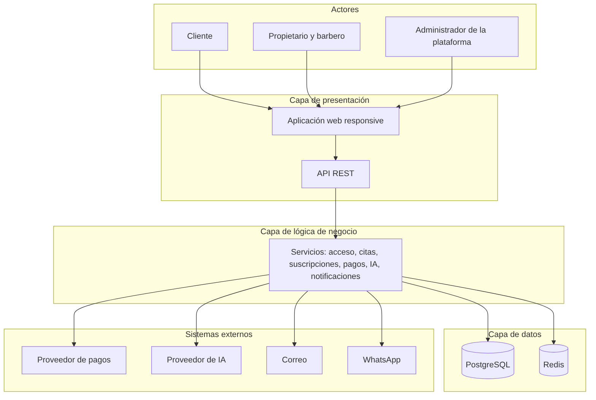
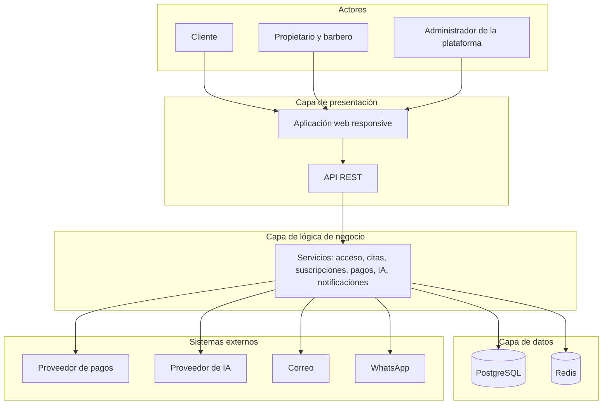

# Arquitectura inicial: de tres capas a cuatro capas

Este documento recoge el punto de partida (Guía 02, arquitectura en capas) y explica su **evolución** hacia la arquitectura final (Guía 03, Clean Architecture con cuatro capas). La decisión formal es [ADR-002](../01-analisis-de-sistema/07-decisiones-arquitectonicas.md#adr-002-arquitectura-lógica-de-cuatro-capas) y [ADR-011](../01-analisis-de-sistema/07-decisiones-arquitectonicas.md#adr-011-clean-architecture-como-enfoque-interno).

## 1. Propuesta inicial: tres capas

La primera propuesta fue una arquitectura clásica de tres capas. Es válida para un negocio como este porque la plataforma tiene presentación, reglas de negocio y datos claramente distintos.

_Figura. 1. Propuesta inicial: tres capas._

Código fuente del diagrama (Mermaid)

**Limitaciones detectadas al analizar la Guía 03:**

| Limitación                                                                                                    | Consecuencia                                                        |
| ------------------------------------------------------------------------------------------------------------- | ------------------------------------------------------------------- |
| La capa de lógica de negocio mezcla casos de uso (qué hace el sistema) con reglas del dominio (qué es válido) | Difícil probar reglas de reserva o de suscripción sin base de datos |
| La lógica de negocio depende directamente de la capa de datos                                                 | Cambiar el proveedor de pagos o de IA obliga a tocar la lógica      |
| Los proveedores externos (pagos, IA, correo) no tienen lugar claro                                            | Integraciones esparcidas por la lógica                              |

## 2. Arquitectura final: cuatro capas con Clean Architecture

Se mantiene la idea de separar responsabilidades, pero se divide la lógica de negocio en **Aplicación** y **Dominio**, y se agrupa todo lo técnico en **Infraestructura**, con la **regla de dependencia hacia el interior**.

| Tres capas (Guía 02) | Cuatro capas (Guía 03)                                                               | Cambio      |
| -------------------- | ------------------------------------------------------------------------------------ | ----------- |
| Presentación         | **Presentación** (interfaz web y controladores de la API)                            | Se mantiene |
| Lógica de negocio    | **Aplicación** (casos de uso, puertos, transacciones)                                | Se separa   |
| Lógica de negocio    | **Dominio** (entidades, objetos de valor, reglas e invariantes)                      | Se separa   |
| Datos                | **Infraestructura** (PostgreSQL, Redis, adaptadores de pagos, IA y correo, registro) | Se amplía   |

El diagrama completo con las dependencias permitidas está en [enfoque-arquitectonico.md](enfoque-arquitectonico.md#3-diagrama-de-cuatro-capas-y-dependencias-permitidas).

## 3. Proceso de la Guía 03 y dónde está cada etapa

| Etapa del proceso                                   | Dónde se resuelve en este repositorio                                                                            |
| --------------------------------------------------- | ---------------------------------------------------------------------------------------------------------------- |
| 1. Contexto y problema                              | [00-contexto](../00-contexto-negocio-y-evidencias.md), [01-actores](../01-analisis-de-sistema/01-actores.md)     |
| 2. Requisitos funcionales                           | [03-requisitos-funcionales](../01-analisis-de-sistema/03-requisitos-funcionales.md)                              |
| 3. Requisitos no funcionales y atributos de calidad | [04-atributos-de-calidad](../01-analisis-de-sistema/04-atributos-de-calidad.md)                                  |
| 4. Restricciones                                    | [05-restricciones](../01-analisis-de-sistema/05-restricciones.md)                                                |
| 5. Drivers arquitectónicos                          | [06-driver-arquitectonicos](../01-analisis-de-sistema/06-driver-arquitectonicos.md)                              |
| 6. Escenarios de calidad                            | [08-escenarios-atributos-calidad](../01-analisis-de-sistema/08-escenarios-atributos-calidad.md)                  |
| 7. Decisiones (ADR)                                 | [07-decisiones-arquitectonicas](../01-analisis-de-sistema/07-decisiones-arquitectonicas.md)                      |
| 8. Estilo arquitectónico                            | [estilo-arquitectonico](estilo-arquitectonico.md)                                                                |
| 9. Tácticas                                         | [tacticas-arquitectonicas](tacticas-arquitectonicas.md)                                                          |
| 10. Enfoque interno (Clean Architecture)            | [enfoque-arquitectonico](enfoque-arquitectonico.md)                                                              |
| 11. Componentes y datos                             | [componentes-arquitectonicos](componentes-arquitectonicos.md), [multi-tenancy-y-datos](multi-tenancy-y-datos.md) |
| 12. Diseño interno y patrones                       | [diseño interno](../03-diseño-de-software/diseño-interno/)                                                       |
| 13. Modelo C4 y validación                          | [modelo C4](../04-modelo-c4/), [trazabilidad](../trazabilidad.md)                                                |

## 4. Respuesta a la pregunta "¿tres capas es posible en nuestro negocio?"

Sí es posible y funcionaría. Se evoluciona a cuatro capas porque la plataforma tiene **integraciones externas críticas** (pagos, IA), **reglas de consistencia** (reservas duplicadas, estados de suscripción) y **requisitos de cambio de proveedor** (EQ-14, EQ-20) que una lógica de negocio acoplada a la infraestructura no cubre bien. El balanceador de carga **no** es una capa: pertenece al despliegue ([despliegue](despliegue-y-escalabilidad.md)).
