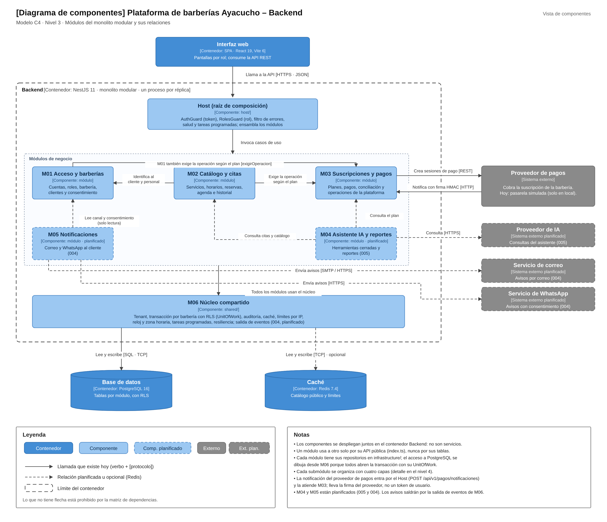

# Componentes arquitectónicos

Los componentes son los **seis módulos** del backend (C4 nivel 3): cinco de negocio y un núcleo compartido. Cada uno nace de requisitos concretos y publica una interfaz pública. Los módulos con dos responsabilidades cercanas se dividen internamente en **submódulos**, cada uno con sus cuatro capas. El estado de cada módulo (implementado, parcial o planificado) está en la sección 4.

## 1. Mapa de componentes

_Figura. Componentes arquitectónicos de la plataforma (módulos del backend monolítico modular). Código fuente Mermaid y detalle en [C4 Nivel 3](../04-modelo-c4/Nivel3-Diagrama-de-Componentes.md)._

Los nombres de la tabla son los del código (`backend/src/modules/*/index.ts`, carpetas `application/ports/` y `shared/`). Las filas marcadas _(planificado)_ no tienen código todavía.

| ID  | Módulo (submódulo)                      | Origen (RF)            | Interfaz pública (lo que otros importan)                                                                  | Puertos de salida                                                                                                                                  | Depende de             | Tablas propias                                                                                                            |
| --- | --------------------------------------- | ---------------------- | --------------------------------------------------------------------------------------------------------- | -------------------------------------------------------------------------------------------------------------------------------------------------- | ---------------------- | ------------------------------------------------------------------------------------------------------------------------- |
| M01 | Acceso y barberías (`identidad`)        | RF04, RF06             | `ValidarSolicitud`, `ValidarSolicitudPlataforma`, `Permisos`, `PersonalApi`                               | `UsuarioRepository`, `SesionRepository`, `ActivacionRepository`, `IntentosRepository`, `PasswordHasher`, `TokenSigner`, `SegundoFactor`, `AccesoPlataformaRepository` | M06                    | `role`, `user_account`, `membership`, `auth_session`, `account_activation`, `login_attempt`, `platform_admin`, `platform_session`, `platform_challenge`, `platform_audit_log` |
| M01 | Acceso y barberías (`barberias`)        | RF01, RF02, RF03       | `BarberiasApi` (datos públicos por enlace, configuración de agenda), `BarberiaNoDisponible`                | `TenantRepository`, `TermsAcceptanceRepository`, `BarberiasPlataformaLectura`                                                                       | `identidad`, M03, M06  | `tenant`, `terms_acceptance`                                                                                              |
| M01 | Acceso y barberías (`clientes`)         | RF05, RF33             | `ClientesApi` (perfil del cliente en la barbería y, desde 004, `contactoParaAvisos`)                       | `PerfilClienteRepository`, `ConsentimientoRepository`, `PreferenciaAvisoRepository`, `ConsentimientoWhatsappRepository`                              | `identidad`, M06       | `customer_profile`, `consent_record`, `customer_notification_preference`, `whatsapp_consent`                              |
| M02 | Catálogo y citas (`catalogo`)           | RF03, RF07–RF11        | `PermisosCatalogoCitas`                                                                                   | `ServicioRepository`, `BarberoRepository`, `HorarioRepository`, `BloqueoRepository`, `CatalogQuery`, `CatalogoPublicoQuery`, `FuenteDisponibilidad` | M01, M03, M06          | `business_hours`, `service`, `barber`, `barber_service`, `working_hours`, `time_off`                                      |
| M02 | Catálogo y citas (`citas`)              | RF12–RF17, RF34        | (solo sus controladores); `PurgarIntentosEnlace` (tarea que registra el host)                              | `CitaRepository`, `IntentosEnlaceRepository`                                                                                                        | `catalogo`, M01, M03, M06 | `appointment`, `appointment_status_history`, `appointment_reschedule`, `appointment_link_use`, `action_link_attempt`      |
| M03 | Suscripciones y pagos (`suscripciones`) | RF18–RF22              | `SuscripcionesApi` (`exigirOperacion`, estado operativo, prueba gratuita), `VencerSuscripciones`, `AvisarFinDePrueba` | `SuscripcionRepository`, `SuscripcionesPorVencer`                                                                                                   | M06                    | `plan`, `subscription`, `subscription_period`                                                                             |
| M03 | Suscripciones y pagos (`pagos`)         | RF23–RF26; RF35 (comprobante del adelanto, planificado 008) | `ConciliarPagos`, `ExpirarTransferencias` (tareas que registra el host)                                     | `PaymentGateway`, `PagoRepository`, `EventoProveedorRepository`, `AlmacenComprobantes`                                                              | `suscripciones`, M06   | `payment`, `payment_receipt`, `payment_receipt_file`, `receipt_upload_counter`, `provider_event`                          |
| M03 | Suscripciones y pagos (`plataforma`)    | RF02, RF22             | (solo sus controladores, rutas `/plataforma/…`)                                                           | `ColaDeComprobantesLectura`, `PagosPorRevisarLectura`, `ResumenesDeSuscripcionLectura` (rol `barberias_plataforma`)                                 | `pagos`, `suscripciones`, M06 | (las de `pagos` y `suscripciones`)                                                                                  |
| M04 | Asistente IA y reportes _(planificado, 005)_ | RF27–RF29         | Por definir en la especificación de 005                                                                   | `AIProvider` (puerto previsto en ADR-008)                                                                                                          | M02, M03, M06          | Por definir                                                                                                               |
| M05 | Notificaciones (004)                    | RF30, RF33, RF34; avisos de RF35 (planificado, 008) | `ManejadoresDeCita`, `ManejadorRecordatorio`, `ManejadoresDeSuscripcion` (los suscribe el host al bus) y `EnviarAvisos` (tarea que registra el host) | `NotificationChannel` (ADR-013 y ADR-026), con correo (SMTP con `nodemailer`; Mailpit en desarrollo) y WhatsApp simulado; `AvisoRepository`, `PendientesDeAvisos` | M01 (solo lectura: canal, consentimiento y correos), M06 | `notification` (y `outbox_event` en M06)                                                                                  |
| M06 | Núcleo compartido (`shared/eventos`, `shared/enlaces`) _(004)_ | RF30, RF34 | `BusDeEventos`, `DespachadorDeEventos`, `EnlacesFirmados`                                                  | PostgreSQL (Kysely)                                                                                                                                | —                      | `outbox_event`                                                                                                            |
| M06 | Núcleo compartido (`shared/`)           | RF31 y transversal     | `TenantContext`, `TenantId`, `UnitOfWork`, `AuditLog`, `CacheCompartida`, `ClavesCache`, `Interruptor`, `EjecutorTareas`, `Clock`, `ZonaHoraria`, `LecturaPublica`, `LecturaPlataforma` | PostgreSQL (Kysely), Redis (`ioredis`, solo en `cache/`)                                                                                           | —                      | `audit_log`, `scheduled_job_run`                                                                                          |

## 2. Responsabilidades y límites

| Módulo                      | Hace                                                                                                                                                                       | **No** hace                                                                                     |
| --------------------------- | -------------------------------------------------------------------------------------------------------------------------------------------------------------------------- | ----------------------------------------------------------------------------------------------- |
| M01 Acceso y barberías      | Autentica (personal, clientes y administrador con segundo factor), emite el token con rol y tenant, registra el consentimiento; crea la barbería, guarda sus datos y su estado | Decidir si una barbería puede operar según su plan (eso lo decide M03); reservar; cobrar        |
| M02 Catálogo y citas        | Mantiene catálogo, horario de atención y disponibilidad; calcula los horarios libres, reserva y reprograma con garantía en PostgreSQL; aplica las acciones por enlace del recordatorio; publica los eventos de la cita | Cobrar; enviar mensajes (lo hace M05)                                                           |
| M03 Suscripciones y pagos   | Mantiene la máquina de estados de la suscripción; cobra por el puerto `PaymentGateway`; valida la notificación firmada del proveedor; concilia; revisa comprobantes. _(Planificado, 008)_ Guarda el comprobante del adelanto de reserva (número de operación no repetible y captura opcional) sin cobrarlo: el cliente paga con el QR de la barbería (ADR-033)        | Gestionar citas, clientes, catálogo ni usuarios                                                 |
| M04 Asistente IA y reportes | _(planificado)_ Interpretar la intención y ejecutar herramientas cerradas; reportes de solo lectura                                                                        | Leer la base libremente; confirmar reservas sin casos de uso                                    |
| M05 Notificaciones          | Envía por correo y por WhatsApp (simulado) los avisos de las citas, el recordatorio con sus enlaces y los avisos de suscripción al propietario, con reintentos y respaldo por correo (004). _(Planificado, 008)_ También los avisos del adelanto de reserva al cliente y al propietario | Bloquear una operación si el envío falla                                                        |
| M06 Núcleo compartido       | Servicios técnicos comunes: tenant, transacción con RLS, auditoría, caché, límites, reloj, tareas programadas                                                             | Contener reglas de negocio                                                                      |

## 3. Comunicación entre módulos

Los módulos se llaman de forma síncrona por su interfaz pública; desde 004, los efectos hacia M05 van por eventos (ver abajo):

| Quién llama            | A quién                         | Para qué                                                                                                              |
| ---------------------- | ------------------------------- | --------------------------------------------------------------------------------------------------------------------- |
| M02                    | M01 (`BarberiasApi`, `ClientesApi`, `PersonalApi`) | Datos públicos de la barbería por su enlace, perfil del cliente, barberos que son usuarios                 |
| M01 y M02              | M03 (`SuscripcionesApi.exigirOperacion`) | Impedir escrituras si la suscripción no lo permite (por ejemplo, reservas nuevas en `EXPIRED`)                 |
| M01 (registro)         | M03 (`SuscripcionesApi`)        | Iniciar la prueba gratuita en la misma transacción que crea la barbería                                               |
| M03 `pagos`            | M03 `suscripciones`             | Al aprobarse un pago, crear el período y actualizar la suscripción **en la misma transacción** (`aplicar-resultado.ts`) |
| Host (`host/tareas`)   | M03 (`VencerSuscripciones`, `ConciliarPagos`, `ExpirarTransferencias`, `AvisarFinDePrueba`), M02 (`PurgarIntentosEnlace`), M05 (`EnviarAvisos`), M06 (`DespachadorDeEventos`) | Ejecutar las tareas programadas con el `EjecutorTareas` de M06 |
| M05                    | M01 (`ClientesApi`, `PersonalApi`, `BarberiasApi`), **solo lectura** | Al enviar, leer el canal, el consentimiento vigente y el correo del destinatario, y el nombre de la barbería |

**Eventos (004, ADR-025):** M02 y M03 publican sus hechos en el bus de M06 **en la misma transacción** que la operación (`outbox_event`): `CitaCreada`, `CitaCancelada`, `CitaReprogramada` y `RecordatorioDeCita` (M02), y `PruebaPorTerminar`, `SuscripcionEnGracia`, `SuscripcionVencida`, `PagoAprobado` y `PagoRechazado` (M03). El host (`host/eventos.ts`) suscribe los manejadores de M05; nadie llama a M05 directamente. La única llamada de M05 es hacia M01, **solo de lectura** (revisión de ADR-013; [estilo §3](estilo-arquitectonico.md#3-dependencias-permitidas), nota ²).

Evidencia: `backend/src/modules/*/index.ts`, `modules/acceso-barberias/api-publica.ts`, `modules/suscripciones-pagos/suscripciones-api.ts`, `modules/suscripciones-pagos/pagos/application/aplicar-resultado.ts`, `backend/src/shared/eventos/`, `backend/src/host/eventos.ts`, `backend/.dependency-cruiser.cjs`; prueba `test/architecture/`.
## 4. Etiquetas de estado

"Implementado" significa con código y pruebas en verde en el entorno local (PostgreSQL real con RLS,
Testcontainers y Docker Compose); **nada está desplegado** todavía. Detalle y evidencia en la
[matriz de trazabilidad](../trazabilidad.md#4-funcionalidades-en-implementación-sdd-con-spec-kit).

| Elemento                                         | Estado                                                                                                                                                                                                                                                                                                      |
| ------------------------------------------------ | ----------------------------------------------------------------------------------------------------------------------------------------------------------------------------------------------------------------------------------------------------------------------------------------------------------- |
| Documentación y diagramas                        | Implementado (este entregable)                                                                                                                                                                                                                                                                              |
| M01 Acceso y barberías                           | **Implementado** (001, 002 y 003): registro, autenticación con roles, usuarios, cuenta de cliente en varias barberías, consentimiento, configuración, suspensión de barberías y administrador de la plataforma con TOTP; canal de aviso y consentimiento de WhatsApp (RF33, 004). **Pendiente:** solicitudes de datos (RF32, 007) |
| M02 Catálogo y citas                             | **Implementado** (002, 004 y 006): catálogo, disponibilidad, reserva sin duplicados, cancelación, estados, agenda, historial, catálogo público en caché, reprogramación (RF13) y acciones por enlace del recordatorio (RF34)                                                                                 |
| M03 Suscripciones y pagos                        | **Implementado** (001 y 003): planes, prueba gratuita, estados y restricciones, vencimiento, pagos con Yape **simulado**, transferencia con comprobante, notificaciones firmadas, conciliación, historial y administración. **Pendiente:** el adaptador del proveedor real (credenciales y Yape, R15) y el comprobante del adelanto de reserva (RF35, 008)       |
| M04 Asistente IA y reportes                      | Planificado (005)                                                                                                                                                                                                                                                                                           |
| M05 Notificaciones                               | **Implementado** (004): avisos de citas, recordatorio con enlaces, canal elegido con respaldo por correo y avisos de suscripción al propietario, con el correo contra Mailpit y WhatsApp **simulado**. **Pendiente:** los proveedores reales de correo y de WhatsApp, y los avisos del adelanto de reserva (RF35, 008) |
| M06 Núcleo compartido y observabilidad           | **Parcial**: contexto de tenant, transacción con RLS, auditoría, caché compartida, límites, zona horaria, tareas programadas, bus de eventos con salida transaccional y enlaces firmados (001, 002, 003, 004 y 006). **Pendiente:** indicadores (007)                                                  |
| Aplicación en `tecnologia/plataforma-barberias/` | Implementada en local para 001, 002, 003, 004 y 006 (SDD con Spec Kit); no desplegada                                                                                                                                                                                                                       |
| Aplicación móvil nativa                          | Futuro (no se diseña)                                                                                                                                                                                                                                                                                       |
| Microservicios                                   | Futuro, condicionado                                                                                                                                                                                                                                                                                        |
