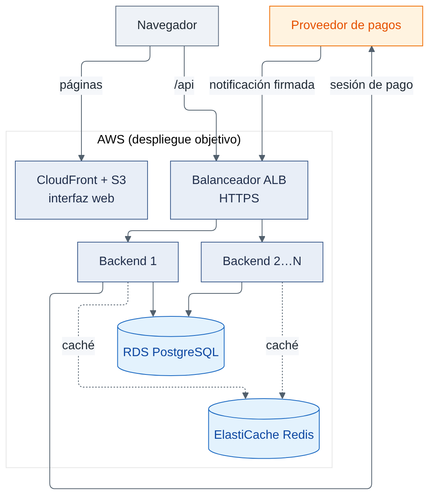
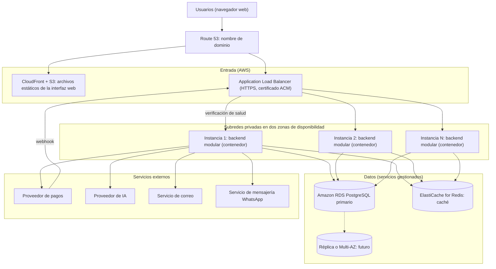

# Despliegue, balanceo y escalabilidad

Decisión: [ADR-006](../01-analisis-de-sistema/07-decisiones-arquitectonicas.md#adr-006-balanceador-de-carga-y-escalado-horizontal). Escenarios EQ-03 y EQ-04. Este documento distingue la **arquitectura objetivo** de la **implementación inicial**. El despliegue se planifica en la nube de **Amazon Web Services (AWS)**, y el balanceador de carga es el **Application Load Balancer (ALB)** del proveedor. Los servicios, la región y los costos son una **propuesta por validar** (ver [tecnologías](tecnologias.md)).

## 1. Diagrama de despliegue (arquitectura objetivo)

_Figura. 1. Diagrama de despliegue (arquitectura objetivo)._

Código fuente del diagrama (Mermaid)

## 2. Implementación inicial frente a arquitectura objetivo

| Elemento               | Implementación inicial (MVP)                                                                          | Arquitectura objetivo                                                            |
| ---------------------- | ----------------------------------------------------------------------------------------------------- | -------------------------------------------------------------------------------- |
| Instancias del backend | **1**                                                                                                 | 2 o más, sin estado                                                              |
| Balanceador            | **ALB** delante de una instancia (el ALB se configura desde el inicio en dos zonas de disponibilidad) | ALB con grupo de destino, verificación de salud y varias instancias en dos zonas |
| Cómputo                | Un contenedor del backend (servicio de contenedores de AWS o máquina virtual; por decidir)            | Varias réplicas con escalado automático según carga                              |
| PostgreSQL             | Amazon RDS for PostgreSQL, una instancia con respaldos automáticos                                    | Multi-AZ y réplica de lectura a evaluar                                          |
| Redis                  | Amazon ElastiCache for Redis, un nodo                                                                 | Réplica y conmutación a evaluar                                                  |
| Interfaz web           | Archivos estáticos en S3                                                                              | S3 con CloudFront (CDN)                                                          |
| Estado                 | Planificado                                                                                           | Planificado                                                                      |

Se empieza con una instancia y se evoluciona cuando una **necesidad justificada** (medida en pruebas de carga) lo requiera.

## 3. Balanceo de carga

| Aspecto               | Diseño                                                                                                                                                        |
| --------------------- | ------------------------------------------------------------------------------------------------------------------------------------------------------------- |
| Tipo                  | Application Load Balancer (capa 7, HTTP/HTTPS), con nodos en dos zonas de disponibilidad                                                                      |
| Reparto               | Grupo de destino con algoritmo de reparto del ALB; sin afinidad de sesión (no hace falta: el backend no guarda estado)                                        |
| Verificación de salud | El ALB consulta `GET /salud` en cada instancia; umbrales de intervalo y de fallos consecutivos configurables (propuesta: cada 10 s y 3 fallos para retirarla) |
| Tiempo límite         | Tiempo de inactividad del ALB y del backend definidos para no acumular solicitudes colgadas                                                                   |
| Despliegue sin corte  | Registrar la instancia nueva, esperar a que esté sana y drenar la anterior (vaciado de conexiones)                                                            |
| Webhooks              | Entran por el mismo ALB y se procesan por cualquier instancia (idempotencia en base de datos)                                                                 |

Varias instancias del mismo monolito **siguen siendo una arquitectura monolítica**; el balanceador pertenece al despliegue y no es una capa.

## 4. Sesiones sin estado, conexiones y configuración

- **Sin estado:** autenticación con token firmado; nada de sesión en memoria del proceso. Los trabajos en segundo plano (conciliación, recordatorios y envío de correos y WhatsApp, vencimientos) se ejecutan con un mecanismo que evita duplicados entre instancias (por ejemplo, bloqueo con `pg_advisory_lock` o una sola instancia con rol de planificador).
- **Conexiones a PostgreSQL:** pool por instancia; límite total controlado. Si crecen las instancias, usar un agrupador de conexiones.
- **Redis:** cliente con tiempos límite cortos y circuit breaker.
- **Configuración y secretos:** variables de entorno o AWS Secrets Manager; nunca en el repositorio (EQ-11).
- **Monitoreo y registro:** logs estructurados con identificador de correlación enviados a Amazon CloudWatch; métricas de latencia, errores, circuit breakers y conexiones (incluidas las del ALB); alertas (EQ-21).

## 5. CORS y HTTPS

| Tema           | Diseño                                                                                                                                        |
| -------------- | --------------------------------------------------------------------------------------------------------------------------------------------- |
| HTTPS          | Terminación TLS en el ALB con certificado de AWS Certificate Manager; redirección de HTTP a HTTPS; cabecera HSTS                              |
| CORS           | El backend acepta únicamente los orígenes de la interfaz web (lista explícita); métodos y cabeceras limitados; no se usa `*` con credenciales |
| Cookies/Tokens | Token en cabecera `Authorization`; si se usan cookies, `Secure`, `HttpOnly`, `SameSite`                                                       |
| Webhooks       | Ruta pública con verificación de firma y límite de tasa (AWS WAF opcional frente al ALB)                                                      |

## 6. Alta disponibilidad: lo que NO se afirma

**Incluir un balanceador no significa alta disponibilidad.** Para afirmarla serían necesarias, además:

| Condición                                                          | Estado                                                                                    |
| ------------------------------------------------------------------ | ----------------------------------------------------------------------------------------- |
| Balanceador redundante (no ser punto único de falla)               | El ALB reparte entre nodos de varias zonas; se debe **configurar y probar** con dos zonas |
| PostgreSQL con Multi-AZ o réplica y conmutación automática probada | Futuro                                                                                    |
| Redis tolerante a fallos o degradación probada                     | Parcial (degradación diseñada, EQ-05)                                                     |
| Respaldos restaurados con éxito (simulacro)                        | Planificado (EQ-22)                                                                       |
| Pruebas de falla de instancia y de base de datos                   | Planificado (EQ-04)                                                                       |
| Monitoreo con alertas                                              | Planificado (EQ-21)                                                                       |

Hasta cumplirlas, se habla de **tolerancia a la falla de una instancia del backend**, no de alta disponibilidad.

## 7. Consideraciones de la nube (por validar)

| Tema              | Nota                                                                                                                                                |
| ----------------- | --------------------------------------------------------------------------------------------------------------------------------------------------- |
| Región            | Elegir una región cercana a Perú (por ejemplo, São Paulo) según latencia y costo. **Por validar**                                                   |
| Datos personales  | Los datos se alojarían fuera del país: revisar lo que exige la Ley N.° 29733 sobre flujo transfronterizo. **Por validar; no es asesoría legal**     |
| Costos            | El ALB, RDS y ElastiCache tienen costo mensual aun con poco tráfico: estimar con la calculadora de precios de AWS antes de decidir. **Por validar** |
| Alcance del curso | La documentación describe el despliegue; no se exige desplegarlo en AWS para este entregable                                                        |

## 8. Escalado

| Cuándo                                                               | Acción                                                               |
| -------------------------------------------------------------------- | -------------------------------------------------------------------- |
| Latencia p95 supera la meta de EQ-01/EQ-02 con CPU de instancia alta | Agregar instancias al grupo de destino del ALB (escalado automático) |
| Lecturas pesadas (reportes)                                          | Réplica de lectura                                                   |
| Un tenant domina la carga                                            | Evaluar esquema o base dedicada (ADR-003)                            |
| Un módulo (p. ej. IA) tiene carga muy distinta                       | Evaluar su extracción (opción futura condicionada)                   |
