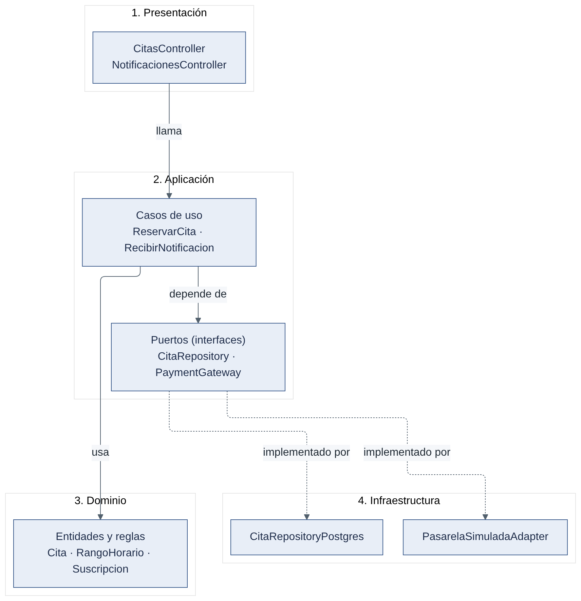
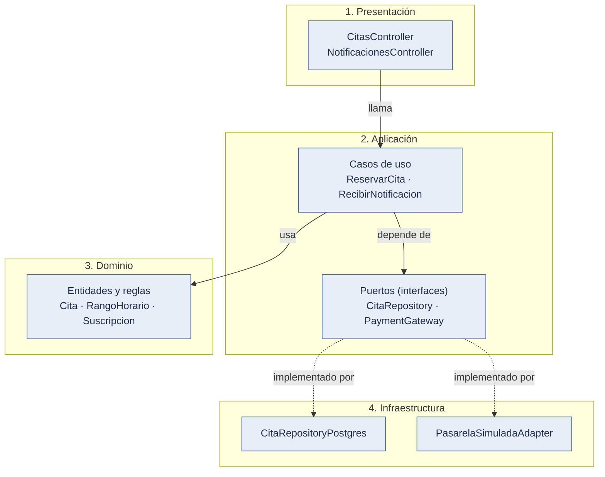

# Enfoque arquitectónico: Clean Architecture y cuatro capas

Decisiones: [ADR-002](../01-analisis-de-sistema/07-decisiones-arquitectonicas.md#adr-002-arquitectura-lógica-de-cuatro-capas) y [ADR-011](../01-analisis-de-sistema/07-decisiones-arquitectonicas.md#adr-011-clean-architecture-como-enfoque-interno).

## 1. No confundir los conceptos

| Concepto               | Qué es en este proyecto                        | Qué responde                                      |
| ---------------------- | ---------------------------------------------- | ------------------------------------------------- |
| **Scrum**              | Marco de trabajo del equipo                    | ¿Cómo nos organizamos?                            |
| **Monolito modular**   | Estilo arquitectónico                          | ¿Cómo se estructura y despliega el sistema?       |
| **Clean Architecture** | Enfoque de organización interna y dependencias | ¿Hacia dónde apuntan las dependencias del código? |
| **Cuatro capas**       | Organización lógica dentro de cada módulo      | ¿Dónde vive cada responsabilidad?                 |
| **SDD**                | Forma de especificar antes de implementar      | ¿Cómo documentamos qué construir?                 |

## 2. Las cuatro capas

Los ejemplos son clases reales de `backend/src/modules/`. Lo marcado _(planificado)_ todavía no existe.

| Capa                   | Contiene                                                        | Ejemplos del proyecto                                                                                                     | No debe contener                           |
| ---------------------- | --------------------------------------------------------------- | ------------------------------------------------------------------------------------------------------------------------- | ------------------------------------------ |
| **1. Presentación**    | Interfaz web; controladores REST; DTO; validación de formato    | Pantalla `Reservar.tsx`; `CitasController`, `ReservarCitaDto`, `NotificacionesController`                                 | Reglas de negocio críticas                 |
| **2. Aplicación**      | Casos de uso, puertos (interfaces), transacciones, orquestación | `ReservarCita`, `CancelarCita`, `ConsultarHorarios`, `IniciarPago`, `RecibirNotificacion`, `ConciliarPagos`, `VencerSuscripciones` | Detalles de SQL, HTTP o del proveedor      |
| **3. Dominio**         | Entidades, objetos de valor, reglas e invariantes               | `Cita`, `RangoHorario`, `Suscripcion`, `Plan`, `Slug`; errores como `HorarioNoDisponible` y `TransicionInvalida`            | Frameworks, PostgreSQL, Redis, proveedores |
| **4. Infraestructura** | Implementaciones técnicas de los puertos                        | `CitaRepositoryPostgres`, `KyselyPagoRepository`, `PasarelaSimuladaAdapter`, `AlmacenComprobantesPostgres`, `JoseTokenSigner`, `Argon2PasswordHasher`, `TotpNode`, `RedisCacheCompartida` (M06) | Reglas de negocio                          |

### Tabla "Tu carpeta → Capa → Qué contiene → Ejemplo"

| Carpeta del proyecto               | Capa de Clean Architecture          | ¿Qué contiene?                                       | Ejemplo del proyecto                                  |
| ---------------------------------- | ----------------------------------- | ---------------------------------------------------- | ----------------------------------------------------- |
| `modules/<m>//domain`         | Entidades y reglas de empresa       | Entidades, objetos de valor, invariantes             | `Cita`, `Suscripcion`                                 |
| `modules/<m>//application`    | Casos de uso                        | Lógica de aplicación, puertos (`application/ports/`) | `ReservarCita`, puerto `CitaRepository`               |
| `modules/<m>//presentation`   | Adaptadores de interfaz             | Controladores, DTO, validadores                      | `CitasController`                                     |
| `modules/<m>//infrastructure` | Frameworks y controladores externos | Repositorios, adaptadores a servicios                | `CitaRepositoryPostgres`, `PasarelaSimuladaAdapter`   |
| `frontend/src/`                    | Presentación (cliente web)          | Pantallas, estado de UI, cliente REST                | `pages/publico/Reservar.tsx`                          |
| `shared/`                          | Núcleo compartido (M06)             | Tenant, transacción, auditoría, caché, tareas        | `TenantContext`, `UnitOfWork`, `AuditLog`             |
| `host/`                            | Arranque y piezas transversales HTTP | Módulo raíz, guardas, filtro de errores, salud, tareas | `AuthGuard`, `RolesGuard`, `SaludController`        |

## 3. Diagrama de cuatro capas y dependencias permitidas

_Figura 3. Cuatro capas y dependencias permitidas, con el ejemplo de la reserva y del pago._

Código fuente del diagrama (Mermaid)

Leyenda: azul grisáceo = sistema propio. Flecha continua = "usa" (dependencia de código); flecha discontinua = "implementa" el puerto.

Evidencia: `backend/src/modules/catalogo-citas/citas/presentation/citas.controller.ts`, `citas/application/reservar-cita.ts`, `citas/application/ports/cita-repository.ts`, `citas/domain/cita.ts`, `citas/infrastructure/`; `suscripciones-pagos/pagos/application/ports/payment-gateway.ts`, `pagos/infrastructure/pasarela-simulada.adapter.ts`; reglas en `backend/.dependency-cruiser.cjs` y prueba `backend/test/architecture/reglas.spec.ts`.
**Lectura.** Las flechas continuas son dependencias de código: apuntan al interior (Presentación → Aplicación → Dominio). Las flechas punteadas indican que la infraestructura **implementa** los contratos que define la capa de aplicación (inversión de dependencias). El balanceador de carga **no aparece**: pertenece al despliegue.

## 4. Regla de dependencia

1. Las dependencias del código apuntan hacia el interior.
2. El **dominio** no importa frameworks, PostgreSQL, Redis ni SDK de proveedores.
3. La **aplicación** conoce el dominio y define puertos; no conoce implementaciones.
4. La **infraestructura** implementa los puertos y puede conocer dominio y aplicación.
5. La **presentación** llama a casos de uso; nunca al repositorio.

La regla se verifica con la prueba de arquitectura PR14.

## 5. Comparación con la Arquitectura Hexagonal

| Aspecto             | Hexagonal                                                                   | Clean Architecture (este proyecto)             |
| ------------------- | --------------------------------------------------------------------------- | ---------------------------------------------- |
| Idea central        | Puertos y adaptadores alrededor del núcleo                                  | Capas concéntricas con regla de dependencia    |
| Qué comparten       | Dominio independiente; infraestructura intercambiable                       | Ídem                                           |
| Diferencia práctica | Enfatiza el borde (entradas y salidas)                                      | Nombra explícitamente casos de uso y entidades |
| Uso aquí            | Los **puertos y adaptadores** se usan para pagos y repositorios (y se usarán para IA y correo, planificados) | Es el enfoque principal |

## 6. Justificación honesta frente al criterio de la guía

La Guía 03 recomienda Clean Architecture para sistemas con reglas de negocio complejas, integraciones cambiantes y necesidad de pruebas, y **desaconseja** usarla en proyectos pequeños o muy simples por el costo de abstracciones.

| Criterio de la guía                      | Aplicación en la plataforma                                                        |
| ---------------------------------------- | ---------------------------------------------------------------------------------- |
| Reglas de negocio complejas              | **Sí:** reservas sin solape, estados de cita y suscripción, restricciones por plan |
| Integraciones externas cambiantes        | **Sí:** pagos (hoy simulado); IA y correo (planificados)                           |
| Necesidad de pruebas sin infraestructura | **Sí:** dominio probado sin base de datos                                          |
| Equipo pequeño y MVP                     | **Riesgo:** exceso de ceremonia                                                    |

**Qué se simplifica (decisión del equipo):**

- En módulos de CRUD simple (catálogo; reportes y notificaciones, planificados), el caso de uso puede ser una clase delgada que llama al repositorio.
- Los **puertos se crean solo donde hay riesgo de cambio o de fallo**: hoy `PaymentGateway`, `AlmacenComprobantes`, `CitaRepository`, `TokenSigner`, `PasswordHasher`, `SegundoFactor` y `CacheCompartida` (M06); se agregarán `AIProvider` (005) y `NotificationChannel` (004).
- Sin mapeos innecesarios: entidades de dominio y DTO se separan solo en los módulos críticos (M02 citas, M03 suscripciones y pagos; M04 asistente cuando se construya).
- El código se construye en `tecnologia/plataforma-barberias/`; la regla de dependencia se verifica con una prueba de arquitectura (PR14).

## 7. Evolución: de tres a cuatro capas

Ver [arquitectura-inicial.md](arquitectura-inicial.md). Resumen: la lógica de negocio de la propuesta inicial se divide en Aplicación y Dominio; los datos pasan a ser Infraestructura implementando contratos. Se registra en ADR-011.
