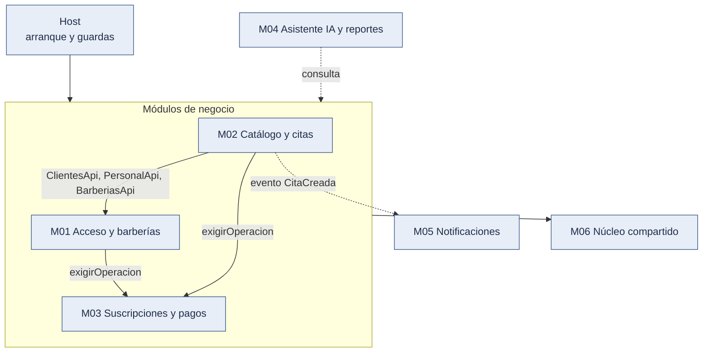

# Estilo arquitectónico: monolito modular

Decisión: [ADR-001](../01-analisis-de-sistema/07-decisiones-arquitectonicas.md#adr-001-monolito-modular). Drivers: DA04, DA06, DA09, DA10.

## 1. Definición

El backend es **una aplicación principal desplegable como unidad**, organizada internamente en **módulos con límites definidos**. No son microservicios: no se despliegan por separado ni se comunican por red entre sí; se llaman mediante interfaces públicas dentro del mismo proceso.

> **Vocabulario C4.** En el modelo C4, "contenedor" es una aplicación o almacén de datos ejecutable por separado (no necesariamente Docker). El backend es **un solo contenedor**; los módulos son **componentes** de ese contenedor ([Nivel 3](../04-modelo-c4/Nivel3-Diagrama-de-Componentes.md)).

## 2. Los seis módulos

Cinco módulos de negocio y un núcleo compartido. Se agrupó por **cohesión funcional** para que el equipo maneje pocas piezas; dentro de cada módulo hay **submódulos** (carpetas con sus cuatro capas) que conservan la separación fina y permiten, si el sistema crece, extraer uno sin rehacer el diseño.

| ID  | Módulo                             | Submódulos internos                     | Responsabilidad                                                                                                                                         | RF                    | Estado                                                     |
| --- | ---------------------------------- | --------------------------------------- | ------------------------------------------------------------------------------------------------------------------------------------------------------- | --------------------- | ---------------------------------------------------------- |
| M01 | Acceso y barberías                 | `identidad`, `barberias`, `clientes`    | Cuentas, autenticación, tokens, roles, administrador de la plataforma con segundo factor; alta y estado de la barbería; cuenta del cliente y consentimiento | RF01–RF06             | Implementado (001, 002 y 003); RF32 y RF33 planificados     |
| M02 | Catálogo y citas                   | `catalogo`, `citas`                     | Servicios, barberos, horario de atención y disponibilidad; horarios libres, reserva, cancelación, estados, agenda e historial                            | RF07–RF12, RF14–RF17  | Implementado (002 y 006); RF13 y RF34 planificados (004)    |
| M03 | Suscripciones y pagos              | `suscripciones`, `pagos`, `plataforma`  | Planes, prueba gratuita, estados y restricciones; pago con pasarela simulada, transferencia, notificación firmada y conciliación; operaciones del administrador | RF18–RF26             | Implementado (001 y 003), con pasarela simulada            |
| M04 | Asistente IA y reportes            | `asistente`, `reportes` (previstos)     | Asistente con herramientas cerradas; reportes por período                                                                                              | RF27–RF29             | Planificado (005)                                          |
| M05 | Notificaciones                     | —                                       | Correos y mensajes de WhatsApp al cliente                                                                                                               | RF30, RF33, RF34      | Planificado (004)                                          |
| M06 | Núcleo compartido                  | carpetas de `shared/`                   | Tenant, transacción con RLS, auditoría, caché, límites, reloj y zona horaria, tareas programadas, resiliencia                                         | RF31 (auditoría)      | Parcial: eventos y enlaces firmados (004) e indicadores (007) planificados |
> **Por qué seis y no diez.** Un módulo por cada capacidad aislada aumenta las interfaces, las pruebas de frontera y la coordinación, algo que un equipo pequeño no necesita en el MVP (RC06, RC14). Las capacidades que cambian juntas (por ejemplo, catálogo y citas; suscripciones y pagos) se agrupan. La separación fina se mantiene dentro del módulo como submódulos con su propio puerto, de modo que el sistema sigue siendo escalable: un submódulo puede convertirse en módulo, o en servicio, sin cambiar su contrato.

## 3. Dependencias permitidas

Un módulo **solo** puede depender de otro a través de su **interfaz pública** (ver [componentes](componentes-arquitectonicos.md)). Nunca accede a sus tablas ni a sus clases internas. La siguiente matriz indica con ✓ que la fila **puede llamar** a la columna.

| Desde \ Hacia               | M01 | M02 | M03 | M04 | M05 | M06 |
| --------------------------- | --- | --- | --- | --- | --- | --- |
| M01 Acceso y barberías      | —   |     | ✓   |     |     | ✓   |
| M02 Catálogo y citas        | ✓ ¹ | —   | ✓   |     |     | ✓   |
| M03 Suscripciones y pagos   |     |     | —   |     |     | ✓   |
| M04 Asistente IA y reportes |     | ✓   | ✓   | —   |     | ✓   |
| M05 Notificaciones          |     |     |     |     | —   | ✓   |
| M06 Núcleo compartido       |     |     |     |     |     | —   |

¹ Agregado por [ADR-020](../01-analisis-de-sistema/07-decisiones-arquitectonicas.md#adr-020-cuenta-de-cliente-con-membresía-y-sesión-por-barbería) (Aceptado el 2026-10-17, funcionalidad 002). M02 llama a M01 solo por su interfaz pública: `ClientesApi`, que identifica al cliente de la sesión y da nombre y teléfono para la agenda, `PersonalApi`, que comprueba que un usuario es personal activo para vincularlo a un barbero, y `BarberiasApi`, que da la zona horaria, la antelación de cancelación y los datos públicos de la barbería. M01 no llama a M02.

**Reglas.**

1. Todo lo que no tiene ✓ está **prohibido**.
2. No hay ciclos (se comprueba con la matriz: el grafo es acíclico).
3. M06 no depende de ningún módulo de negocio.
4. **Hoy toda la comunicación es síncrona**, por la interfaz pública. Dentro de M03, `pagos` actualiza la suscripción en la misma transacción que aprueba el pago (`aplicar-resultado.ts`). Los eventos asíncronos hacia M05 (`CitaCreada` y avisos de suscripción) están **planificados** con la funcionalidad 004.
5. El **identificador del tenant** (`TenantId`) es un valor compartido del núcleo (M06); por eso M03 no depende de M01. M02 depende de M01 solo para los datos del cliente y del personal (nota ¹), no para el tenant.
6. La **raíz de composición** (`host/`) es el único lugar autorizado para ensamblar módulos. Su `AuthGuard` valida el token con `ValidarSolicitud` de M01 (que también comprueba el estado de la barbería), y `host/tareas.ts` registra las tareas programadas de M03. La política de suscripción la aplica cada caso de uso de escritura llamando a `SuscripcionesApi.exigirOperacion`.
7. Entre submódulos del **mismo** módulo se permite llamar a su interfaz interna; hacia otro módulo, solo a su interfaz pública (`index`).


_Figura 1. Dependencias permitidas entre módulos._

<details>
<summary>Código fuente del diagrama (Mermaid)</summary>



</details>

Leyenda: azul grisáceo = sistema propio. Flecha continua = llamada que existe hoy por la interfaz pública; flecha discontinua = dependencia planificada (M04 y M05 también dependerán de M06). No hay flechas hacia M02 desde M01 ni desde M03: el grafo no tiene ciclos.

Evidencia: importaciones entre `backend/src/modules/*/index.ts` (por ejemplo, `catalogo-citas/citas/application/reservar-cita.ts` importa `BarberiasApi`, `ClientesApi` y `SuscripcionesApi`); `host/auth.guard.ts`, `host/tareas.ts`; reglas en `backend/.dependency-cruiser.cjs`; prueba `backend/test/architecture/reglas.spec.ts` (PR14).

## 4. Organización del código

El código de la aplicación vive en `tecnologia/plataforma-barberias/` (`backend/` y `frontend/`). La estructura siguiente corresponde al backend, es decir, a `tecnologia/plataforma-barberias/backend/src/`.

```text
backend/src/
  modules/
    acceso-barberias/         (M01)
      identidad/              submódulo (incluye el ingreso del administrador de la plataforma)
      barberias/              submódulo
      clientes/               submódulo
      index.ts                interfaz pública del módulo (única entrada permitida)
    catalogo-citas/           (M02)
      catalogo/
      citas/
        presentation/         controladores REST, DTO, validación de formato
        application/          casos de uso, puertos, transacciones
        domain/               entidades, objetos de valor, reglas
        infrastructure/       repositorios PostgreSQL, adaptadores
      index.ts
    suscripciones-pagos/      (M03)  suscripciones/, pagos/ y plataforma/
                              (M04 y M05: sin carpeta todavía; planificados)
  shared/                     núcleo compartido (M06): audit, cache, clock, config, http,
                              limites, persistence, resiliencia, tareas, tenant, tiempo
  host/                       raíz de composición, guardas, filtro de errores, salud y tareas
```

Cada submódulo tiene sus cuatro capas, como se muestra en `citas/`.

## 4.1 Cómo crece el sistema

| Señal                                                    | Respuesta                                                                         |
| -------------------------------------------------------- | --------------------------------------------------------------------------------- |
| Un submódulo crece o lo toca otro equipo                 | Se promueve a módulo (nueva fila en la matriz)                                    |
| Un módulo tiene una carga muy distinta (por ejemplo, IA) | Se extrae como servicio detrás de su interfaz pública (evolución futura, ADR-001) |
| Aparecen reglas nuevas de notificación o canales         | Se agrega un adaptador al puerto `NotificationChannel` sin tocar a M02            |

## 5. Cómo se evita que el monolito se desordene

| Mecanismo                        | Descripción                                                                   | Verificación                      |
| -------------------------------- | ----------------------------------------------------------------------------- | --------------------------------- |
| Interfaz pública por módulo      | Solo `index` se importa desde afuera                                          | Regla de dependency-cruiser (PR14) |
| Pruebas de arquitectura          | Una prueba falla si un módulo importa algo prohibido por la matriz            | PR14 (en CI)                      |
| Esquemas de datos por módulo     | Cada módulo es dueño de sus tablas; las demás consultas pasan por su interfaz | Revisión de código                |
| Revisión de código               | Pull request con checklist de dependencias                                    | Proceso Scrum                     |
| Eventos para efectos secundarios | _(planificado, 004)_ Las notificaciones no se llamarán directamente           | Revisión                          |

## 6. Justificación, ventajas y desventajas

| Aspecto                          | Valoración                                                                                           |
| -------------------------------- | ---------------------------------------------------------------------------------------------------- |
| Complejidad adecuada al proyecto | Un equipo pequeño opera una sola unidad                                                              |
| Costo                            | Una sola aplicación, una base de datos, una caché                                                    |
| Desarrollo, pruebas y despliegue | Transacciones locales; pruebas de integración sin red entre módulos                                  |
| Mantenibilidad                   | Límites explícitos facilitan cambios localizados                                                     |
| Escalado                         | Se replican instancias del mismo monolito detrás del balanceador                                     |
| **Desventajas**                  | Despliegue común; una falla del proceso afecta a todo; requiere disciplina para sostener los límites |

**Microservicios** quedan como opción futura, solo si una necesidad demostrada (por ejemplo, un módulo con carga muy distinta, como IA) lo justifica. Los módulos con interfaces claras facilitarían esa extracción.

## 7. Alternativas descartadas

| Alternativa          | Motivo del descarte                                                               |
| -------------------- | --------------------------------------------------------------------------------- |
| Microservicios       | Operación y consistencia distribuida superan la capacidad del equipo (RC06, RC14) |
| Monolito sin módulos | Alto riesgo de enredo (DA06)                                                      |
| Serverless           | Dificulta transacciones de reserva y control de costos en este contexto           |
