# Multi-tenancy y modelo de datos en PostgreSQL

Decisiones: [ADR-003](../01-analisis-de-sistema/07-decisiones-arquitectonicas.md#adr-003-estrategia-multi-tenant), [ADR-004](../01-analisis-de-sistema/07-decisiones-arquitectonicas.md#adr-004-postgresql-como-base-principal), [ADR-009](../01-analisis-de-sistema/07-decisiones-arquitectonicas.md#adr-009-prevención-de-reservas-duplicadas) y [ADR-010](../01-analisis-de-sistema/07-decisiones-arquitectonicas.md#adr-010-autenticación-autorización-y-aislamiento-de-datos). Drivers: DA01, DA02, DA09, DA11.

> Los fragmentos SQL **resumen** las migraciones reales de `backend/migrations/` (funcionalidades 001, 002 y 003, migraciones 0001 a 0020); el texto exacto está en esos archivos. Todo lo de este documento está implementado y probado en local, salvo lo marcado _(planificado)_.

## 1. Comparación de estrategias

| Criterio                           | Base por tenant              | Esquema por tenant                   | **Base compartida con `tenant_id`**           |
| ---------------------------------- | ---------------------------- | ------------------------------------ | --------------------------------------------- |
| Costo                              | Alto (muchas bases)          | Medio                                | **Bajo**                                      |
| Complejidad operativa              | Alta (migraciones por base)  | Media-alta (migraciones por esquema) | **Baja** (una migración)                      |
| Aislamiento natural                | Muy alto                     | Alto                                 | Medio: **requiere controles complementarios** |
| Mantenimiento                      | Costoso con muchas barberías | Costoso                              | **Simple**                                    |
| Escalabilidad en número de tenants | Baja                         | Media                                | **Alta**                                      |
| Respaldo/restauración por tenant   | Fácil                        | Media                                | Difícil (exige exportación filtrada)          |
| Alta de un tenant                  | Lenta                        | Media                                | **Inmediata**                                 |
| Facilidad para un equipo pequeño   | Baja                         | Media                                | **Alta**                                      |

**Decisión.** Base compartida con `tenant_id` como punto de partida, por costo, simplicidad y número esperado de tenants pequeños, **con aislamiento reforzado**.
### 1.1 Cómo se aíslan las barberías (vista general)

Todas las barberías comparten **una sola base**. Cada fila lleva su `tenant_id` y PostgreSQL filtra con RLS. El backend toma la barbería **solo del token firmado**, nunca de lo que envía el cliente.

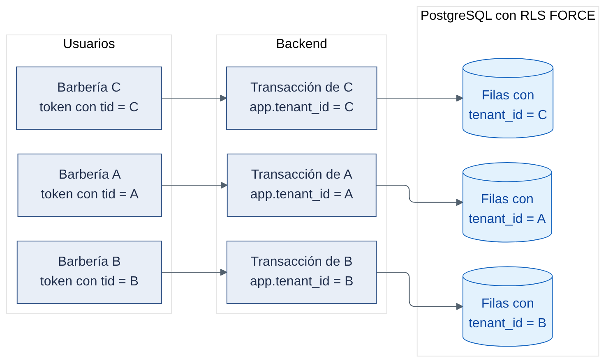

_Figura 1. Aislamiento entre barberías en una base compartida._

<details>
<summary>Código fuente del diagrama (Mermaid)</summary>

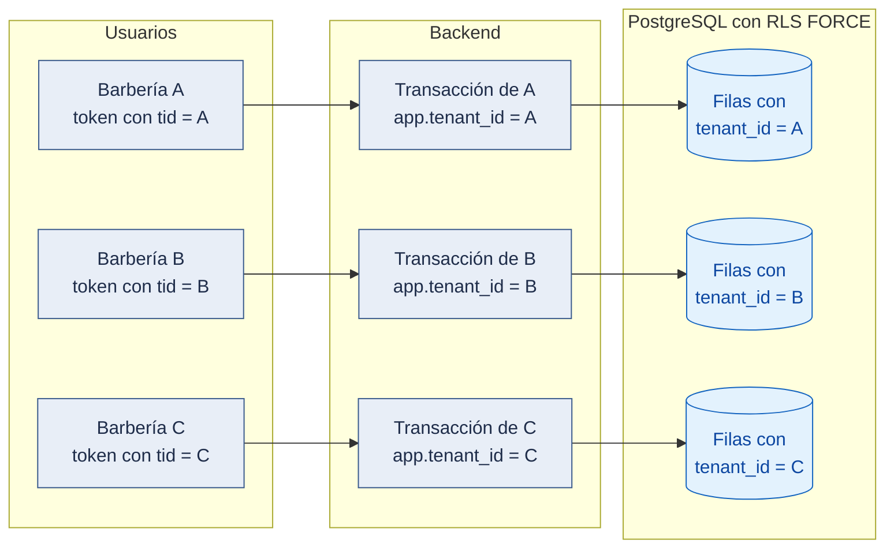

</details>

Leyenda: azul grisáceo = sistema propio; azul = datos; rojo = solicitud rechazada.

Evidencia: `backend/src/host/auth.guard.ts` y `host/tenant-header.interceptor.ts` (tenant del token; campos de tenant rechazados), `backend/src/shared/persistence/kysely-unit-of-work.ts` (`set_config('app.tenant_id', …, true)`), `backend/migrations/sql-comun.ts` (`TENANT_ACTUAL`) y las políticas de cada migración, `db/init/01-roles.sql` (`barberias_app NOBYPASSRLS`); pruebas `backend/test/integration/aislamiento/rls.spec.ts`, `aislamiento-tenant.spec.ts` y `token-tenant.spec.ts`.

### 1.2 Qué pasa si la barbería A intenta leer datos de B

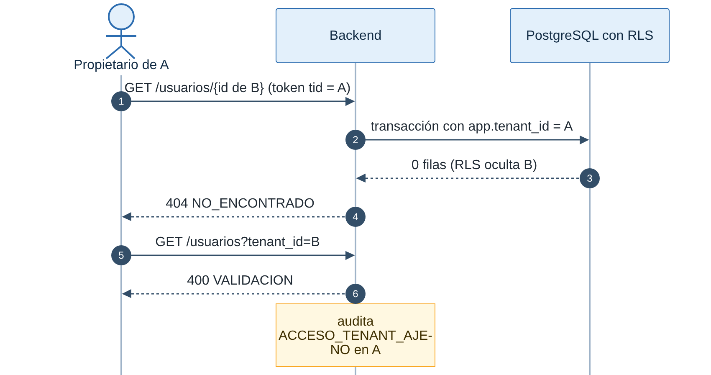

_Figura 2. El propietario de A pide datos de B por dos caminos; ninguno funciona._

<details>
<summary>Código fuente del diagrama (Mermaid)</summary>

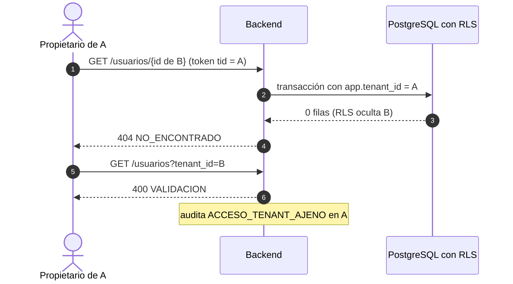

</details>

Todo lo de esta secuencia está implementado. Con un token de A cuyo `tid` se cambió a B sin volver a firmarlo, la respuesta es 401.

Evidencia: prueba `backend/test/integration/aislamiento/aislamiento-tenant.spec.ts` (casos "→ 404, sin cambios en B" y "→ 400, auditado en A, sin cambios en B"), `token-tenant.spec.ts` (`tid` cambiado → 401) y `rls.spec.ts` (consultas sin filtro bloqueadas por RLS).

### 1.3 Las tres excepciones acotadas (constitución 1.3.1, principio III)

Fuera de la regla general, hay tres caminos documentados. Ninguno usa un rol que omita RLS.

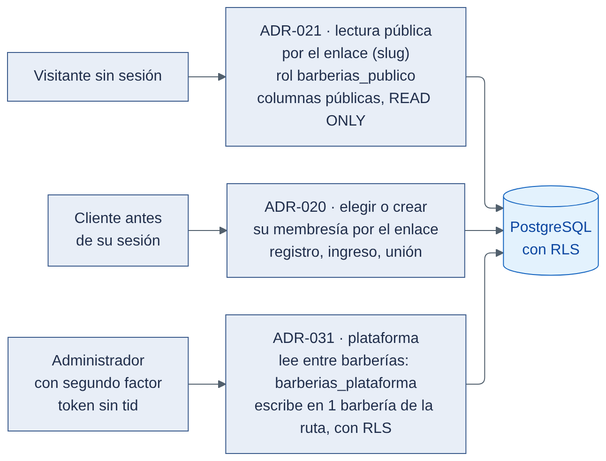

_Figura 3. Excepciones acotadas: lectura pública, selección de membresía y plataforma._

<details>
<summary>Código fuente del diagrama (Mermaid)</summary>

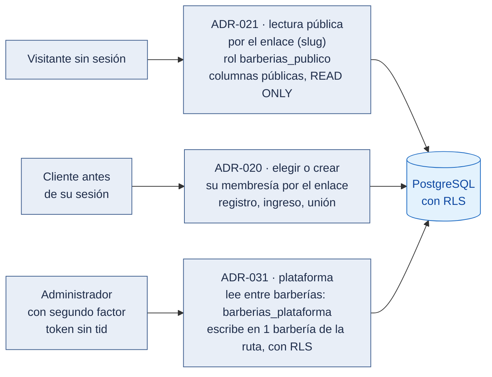

</details>

Leyenda: azul grisáceo = sistema propio; azul = datos. Además existe la única omisión de RLS del sistema: las tres funciones `SECURITY DEFINER` de inicio de sesión, renovación y activación (ADR-015), que buscan por una clave exacta y no reciben `tenant_id` (ver "Casos especiales").

Evidencia: ADR-021 → `backend/src/shared/persistence/lectura-publica.ts`, `migrations/0012_lectura_publica.ts`, prueba `aislamiento/lectura-publica.spec.ts`; ADR-020 → `backend/src/modules/acceso-barberias/clientes/`, prueba `aislamiento/cliente-dos-barberias.spec.ts`; ADR-031 → `shared/persistence/lectura-plataforma.ts`, `migrations/0016_plataforma.ts`, pruebas `aislamiento/lectura-plataforma.spec.ts`, `aislamiento-pagos.spec.ts` y `host/token-plataforma.spec.ts`; ADR-015 → `migrations/0003_autenticacion_sin_tenant.ts`, prueba `aislamiento/funciones-definer.spec.ts`.

## 2. Controles complementarios (el aislamiento no descansa solo en `tenant_id`)

| #   | Control                                  | Descripción                                                                                                                                                                                                                                                                                                                                                                                                                                                                                                                                                                                                                                                                                                                                                                                                                                                                                                                                                                                                                                                                                                                                                                                                          |
| --- | ---------------------------------------- | -------------------------------------------------------------------------------------------------------------------------------------------------------------------------------------------------------------------------------------------------------------------------------------------------------------------------------------------------------------------------------------------------------------------------------------------------------------------------------------------------------------------------------------------------------------------------------------------------------------------------------------------------------------------------------------------------------------------------------------------------------------------------------------------------------------------------------------------------------------------------------------------------------------------------------------------------------------------------------------------------------------------------------------------------------------------------------------------------------------------------------------------------------------------------------------------------------------------- |
| 1   | `tenant_id` del **token firmado**        | Nunca se acepta de la URL, del cuerpo ni de cabeceras del cliente. Tres excepciones acotadas (constitución 1.3.1, principio III): (1) lecturas públicas sin sesión del catálogo y los horarios libres por el enlace (`slug`) de la barbería, de solo lectura y solo con columnas públicas (ADR-021, Aceptado: rol `barberias_publico` sin `BYPASSRLS`, con `SELECT` por columna, transacción `READ ONLY` y la misma RLS); (2) selección de membresía por enlace: el registro, el ingreso con enlace, la unión y el cambio de barbería del cliente usan el `slug` solo para elegir en qué barbería crear o abrir su propia membresía, antes de tener la sesión (ADR-020, Aceptado); (3) operaciones de la plataforma: el administrador, con cuenta, sesión y segundo factor propios y un token sin tenant que no sirve en rutas de barbería, lee metadatos de pago entre barberías con el rol `barberias_plataforma` (sin `BYPASSRLS`, solo lectura por columna) y escribe sobre **una** barbería elegida en la ruta, con su tenant fijado, RLS y auditoría en esa barbería; las notificaciones del proveedor y las tareas programadas localizan el tenant con esa misma lectura por clave exacta (ADR-031, Aceptado) |
| 2   | Contexto de tenant por solicitud         | Middleware construye `TenantContext`; los casos de uso lo reciben                                                                                                                                                                                                                                                                                                                                                                                                                                                                                                                                                                                                                                                                                                                                                                                                                                                                                                                                                                                                                                                                                                                                                    |
| 3   | Filtro en repositorios                   | Toda consulta lleva `tenant_id`; no hay repositorio sin contexto                                                                                                                                                                                                                                                                                                                                                                                                                                                                                                                                                                                                                                                                                                                                                                                                                                                                                                                                                                                                                                                                                                                                                     |
| 4   | **Row-Level Security** en PostgreSQL     | La base rechaza filas de otro tenant aunque el código falle                                                                                                                                                                                                                                                                                                                                                                                                                                                                                                                                                                                                                                                                                                                                                                                                                                                                                                                                                                                                                                                                                                                                                          |
| 5   | Rol de base sin privilegio de omitir RLS | La aplicación no usa superusuario ni propietario de tablas; `FORCE ROW LEVEL SECURITY`. Única omisión de RLS: las 3 funciones de autenticación de ADR-015. Los roles `barberias_publico` (ADR-021) y `barberias_plataforma` (ADR-031) no omiten RLS: tienen políticas propias de solo lectura. Roles: ver §2.1                                                                                                                                                                                                                                                                                                                                                                                                                                                                                                                                                                                                                                                                                                                                                                                                                                                                                                       |
| 6   | Claves de caché con tenant               | `bp:v1:t:{tenantId}:…` (ADR-029)                                                                                                                                                                                                                                                                                                                                                                                                                                                                                                                                                                                                                                                                                                                                                                                                                                                                                                                                                                                                                                                                                                                                                                                                 |
| 7   | Pruebas automáticas de fuga              | PR09 recorre los endpoints protegidos con datos de otra barbería                                                                                                                                                                                                                                                                                                                                                                                                                                                                                                                                                                                                                                                                                                                                                                                                                                                                                                                                                                                                                                                                                                                                                         |
| 8   | Auditoría                                | Registro de acciones sensibles por tenant                                                                                                                                                                                                                                                                                                                                                                                                                                                                                                                                                                                                                                                                                                                                                                                                                                                                                                                                                                                                                                                                                                                                                                            |

```sql
-- Resumen. Dentro de cada transacción el backend fija el tenant (kysely-unit-of-work.ts):
--   SELECT set_config('app.tenant_id', '<uuid-del-token>', true);   -- true = solo esta transacción
ALTER TABLE appointment ENABLE ROW LEVEL SECURITY;
ALTER TABLE appointment FORCE ROW LEVEL SECURITY;
CREATE POLICY tenant_isolation ON appointment
  USING      (tenant_id = NULLIF(current_setting('app.tenant_id', true), '')::uuid)
  WITH CHECK (tenant_id = NULLIF(current_setting('app.tenant_id', true), '')::uuid);
-- Es la función rlsPorTenant() de backend/migrations/sql-comun.ts, aplicada a cada tabla con tenant_id.
```

**Casos especiales.**

- _Administrador de la plataforma ([ADR-031](../01-analisis-de-sistema/07-decisiones-arquitectonicas.md#adr-031-operaciones-del-administrador-de-la-plataforma-fuera-de-las-barberías), funcionalidad 003):_
  - **Identidad y token propios:** tiene cuenta y sesión de la plataforma (`platform_admin`, `platform_session`), con segundo factor TOTP obligatorio. Su token tiene `aud: "plataforma"` y no lleva `tid`, así que solo sirve en rutas `/plataforma/*`.
  - **Lecturas entre barberías:** las colas de comprobantes y pagos por revisar y la lista de barberías las lee con el rol `barberias_plataforma`, que ve solo metadatos de pago y estado.
  - **Escrituras:** aprobar o rechazar un comprobante, suspender o activar a mano corren con el tenant de **la** barbería elegida en la ruta y RLS, y se auditan en esa barbería.
  - **Fuera de su alcance:** **no** ve citas, clientes, catálogo, usuarios ni el contenido de los comprobantes por la vía de la plataforma. La suspensión de la barbería se hace sobre `tenant`.
- _Notificación del proveedor de pagos (`POST /api/v1/pagos/notificaciones`):_ llega sin token de usuario. Se verifica la firma, y el pago se busca por su referencia del proveedor (clave exacta) con la lectura de `barberias_plataforma`. Con el tenant obtenido, el evento, el pago, el período y la suscripción se actualizan en una transacción con RLS.
- _Tareas programadas ([ADR-024](../01-analisis-de-sistema/07-decisiones-arquitectonicas.md#adr-024-tareas-programadas-sin-duplicados-entre-instancias)):_ cada réplica intenta la tarea con un candado de PostgreSQL. Busca los elementos pendientes con la lectura de `barberias_plataforma` y procesa **cada barbería en su propia transacción**, con su tenant y una transición condicional, para que ningún efecto se repita.
- _Conexiones agrupadas (pool):_ usar `set_config(..., true)` dentro de la transacción para que el contexto no se filtre entre solicitudes.
- _Inicio de sesión, renovación y activación de cuenta ([ADR-015](../01-analisis-de-sistema/07-decisiones-arquitectonicas.md#adr-015-autenticación-antes-de-conocer-el-tenant-y-rls-en-user_account)):_ ocurren sin token, cuando el sistema todavía no conoce la barbería del usuario, y las tablas que consultan (`user_account`, `membership`, `auth_session`, `account_activation`) están bajo RLS. Para esos tres casos hay tres funciones `SECURITY DEFINER` (`auth_resolver_cuenta`, `auth_buscar_sesion`, `auth_buscar_activacion`) cuyo dueño es el rol `barberias_auth` (`NOLOGIN BYPASSRLS`, sin propiedad de tablas), con `search_path` fijo y `EXECUTE` solo para el rol de la aplicación. Cada una busca por una clave exacta, devuelve como máximo una fila y **no recibe `tenant_id`**. Con el `tenant_id` obtenido, el resto del flujo corre en una transacción con RLS normal. Con `FORCE ROW LEVEL SECURITY` ni el dueño de las tablas omite RLS; por eso el dueño de las funciones debe ser un rol con `BYPASSRLS`. La prueba de aislamiento PR09 (unciones-definer.spec.ts) lo cubre. **Por validar:** que Amazon RDS for PostgreSQL permita crear ese rol.

```sql
-- Resumen. RLS en user_account: solo se ven cuentas con membresía en el tenant actual
ALTER TABLE user_account ENABLE ROW LEVEL SECURITY;
ALTER TABLE user_account FORCE ROW LEVEL SECURITY;
CREATE POLICY cuentas_del_tenant ON user_account FOR SELECT
  USING (EXISTS (SELECT 1 FROM membership m WHERE m.user_id = user_account.id)); -- membership ya filtra por RLS
CREATE POLICY cuentas_del_tenant_upd ON user_account FOR UPDATE
  USING (EXISTS (SELECT 1 FROM membership m WHERE m.user_id = user_account.id));
CREATE POLICY alta_de_cuenta ON user_account FOR INSERT WITH CHECK (true); -- la cuenta nace antes que su membresía
```

### 2.1 Roles de base de datos

| Rol                    | Atributos                     | Uso                                                                                                                                                                                                                                                                                                                                                                                                                                                                                                                                                                                                                                                                                                                                                                                                                                                                                                                                                                                                                                           |
| ---------------------- | ----------------------------- | --------------------------------------------------------------------------------------------------------------------------------------------------------------------------------------------------------------------------------------------------------------------------------------------------------------------------------------------------------------------------------------------------------------------------------------------------------------------------------------------------------------------------------------------------------------------------------------------------------------------------------------------------------------------------------------------------------------------------------------------------------------------------------------------------------------------------------------------------------------------------------------------------------------------------------------------------------------------------------------------------------------------------------------------- |
| `barberias_owner`      | dueño de las tablas           | Solo las migraciones                                                                                                                                                                                                                                                                                                                                                                                                                                                                                                                                                                                                                                                                                                                                                                                                                                                                                                                                                                                                                          |
| `barberias_app`        | `LOGIN NOBYPASSRLS`           | La aplicación con sesión: privilegios mínimos por tabla y columna (sin borrar citas, historial, auditoría ni consentimientos)                                                                                                                                                                                                                                                                                                                                                                                                                                                                                                                                                                                                                                                                                                                                                                                                                                                                                                                 |
| `barberias_auth`       | `NOLOGIN BYPASSRLS`           | Dueño de las 3 funciones de ADR-015; sin propiedad de tablas                                                                                                                                                                                                                                                                                                                                                                                                                                                                                                                                                                                                                                                                                                                                                                                                                                                                                                                                                                                  |
| `barberias_publico`    | `LOGIN NOBYPASSRLS`           | Vía pública por enlace (ADR-021, funcionalidad 002): `SELECT` solo sobre una lista cerrada de columnas públicas de `business_hours`, `service`, `barber`, `barber_service`, `working_hours`, `time_off` (sin motivo) y `appointment` (sin cliente), con pool propio (`DATABASE_URL_PUBLICO`) y transacción `READ ONLY` con el tenant del enlace; sin acceso a `tenant` (el enlace lo resuelve M01)                                                                                                                                                                                                                                                                                                                                                                                                                                                                                                                                                                                                                                            |
| `barberias_plataforma` | `LOGIN NOBYPASSRLS NOINHERIT` | Operaciones de la plataforma (ADR-031, funcionalidad 003). `SELECT` por columna sobre `tenant(id, name, slug, status)`, `plan`, `subscription`, `subscription_period`, `payment` (del número de operación, solo sus últimos 4 caracteres y su hash), `provider_event` y las tablas de la plataforma, con políticas `FOR SELECT ... USING (true)` y transacciones `READ ONLY`. **No escribe en ninguna tabla.** Las tablas de la plataforma (`provider_event`, `scheduled_job_run`, `platform_session`, `platform_challenge`, `platform_admin`, `platform_audit_log`) no tienen `tenant_id` ni datos de negocio (constitución 1.3.1). El rol de la aplicación escribe las sesiones y desafíos del administrador, `platform_audit_log` y `scheduled_job_run`, solo inserta en `provider_event` (sin leerlo) y no tiene permiso sobre `platform_admin`. **Ningún** permiso sobre el contenido de los comprobantes, citas, clientes, catálogo, usuarios ni sesiones de barbería. Pool propio, confinado por PR14 (`lectura-plataforma-confinada`) |

**RLS de `tenant` (funcionalidad 002):** `tenant` sigue siendo global, pero desde que la aplicación edita
datos comerciales tiene RLS con `FORCE` y tres políticas: lectura libre (la usan la autenticación y la vía
pública vía M01), alta libre (registro de 001) y `UPDATE` solo sobre el tenant de la transacción
(`tenant_edicion`). `barberias_app` solo puede actualizar las columnas editables (nombre, enlace,
dirección, teléfono, descripción y antelación de cancelación).

## 3. Modelo de datos (actual: 001, 002 y 003)

Son las **32 tablas** de las migraciones `0001` a `0020`, divididas en cuatro diagramas para que se lean de un vistazo. Cada diagrama muestra solo las columnas clave; la lista completa está en `backend/src/shared/persistence/db-types.ts`. `tenant` aparece en varios diagramas porque casi todo cuelga de él. Todas las tablas están implementadas. Las tablas del asistente de IA (005), de las notificaciones (004) y de las solicitudes sobre datos personales (007) están **planificadas** y no aparecen.

### 3.0.1 Identidad y acceso (funcionalidad 001)

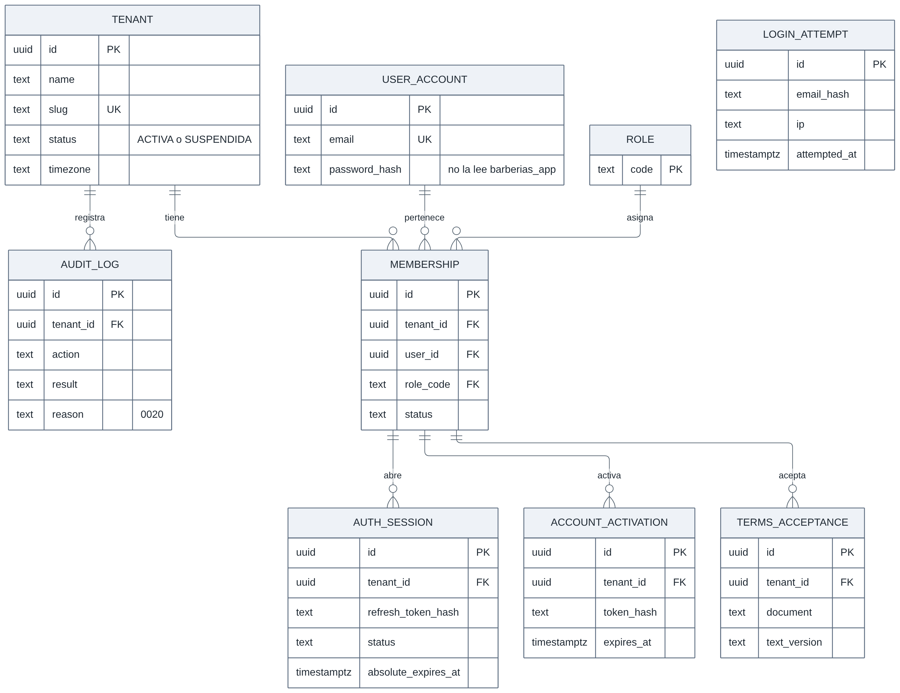

_Figura 4. Identidad y acceso._

<details>
<summary>Código fuente del diagrama (Mermaid)</summary>

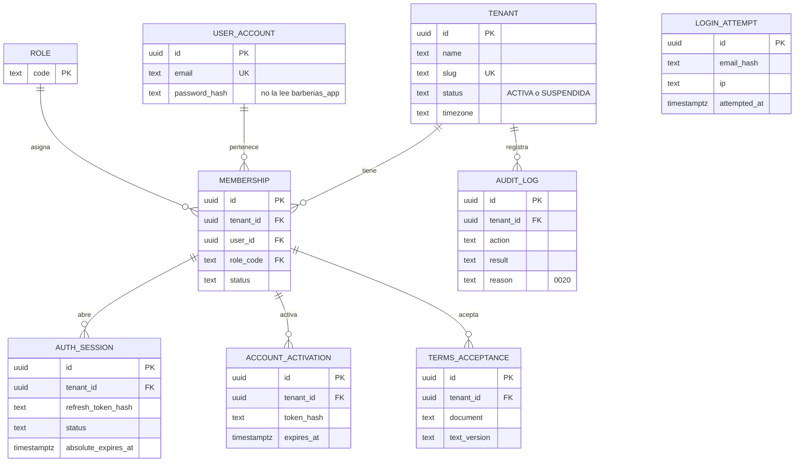

</details>

`login_attempt` no tiene relaciones: cuenta intentos por correo (en hash) e IP. `auth_session`, `account_activation` y `terms_acceptance` apuntan a la membresía con la clave compuesta `(tenant_id, user_id)`.

Evidencia: `backend/migrations/0001_nucleo_identidad.ts`, `0002_sesiones_y_activacion.ts`, `0003_autenticacion_sin_tenant.ts`, `0005_aceptacion_terminos.ts`, `0006_intentos_login.ts`, `0020_motivo_en_auditoria.ts`; pruebas `backend/test/integration/aislamiento/rls.spec.ts` y `identidad/limite-intentos.spec.ts`.

### 3.0.2 Clientes, catálogo y citas (funcionalidad 002)

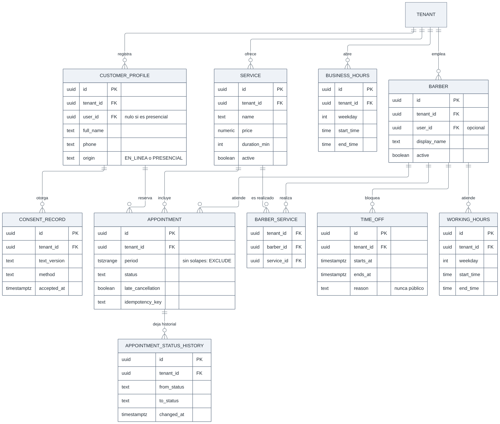

_Figura 5. Clientes, catálogo y citas._

<details>
<summary>Código fuente del diagrama (Mermaid)</summary>

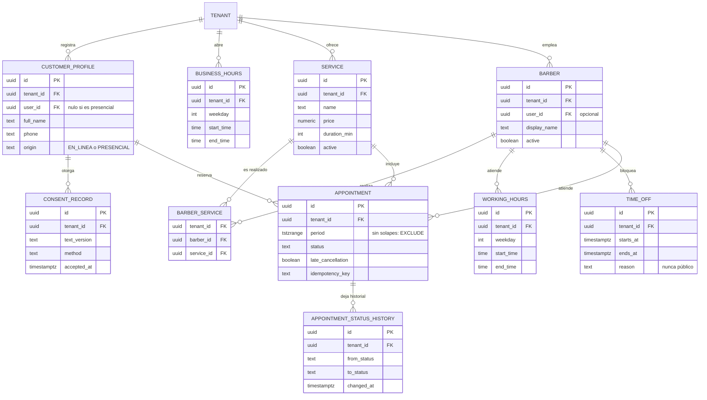

</details>

Evidencia: `backend/migrations/0009_cuenta_cliente.ts`, `0010_catalogo.ts`, `0011_citas.ts` (`appointment_no_overlap_barber` y `appointment_no_overlap_customer`); pruebas `backend/test/integration/citas/concurrencia-reservas.spec.ts` (PR16) y `clientes/cuenta-cliente.spec.ts`.

### 3.0.3 Suscripciones y pagos (funcionalidades 001 y 003)

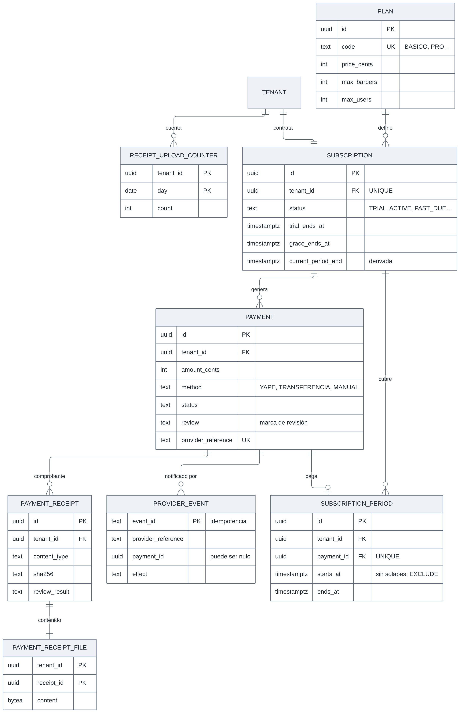

_Figura 6. Suscripciones y pagos._

<details>
<summary>Código fuente del diagrama (Mermaid)</summary>

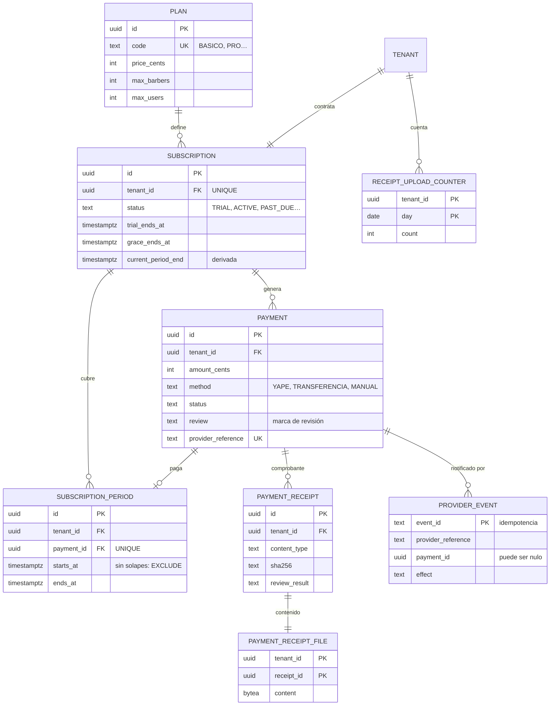

</details>

`provider_event` es una tabla de la plataforma (sin RLS por barbería). Apunta al pago con la clave compuesta `(tenant_id, payment_id)`, que puede quedar vacía si la notificación no corresponde a ningún pago (`effect = SIN_PAGO`).

Evidencia: `backend/migrations/0004_suscripciones.ts`, `0007_bloqueo_suscripcion.ts`, `0014_planes_y_suscripcion.ts`, `0015_pagos.ts`, `0018_url_de_pago.ts`, `0019_marca_fecha_anterior.ts`; pruebas `backend/test/integration/suscripciones/garantias-pagos.spec.ts`, `pagos/notificaciones.spec.ts` y `aislamiento/aislamiento-pagos.spec.ts`.

### 3.0.4 Tablas de la plataforma (funcionalidad 003)

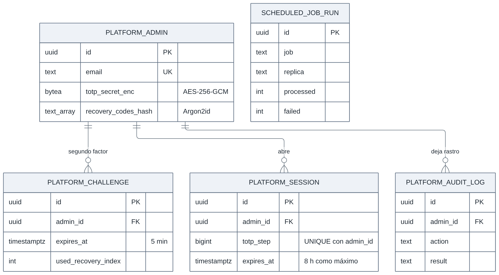

_Figura 7. Tablas de la plataforma (sin barbería)._

<details>
<summary>Código fuente del diagrama (Mermaid)</summary>

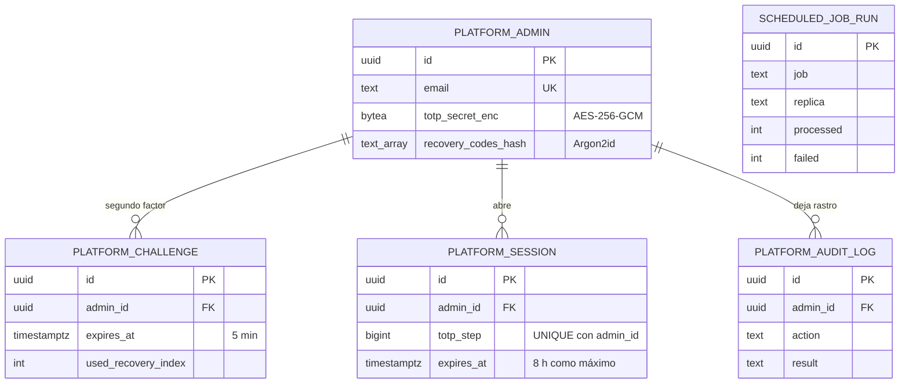

</details>

Estas tablas no tienen `tenant_id` ni datos de negocio (constitución 1.3.1). `scheduled_job_run` registra cada corrida de las tareas programadas (ADR-024).

Evidencia: `backend/migrations/0016_plataforma.ts`, `0017_tareas.ts`; pruebas `backend/test/integration/identidad/segundo-factor.spec.ts`, `tareas/vencimiento-dos-replicas.spec.ts` y `aislamiento/lectura-plataforma.spec.ts`.

_Notas._ `tenant`, `plan` y `role` son tablas globales. `tenant` tiene RLS con `FORCE` para las escrituras (ver §2.1). `user_account` no lleva `tenant_id` (una cuenta, un correo), pero tiene RLS: el rol de la aplicación solo ve las cuentas con membresía en el tenant actual y no puede leer `password_hash` (ADR-015). Las demás tablas de barbería llevan `tenant_id` con RLS. Un mismo cliente puede estar en varias barberías: tiene un `customer_profile` en cada una. La columna `user_account.is_platform_admin` (migración 0001) sigue en la base, pero **no se usa**: el administrador de la plataforma vive en `platform_admin` desde la 003.
### 3.1 Correspondencia con las entidades del enunciado

| Entidad del enunciado      | Tabla o elemento del modelo           | Observación                                                                                                                                   |
| -------------------------- | ------------------------------------- | --------------------------------------------------------------------------------------------------------------------------------------------- |
| Tenant / Barbería          | `tenant`                              | Tabla global; estado del tenant                                                                                                               |
| Usuario                    | `user_account` + `membership`         | La cuenta es global; la pertenencia a una barbería lleva el rol                                                                               |
| Rol                        | `role`                                | Catálogo global con ADMIN_PLATAFORMA, PROPIETARIO, BARBERO y CLIENTE. Una membresía puede ser PROPIETARIO, BARBERO o CLIENTE (`CHECK`, migración 0009); el administrador no tiene membresía: vive en `platform_admin` |
| Cliente                    | `customer_profile` + `consent_record` | Perfil por barbería (con cuenta o presencial); cada perfil tiene su consentimiento (en línea con IP, o presencial anotado por el propietario) |
| Horario de atención        | `business_hours` (M02)                | Tramos semanales de la barbería; vive en M02 para detectar citas en conflicto al reducirlo                                                    |
| Barbero                    | `barber` + `barber_service`           | Asignación de servicios por barbero                                                                                                           |
| Servicio                   | `service`                             | Precio y duración                                                                                                                             |
| Horario / Disponibilidad   | `working_hours` + `time_off`          | La disponibilidad se **calcula** a partir de horarios, bloqueos y citas activas; no se guarda                                                 |
| Cita                       | `appointment`                         | `period tstzrange [)` generado y dos restricciones de exclusión: barbero y cliente                                                            |
| EstadoCita                 | `appointment.status`                  | Lista controlada: PENDIENTE, CONFIRMADA, COMPLETADA, NO_ASISTIO, CANCELADA (restricción `CHECK`)                                              |
| HistorialCita              | `appointment_status_history`          | Una fila por cambio de estado (incluida la creación), con quién y cuándo; inmutable                                                           |
| Suscripción                | `plan` + `subscription`               | Estados TRIAL, ACTIVE, PAST_DUE, EXPIRED, CANCELLED, SUSPENDED; planes TRIAL (14 días, 0004), BASICO (S/ 49) y PRO (S/ 89) (0014)            |
| ConversaciónIA / MensajeIA | _(planificado, 005)_                  | Sin tablas todavía; se definirán en la especificación de 005                                                                                  |
| Auditoría                  | `audit_log`                           | Acciones sensibles                                                                                                                            |
| Pago de la suscripción     | `payment` + `subscription_period`     | Cada intento de pago y cada período pagado (003); el comprobante en `payment_receipt` y `payment_receipt_file`                                |

### 3.2 Tablas de la funcionalidad 003 (M03 y la plataforma)

Detalle completo en el [modelo de datos de 003](../../specs/003-suscripciones-pagos/data-model.md)
(migraciones `0014` a `0020`). Lo esencial para el aislamiento y la integridad:

| Tabla                                     | Tenant y RLS                                      | Restricciones clave                                                                                                                                                                                                                                                                      |
| ----------------------------------------- | ------------------------------------------------- | ---------------------------------------------------------------------------------------------------------------------------------------------------------------------------------------------------------------------------------------------------------------------------------------- |
| `subscription` (cambios)                  | Sí                                                | `grace_ends_at` obligatoria en `PAST_DUE`; `SUSPENDED` ⇔ `suspended_at` y `suspension_reason` (5–300). `current_period_end` es una **copia derivada** de los períodos, actualizada en la misma transacción                                                                               |
| `subscription_period`                     | Sí; FK compuestas `(tenant_id, …)`                | **`EXCLUDE USING gist`**: los períodos de una suscripción no se solapan; `UNIQUE (payment_id)`: un pago paga a lo sumo un período                                                                                                                                                        |
| `payment`                                 | Sí; FK compuestas                                 | Importe en céntimos enteros (`> 0`); cada medio solo con sus datos y sus estados posibles (`CHECK`); **un pago abierto por suscripción** (índice único parcial); `provider_reference` y `transfer_reference` únicos; **número de operación aprobado una sola vez** en toda la plataforma |
| `payment_receipt`                         | Sí                                                | Tipo `image/jpeg`, `image/png` o `application/pdf` (verificado por bytes); hasta 5 MB; uno en revisión por pago; revisión única; sin el nombre original del archivo                                                                                                                      |
| `payment_receipt_file`                    | Sí                                                | El contenido (`bytea`). El rol de solo lectura de la plataforma **no** tiene ningún permiso sobre esta tabla                                                                                                                                                                             |
| `receipt_upload_counter`                  | Sí                                                | Límite diario de comprobantes por barbería                                                                                                                                                                                                                                               |
| `audit_log` (cambio)                      | Sí                                                | `reason` (0020): el motivo del administrador, **solo** en `BARBERIA_SUSPENDIDA`, `SUSCRIPCION_SUSPENDIDA` y `ACTIVACION_MANUAL` (`CHECK`)                                                                                                                                                |
| `provider_event`                          | No (de la plataforma; `tenant_id` puede ser nulo) | `event_id` clave primaria (idempotencia). La aplicación solo inserta (`ON CONFLICT DO NOTHING`); sin datos del pagador                                                                                                                                                                   |
| `platform_admin`                          | No (sin barbería)                                 | Correo único; secreto TOTP cifrado con AES-256-GCM; 10 hashes Argon2id de recuperación. La aplicación **no** tiene ningún permiso: solo la lee `barberias_plataforma`                                                                                                                    |
| `platform_session`, `platform_challenge`  | No                                                | Vida máxima de 8 h y de 5 min; `UNIQUE (admin_id, totp_step)` (un código TOTP abre una sola sesión) y `UNIQUE (admin_id, used_recovery_index)` (cada código de recuperación, una vez)                                                                                                    |
| `platform_audit_log`, `scheduled_job_run` | No                                                | Auditoría del acceso del administrador y corridas de las tareas programadas (solo conteos)                                                                                                                                                                                               |

El rol `barberias_plataforma` lee entre barberías solo por políticas `FOR SELECT … USING (true)` propias,
por columna y sobre una lista cerrada (nunca el número de operación completo ni el contenido de los
comprobantes); una prueba compara sus permisos con esa lista exacta (PR09). Las escrituras del
administrador sobre una barbería corren con el rol de la aplicación y el tenant de la ruta.

## 4. Claves, restricciones e índices

| Tabla                        | Clave primaria            | Claves foráneas                                                      | Restricciones                                                                                                                                                                                                                                                                 | Índices (propuestos)                                                  |
| ---------------------------- | ------------------------- | -------------------------------------------------------------------- | ----------------------------------------------------------------------------------------------------------------------------------------------------------------------------------------------------------------------------------------------------------------------------- | --------------------------------------------------------------------- |
| `membership`                 | `id`                      | `tenant_id`, `user_id`                                               | `UNIQUE (tenant_id, user_id)`; `role` en lista permitida                                                                                                                                                                                                                      | `(user_id)`                                                           |
| `service`                    | `id`                      | `tenant_id`                                                          | `price >= 0`, `duration_min > 0`                                                                                                                                                                                                                                              | `(tenant_id, active)`                                                 |
| `barber_service`             | `(barber_id, service_id)` | `tenant_id`, `barber_id`, `service_id`                               | FK compuestas que garantizan el mismo tenant                                                                                                                                                                                                                                  | `(tenant_id, service_id)`                                             |
| `working_hours`              | `id`                      | `tenant_id`, `barber_id`                                             | `start_time < end_time`; `weekday` entre 0 y 6                                                                                                                                                                                                                                | `(tenant_id, barber_id, weekday)`                                     |
| `business_hours`             | `id`                      | `tenant_id`                                                          | `start_time < end_time`; `weekday` entre 0 y 6                                                                                                                                                                                                                                | `(tenant_id, weekday)`                                                |
| `time_off`                   | `id`                      | `tenant_id`, `barber_id`                                             | `starts_at < ends_at`; motivo opcional (nunca público)                                                                                                                                                                                                                        | GiST `(tenant_id, barber_id, tstzrange(starts_at, ends_at))`          |
| `appointment`                | `id`                      | `tenant_id`, `barber_id`, `service_id`, `customer_id`                | `period tstzrange(starts_at, ends_at, '[)')` generado; **`appointment_no_overlap_barber`** y **`appointment_no_overlap_customer`** (`EXCLUDE USING gist`, solo `PENDIENTE` y `CONFIRMADA`); idempotencia `UNIQUE (tenant_id, created_by, idempotency_key)`; `status` en lista | `(tenant_id, starts_at)`, `(tenant_id, customer_id, starts_at DESC)`  |
| `customer_profile`           | `id`                      | `tenant_id`, `user_id` (opcional)                                    | Un perfil por cuenta y barbería (`UNIQUE` parcial); con cuenta, correo obligatorio                                                                                                                                                                                            | `(tenant_id, lower(full_name))`, `(tenant_id, phone)`                 |
| `consent_record`             | `id`                      | `tenant_id`, `customer_id`                                           | Inmutable; `PRESENCIAL` exige `recorded_by`                                                                                                                                                                                                                                   | `(tenant_id, customer_id)`                                            |
| `subscription`               | `id`                      | `tenant_id`, `plan_id`                                               | `UNIQUE (tenant_id)`; `status` en lista                                                                                                                                                                                                                                       | `(status, current_period_end)`                                        |
| `subscription_period`        | `id`                      | `(tenant_id, subscription_id)`, `(tenant_id, payment_id)`, `plan_id` | `EXCLUDE USING gist` sin solapes; `UNIQUE (payment_id)`                                                                                                                                                                                                                       | GiST de la exclusión                                                  |
| `payment`                    | `id`                      | `(tenant_id, subscription_id)`, `plan_id`                            | `UNIQUE (provider_reference)`, `UNIQUE (transfer_reference)`; un pago abierto por suscripción; número de operación aprobado una vez; datos y estados por medio (`CHECK`)                                                                                                      | `(tenant_id, created_at DESC)`; parciales de pendientes y por revisar |
| `provider_event`             | `event_id`                | —                                                                    | Clave primaria **(idempotencia)**; solo `INSERT … ON CONFLICT DO NOTHING`                                                                                                                                                                                                     | —                                                                     |
| `appointment_status_history` | `id`                      | `tenant_id`, `appointment_id`                                        | Solo inserciones (sin actualizar ni borrar)                                                                                                                                                                                                                                   | `(tenant_id, appointment_id, changed_at)`                             |
| `role`                       | `code`                    | —                                                                    | Catálogo global de solo lectura                                                                                                                                                                                                                                               | —                                                                     |

**Integridad entre tenants.** Para que una cita no mezcle entidades de tenants distintos, las claves foráneas incluyen `tenant_id` (por ejemplo, `FOREIGN KEY (tenant_id, barber_id) REFERENCES barber (tenant_id, id)`), lo que requiere `UNIQUE (tenant_id, id)` en las tablas referenciadas.

## 5. Transacciones y concurrencia

- Toda operación que cambia estado (reservar, cancelar, confirmar pago) se ejecuta en **una transacción** dentro de un caso de uso.
- Nivel de aislamiento por defecto (`READ COMMITTED`) más restricciones de exclusión: la garantía la da la restricción, no el orden de ejecución.
- Operaciones sobre la suscripción tras un pago: actualización condicionada por estado, la exclusión de períodos y `UNIQUE (payment_id)` en `subscription_period`, más la clave primaria `event_id` de `provider_event` (una notificación repetida no tiene efecto).
- Pool de conexiones dimensionado para `instancias × tamaño del pool` menor que el máximo de conexiones de PostgreSQL.

## 6. Prevención de reservas duplicadas

Se evita en la **base de datos**, no en la pantalla ni en Redis:

```sql
-- Resumen de backend/migrations/0011_citas.ts (requiere btree_gist)
period tstzrange GENERATED ALWAYS AS (tstzrange(starts_at, ends_at, '[)')) STORED,
CONSTRAINT appointment_no_overlap_barber
  EXCLUDE USING gist (tenant_id WITH =, barber_id WITH =, period WITH &&)
  WHERE (status IN ('PENDIENTE', 'CONFIRMADA')),
CONSTRAINT appointment_no_overlap_customer
  EXCLUDE USING gist (tenant_id WITH =, customer_id WITH =, period WITH &&)
  WHERE (status IN ('PENDIENTE', 'CONFIRMADA'))
```

Flujo del caso de uso `ReservarCita`:

1. Validar permisos, estado de la suscripción y datos de entrada.
2. Comprobar que el rango cabe en la disponibilidad configurada (horario del barbero, sin bloqueos).
3. Iniciar transacción, fijar el tenant, insertar la cita.
4. Si PostgreSQL reporta violación de la restricción de exclusión, el repositorio lo traduce a un error de dominio "horario no disponible" (nunca un error 500).
5. Confirmar la transacción. (Publicar `CitaCreada` para avisar al cliente está planificado en 004.)

Con 200 solicitudes simultáneas por el mismo horario, **exactamente una** inserción tiene éxito (EQ-16, PR16). Esto se cumple aunque haya varias instancias y aunque Redis esté caído, porque la disponibilidad mostrada en pantalla es solo informativa.

## 7. Migraciones, respaldo, recuperación y datos personales

| Tema                         | Decisión                                                                                                           |
| ---------------------------- | ------------------------------------------------------------------------------------------------------------------ |
| Migraciones                  | Versionadas en `backend/migrations/` (0001 a 0020); se aplican una sola vez antes de arrancar las réplicas (`preparar-backend` en local; tarea previa en la nube), con el rol `barberias_owner` |
| Respaldo                     | Completo diario (propuesta); la normativa menciona respaldos al menos semanales según fuente secundaria (L-02)     |
| Recuperación                 | RPO ≤ 24 h, RTO ≤ 4 h (propuesta por validar, EQ-22); simulacro mensual                                            |
| Respaldos y datos personales | Cifrados y con acceso restringido; retención definida                                                              |
| Datos mínimos                | Solo nombre, correo, número de WhatsApp (si el cliente lo da y acepta) y datos de la cita                          |
| Eliminación                  | _(planificado, 007)_ Anonimización de datos del cliente salvo obligaciones de conservación; atiende RF32           |
| Crecimiento                  | Índices por `(tenant_id, ...)`; particionar `appointment` por fecha cuando supere un volumen a definir con pruebas |

## 8. Ruta de evolución para tenants grandes

1. Optimizar índices y consultas.
2. Particionar tablas grandes (`appointment`, `audit_log`) por tiempo.
3. Mover un tenant grande a un **esquema** o a una **base dedicada** (hoy fuera del alcance); los repositorios ya filtran por tenant, por lo que los casos de uso no cambian.
4. Réplica de lectura para reportes (M04, planificado).
