# Multi-tenancy y modelo de datos en PostgreSQL

Decisiones: [ADR-003](../01-analisis-de-sistema/07-decisiones-arquitectonicas.md#adr-003-estrategia-multi-tenant), [ADR-004](../01-analisis-de-sistema/07-decisiones-arquitectonicas.md#adr-004-postgresql-como-base-principal), [ADR-009](../01-analisis-de-sistema/07-decisiones-arquitectonicas.md#adr-009-prevención-de-reservas-duplicadas) y [ADR-010](../01-analisis-de-sistema/07-decisiones-arquitectonicas.md#adr-010-autenticación-autorización-y-aislamiento-de-datos). Drivers: DA01, DA02, DA09, DA11.

> Los fragmentos SQL son **ilustrativos** y deben validarse en PostgreSQL durante la implementación. No se presentan como probados.

## 1. Comparación de estrategias

| Criterio                           | Base por tenant              | Esquema por tenant                   | **Base compartida con `tenant_id`**           |
| ---------------------------------- | ---------------------------- | ------------------------------------ | --------------------------------------------- |
| Costo                              | Alto (muchas bases)          | Medio                                | **Bajo**                                      |
| Complejidad operativa              | Alta (migraciones por base)  | Media-alta (migraciones por esquema) | **Baja** (una migración)                      |
| Aislamiento natural                | Muy alto                     | Alto                                 | Medio: **requiere controles complementarios** |
| Mantenimiento                      | Costoso con muchas barberías | Costoso                              | **Simple**                                    |
| Escalabilidad en número de tenants | Baja                         | Media                                | **Alta**                                      |
| Respaldo/restauración por tenant   | Fácil                        | Media                                | Difícil (exige exportación filtrada)          |
| Alta de un tenant                  | Lenta                        | Media                                | **Inmediata**                                 |
| Facilidad para un equipo pequeño   | Baja                         | Media                                | **Alta**                                      |

**Decisión.** Base compartida con `tenant_id` como punto de partida, por costo, simplicidad y número esperado de tenants pequeños, **con aislamiento reforzado**.

## 2. Controles complementarios (el aislamiento no descansa solo en `tenant_id`)

| #   | Control                                  | Descripción                                                                                                                                                                                                                                                                                                                                                                                                                                                                                                                                                                                                                                                                      |
| --- | ---------------------------------------- | -------------------------------------------------------------------------------------------------------------------------------------------------------------------------------------------------------------------------------------------------------------------------------------------------------------------------------------------------------------------------------------------------------------------------------------------------------------------------------------------------------------------------------------------------------------------------------------------------------------------------------------------------------------------------------- |
| 1   | `tenant_id` del **token firmado**        | Nunca se acepta de la URL, del cuerpo ni de cabeceras del cliente. Dos excepciones acotadas (constitución 1.2.0, principio III): (1) lecturas públicas sin sesión del catálogo y los horarios libres por el enlace (`slug`) de la barbería, de solo lectura y solo con columnas públicas (ADR-021, Aceptado: rol `barberias_publico` sin `BYPASSRLS`, con `SELECT` por columna, transacción `READ ONLY` y la misma RLS); (2) selección de membresía por enlace: el registro, el ingreso con enlace, la unión y el cambio de barbería del cliente usan el `slug` solo para elegir en qué barbería crear o abrir su propia membresía, antes de tener la sesión (ADR-020, Aceptado) |
| 2   | Contexto de tenant por solicitud         | Middleware construye `TenantContext`; los casos de uso lo reciben                                                                                                                                                                                                                                                                                                                                                                                                                                                                                                                                                                                                                |
| 3   | Filtro en repositorios                   | Toda consulta lleva `tenant_id`; no hay repositorio sin contexto                                                                                                                                                                                                                                                                                                                                                                                                                                                                                                                                                                                                                 |
| 4   | **Row-Level Security** en PostgreSQL     | La base rechaza filas de otro tenant aunque el código falle                                                                                                                                                                                                                                                                                                                                                                                                                                                                                                                                                                                                                      |
| 5   | Rol de base sin privilegio de omitir RLS | La aplicación no usa superusuario ni propietario de tablas; `FORCE ROW LEVEL SECURITY`. Única excepción acotada: las 3 funciones de autenticación de ADR-015. Roles: ver §2.1                                                                                                                                                                                                                                                                                                                                                                                                                                                                                                    |
| 6   | Claves de caché con tenant               | `t:{tenantId}:...`                                                                                                                                                                                                                                                                                                                                                                                                                                                                                                                                                                                                                                                               |
| 7   | Pruebas automáticas de fuga              | PR09 recorre todos los endpoints con un token de otro tenant                                                                                                                                                                                                                                                                                                                                                                                                                                                                                                                                                                                                                     |
| 8   | Auditoría                                | Registro de acciones sensibles por tenant                                                                                                                                                                                                                                                                                                                                                                                                                                                                                                                                                                                                                                        |

```sql
-- Ilustrativo. Dentro de cada transacción el backend establece el tenant:
--   SELECT set_config('app.tenant_id', '<uuid-del-token>', true);   -- true = solo esta transacción
ALTER TABLE appointment ENABLE ROW LEVEL SECURITY;
ALTER TABLE appointment FORCE ROW LEVEL SECURITY;
CREATE POLICY tenant_isolation ON appointment
  USING      (tenant_id = current_setting('app.tenant_id', true)::uuid)
  WITH CHECK (tenant_id = current_setting('app.tenant_id', true)::uuid);
```

**Casos especiales.**

- _Administrador de la plataforma:_ solo opera sobre tablas globales (`tenant`, `plan`, `subscription`); **no** lee datos de negocio de las barberías. La suspensión se hace sobre `tenant`.
- _Webhook de pagos:_ llega sin token de usuario. Se identifica el pago por su referencia externa en `payment_transaction` mediante un acceso de sistema restringido y, a partir de ahí, se fija el tenant para actualizar la suscripción.
- _Conexiones agrupadas (pool):_ usar `set_config(..., true)` dentro de la transacción para que el contexto no se filtre entre solicitudes.
- _Inicio de sesión, renovación y activación de cuenta ([ADR-015](../01-analisis-de-sistema/07-decisiones-arquitectonicas.md#adr-015-autenticación-antes-de-conocer-el-tenant-y-rls-en-user_account)):_ ocurren sin token, cuando el sistema todavía no conoce la barbería del usuario, y las tablas que consultan (`user_account`, `membership`, `auth_session`, `account_activation`) están bajo RLS. Para esos tres casos hay tres funciones `SECURITY DEFINER` (`auth_resolver_cuenta`, `auth_buscar_sesion`, `auth_buscar_activacion`) cuyo dueño es el rol `barberias_auth` (`NOLOGIN BYPASSRLS`, sin propiedad de tablas), con `search_path` fijo y `EXECUTE` solo para el rol de la aplicación. Cada una busca por una clave exacta, devuelve como máximo una fila y **no recibe `tenant_id`**. Con el `tenant_id` obtenido, el resto del flujo corre en una transacción con RLS normal. Con `FORCE ROW LEVEL SECURITY` ni el dueño de las tablas omite RLS; por eso el dueño de las funciones debe ser un rol con `BYPASSRLS`. Es el mismo patrón de "acceso de sistema restringido" del webhook de pagos, y la prueba de aislamiento (PR09) lo cubre. **Por validar:** que Amazon RDS for PostgreSQL permita crear ese rol.

```sql
-- Ilustrativo. RLS en user_account: solo se ven cuentas con membresía en el tenant actual
ALTER TABLE user_account ENABLE ROW LEVEL SECURITY;
ALTER TABLE user_account FORCE ROW LEVEL SECURITY;
CREATE POLICY cuentas_del_tenant ON user_account FOR SELECT
  USING (EXISTS (SELECT 1 FROM membership m WHERE m.user_id = user_account.id)); -- membership ya filtra por RLS
CREATE POLICY cuentas_del_tenant_upd ON user_account FOR UPDATE
  USING (EXISTS (SELECT 1 FROM membership m WHERE m.user_id = user_account.id));
CREATE POLICY alta_de_cuenta ON user_account FOR INSERT WITH CHECK (true); -- la cuenta nace antes que su membresía
```

### 2.1 Roles de base de datos

| Rol                 | Atributos           | Uso                                                                                                                                                                                                                                                                                                                                                                                                |
| ------------------- | ------------------- | -------------------------------------------------------------------------------------------------------------------------------------------------------------------------------------------------------------------------------------------------------------------------------------------------------------------------------------------------------------------------------------------------- |
| `barberias_owner`   | dueño de las tablas | Solo las migraciones                                                                                                                                                                                                                                                                                                                                                                               |
| `barberias_app`     | `LOGIN NOBYPASSRLS` | La aplicación con sesión: privilegios mínimos por tabla y columna (sin borrar citas, historial, auditoría ni consentimientos)                                                                                                                                                                                                                                                                      |
| `barberias_auth`    | `NOLOGIN BYPASSRLS` | Dueño de las 3 funciones de ADR-015; sin propiedad de tablas                                                                                                                                                                                                                                                                                                                                       |
| `barberias_publico` | `LOGIN NOBYPASSRLS` | Vía pública por enlace (ADR-021, funcionalidad 002): `SELECT` solo sobre una lista cerrada de columnas públicas de `business_hours`, `service`, `barber`, `barber_service`, `working_hours`, `time_off` (sin motivo) y `appointment` (sin cliente), con pool propio (`DATABASE_URL_PUBLICO`) y transacción `READ ONLY` con el tenant del enlace; sin acceso a `tenant` (el enlace lo resuelve M01) |

**RLS de `tenant` (funcionalidad 002):** `tenant` sigue siendo global, pero desde que la aplicación edita
datos comerciales tiene RLS con `FORCE` y tres políticas: lectura libre (la usan la autenticación y la vía
pública vía M01), alta libre (registro de 001) y `UPDATE` solo sobre el tenant de la transacción
(`tenant_edicion`). `barberias_app` solo puede actualizar las columnas editables (nombre, enlace,
dirección, teléfono, descripción y antelación de cancelación).

## 3. Modelo de datos


_Figura. 3. Modelo de datos._

```mermaid
erDiagram
    TENANT ||--o{ MEMBERSHIP : "tiene miembros"
    USER_ACCOUNT ||--o{ MEMBERSHIP : "pertenece"
    TENANT ||--o{ BARBER : "emplea"
    TENANT ||--o{ SERVICE : "ofrece"
    BARBER ||--o{ BARBER_SERVICE : "realiza"
    SERVICE ||--o{ BARBER_SERVICE : "es realizado"
    BARBER ||--o{ WORKING_HOURS : "define"
    BARBER ||--o{ TIME_OFF : "bloquea"
    TENANT ||--o{ CUSTOMER_PROFILE : "registra"
    CUSTOMER_PROFILE ||--o{ APPOINTMENT : "reserva"
    BARBER ||--o{ APPOINTMENT : "atiende"
    APPOINTMENT ||--o{ USED_ACTION_TOKEN : "consume"
    SERVICE ||--o{ APPOINTMENT : "incluye"
    PLAN ||--o{ SUBSCRIPTION : "define"
    TENANT ||--|| SUBSCRIPTION : "contrata"
    SUBSCRIPTION ||--o{ PAYMENT_TRANSACTION : "genera"
    PAYMENT_TRANSACTION ||--o{ WEBHOOK_EVENT : "confirma"
    CUSTOMER_PROFILE ||--o{ CONSENT_RECORD : "otorga"
    TENANT ||--o{ DATA_REQUEST : "recibe"
    TENANT ||--o{ AUDIT_LOG : "registra"
    TENANT ||--o{ AI_CONVERSATION : "registra"
    AI_CONVERSATION ||--o{ AI_MESSAGE : "contiene"
    APPOINTMENT ||--o{ APPOINTMENT_HISTORY : "deja historial"
    ROLE ||--o{ MEMBERSHIP : "asigna"
    TENANT ||--o{ NOTIFICATION_LOG : "registra"
    TENANT ||--o{ NOTIFICATION_JOB : "programa"

    TENANT {
        uuid id PK
        string name
        string status
        timestamptz created_at
    }
    USER_ACCOUNT {
        uuid id PK
        string email UK
        string password_hash
        boolean is_platform_admin
    }
    MEMBERSHIP {
        uuid id PK
        uuid tenant_id FK
        uuid user_id FK
        string role_code FK
    }
    BARBER {
        uuid id PK
        uuid tenant_id FK
        uuid user_id FK
        string display_name
        boolean active
    }
    SERVICE {
        uuid id PK
        uuid tenant_id FK
        string name
        numeric price
        int duration_min
        boolean active
    }
    BARBER_SERVICE {
        uuid tenant_id FK
        uuid barber_id FK
        uuid service_id FK
    }
    WORKING_HOURS {
        uuid id PK
        uuid tenant_id FK
        uuid barber_id FK
        int weekday
        time start_time
        time end_time
    }
    TIME_OFF {
        uuid id PK
        uuid tenant_id FK
        uuid barber_id FK
        timestamptz starts_at
        timestamptz ends_at
    }
    CUSTOMER_PROFILE {
        uuid id PK
        uuid tenant_id FK
        uuid user_id FK
        string full_name
        string email
        string whatsapp_phone
        string preferred_channel
        boolean whatsapp_opt_in
    }
    APPOINTMENT {
        uuid id PK
        uuid tenant_id FK
        uuid barber_id FK
        uuid service_id FK
        uuid customer_id FK
        timestamptz starts_at
        timestamptz ends_at
        string status
        timestamptz client_confirmed_at
        boolean late_cancellation
    }
    USED_ACTION_TOKEN {
        string jti PK
        uuid tenant_id FK
        uuid appointment_id FK
        string action
        timestamptz used_at
    }
    PLAN {
        uuid id PK
        string code UK
        int max_barbers
        int max_users
        boolean ai_enabled
    }
    SUBSCRIPTION {
        uuid id PK
        uuid tenant_id FK
        uuid plan_id FK
        string status
        timestamptz trial_ends_at
        timestamptz current_period_end
    }
    PAYMENT_TRANSACTION {
        uuid id PK
        uuid tenant_id FK
        uuid subscription_id FK
        string provider_ref UK
        numeric amount
        string status
    }
    WEBHOOK_EVENT {
        uuid id PK
        string provider_event_id UK
        uuid payment_id FK
        timestamptz received_at
    }
    CONSENT_RECORD {
        uuid id PK
        uuid tenant_id FK
        uuid customer_id FK
        string text_version
        timestamptz accepted_at
    }
    DATA_REQUEST {
        uuid id PK
        uuid tenant_id FK
        string type
        string status
        timestamptz requested_at
    }
    AUDIT_LOG {
        uuid id PK
        uuid tenant_id FK
        uuid actor_id
        string action
        timestamptz at
    }
    AI_CONVERSATION {
        uuid id PK
        uuid tenant_id FK
        uuid actor_id
        string actor_role
        timestamptz started_at
    }
    AI_MESSAGE {
        uuid id PK
        uuid tenant_id FK
        uuid conversation_id FK
        string author
        string intent
        string tool_name
        string outcome
        timestamptz at
    }
    APPOINTMENT_HISTORY {
        uuid id PK
        uuid tenant_id FK
        uuid appointment_id FK
        string from_status
        string to_status
        uuid changed_by
        string reason
        timestamptz at
    }
    ROLE {
        string code PK
        string description
    }
    NOTIFICATION_JOB {
        uuid id PK
        uuid tenant_id FK
        uuid appointment_id
        string type
        string channel
        timestamptz scheduled_for
        string status
    }
    NOTIFICATION_LOG {
        uuid id PK
        uuid tenant_id FK
        uuid job_id
        string channel
        string status
        timestamptz at
    }
```

<details>
<summary>Código fuente del diagrama (Mermaid)</summary>



</details>

_Notas._ `TENANT` y `PLAN` son tablas globales (sin RLS por `tenant_id`; el acceso se limita por rol de base). `USER_ACCOUNT` es global en el sentido de que no lleva `tenant_id` (una cuenta, un correo), pero tiene RLS: el rol de aplicación solo ve las cuentas con membresía en el tenant actual y no puede leer `password_hash` (ADR-015). Las demás llevan `tenant_id` con RLS. Un correo de cliente puede existir en varias barberías: el cliente se modela como `customer_profile` por tenant.

### 3.1 Correspondencia con las entidades del enunciado

| Entidad del enunciado      | Tabla o elemento del modelo           | Observación                                                                                                                                   |
| -------------------------- | ------------------------------------- | --------------------------------------------------------------------------------------------------------------------------------------------- |
| Tenant / Barbería          | `tenant`                              | Tabla global; estado del tenant                                                                                                               |
| Usuario                    | `user_account` + `membership`         | La cuenta es global; la pertenencia a una barbería lleva el rol                                                                               |
| Rol                        | `role`                                | Catálogo global: ADMIN_PLATAFORMA, PROPIETARIO, BARBERO, CLIENTE                                                                              |
| Cliente                    | `customer_profile` + `consent_record` | Perfil por barbería (con cuenta o presencial); cada perfil tiene su consentimiento (en línea con IP, o presencial anotado por el propietario) |
| Horario de atención        | `business_hours` (M02)                | Tramos semanales de la barbería; vive en M02 para detectar citas en conflicto al reducirlo                                                    |
| Barbero                    | `barber` + `barber_service`           | Asignación de servicios por barbero                                                                                                           |
| Servicio                   | `service`                             | Precio y duración                                                                                                                             |
| Horario / Disponibilidad   | `working_hours` + `time_off`          | La disponibilidad se **calcula** a partir de horarios, bloqueos y citas activas; no se guarda                                                 |
| Cita                       | `appointment`                         | `period tstzrange [)` generado y dos restricciones de exclusión: barbero y cliente                                                            |
| EstadoCita                 | `appointment.status`                  | Lista controlada: PENDIENTE, CONFIRMADA, COMPLETADA, NO_ASISTIO, CANCELADA (restricción `CHECK`)                                              |
| HistorialCita              | `appointment_status_history`          | Una fila por cambio de estado (incluida la creación), con quién y cuándo; inmutable                                                           |
| Suscripción                | `plan` + `subscription`               | Estados TRIAL, ACTIVE, PAST_DUE, EXPIRED, CANCELLED, SUSPENDED                                                                                |
| ConversaciónIA / MensajeIA | `ai_conversation` + `ai_message`      | Sin contenido sensible innecesario; se registra intención, herramienta y resultado                                                            |
| Auditoría                  | `audit_log`                           | Acciones sensibles                                                                                                                            |

## 4. Claves, restricciones e índices

| Tabla                        | Clave primaria            | Claves foráneas                                       | Restricciones                                                                                                                                                                                                                                                                 | Índices (propuestos)                                                 |
| ---------------------------- | ------------------------- | ----------------------------------------------------- | ----------------------------------------------------------------------------------------------------------------------------------------------------------------------------------------------------------------------------------------------------------------------------- | -------------------------------------------------------------------- |
| `membership`                 | `id`                      | `tenant_id`, `user_id`                                | `UNIQUE (tenant_id, user_id)`; `role` en lista permitida                                                                                                                                                                                                                      | `(user_id)`                                                          |
| `service`                    | `id`                      | `tenant_id`                                           | `price >= 0`, `duration_min > 0`                                                                                                                                                                                                                                              | `(tenant_id, active)`                                                |
| `barber_service`             | `(barber_id, service_id)` | `tenant_id`, `barber_id`, `service_id`                | FK compuestas que garantizan el mismo tenant                                                                                                                                                                                                                                  | `(tenant_id, service_id)`                                            |
| `working_hours`              | `id`                      | `tenant_id`, `barber_id`                              | `start_time < end_time`; `weekday` entre 0 y 6                                                                                                                                                                                                                                | `(tenant_id, barber_id, weekday)`                                    |
| `business_hours`             | `id`                      | `tenant_id`                                           | `start_time < end_time`; `weekday` entre 0 y 6                                                                                                                                                                                                                                | `(tenant_id, weekday)`                                               |
| `time_off`                   | `id`                      | `tenant_id`, `barber_id`                              | `starts_at < ends_at`; motivo opcional (nunca público)                                                                                                                                                                                                                        | GiST `(tenant_id, barber_id, tstzrange(starts_at, ends_at))`         |
| `appointment`                | `id`                      | `tenant_id`, `barber_id`, `service_id`, `customer_id` | `period tstzrange(starts_at, ends_at, '[)')` generado; **`appointment_no_overlap_barber`** y **`appointment_no_overlap_customer`** (`EXCLUDE USING gist`, solo `PENDIENTE` y `CONFIRMADA`); idempotencia `UNIQUE (tenant_id, created_by, idempotency_key)`; `status` en lista | `(tenant_id, starts_at)`, `(tenant_id, customer_id, starts_at DESC)` |
| `customer_profile`           | `id`                      | `tenant_id`, `user_id` (opcional)                     | Un perfil por cuenta y barbería (`UNIQUE` parcial); con cuenta, correo obligatorio                                                                                                                                                                                            | `(tenant_id, lower(full_name))`, `(tenant_id, phone)`                |
| `consent_record`             | `id`                      | `tenant_id`, `customer_id`                            | Inmutable; `PRESENCIAL` exige `recorded_by`                                                                                                                                                                                                                                   | `(tenant_id, customer_id)`                                           |
| `subscription`               | `id`                      | `tenant_id`, `plan_id`                                | `UNIQUE (tenant_id)`; `status` en lista                                                                                                                                                                                                                                       | `(status, current_period_end)`                                       |
| `payment_transaction`        | `id`                      | `tenant_id`, `subscription_id`                        | `UNIQUE (provider_ref)`                                                                                                                                                                                                                                                       | `(tenant_id, subscription_id)`                                       |
| `webhook_event`              | `id`                      | `payment_id`                                          | `UNIQUE (provider_event_id)` **(idempotencia)**                                                                                                                                                                                                                               | —                                                                    |
| `appointment_status_history` | `id`                      | `tenant_id`, `appointment_id`                         | Solo inserciones (sin actualizar ni borrar)                                                                                                                                                                                                                                   | `(tenant_id, appointment_id, changed_at)`                            |
| `ai_conversation`            | `id`                      | `tenant_id`                                           | RLS por `tenant_id`; `actor_role` en lista permitida                                                                                                                                                                                                                          | `(tenant_id, actor_id, started_at)`                                  |
| `ai_message`                 | `id`                      | `tenant_id`, `conversation_id`                        | FK compuesta que garantiza el mismo tenant                                                                                                                                                                                                                                    | `(tenant_id, conversation_id, at)`                                   |
| `role`                       | `code`                    | —                                                     | Catálogo global de solo lectura                                                                                                                                                                                                                                               | —                                                                    |

**Integridad entre tenants.** Para que una cita no mezcle entidades de tenants distintos, las claves foráneas incluyen `tenant_id` (por ejemplo, `FOREIGN KEY (tenant_id, barber_id) REFERENCES barber (tenant_id, id)`), lo que requiere `UNIQUE (tenant_id, id)` en las tablas referenciadas.

## 5. Transacciones y concurrencia

- Toda operación que cambia estado (reservar, cancelar, confirmar pago) se ejecuta en **una transacción** dentro de un caso de uso.
- Nivel de aislamiento por defecto (`READ COMMITTED`) más restricciones de exclusión: la garantía la da la restricción, no el orden de ejecución.
- Operaciones sobre la suscripción tras un pago: `SELECT ... FOR UPDATE` sobre la fila de suscripción, o actualización condicionada por estado (`UPDATE ... WHERE status = 'PAST_DUE'`), más el índice único de `webhook_event`.
- Pool de conexiones dimensionado para `instancias × tamaño del pool` menor que el máximo de conexiones de PostgreSQL.

## 6. Prevención de reservas duplicadas

Se evita en la **base de datos**, no en la pantalla ni en Redis:

```sql
-- Ilustrativo (requiere la extensión btree_gist)
CREATE EXTENSION IF NOT EXISTS btree_gist;

ALTER TABLE appointment
  ADD CONSTRAINT appointment_no_overlap
  EXCLUDE USING gist (
    tenant_id WITH =,
    barber_id WITH =,
    tstzrange(starts_at, ends_at, '[)') WITH &&
  )
  WHERE (status IN ('PENDING', 'CONFIRMED'));
```

Flujo del caso de uso `ReservarCita`:

1. Validar permisos, estado de la suscripción y datos de entrada.
2. Comprobar que el rango cabe en la disponibilidad configurada (horario del barbero, sin bloqueos).
3. Iniciar transacción, fijar el tenant, insertar la cita.
4. Si PostgreSQL reporta violación de la restricción de exclusión, el repositorio lo traduce a un error de dominio "horario no disponible" (nunca un error 500).
5. Confirmar la transacción y publicar `CitaCreada`.

Con 200 solicitudes simultáneas por el mismo horario, **exactamente una** inserción tiene éxito (EQ-16, PR16). Esto se cumple aunque haya varias instancias y aunque Redis esté caído, porque la disponibilidad mostrada en pantalla es solo informativa.

## 7. Migraciones, respaldo, recuperación y datos personales

| Tema                         | Decisión                                                                                                           |
| ---------------------------- | ------------------------------------------------------------------------------------------------------------------ |
| Migraciones                  | Versionadas en el repositorio, aplicadas automáticamente en el despliegue; cada migración con reversa documentada  |
| Respaldo                     | Completo diario (propuesta); la normativa menciona respaldos al menos semanales según fuente secundaria (L-02)     |
| Recuperación                 | RPO ≤ 24 h, RTO ≤ 4 h (propuesta por validar, EQ-22); simulacro mensual                                            |
| Respaldos y datos personales | Cifrados y con acceso restringido; retención definida                                                              |
| Datos mínimos                | Solo nombre, correo, número de WhatsApp (si el cliente lo da y acepta) y datos de la cita                          |
| Eliminación                  | Anonimización de datos del cliente salvo obligaciones de conservación; atiende RF32                                |
| Crecimiento                  | Índices por `(tenant_id, ...)`; particionar `appointment` por fecha cuando supere un volumen a definir con pruebas |

## 8. Ruta de evolución para tenants grandes

1. Optimizar índices y consultas.
2. Particionar tablas grandes (`appointment`, `audit_log`) por tiempo.
3. Mover un tenant grande a un **esquema** o a una **base dedicada** (hoy fuera del alcance); los repositorios ya filtran por tenant, por lo que los casos de uso no cambian.
4. Réplica de lectura para reportes (M04).
