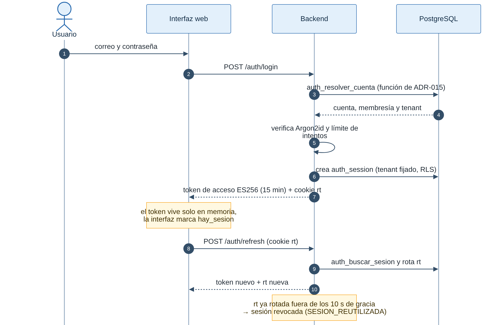
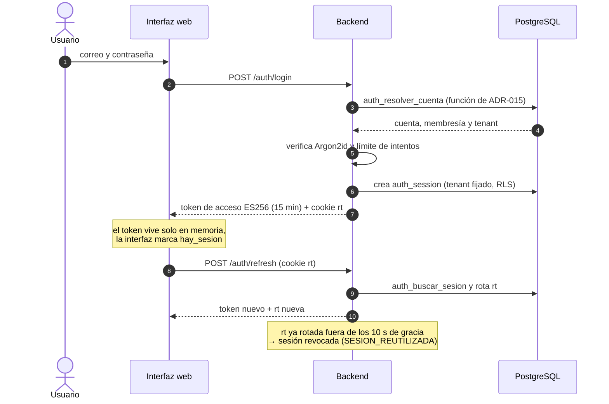
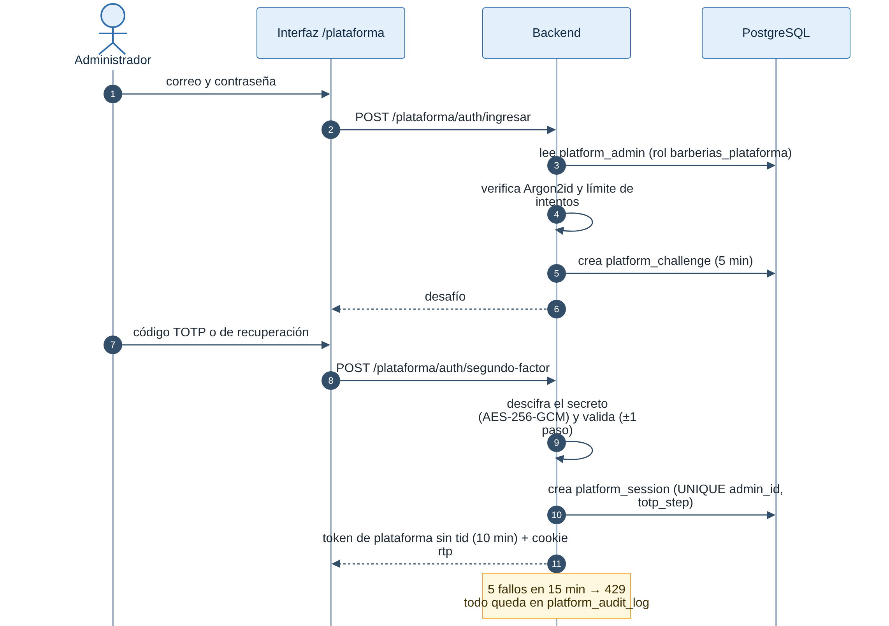
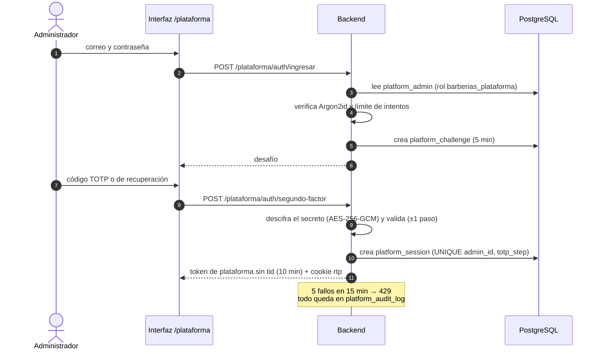

# Seguridad y privacidad

Decisión base: [ADR-010](../01-analisis-de-sistema/07-decisiones-arquitectonicas.md#adr-010-autenticación-autorización-y-aislamiento-de-datos). Drivers: DA01 y DA11. Escenarios EQ-07 a EQ-13, EQ-18 y EQ-19.

## 1. Principios

1. **Defensa en profundidad:** ningún control es la única barrera (el aislamiento usa token + contexto + repositorios + RLS + pruebas).
2. **Mínimo privilegio:** cada rol y cada rol de base de datos recibe solo lo necesario.
3. **Confianza cero en el cliente:** la interfaz no decide permisos; el backend valida siempre.
4. **Privacidad por diseño:** datos mínimos, consentimiento y retención definida.

## 2. Matriz rol × operación (RBAC)

✓ permitido · ✓\* permitido solo sobre sus propios recursos · — denegado. Las filas marcadas _(planificado)_ describen el diseño; las demás están implementadas y probadas celda por celda (PR08). PA = Administrador de la plataforma; PR = Propietario (administra todo en su barbería); BA = Barbero; CL = Cliente; AN = Anónimo.

| Operación                                                  | AN  | CL                      | BA             | PR                   | PA  |
| ---------------------------------------------------------- | --- | ----------------------- | -------------- | -------------------- | --- |
| Registrar una barbería (alta con prueba gratuita)          | ✓   | ✓                       | ✓              | ✓                    | ✓   |
| Activar / suspender / reactivar barbería                   | —   | —                       | —              | —                    | ✓   |
| Configurar datos, enlace, antelación y horario de atención | —   | —                       | — (ve)         | ✓                    | —   |
| Gestionar usuarios y roles de la barbería                  | —   | —                       | —              | ✓                    | —   |
| Gestionar servicios y barberos                             | —   | —                       | — (ve)         | ✓                    | —   |
| Definir disponibilidad y bloqueos                          | —   | —                       | ✓\*            | ✓                    | —   |
| Ver catálogo público y horarios libres por el enlace       | ✓   | ✓                       | ✓              | ✓                    | —   |
| Consultar horarios libres con sesión                       | —   | ✓                       | —              | ✓                    | —   |
| Registrarse como cliente / unirse a otra barbería          | ✓   | ✓ (cambiar de barbería) | —              | —                    | —   |
| Reservar cita                                              | —   | ✓\*                     | —              | ✓ (presencial)       | —   |
| Cancelar cita                                              | —   | ✓\* (hasta el inicio)   | —              | ✓ (nunca tardía)     | —   |
| Cambiar estado de cita (aprobar, completada, no asistió)   | —   | —                       | ✓\*            | ✓                    | —   |
| Ver agenda                                                 | —   | —                       | ✓\*            | ✓ (toda la barbería) | —   |
| Ver historial de citas                                     | —   | ✓\*                     | —              | —                    | —   |
| Buscar clientes y registrar cliente presencial             | —   | —                       | —              | ✓                    | —   |
| Ver estado de suscripción, pagar e historial de pagos      | —   | —                       | —              | ✓                    | —   |
| Saber si la barbería acepta reservas                       | —   | ✓                       | ✓              | ✓                    | —   |
| Suspender y reactivar suscripciones; activación manual     | —   | —                       | —              | —                    | ✓   |
| Revisar comprobantes y resolver pagos por revisar          | —   | —                       | —              | —                    | ✓   |
| Ver citas, clientes, catálogo o usuarios de una barbería   | —   | —                       | (según su rol) | (según su rol)       | —   |
| Ver reportes de la barbería _(planificado, 005)_           | —   | —                       | ✓\* (resumen)  | ✓                    | —   |
| Indicadores agregados de la plataforma _(planificado, 007)_ | —   | —                       | —              | —                    | ✓   |
| Asistente de IA: catálogo y disponibilidad _(planificado, 005)_ | —   | ✓                       | —              | ✓                    | —   |
| Asistente de IA: consultas administrativas _(planificado, 005)_ | —   | —                       | —              | ✓                    | —   |
| Solicitar acceso, rectificación o eliminación de datos _(planificado, 007)_ | —   | ✓\*                     | —              | ✓\*                  | —   |

La matriz se convierte en una **prueba parametrizada** (PR08): cada celda es un caso. Las matrices detalladas por ruta están en `specs/001-registro-acceso-barberia/contracts/rbac.md`, `specs/002-catalogo-citas-cliente/contracts/rbac.md` y `specs/003-suscripciones-pagos/contracts/rbac.md`; las pruebas de 002 y 003 (`backend/test/contract/rbac-002.spec.ts` y `rbac-003.spec.ts`) leen su tabla y ejecutan cada celda. La de 003 recorre la tabla **completa** (falla si una fila no tiene su caso), con los cuatro roles de barbería, el administrador y sin token, y además comprueba que el token del administrador responde 401 en **todas** las rutas de 001 y 002, leídas de la propia aplicación.

**Vía pública por enlace (ADR-021):** el catálogo y los horarios libres se leen sin sesión por el `slug` de la barbería, con un rol de base propio (`barberias_publico`: `NOBYPASSRLS`, solo `SELECT` sobre una lista cerrada de columnas públicas, transacción de solo lectura con el tenant del enlace y RLS). Nunca devuelve datos de clientes, del personal ni motivos de bloqueos; un enlace inexistente, cambiado o suspendido responde igual. El `slug` solo se acepta además para elegir la membresía del cliente (registro, ingreso, unión y cambio de barbería, ADR-020); ninguna operación de negocio con sesión lo usa: el tenant sale siempre del token.

**Cliente en varias barberías (ADR-020):** una cuenta por correo con una membresía `CLIENTE` y un perfil por barbería. El token lleva una sola barbería; cambiar de barbería emite otro token tras comprobar la membresía (o crearla con la aceptación de la política de esa barbería) y cierra la sesión anterior.

## 3. Amenazas, controles y verificación

| Amenaza                                                 | Control                                                                                                                                                                                                         | Verificación              |
| ------------------------------------------------------- | --------------------------------------------------------------------------------------------------------------------------------------------------------------------------------------------------------------- | ------------------------- |
| Acceso a datos de otra barbería                         | `tenant_id` del token, contexto, filtro en repositorios, **RLS**, claves de caché con tenant                                                                                                                    | EQ-09 / PR09              |
| Suplantación (token falso o vencido)                    | Firma, vencimiento corto, rotación de claves                                                                                                                                                                    | EQ-07 / PR07              |
| Fuerza bruta de contraseñas                             | Limitación de intentos, hash lento con sal                                                                                                                                                                      | EQ-12 / PR12              |
| Escalada de privilegios                                 | RBAC en la capa de aplicación; rol no modificable por el cliente                                                                                                                                                | EQ-08 / PR08              |
| Inyección SQL / XSS                                     | Consultas parametrizadas, validación y codificación de salida                                                                                                                                                   | EQ-10 / PR10              |
| Notificación de pago falsa o repetida                   | Firma HMAC-SHA256 con marca de tiempo (ventana de 5 min) comparada en tiempo constante; idempotencia por `evento_id`; límite de tasa; rechazo sin efecto y sin registrar el cuerpo                              | EQ-17 / PR17              |
| Robo de la cuenta del administrador de la plataforma    | Segundo factor TOTP obligatorio, bloqueo por intentos, token de 10 min con sesión de 8 h como máximo, token sin acceso a rutas de barbería (sección 4.2)                                                                                 | EQ-07, EQ-08 / PR07, PR08 |
| Comprobante malicioso o filtrado                        | Tipo verificado por bytes, tope de 5 MB, nunca servido sin sesión con permiso, sin el nombre original (sección 4.3)                                                                                             | EQ-09, EQ-10 / PR09, PR10 |
| Pago aplicado dos veces o en otra barbería              | Un pago abierto por suscripción, períodos sin solape (`EXCLUDE`), número de operación aprobado una sola vez, bloqueo de la suscripción y luego del pago                                                         | EQ-17 / PR17, PR09        |
| Fuga de secretos                                        | Variables de entorno/gestor; escaneo del repositorio; sin secretos en logs ni prompts                                                                                                                           | EQ-11 / PR11              |
| _(planificado, 005)_ Prompt injection / exceso de agencia de la IA | Herramientas cerradas por rol, sin SQL libre, intención estructurada, confirmación para acciones sensibles                                                                                                      | EQ-19 / PR19              |
| _(planificado, 005)_ Fuga de datos personales a la IA   | Enviar solo datos mínimos del tenant autenticado; sin datos de pago; revisión de lo enviado                                                                                                                     | EQ-19 / PR19              |
| _(planificado, 004)_ Enlace del recordatorio reenviado, robado o reutilizado | Enlace firmado de un solo uso (`jti` registrado), vence al iniciar la cita, alcance a una cita y un tenant, acción limitada (confirmar, reprogramar o cancelar), sin datos personales en la URL, límite de tasa | EQ-08, EQ-09 / PR28       |
| Datos de tarjeta expuestos                              | No se reciben ni almacenan; se usa el flujo alojado por el proveedor                                                                                                                                            | Revisión de diseño (RC12) |
| Denegación de servicio / abuso                          | Rate limiting, tiempos límite, balanceo                                                                                                                                                                         | EQ-12 / PR12              |
| Manipulación de acciones sensibles sin rastro           | Auditoría inmutable para el rol de aplicación                                                                                                                                                                   | EQ-13 / PR13              |
| Pérdida de datos                                        | Respaldos cifrados y probados                                                                                                                                                                                   | EQ-22 / PR22              |
| CSRF/CORS abusivo                                       | Lista de orígenes, `SameSite` si hay cookies, tokens en cabecera                                                                                                                                                | Revisión y prueba de CORS |

## 4. Autenticación y sesiones

- Contraseñas con algoritmo de hash lento y sal: Argon2id en la funcionalidad 001 (ver [tecnologías](tecnologias.md)).
- Token de acceso de vida corta (15 min) y token de refresco rotativo; cierre de sesión revoca el refresco. Si llega un token de refresco ya rotado, se trata como robo: la sesión se revoca y se audita `SESION_REUTILIZADA`.
- **Período de gracia (ADR-019):** el token de refresco inmediatamente anterior se acepta **una sola vez** durante 10 s tras la rotación (`REFRESH_GRACIA_SEGUNDOS`, de 0 a 30), para no cerrar la sesión cuando una renovación se interrumpe o se repite (riesgo R18 de la [matriz de riesgos](../05-gestion/05-riesgos.md)); cada uso se audita (`SESION_RENOVADA_EN_GRACIA`). Fuera de la ventana, el segundo uso o el token que la gracia dejó sin efecto revocan la sesión. La renovación bloquea la fila de la sesión y la interfaz serializa las renovaciones entre pestañas (Web Locks).
- El token contiene `sub`, `tid`, `rol` y `sid`; no contiene datos personales.
- Mensajes de error genéricos en el inicio de sesión.

#### Inicio de sesión y renovación del token (implementado, 001)

_Figura 1. Inicio de sesión del personal o del cliente y renovación del token._

Código fuente del diagrama (Mermaid)

El token lleva `sub` (usuario), `tid` (barbería), `rol` y `sid` (sesión). En cada solicitud, `AuthGuard` verifica la firma y comprueba en la base que la sesión siga activa.

Evidencia: `backend/src/modules/acceso-barberias/identidad/presentation/auth.controller.ts`, `identidad/application/iniciar-sesion.ts` y `renovar-sesion.ts`, `identidad/infrastructure/` (`JoseTokenSigner`, `Argon2PasswordHasher`), `backend/migrations/0003_autenticacion_sin_tenant.ts`, `frontend/src/auth/indicadorSesion.ts`; pruebas `backend/test/integration/identidad/autenticacion.spec.ts`, `limite-intentos.spec.ts` y `test/contract/auth.contract.spec.ts`.

### 4.1 Qué guarda el navegador

| Dato                         | Dónde                                                                       | Características                                                                                                        | Decisión |
| ---------------------------- | --------------------------------------------------------------------------- | ---------------------------------------------------------------------------------------------------------------------- | -------- |
| Token de acceso              | Memoria de la página (nunca en `localStorage`, `sessionStorage` ni cookies) | Se pierde al recargar; se recupera con la renovación                                                                   | ADR-010  |
| Token de renovación `rt`     | Cookie                                                                      | `HttpOnly`, `Secure`, `SameSite=Strict`, `Path=/api/v1/auth`, 7 días, rotativa; JavaScript no puede leerla             | ADR-010  |
| Indicador `hay_sesion=1`     | Cookie                                                                      | No secreta ni da acceso; `SameSite=Strict`, `Secure` con HTTPS, 7 días; solo evita llamar a `/auth/refresh` sin sesión | ADR-017  |
| Preferencia de tema (`tema`) | `localStorage`                                                              | Solo `claro` u `oscuro`; sin datos personales; si no se puede guardar, se usa el tema del sistema                      | ADR-016  |

La sesión del administrador de la plataforma usa su propia cookie `rtp` (`HttpOnly`, `Secure`, `SameSite=Strict`, `Path=/api/v1/plataforma/auth`, a lo sumo 8 h) y su token de acceso vive solo en la memoria de la página, en una variable distinta de la de las barberías.

Las cookies `rt`, `rtp` y `hay_sesion` son técnicas (necesarias para mantener la sesión) y deben figurar en la política de privacidad y de cookies.

### 4.2 Administrador de la plataforma y segundo factor (003, ADR-031)

- **Sin barbería:** el administrador no tiene membresía. Su token lleva la audiencia `plataforma` y no lleva tenant; la guardia rechaza con 401 ese token en cualquier ruta de barbería y el de una barbería en `/plataforma/*`. Cada solicitud comprueba en la base que su sesión siga activa.
- **Dos pasos:** contraseña (Argon2id) → desafío de 5 minutos → código TOTP (RFC 6238, 6 dígitos, 30 s, ±1 paso) o uno de los 10 códigos de recuperación. Un código TOTP abre una sola sesión (`UNIQUE (admin_id, totp_step)`) y cada código de recuperación sirve una sola vez, garantizado por la base.
- **Bloqueo:** 5 fallos de contraseña o de código en 15 minutos bloquean ese correo desde esa IP (429 con `Retry-After`). Los ingresos, fallos, usos de códigos de recuperación y salidas quedan en `platform_audit_log`.
- **Secretos:** el secreto TOTP se guarda cifrado con AES-256-GCM (llave `PLATAFORMA_LLAVE_TOTP`, de 32 bytes, con el id del administrador como dato asociado) y los códigos de recuperación como hashes Argon2id. El rol de la aplicación **no tiene ningún permiso** sobre `platform_admin`: solo la lee `barberias_plataforma`. Ni el secreto, ni los códigos, ni la contraseña aparecen en registros, errores o auditoría.
- **Alta:** solo por la orden `npm run plataforma:crear-admin` (rol dueño de la base), que pide la contraseña sin eco y muestra **una sola vez** la URI `otpauth://` y los códigos de recuperación.
- **Lo que puede hacer:** listar barberías (sin datos de negocio), suspender y reactivar barberías y suscripciones, activar un plan a mano, revisar comprobantes y resolver pagos por revisar. No puede ver ni cambiar citas, clientes, catálogo ni usuarios (FR-038). Sus escrituras corren con el tenant de la barbería de la ruta y RLS, y quedan en el `audit_log` de esa barbería con él como actor y el motivo.

#### Ingreso del administrador con segundo factor (implementado, 003)

_Figura 2. Ingreso del administrador de la plataforma en dos pasos._

Código fuente del diagrama (Mermaid)

Con ese token solo responden las rutas `/plataforma/*`; en cualquier ruta de barbería da 401. La sesión se renueva con `POST /plataforma/auth/renovar` hasta un máximo de 8 h.

Evidencia: `backend/src/modules/acceso-barberias/identidad/presentation/plataforma-auth.controller.ts`, `identidad/application/plataforma/`, `identidad/infrastructure/totp-node.ts`, `backend/migrations/0016_plataforma.ts`, `backend/scripts/crear-admin-plataforma.ts`; pruebas `backend/test/integration/identidad/segundo-factor.spec.ts`, `host/token-plataforma.spec.ts`, `test/unit/identidad/totp.spec.ts` y `test/contract/rbac-003.spec.ts`.
### 4.3 Comprobantes de transferencia (003, ADR-023)

- El tipo se decide por los **primeros bytes** (JPEG, PNG o PDF), no por el nombre ni por el `Content-Type`; un archivo de otro tipo o de más de 5 MB se rechaza sin guardarse. Nginx admite 6 MB solo en la ruta de subida.
- Se guardan en PostgreSQL con RLS (`payment_receipt_file`), sin el nombre original. El rol de solo lectura de la plataforma no puede leer su contenido.
- Solo se descargan con una sesión con permiso (el propietario de esa barbería o el administrador), como adjunto, con `Cache-Control: no-store` y `X-Content-Type-Options: nosniff`. La interfaz los muestra en memoria (`blob:`) y libera la URL al minuto.
- Ni el contenido, ni el nombre, ni el número de operación completo aparecen en registros, errores o auditoría; el número completo solo lo ve el administrador en el detalle del pago, y en los listados solo sus últimos 4 caracteres. Un número de operación se aprueba una sola vez en toda la plataforma.

### 4.4 Notificaciones del proveedor de pagos (003, PR17)

- Firma HMAC-SHA256 sobre el cuerpo crudo con marca de tiempo (`X-Firma: t=…,v1=…`), ventana de 5 minutos y comparación en tiempo constante. Sin firma, con firma inválida o vencida: 401, sin ningún efecto, y una sola línea `PAGO_NOTIFICACION_RECHAZADA` con la IP, **sin el cuerpo**.
- Idempotencia por `evento_id` (clave primaria de `provider_event`); el resultado se aplica con la suscripción y el pago bloqueados, en una sola función que también usan la conciliación, la revisión del comprobante y la activación manual.
- La confirmación siempre la da la notificación o la conciliación, nunca el navegador al volver del proveedor. La plataforma nunca recibe datos de tarjeta ni del pagador.

### 4.5 Limitaciones conocidas de seguridad (003)

- **Rotación de la llave TOTP:** no hay un procedimiento para cambiar `PLATAFORMA_LLAVE_TOTP`. Cambiarla deja ilegibles los secretos guardados: habría que volver a dar de alta a cada administrador (nuevo secreto y nuevos códigos). Una rotación sin interrupción exigiría guardar la versión de la llave con cada secreto y recifrarlos; queda pendiente.
- **Proveedor real:** el adaptador real (Culqi) depende de obtener credenciales de pruebas y de confirmar que el comercio puede cobrar con Yape (riesgo R15). Hasta entonces, todo pago es con el simulador.

## 5. Privacidad y protección de datos personales (Ley N.° 29733)

> Verificar el texto vigente de la Ley N.° 29733 y del D. S. N.° 016-2024-JUS en _El Peruano_ antes de citarlos. Esto no es asesoría legal definitiva.

| Principio / obligación                                     | Medida de diseño                                                                                                                                                                                              | Estado      |
| ---------------------------------------------------------- | ------------------------------------------------------------------------------------------------------------------------------------------------------------------------------------------------------------- | ----------- |
| Consentimiento previo, informado, expreso e inequívoco     | Registro `consent_record` (fecha, versión del texto, método e IP) antes de crear el perfil (RF05)                                                                                                             | Implementado (002) |
| Finalidad y proporcionalidad                               | Solo nombre, correo, teléfono y datos de la cita; el número de WhatsApp opcional llegará con 004                                                                                                               | Implementado (002) |
| Consentimiento para mensajes por WhatsApp                  | Casilla expresa y separada; se registra en `consent_record` antes de enviar; el cliente puede cambiar de canal o retirarlo (RF33)                                                                             | Planificado (004) |
| Contenido de los mensajes                                  | Solo barbería, servicio, fecha y hora; sin datos sensibles ni enlaces de autenticación                                                                                                                        | Planificado (004) |
| Derechos de acceso, rectificación, cancelación y oposición | Flujo de solicitudes con seguimiento (RF32); sin tablas todavía                                                                                                                                               | Planificado (007) |
| Seguridad del tratamiento                                  | Hash de contraseñas (Argon2id), RLS, auditoría y comprobantes privados; cifrado en tránsito (HTTPS) en la nube                                                                                               | Implementado en local; HTTPS planificado |
| Respaldos                                                  | Diarios (propuesta); la normativa menciona al menos semanales según fuente secundaria                                                                                                                         | Planificado |
| Trazabilidad de accesos                                    | Auditoría de acciones sensibles (`audit_log`, `platform_audit_log`)                                                                                                                                          | Implementado (001–003) |
| Incidentes graves                                          | Procedimiento de notificación a la ANPD en 48 h (según fuente secundaria; verificar)                                                                                                                          | Por validar |
| Inscripción de bancos de datos (RNPDP)                     | Evaluar antes de operar                                                                                                                                                                                       | Por validar |
| Roles responsable / encargado                              | Barbería = responsable de los datos de sus clientes; plataforma = encargada. Para los datos de las barberías como clientes de la plataforma, la plataforma es responsable. **Por validar con asesoría legal** | Por validar |
| Oficial de Datos Personales                                | Evaluar si corresponde según tamaño de empresa; **no se afirma**                                                                                                                                              | Por validar |

### Privacidad en el asistente de IA _(planificado, 005)_

- Solo recibe datos del tenant y rol autenticados, el mínimo necesario.
- No recibe secretos, contraseñas ni datos de pago.
- Cada consulta queda registrada (intención, herramientas usadas, tenant, usuario), sin guardar más datos personales de los necesarios.
- Se informa al usuario que usa un asistente automatizado.
- Se revisan los términos del proveedor de IA sobre retención y uso de datos antes de contratarlo.

## 6. Auditoría

Se registran hoy: alta, suspensión y reactivación de barberías; cambios de rol y de usuarios; cambios de plan; accesos denegados a otra barbería (`ACCESO_TENANT_AJENO`); pagos y comprobantes. Planificado: acciones de IA con herramientas sensibles (005) y solicitudes de datos personales (007). Cada registro tiene actor, acción, recurso, tenant, fecha y origen. Sin datos sensibles innecesarios.

La funcionalidad 002 agrega 12 acciones (R19): `CLIENTE_REGISTRADO`, `CLIENTE_UNIDO`, `CLIENTE_PRESENCIAL_REGISTRADO`, `BARBERIA_CAMBIADA`, `ENLACE_CAMBIADO`, `SERVICIO_DESACTIVADO`, `BARBERO_DESACTIVADO`, `BLOQUEO_CON_CONFLICTO`, `CAMBIO_CON_CONFLICTO`, `CITA_RESERVADA`, `CITA_CANCELADA` y `CITA_ESTADO_CAMBIADO`. El recurso va siempre como `tipo:identificador` (nunca nombres, teléfonos ni correos); la suite PR13 lo comprueba para cada una.

La funcionalidad 003 agrega: las transiciones automáticas de la suscripción (`SUSCRIPCION_ACTIVADA`, `SUSCRIPCION_EN_GRACIA`, `SUSCRIPCION_VENCIDA`, sin actor y con la fecha que les correspondía), `PAGO_INICIADO`, `PAGO_APROBADO`, `COMPROBANTE_SUBIDO`, `COMPROBANTE_APROBADO`, `COMPROBANTE_RECHAZADO`, `REVISION_RESUELTA` y las del administrador sobre una barbería: `BARBERIA_SUSPENDIDA`, `BARBERIA_REACTIVADA`, `SUSCRIPCION_SUSPENDIDA`, `SUSCRIPCION_REACTIVADA` y `ACTIVACION_MANUAL`, con el administrador como actor. El motivo del administrador va en la columna `reason` (migración 0020), que la base solo admite en las tres acciones con motivo; el resto de la auditoría sigue sin texto libre. El acceso del administrador va aparte, en `platform_audit_log`.
