# Diseño interno de los módulos críticos

**Arquitectura** es la estructura general, los componentes principales y sus decisiones ([componentes](../../02-arquitectura-software/componentes-arquitectonicos.md)). **Diseño de software** es el nivel de clases, métodos, responsabilidades, interfaces y colaboración. Se complementan: este documento baja un nivel.

Flujo interno común: **Controlador → Caso de uso → Entidad → Repositorio (puerto) → Infraestructura (adaptador)**. Los submódulos críticos son `citas` (M02), `suscripciones` y `pagos` (M03) y `asistente` (M04). Cada submódulo tiene sus cuatro capas. Estado: **planificado**.

## 1. Submódulo `citas` (M02 Catálogo y citas)

| Elemento                                                                | Capa                                                        | Responsabilidad                                                                                                  |
| ----------------------------------------------------------------------- | ----------------------------------------------------------- | ---------------------------------------------------------------------------------------------------------------- |
| `CitasController`                                                       | Presentación                                                | Valida formato (fechas, identificadores), toma el contexto de la solicitud y llama al caso de uso                |
| `ConsultarDisponibilidad`                                               | Aplicación                                                  | Obtiene horario y bloqueos (`catalogo`, mismo módulo), citas ocupadas y calcula huecos para un servicio          |
| `ReservarCita`                                                          | Aplicación                                                  | Orquesta: verifica `SubscriptionPolicy`, valida servicio y barbero, crea la entidad, la persiste, publica evento |
| `CancelarCita`, `ReprogramarCita`                                       | Aplicación                                                  | Aplican la política de antelación y las transiciones de estado                                                   |
| `Cita`                                                                  | Dominio                                                     | Entidad con identidad, tenant, barbero, servicio, cliente, `RangoHorario`, estado                                |
| `RangoHorario`                                                          | Dominio                                                     | Objeto de valor: inicio < fin, duración, operación `seSolapaCon`                                                 |
| `EstadoCita`                                                            | Dominio                                                     | Transiciones válidas                                                                                             |
| `CitaRepository`                                                        | Aplicación (puerto)                                         | `guardar`, `buscarPorId`, `listarPorBarbero`, `listarPorRango`                                                   |
| `CitaRepositoryPostgres`                                                | Infraestructura                                             | Implementa el puerto; traduce la violación de exclusión a `HorarioNoDisponible`                                  |
| `CatalogQuery` (submódulo `catalogo`, M02) y `SubscriptionPolicy` (M03) | Interfaz del mismo módulo y interfaz pública de otro módulo | Consultadas desde `ReservarCita`                                                                                 |

### 1.1 Estados de la cita

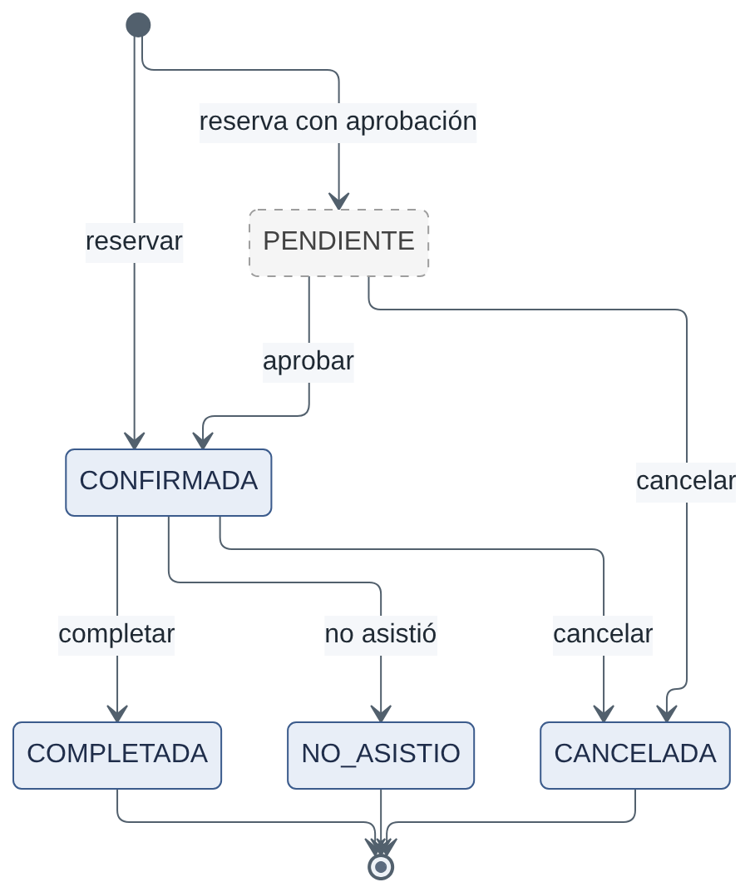

_Figura. 1.1 Estados de la cita._

Código fuente del diagrama (Mermaid)

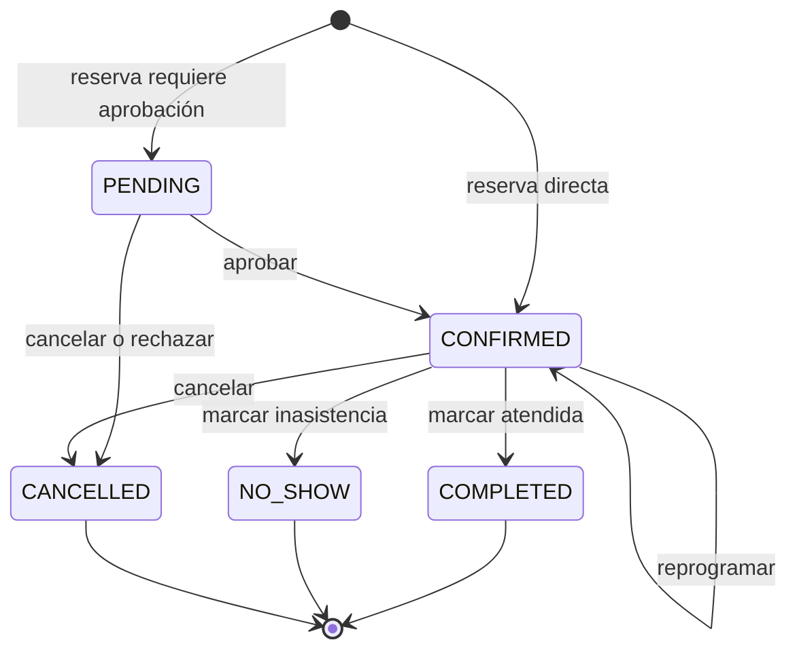

Solo `PENDING` y `CONFIRMED` ocupan el horario (la restricción de exclusión usa esos estados). Cualquier otra transición lanza un error de dominio.

### 1.2 Secuencia de reserva

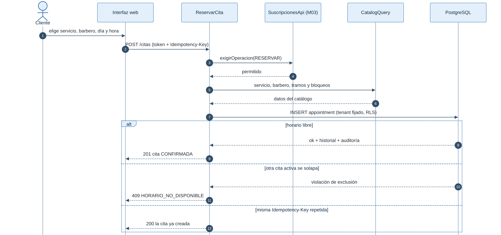

_Figura. 1.2 Secuencia de reserva._

Código fuente del diagrama (Mermaid)

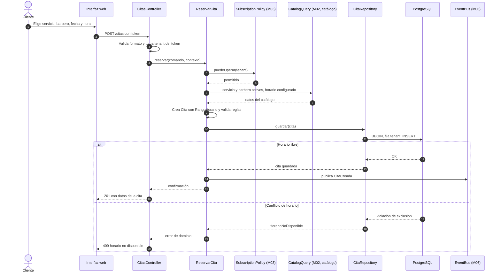

## 2. Submódulo `suscripciones` (M03 Suscripciones y pagos)

| Elemento                                                                                                                  | Capa                          | Responsabilidad                                                        |
| ------------------------------------------------------------------------------------------------------------------------- | ----------------------------- | ---------------------------------------------------------------------- |
| `SuscripcionController`                                                                                                   | Presentación                  | Consulta de estado, contratación, cambio de plan                       |
| `IniciarPrueba`, `ContratarPlan`, `ActivarPorPago`, `SuspenderSuscripcion`, `ReactivarSuscripcion`, `VencerSuscripciones` | Aplicación                    | Casos de uso; los dos últimos también se ejecutan por tarea programada |
| `Suscripcion`                                                                                                             | Dominio                       | Entidad con estado, fechas y reglas de transición                      |
| `EstadoSuscripcion`                                                                                                       | Dominio                       | TRIAL, ACTIVE, PAST_DUE, EXPIRED, CANCELLED, SUSPENDED                 |
| `PlanPolicy` (Strategy)                                                                                                   | Dominio                       | Reglas por plan: límites de barberos/usuarios, IA habilitada           |
| `SubscriptionPolicy`                                                                                                      | Aplicación (interfaz pública) | `puedeOperar(tenant)`, `limitesDelPlan(tenant)`                        |
| `SubscriptionRepository` / `...Postgres`                                                                                  | Aplicación / Infraestructura  | Persistencia con bloqueo de fila                                       |

### 2.1 Flujo de suscripción

_Figura. 2.1 Flujo de suscripción._

Código fuente del diagrama (Mermaid)

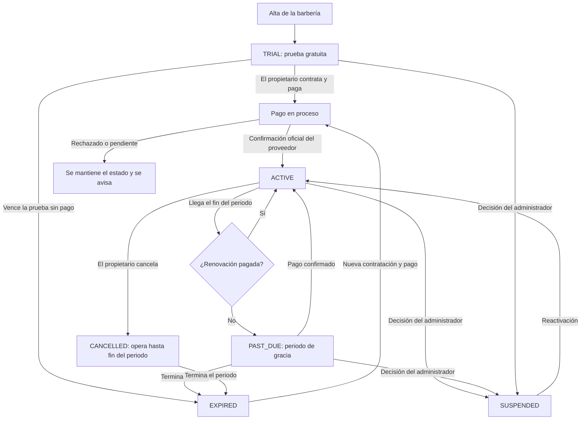

### 2.2 Funciones disponibles según el estado

| Estado    | Reservas nuevas                 | Gestión (servicios, barberos) | Lectura de agenda y reportes                 | Asistente de IA      | Aviso             |
| --------- | ------------------------------- | ----------------------------- | -------------------------------------------- | -------------------- | ----------------- |
| TRIAL     | Sí (límites del plan de prueba) | Sí                            | Sí                                           | Según plan de prueba | Días restantes    |
| ACTIVE    | Sí                              | Sí                            | Sí                                           | Según plan           | —                 |
| PAST_DUE  | Sí (gracia propuesta: 7 días)   | Sí                            | Sí                                           | No                   | Pago pendiente    |
| CANCELLED | Hasta fin del periodo           | Hasta fin del periodo         | Sí                                           | No                   | Fecha de fin      |
| EXPIRED   | **No**                          | Solo lectura                  | Sí (exportación de datos)                    | No                   | Reactivar         |
| SUSPENDED | **No**                          | **No**                        | **No** para la barbería; solo administración | No                   | Contactar soporte |

Los datos nunca se borran por cambiar de estado.

## 3. Submódulo `pagos` (M03 Suscripciones y pagos)

| Elemento                                                 | Capa                         | Responsabilidad                                                                                        |
| -------------------------------------------------------- | ---------------------------- | ------------------------------------------------------------------------------------------------------ |
| `PagosController`                                        | Presentación                 | Inicia pago (autenticado)                                                                              |
| `WebhookController`                                      | Presentación                 | Recibe notificaciones **sin token de usuario**; entrega el cuerpo crudo y las cabeceras al caso de uso |
| `IniciarPagoDeSuscripcion`                               | Aplicación                   | Crea `Pago` en estado PENDING y pide al `PaymentGateway` una orden/checkout                            |
| `ProcesarConfirmacionDePago`                             | Aplicación                   | Verifica autenticidad, registra el evento (único), actualiza el pago y publica `PagoConfirmado`        |
| `ConciliarPagosPendientes`                               | Aplicación                   | Consulta al proveedor los pagos PENDING antiguos                                                       |
| `Pago`, `EstadoPago`                                     | Dominio                      | PENDING, CONFIRMED, REJECTED, EXPIRED; transiciones válidas                                            |
| `PaymentGateway`                                         | Aplicación (puerto)          | `crearOrden`, `verificarNotificacion`, `consultarPago`                                                 |
| `CulqiPaymentGateway` (candidato) / `FakePaymentGateway` | Infraestructura              | Adaptador real y simulador de pruebas                                                                  |
| `PagoRepository`                                         | Aplicación / Infraestructura | Persistencia y `webhook_event` único                                                                   |

### 3.1 Secuencia de pago de una suscripción

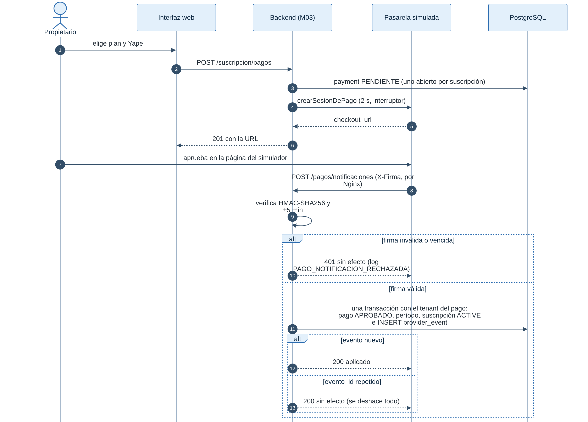

_Figura. 3.1 Secuencia de pago de una suscripción._

Código fuente del diagrama (Mermaid)

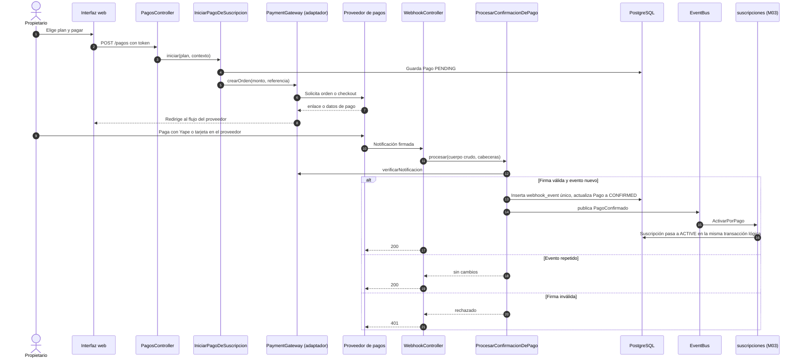

Garantías: la suscripción solo se activa por confirmación oficial del proveedor; el índice único de `webhook_event` impide efectos repetidos; si el proveedor no avisa, `ConciliarPagosPendientes` consulta el estado. No se guardan datos de tarjeta.

> **Atomicidad.** El registro del evento, la actualización del pago y la activación de la suscripción se ejecutan de modo que, ante un fallo, se reintente sin duplicar. Si se usa el bus en proceso, la activación se dispara después del _commit_ del pago y es idempotente (`UPDATE ... WHERE estado <> 'ACTIVE'`); la conciliación cubre un fallo entre ambos pasos.

## 4. Submódulo `asistente` (M04 Asistente IA y reportes)

| Elemento                                                                             | Capa                | Responsabilidad                                                                             |
| ------------------------------------------------------------------------------------ | ------------------- | ------------------------------------------------------------------------------------------- |
| `AsistenteController`                                                                | Presentación        | Recibe el mensaje; el límite de tasa se aplica antes                                        |
| `ConsultaIAAutorizada`                                                               | Aplicación          | Orquesta: contexto → intención estructurada → herramienta cerrada → respuesta               |
| `HerramientaIA` (interfaz)                                                           | Aplicación          | `nombre`, `rolesPermitidos`, `esSensible`, `ejecutar(params, contexto)`                     |
| `ConsultarServicios`, `ConsultarDisponibilidad`, `ResumenDeCitas`, `PrepararReserva` | Aplicación          | Herramientas que llaman a casos de uso de M02 y del submódulo `reportes`                    |
| `Intencion`                                                                          | Dominio             | Objeto de valor: nombre de herramienta + parámetros tipados                                 |
| `AIProvider`                                                                         | Aplicación (puerto) | `interpretar(mensaje, herramientasPermitidas) → Intencion`, `redactarRespuesta(resultados)` |
| `LlmAIProvider` / `FakeAIProvider`                                                   | Infraestructura     | Adaptador al proveedor y simulador                                                          |
| `AiLogRepository`                                                                    | Infraestructura     | Registro de interacciones                                                                   |

### 4.1 Secuencia del asistente

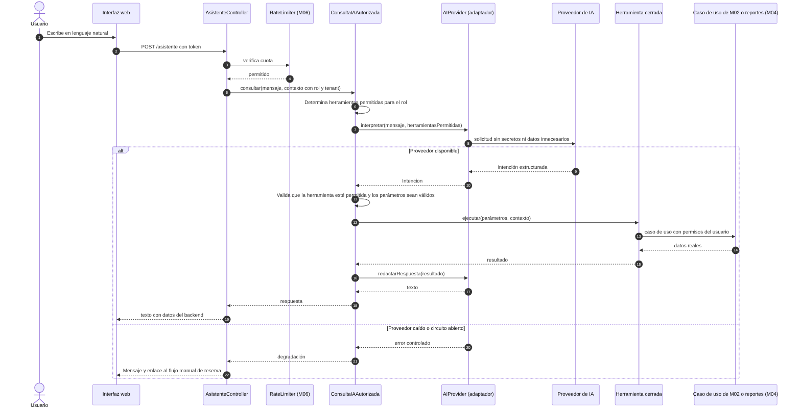

_Figura. 4.1 Secuencia del asistente._

Código fuente del diagrama (Mermaid)

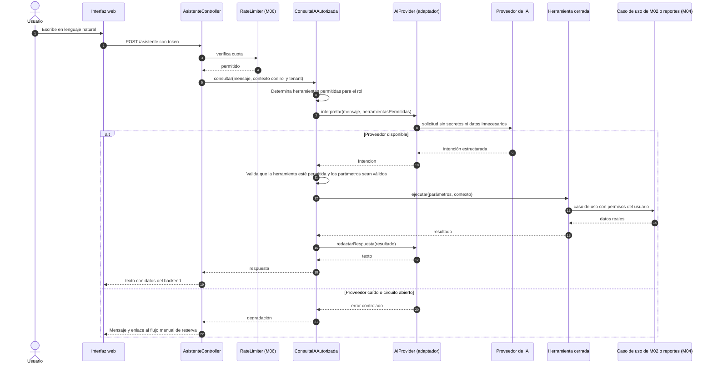

Reglas: la IA nunca recibe SQL ni acceso a la base; **la disponibilidad siempre viene de `ConsultarDisponibilidad`**; la confirmación de una reserva solo ocurre con `ReservarCita` tras confirmación explícita del usuario; las acciones sensibles piden verificación adicional; cada interacción se registra.

## 5. Diagrama de clases del módulo Suscripciones (resumen)

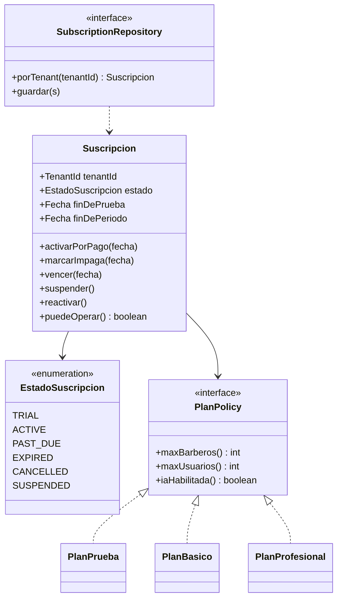

_Figura. 5. Diagrama de clases del módulo Suscripciones (resumen)._

Código fuente del diagrama (Mermaid)

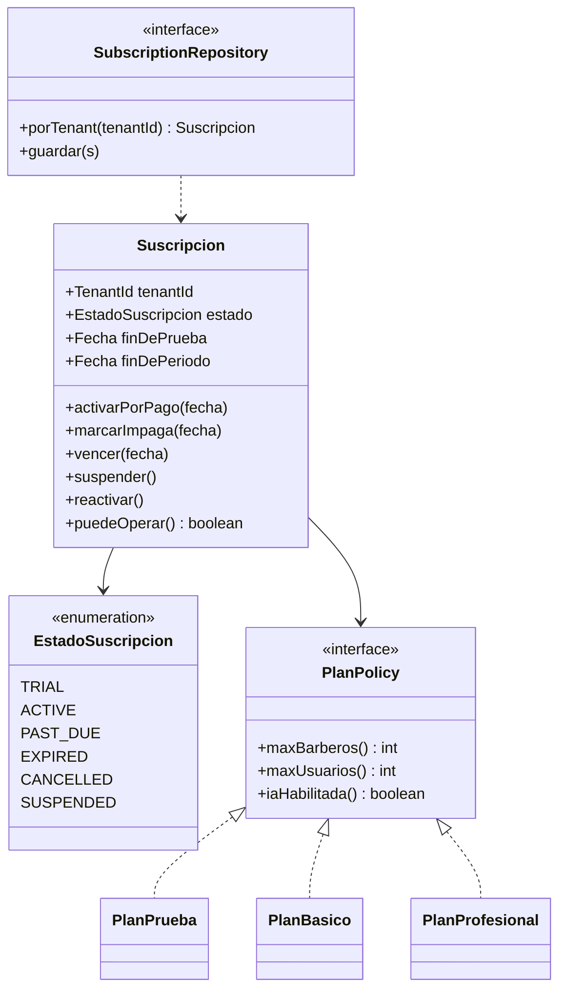

Los nombres y límites de los planes son **ejemplos hipotéticos**, no precios ni condiciones de mercado.

## 6. Módulos no críticos

`identidad`, `barberias`, `catalogo` y `reportes` siguen el mismo flujo con casos de uso delgados (ver la simplificación proporcional en [enfoque](../../02-arquitectura-software/enfoque-arquitectonico.md#6-justificación-honesta-frente-al-criterio-de-la-guía)).

## 7. M05 Notificaciones

El cliente recibe la **fecha y hora de su cita** por su correo electrónico o por su número de WhatsApp, según el canal que eligió al registrarse (RF30, RF33, HU25). Decisión: [ADR-013](../../01-analisis-de-sistema/07-decisiones-arquitectonicas.md#adr-013-notificaciones-multicanal-al-cliente-correo-y-whatsapp).

| Elemento                                       | Capa                          | Responsabilidad                                                                                                                |
| ---------------------------------------------- | ----------------------------- | ------------------------------------------------------------------------------------------------------------------------------ |
| `CitaEventosHandler`                           | Aplicación                    | Escucha `CitaCreada`, `CitaReprogramada`, `CitaCancelada`; crea los envíos inmediatos y programa el recordatorio               |
| `EnviarNotificacion`                           | Aplicación                    | Elige el canal, aplica la plantilla, envía por el puerto y registra el resultado                                               |
| `ProcesarRecordatorios`                        | Aplicación                    | Tarea periódica: toma recordatorios vencidos con bloqueo (`FOR UPDATE SKIP LOCKED`) para que dos instancias no envíen el mismo |
| `CanalDeNotificacion`, `PlantillaDeMensaje`    | Dominio                       | Canal (EMAIL, WHATSAPP), tipos de mensaje y reglas (WhatsApp solo con consentimiento)                                          |
| `NotificationChannel`                          | Aplicación (puerto)           | `enviar(destinatario, mensaje) → ResultadoDeEnvio`                                                                             |
| `EmailSender`, `WhatsAppSender`                | Infraestructura (adaptadores) | Implementan el puerto; protegidos por reintentos y circuit breaker                                                             |
| `NotificationJobRepository`, `NotificationLog` | Aplicación / Infraestructura  | Programación y trazabilidad de envíos                                                                                          |

**Dependencias.** M05 solo depende de M06. Para no depender de M01, el evento de M02 lleva los datos mínimos de contacto (canal elegido, correo, número de WhatsApp y si aceptó recibirlos) y los datos de la cita (barbería, servicio, fecha y hora).

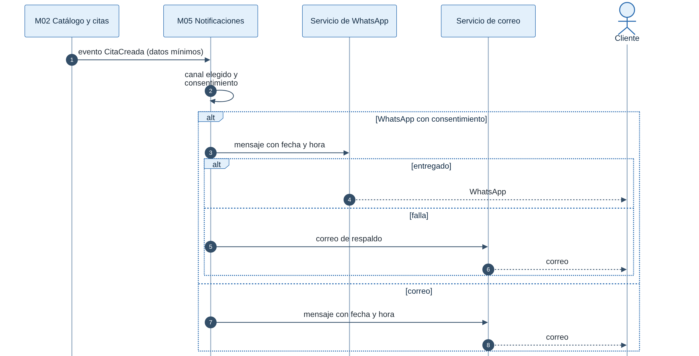

_Figura. 7. M05 Notificaciones._

Código fuente del diagrama (Mermaid)

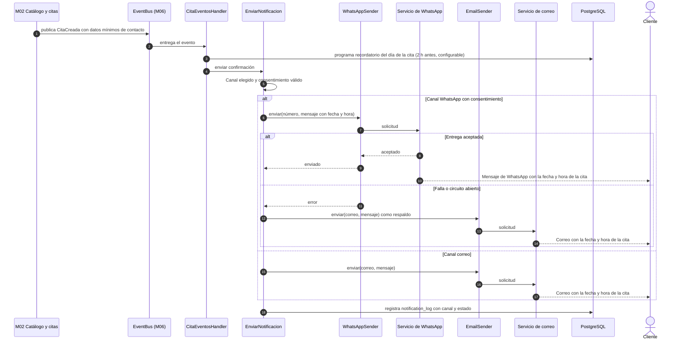

**Reglas.**

1. El envío es **asíncrono**: nunca bloquea ni revierte la reserva (HU25 criterio 6).
2. WhatsApp solo se usa si el cliente dio su número y aceptó expresamente recibir mensajes; si no, se usa correo.
3. Reintentos con espera creciente en errores transitorios; si se agotan, se usa el respaldo por correo y se deja registro.
4. Los mensajes contienen solo barbería, servicio, fecha y hora, y una forma de cancelar o reprogramar mediante la plataforma.
5. El recordatorio se reprograma o se cancela si la cita cambia de horario o se cancela.
6. El recordatorio del día de la cita incluye acciones para el cliente (ver 7.1).
7. Las condiciones de WhatsApp (plantillas aprobadas, costos) dependen del proveedor y están por verificar.

### 7.1 Recordatorio del día de la cita y respuesta del cliente

El mismo día de la cita (propuesta: 2 horas antes, configurable por barbería) el sistema avisa al cliente que tiene cita y le pregunta si podrá asistir, por si surgió un imprevisto (RF34, HU28). Si la cita se reservó con menos tiempo que el de aviso, no se envía recordatorio: basta la confirmación.

| Acción del enlace       | Qué ocurre                                                                                                 | Reglas                                                                                                 |
| ----------------------- | ---------------------------------------------------------------------------------------------------------- | ------------------------------------------------------------------------------------------------------ |
| **Confirmo asistencia** | Se registra `client_confirmed_at`; la agenda del barbero lo muestra                                        | No cambia el estado de la cita                                                                         |
| **Cancelar**            | `CancelarCita` pasa la cita a CANCELLED y libera el horario; se avisa al barbero y al propietario          | Siempre permitido; si es con menos antelación que la mínima configurable, se marca `late_cancellation` |
| **Reprogramar**         | Abre la pantalla de disponibilidad con la cita precargada; el cambio sigue las reglas de `ReprogramarCita` | Misma validación y restricción de exclusión que una reserva nueva                                      |
| Sin respuesta           | La cita **no se cancela automáticamente**; queda "sin confirmar"                                           | Una regla de cancelación automática sería evolución futura, a validar con las barberías                |

Los enlaces los firma el servicio `SignedActionToken` de M06 con: cita, tenant, acción y vencimiento (hasta el inicio de la cita) y un identificador `jti`. M02 los verifica y registra el `jti` en `used_action_token` con restricción de unicidad, así que **cada enlace sirve una sola vez**. M05 no depende de M02: solo firma enlaces con el servicio de M06.

_Figura. 7.1 Recordatorio del día de la cita y respuesta del cliente._

Código fuente del diagrama (Mermaid)

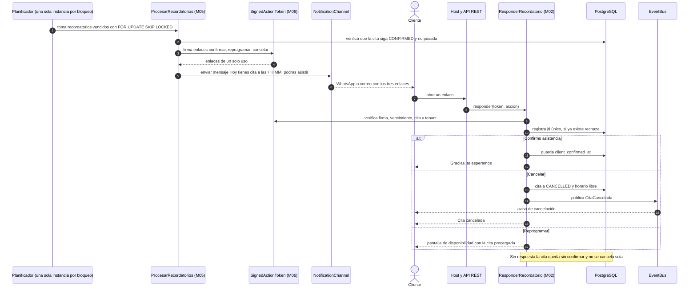

