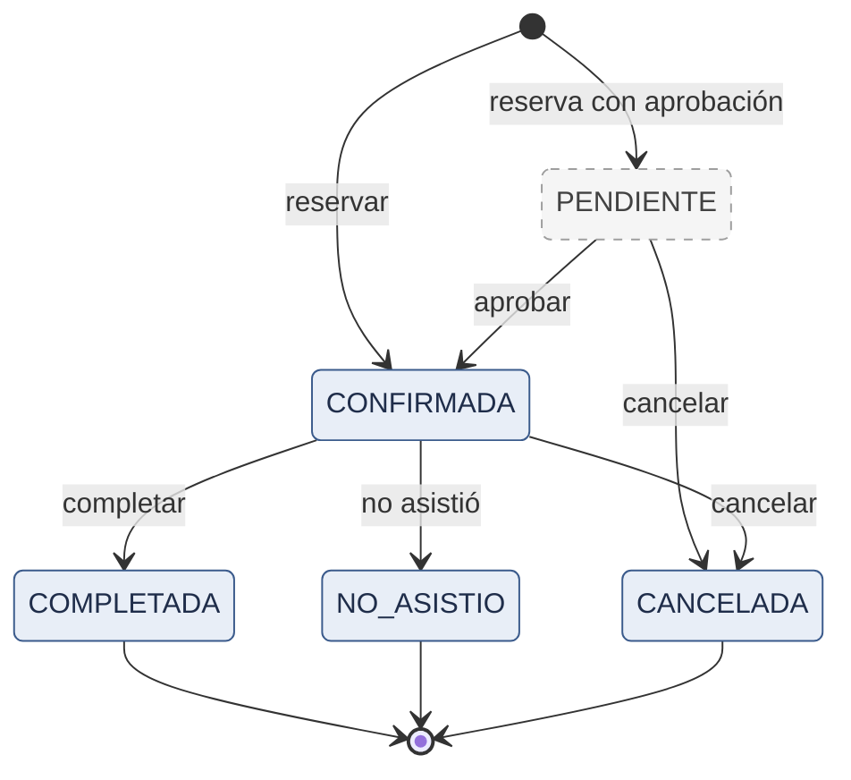
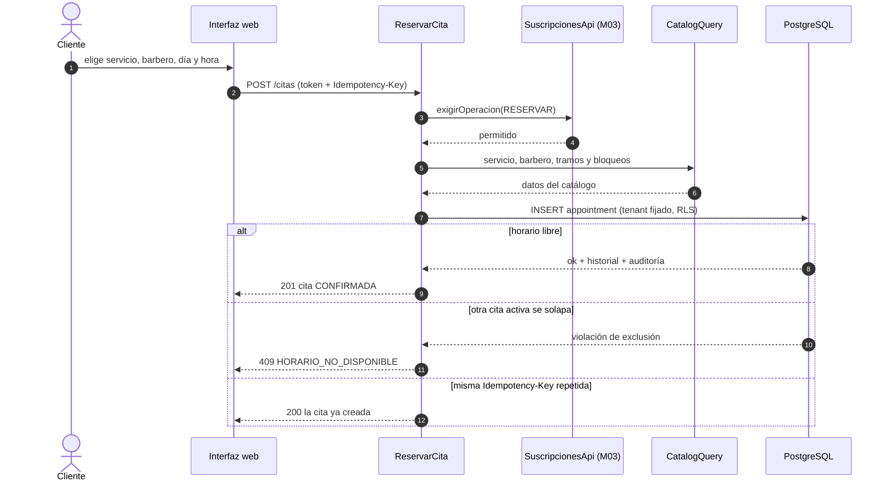
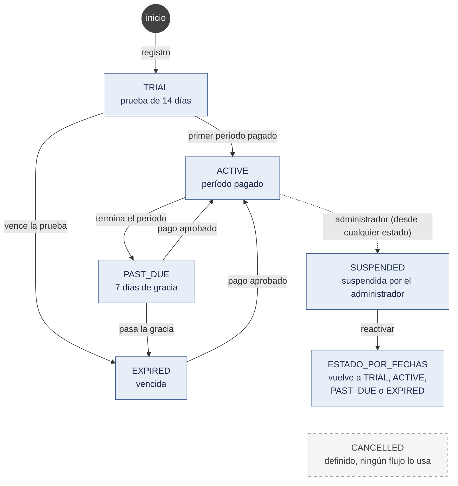
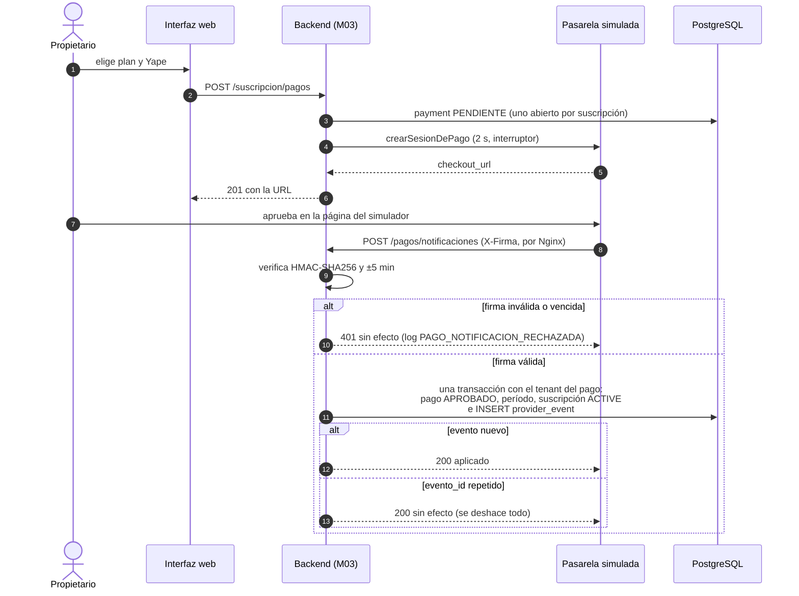
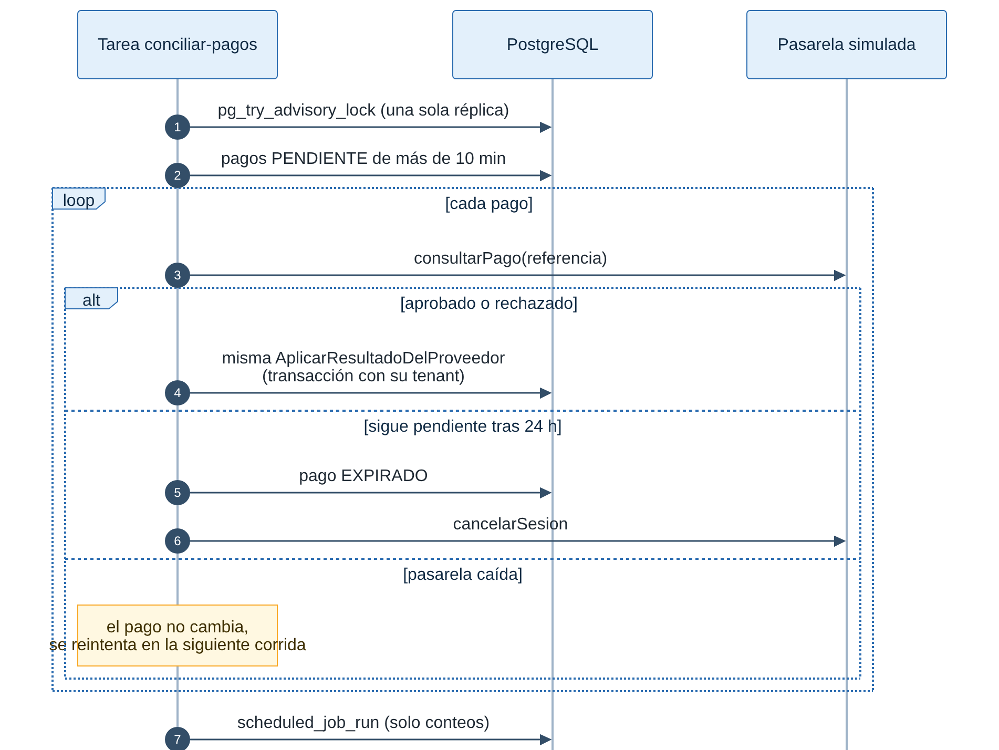
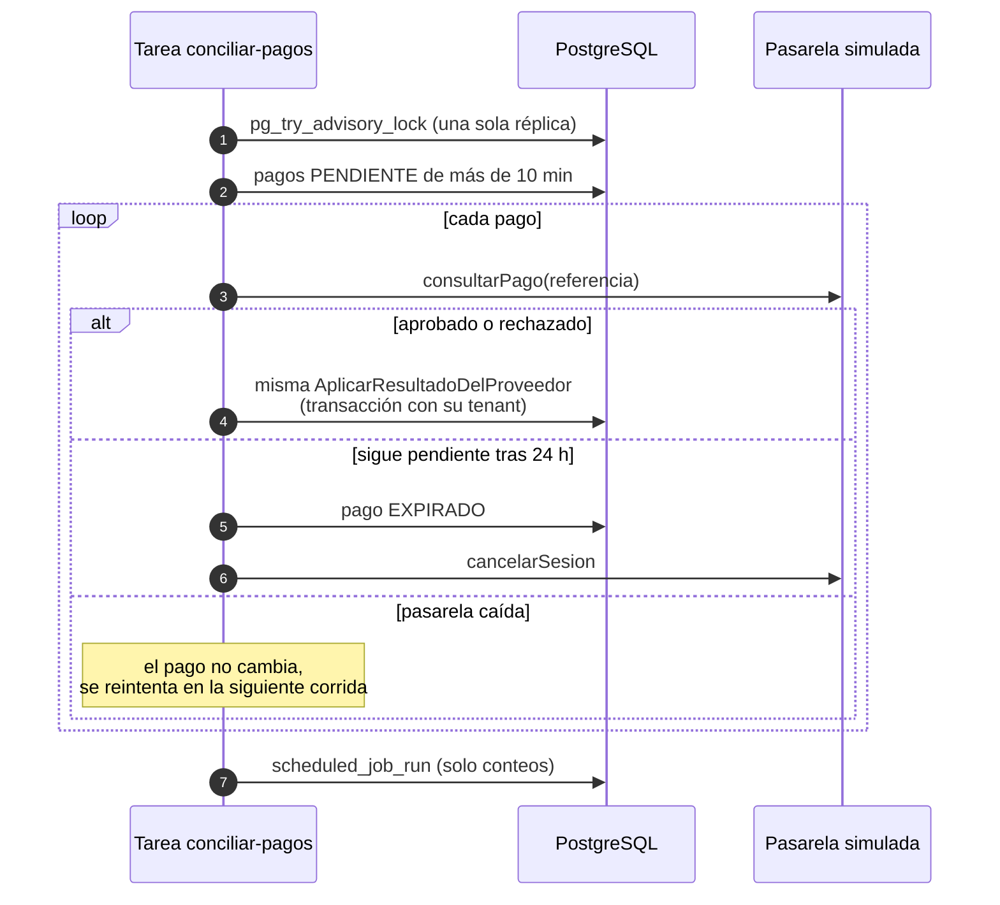
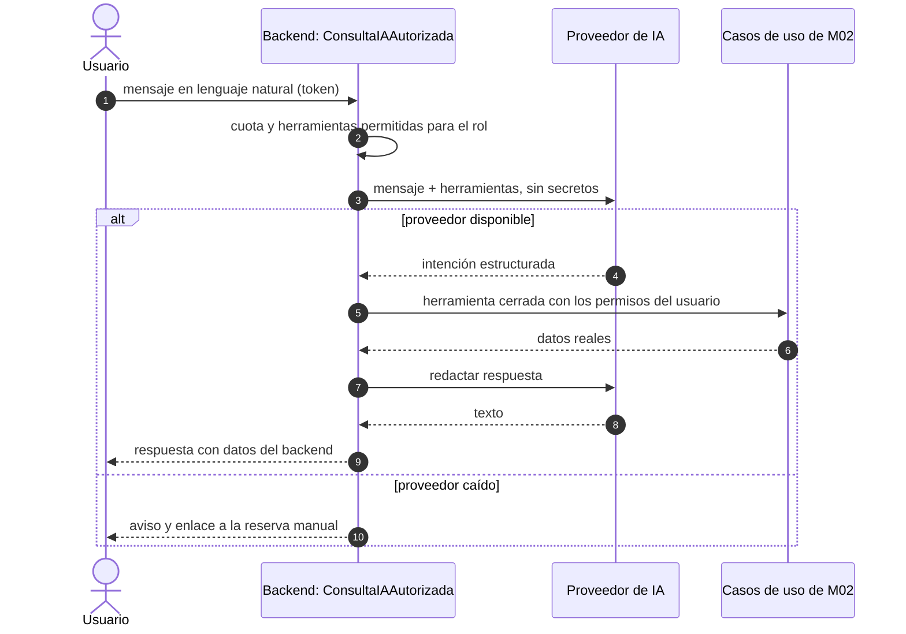
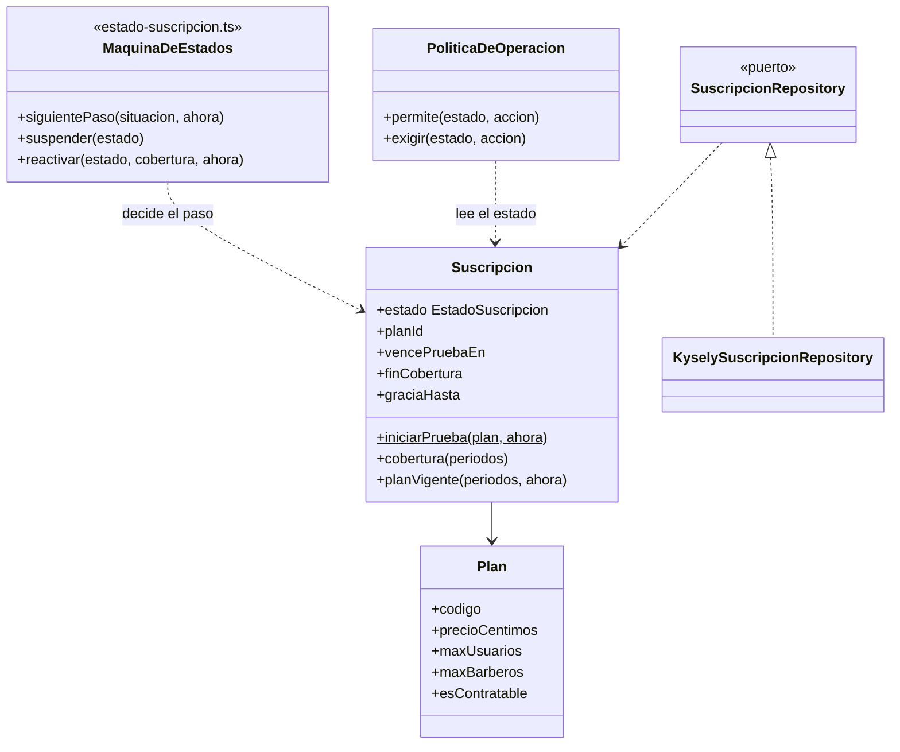
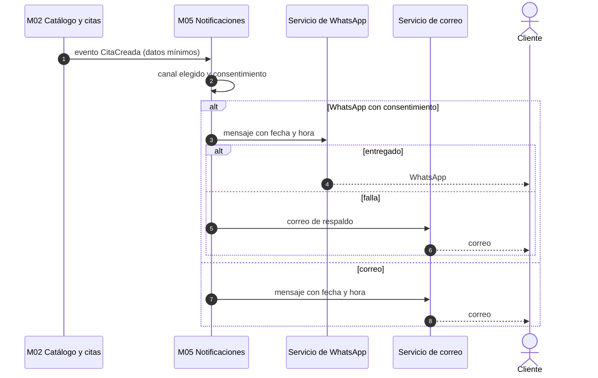
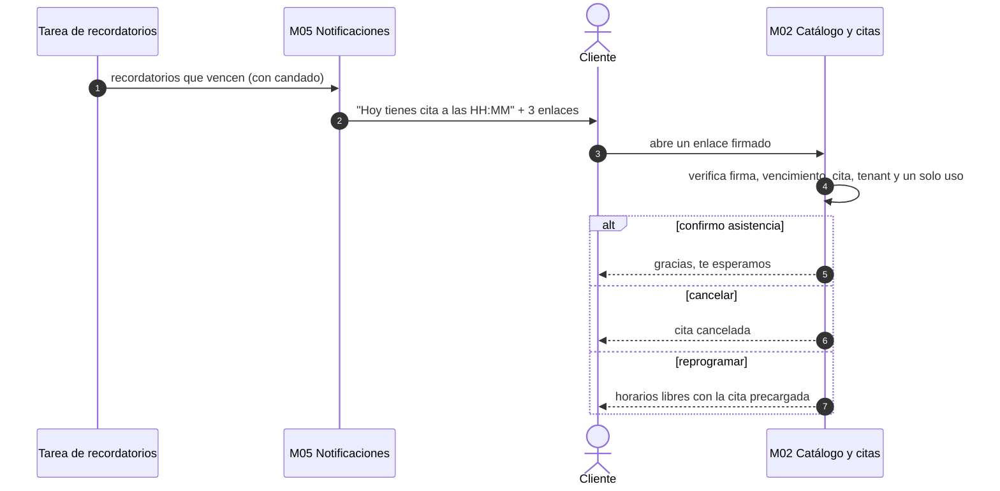

# Diseño interno de los módulos críticos

**Arquitectura** es la estructura general, los componentes principales y sus decisiones ([componentes](../../02-arquitectura-software/componentes-arquitectonicos.md)). **Diseño de software** es el nivel de clases, métodos, responsabilidades, interfaces y colaboración. Se complementan: este documento baja un nivel.

Flujo interno común: **Controlador → Caso de uso → Entidad → Repositorio (puerto) → Infraestructura (adaptador)**.

| Submódulo             | Estado                                    | Secciones |
| --------------------- | ----------------------------------------- | --------- |
| `citas` (M02)         | Implementado (002)                        | 1         |
| `suscripciones` (M03) | Implementado (001 y 003)                  | 2 y 5     |
| `pagos` (M03)         | Implementado (003), con pasarela simulada | 3         |
| `asistente` (M04)     | **Planificado** (005)                     | 4         |
| M05 Notificaciones    | **Planificado** (004)                     | 7         |

Los nombres de las secciones 1, 2, 3 y 5 son clases reales de `backend/src/modules/`. Los de las secciones 4 y 7 son el **diseño propuesto**: todavía no hay código.

Convención de color de los diagramas: azul grisáceo = sistema propio; naranja = sistema externo; azul claro = datos; borde gris discontinuo = elemento definido que todavía no se usa.

## 1. Submódulo `citas` (M02 Catálogo y citas)

| Elemento                                                                                              | Capa                | Responsabilidad                                                                                                                                      |
| ----------------------------------------------------------------------------------------------------- | ------------------- | ---------------------------------------------------------------------------------------------------------------------------------------------------- |
| `CitasController`, `AgendaController`, `HistorialController`                                          | Presentación        | Validan el formato (DTO), toman el actor del token y llaman al caso de uso                                                                           |
| `ConsultarHorarios` (submódulo `catalogo`)                                                            | Aplicación          | Calcula los horarios libres de un servicio con los tramos, los bloqueos y las citas activas del día                                                  |
| `ReservarCita`                                                                                        | Aplicación          | Orquesta: permiso, `SuscripcionesApi.exigirOperacion(RESERVAR)`, servicio y barbero activos, horario de atención, crea la `Cita`, la guarda y audita |
| `CancelarCita`, `CambiarEstadoCita`, `ConsultarAgenda`, `ConsultarHistorial`                          | Aplicación          | Cancelación con antelación (tardía), transiciones con historial, agenda con marca de conflicto e historial del cliente                               |
| `Cita`                                                                                                | Dominio             | Entidad con tenant, barbero, servicio, cliente, rango horario y estado                                                                               |
| `EstadoCita`, `MarcaConflicto`                                                                        | Dominio             | Transiciones válidas; marca "en conflicto" calculada al leer                                                                                         |
| `CitaRepository`                                                                                      | Aplicación (puerto) | `guardar`, `buscarPorIdempotencia`, `buscarParaActualizar`, `actualizarEstado`, `delRango`, `delCliente`                                             |
| `CitaRepositoryPostgres`                                                                              | Infraestructura     | Implementa el puerto; traduce `appointment_no_overlap_barber` a `HorarioNoDisponible` y `appointment_no_overlap_customer` a `CitaSolapadaDelCliente` |
| `CatalogQuery` (submódulo `catalogo`), `BarberiasApi` y `ClientesApi` (M01), `SuscripcionesApi` (M03) | Interfaces          | Consultadas desde `ReservarCita`                                                                                                                     |

### 1.1 Estados de la cita

_Figura 1. Estados de la cita._

Código fuente del diagrama (Mermaid)

Leyenda: gris discontinuo = estado definido en la base y en el dominio, pero que ningún flujo crea todavía.

Toda cita nueva nace `CONFIRMADA` (FR-035a de 002); `PENDIENTE` y la transición `aprobar` quedan para una futura "reserva con aprobación". El cliente cancela hasta la hora de inicio; el propietario, siempre. `COMPLETADA` y `NO_ASISTIO` se marcan desde la hora de inicio. La reprogramación (RF13, planificada en 004) no será una transición: se cancela y se reserva de nuevo. `COMPLETADA`, `NO_ASISTIO` y `CANCELADA` son finales; cualquier otra transición lanza `TransicionInvalida` (422 `TRANSICION_INVALIDA`). Cada cambio, incluida la creación, deja una fila en `appointment_status_history` en la misma transacción, con la fila de la cita bloqueada (`FOR UPDATE`).

Solo `PENDIENTE` y `CONFIRMADA` ocupan el horario. Dos restricciones de exclusión de PostgreSQL sobre `period tstzrange [)` usan esos estados (principio IV):

- `appointment_no_overlap_barber`: nunca dos citas activas del mismo barbero que se solapen (→ 409 `HORARIO_NO_DISPONIBLE`);
- `appointment_no_overlap_customer`: un cliente no tiene dos citas activas que se solapen (→ 409 `CITA_SOLAPADA_DEL_CLIENTE`).

**Cancelación tardía (FR-038 de 002):** la del cliente con menos antelación que la mínima de la barbería se acepta y queda marcada (`late_cancellation`); la del propietario, nunca.

**Marca "en conflicto" (FR-016 y FR-005 de 002):** no se guarda. La agenda la calcula al leer (`MarcaConflicto`) comparando cada cita activa con los bloqueos y los tramos vigentes del día.

Evidencia: `backend/src/modules/catalogo-citas/citas/domain/estado-cita.ts`, `citas/domain/cita.ts`, `citas/domain/marca-conflicto.ts`, `backend/migrations/0011_citas.ts`; pruebas `backend/test/unit/citas/transiciones.spec.ts` e `integration/citas/agenda-estados.spec.ts`.

### 1.2 Secuencia de reserva

_Figura 2. Reserva de una cita (implementado)._

Código fuente del diagrama (Mermaid)

El controlador (`CitasController`) y el repositorio (`CitaRepositoryPostgres`) se omiten para que se lea de un vistazo. No se publica ningún evento: el aviso al cliente está planificado en 004.

Evidencia: `backend/src/modules/catalogo-citas/citas/presentation/citas.controller.ts`, `citas/application/reservar-cita.ts`, `citas/infrastructure/`; pruebas `backend/test/integration/citas/reservar.spec.ts` y `concurrencia-reservas.spec.ts` (PR16: 200 solicitudes simultáneas, una sola cita).

## 2. Submódulo `suscripciones` (M03 Suscripciones y pagos)

| Elemento                                                                                               | Capa                         | Responsabilidad                                                                                                    |
| ------------------------------------------------------------------------------------------------------ | ---------------------------- | ------------------------------------------------------------------------------------------------------------------ |
| `SuscripcionController`                                                                                | Presentación                 | Planes, estado de la suscripción y estado operativo                                                                |
| `IniciarPruebaGratuita`, `AvanzarSuscripcion`, `VencerSuscripciones`, `ExigirOperacion`, `PlanVigente` | Aplicación                   | Prueba gratuita al registrar; transiciones automáticas; tarea de vencimiento; restricción por estado; plan vigente |
| `SuspenderSuscripcion`, `ReactivarSuscripcion`, `ActivacionManual` (submódulo `plataforma`)            | Aplicación                   | Operaciones del administrador sobre una barbería                                                                   |
| `Suscripcion`, `Plan`                                                                                  | Dominio                      | Entidades con estado, fechas y límites del plan                                                                    |
| `estado-suscripcion.ts` (`siguientePaso`, `suspender`, `reactivar`), `periodo.ts`                      | Dominio                      | Máquina de estados por fechas y cobertura (prueba y períodos pagados); 7 días de gracia                            |
| `PoliticaDeOperacion`                                                                                  | Dominio                      | Qué acciones permite cada estado (sección 2.2)                                                                     |
| `SuscripcionesApi`                                                                                     | Interfaz pública del módulo  | `exigirOperacion(tenant, acción)`, estado operativo, prueba gratuita                                               |
| `SuscripcionRepository` / `KyselySuscripcionRepository`                                                | Aplicación / Infraestructura | Persistencia con bloqueo de fila                                                                                   |

### 2.1 Flujo de suscripción

_Figura 3. Estados de la suscripción._

Código fuente del diagrama (Mermaid)

Leyenda: gris discontinuo = estado que existe en la base y en el dominio, pero al que ningún flujo lleva todavía (no hay una operación "cancelar suscripción"). `ESTADO_POR_FECHAS` significa que, al reactivar, la suscripción vuelve a TRIAL, ACTIVE, PAST_DUE o EXPIRED según su cobertura; los días suspendidos no se devuelven.

Las transiciones automáticas las aplica la tarea `vencer-suscripciones` y la aprobación de un pago, de a un paso y con la fecha que les correspondía (cada paso se audita). Cambiar de plan es pagar el período siguiente con otro plan.

Evidencia: `backend/src/modules/suscripciones-pagos/suscripciones/domain/estado-suscripcion.ts` y `periodo.ts`, `suscripciones/application/vencer-suscripciones.ts`, `plataforma/application/suscripciones-plataforma.ts`; pruebas `backend/test/unit/suscripciones/estado-suscripcion.spec.ts`, `periodos.spec.ts`, `integration/tareas/vencimiento.spec.ts` y `vencimiento-dos-replicas.spec.ts`.

### 2.2 Qué permite cada estado

| Estado    | Reservar | Gestionar citas existentes | Configurar catálogo | Gestionar usuarios | Pagar |
| --------- | -------- | -------------------------- | ------------------- | ------------------ | ----- |
| TRIAL     | Sí       | Sí                         | Sí                  | Sí                 | Sí    |
| ACTIVE    | Sí       | Sí                         | Sí                  | Sí                 | Sí    |
| PAST_DUE  | Sí       | Sí                         | Sí                  | Sí                 | Sí    |
| EXPIRED   | **No**   | Sí                         | **No**              | **No**             | Sí    |
| CANCELLED | **No**   | Sí                         | **No**              | **No**             | Sí    |
| SUSPENDED | **No**   | Sí                         | **No**              | **No**             | Sí    |

Las lecturas nunca se restringen. Una acción no permitida responde 403 `SUSCRIPCION_NO_PERMITE`. Aparte de la suscripción, el administrador puede suspender **la barbería** (`tenant.status = SUSPENDIDA`): entonces nadie de esa barbería puede iniciar sesión y su enlace público responde "barbería no disponible". Los datos nunca se borran por cambiar de estado.

Evidencia: `backend/src/modules/suscripciones-pagos/suscripciones/domain/politica-de-operacion.ts`; contrato `specs/003-suscripciones-pagos/contracts/restricciones-estado.md`; prueba `backend/test/integration/suscripciones/restricciones-estado.spec.ts` (PR25, celda por celda).

## 3. Submódulo `pagos` (M03 Suscripciones y pagos)

| Elemento                                                                                                  | Capa                         | Responsabilidad                                                                                                                                                      |
| --------------------------------------------------------------------------------------------------------- | ---------------------------- | -------------------------------------------------------------------------------------------------------------------------------------------------------------------- |
| `SuscripcionController`                                                                                   | Presentación                 | Inicia el pago, historial, detalle y comprobante (con sesión del propietario)                                                                                        |
| `NotificacionesController`                                                                                | Presentación                 | `POST /pagos/notificaciones`: recibe el aviso **sin token de usuario** y entrega el cuerpo crudo y los encabezados al caso de uso                                    |
| `IniciarPago`                                                                                             | Aplicación                   | Crea el pago (Yape o transferencia), reutiliza el abierto si es el mismo intento y pide la sesión de pago al `PaymentGateway`                                        |
| `RecibirNotificacion`                                                                                     | Aplicación                   | Verifica la firma, encuentra el tenant por la referencia y aplica el resultado con el evento en **una** transacción                                                  |
| `AplicarResultadoDelProveedor`                                                                            | Aplicación                   | Única función que aplica un resultado: la usan la notificación, la conciliación, la revisión del comprobante y la activación manual                                  |
| `ConciliarPagos`, `ExpirarTransferencias`                                                                 | Aplicación                   | Tareas programadas: consultan los pendientes de más de 10 min y expiran los de 24 h; expiran transferencias sin comprobante a los 7 días                             |
| `SubirComprobante`; `RevisarComprobante` y `ResolverRevision` (submódulo `plataforma`)                    | Aplicación                   | Transferencia con comprobante revisado por el administrador                                                                                                          |
| `Pago`                                                                                                    | Dominio                      | Estados PENDIENTE, ESPERANDO_COMPROBANTE, EN_REVISION, APROBADO, RECHAZADO, ANULADO, EXPIRADO y sus transiciones                                                     |
| `PaymentGateway`                                                                                          | Aplicación (puerto)          | `crearSesionDePago`, `consultarPago`, `cancelarSesion`, `verificarNotificacion`, `limitesYape`                                                                       |
| `PasarelaSimuladaAdapter`                                                                                 | Infraestructura              | Habla por HTTP con `backend/simulador-pagos/`; tiempo límite de 2 s e interruptor. El adaptador real (`culqi`) **no existe**: `fabrica-pasarela.ts` lo rechaza (R15) |
| `PagoRepository`, `EventoProveedorRepository` / `KyselyPagoRepository`, `KyselyEventoProveedorRepository` | Aplicación / Infraestructura | Persistencia; `provider_event.event_id` como clave de idempotencia                                                                                                   |

### 3.1 Pago con Yape (pasarela simulada) y notificación firmada

_Figura 4. Pago de la suscripción con la pasarela simulada (implementado)._

Código fuente del diagrama (Mermaid)

Leyenda: todo lo de esta secuencia está implementado; la pasarela es el simulador de `backend/simulador-pagos/` (sistema externo simulado). La confirmación nunca la da el navegador al volver: solo la notificación firmada o la conciliación. Con la pasarela caída o lenta, el propietario recibe 503 `PAGO_EN_LINEA_NO_DISPONIBLE` en 3 s o menos y puede pagar por transferencia.

Evidencia: `backend/src/modules/suscripciones-pagos/pagos/application/iniciar-pago.ts`, `recibir-notificacion.ts`, `aplicar-resultado.ts`, `pagos/presentation/notificaciones.controller.ts`, `pagos/infrastructure/pasarela-simulada.adapter.ts`, `backend/simulador-pagos/firma.ts`; pruebas `backend/test/integration/pagos/notificaciones.spec.ts` (PR17), `iniciar-pago.spec.ts`, `proveedor-caido.spec.ts` (PR06) y `gateway-simulado.spec.ts` (PR20).

### 3.2 Conciliación de pagos pendientes

_Figura 5. Conciliación: la tarea programada recupera los pagos cuya notificación no llegó (implementado)._

Código fuente del diagrama (Mermaid)

La tarea corre cada `TAREAS_INTERVALO_MS` (5 min por defecto) en las dos réplicas; el candado hace que solo una procese cada ciclo. Si la notificación llega a la vez que la conciliación, el bloqueo de la fila y la transición condicional dejan un solo efecto.

Evidencia: `backend/src/modules/suscripciones-pagos/pagos/application/conciliar-pagos.ts`, `backend/src/shared/tareas/ejecutor-tareas.ts`, `shared/persistence/tareas-postgres.ts`, `backend/src/host/tareas.ts`, `backend/migrations/0017_tareas.ts`; pruebas `backend/test/integration/pagos/conciliacion.spec.ts`, `tareas/ejecutor-postgres.spec.ts` y `test/unit/shared/ejecutor-tareas.spec.ts`.

## 4. Submódulo `asistente` (M04 Asistente IA y reportes)

**Planificado (005). No hay código de este submódulo.** La tabla y el diagrama son el diseño propuesto ([ADR-008](../../01-analisis-de-sistema/07-decisiones-arquitectonicas.md)); los nombres se confirmarán en la especificación de 005.

| Elemento propuesto                                   | Capa                | Responsabilidad                                                                  |
| ---------------------------------------------------- | ------------------- | -------------------------------------------------------------------------------- |
| `AsistenteController`                                | Presentación        | Recibe el mensaje; la cuota se aplica antes                                      |
| `ConsultaIAAutorizada`                               | Aplicación          | Orquesta: contexto → intención estructurada → herramienta cerrada → respuesta    |
| `HerramientaIA` (interfaz)                           | Aplicación          | `nombre`, `rolesPermitidos`, `esSensible`, `ejecutar(params, contexto)`          |
| Herramientas (consultar servicios y horarios libres) | Aplicación          | Llaman a casos de uso existentes de M02 (`ConsultarHorarios`, `ListarServicios`) |
| `AIProvider`                                         | Aplicación (puerto) | `interpretar(mensaje, herramientasPermitidas)`, `redactarRespuesta(resultados)`  |
| Adaptador del proveedor y simulador                  | Infraestructura     | Proveedor de IA sin elegir                                                       |

### 4.1 Secuencia del asistente (planificada)

_Figura 6. Secuencia propuesta del asistente de IA (planificado, 005)._

Código fuente del diagrama (Mermaid)

Leyenda: todo este diagrama está **planificado**. Reglas propuestas: la IA nunca recibe SQL ni acceso a la base; la disponibilidad siempre viene del cálculo de M02; una reserva solo se confirma con `ReservarCita` tras confirmación explícita del usuario.

Evidencia: solo diseño, sin código. Decisión en ADR-008 (Propuesto) y requisitos RF27 y RF28.

## 5. Clases del submódulo `suscripciones` (resumen)

_Figura 7. Clases principales del submódulo `suscripciones` (implementado)._

Código fuente del diagrama (Mermaid)

Leyenda: todo implementado. `MaquinaDeEstados` no es una clase: agrupa las funciones puras de `estado-suscripcion.ts`. Los planes son datos, no subclases: TRIAL (14 días, 5 usuarios y 5 barberos), BASICO (S/ 49, 3 y 3) y PRO (S/ 89, 8 y 8), sembrados por las migraciones 0004 y 0014.

Evidencia: `backend/src/modules/suscripciones-pagos/suscripciones/domain/suscripcion.ts`, `plan.ts`, `estado-suscripcion.ts`, `politica-de-operacion.ts`, `suscripciones/application/ports/suscripcion-repository.ts`, `suscripciones/infrastructure/`; `backend/migrations/0004_suscripciones.ts` y `0014_planes_y_suscripcion.ts`; prueba `backend/test/unit/suscripciones/politica-de-operacion.spec.ts`.

## 6. Módulos no críticos

`identidad`, `barberias`, `clientes` y `catalogo` siguen el mismo flujo con casos de uso delgados (ver la simplificación proporcional en [enfoque](../../02-arquitectura-software/enfoque-arquitectonico.md#6-justificación-honesta-frente-al-criterio-de-la-guía)). El submódulo `reportes` (M04) está planificado.

## 7. M05 Notificaciones

**Planificado (004). No hay código de este módulo.** El cliente recibirá la **fecha y hora de su cita** por correo o por WhatsApp, según el canal que elija (RF30, RF33, HU25). Decisión: [ADR-013](../../01-analisis-de-sistema/07-decisiones-arquitectonicas.md#adr-013-notificaciones-multicanal-al-cliente-correo-y-whatsapp) (Propuesto). Los nombres de abajo son el diseño propuesto.

| Elemento propuesto                       | Capa                          | Responsabilidad                                                                                      |
| ---------------------------------------- | ----------------------------- | ---------------------------------------------------------------------------------------------------- |
| Manejador de eventos de cita             | Aplicación                    | Escucha `CitaCreada` y `CitaCancelada`; crea los envíos inmediatos y programa el recordatorio        |
| `EnviarNotificacion`                     | Aplicación                    | Elige el canal, aplica la plantilla, envía por el puerto y registra el resultado                     |
| Tarea de recordatorios                   | Aplicación                    | Reutiliza el `EjecutorTareas` de M06 y su candado (ADR-024) para que dos réplicas no envíen el mismo |
| `NotificationChannel`                    | Aplicación (puerto)           | `enviar(destinatario, mensaje)`                                                                      |
| Adaptadores de correo y `WhatsAppSender` | Infraestructura (adaptadores) | Implementan el puerto; protegidos por el `Interruptor` de M06                                        |

**Dependencias propuestas.** M05 solo dependerá de M06. El evento de M02 llevará los datos mínimos de contacto y de la cita.

_Figura 8. Notificación de una cita al cliente (planificado, 004)._

Código fuente del diagrama (Mermaid)

Leyenda: todo este diagrama está **planificado**. Reglas propuestas: el envío es asíncrono y nunca revierte la reserva; WhatsApp solo con número y consentimiento expreso; los mensajes solo llevan barbería, servicio, fecha y hora; las condiciones de WhatsApp (plantillas, costos) están por verificar con el proveedor.

Evidencia: solo diseño, sin código. Requisitos RF30 y RF33; ADR-012 y ADR-013 (Propuestos).

### 7.1 Recordatorio del día de la cita y respuesta del cliente

**Planificado (004).** El mismo día de la cita (propuesta: 2 horas antes, configurable por barbería) el sistema avisará al cliente y le preguntará si podrá asistir (RF34, HU28).

| Acción del enlace       | Qué ocurrirá                                                  | Reglas propuestas                                                        |
| ----------------------- | ------------------------------------------------------------- | ------------------------------------------------------------------------ |
| **Confirmo asistencia** | Se registra la confirmación; la agenda del barbero la muestra | No cambia el estado de la cita                                           |
| **Cancelar**            | `CancelarCita` pasa la cita a CANCELADA y libera el horario   | Mismas reglas que hoy, incluida la cancelación tardía                    |
| **Reprogramar**         | Abre los horarios libres con la cita precargada               | Misma validación y restricción de exclusión que una reserva nueva (RF13) |
| Sin respuesta           | La cita **no se cancela automáticamente**                     | Una cancelación automática sería evolución futura                        |

Los enlaces serán de un solo uso, firmados, con vencimiento al inicio de la cita y limitados a esa cita y a su tenant. Las tablas y columnas que necesiten (por ejemplo, el registro de enlaces usados) se definirán en la especificación de 004; hoy no existen.

_Figura 9. Recordatorio del día y respuesta del cliente (planificado, 004)._

Código fuente del diagrama (Mermaid)

Leyenda: todo este diagrama está **planificado**.

Evidencia: solo diseño, sin código. Requisito RF34 e historia HU28.
