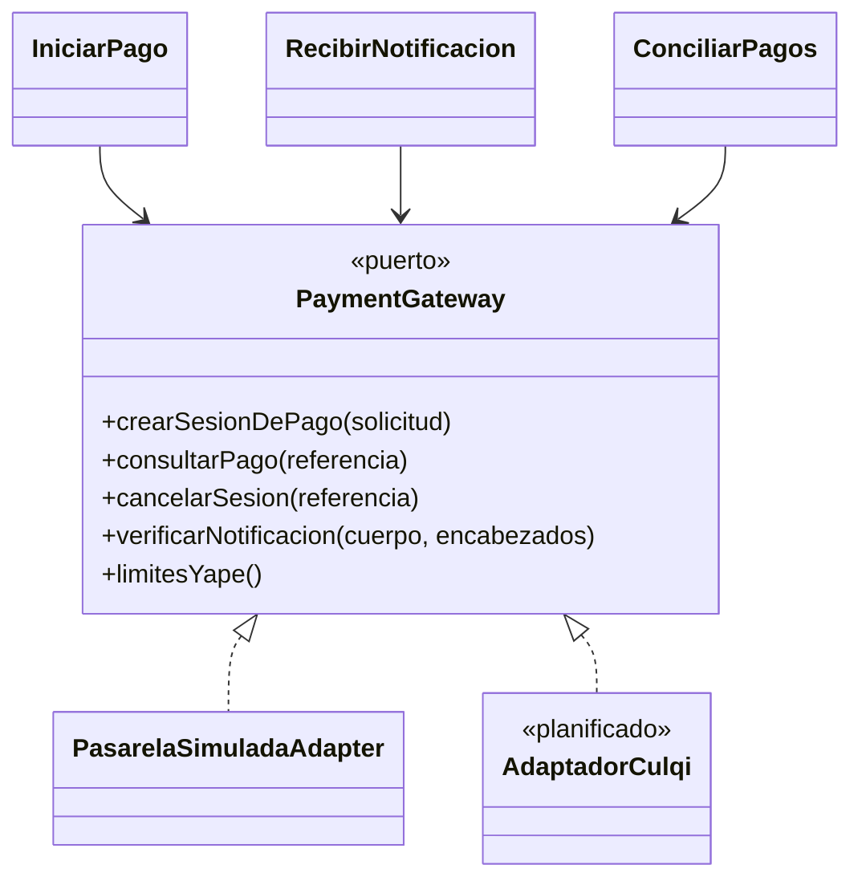

# Patrones de diseño

Un patrón de diseño es una solución reutilizable a un problema recurrente de diseño. Se aplican **solo donde resuelven un problema real** del proyecto (ver ADR-011 sobre proporcionalidad).

Lo marcado _(planificado)_ todavía no tiene código; el resto está en `backend/src/`.

| Patrón                                                    | Problema                                                                             | Solución                                                                                  | Dónde se aplica                                                                                                                                 | Requisito / EQ |
| --------------------------------------------------------- | ------------------------------------------------------------------------------------ | ----------------------------------------------------------------------------------------- | ----------------------------------------------------------------------------------------------------------------------------------------------- | -------------- |
| **Repository**                                            | La lógica no debe conocer SQL ni el ORM                                              | Interfaz de acceso a agregados implementada en infraestructura                            | `CitaRepository`, `SuscripcionRepository`, `PagoRepository` (implementados con Kysely)                                                          | EQ-09, EQ-14   |
| **Adapter**                                               | El proveedor externo tiene su propia API; la aplicación necesita un contrato estable | Un adaptador traduce el contrato propio al del proveedor                                  | `PasarelaSimuladaAdapter` → `PaymentGateway`; `RedisCacheCompartida` → `CacheCompartida`; `AIProvider` y `NotificationChannel` _(planificados)_ | EQ-14, EQ-20   |
| **Factory**                                               | Crear la implementación adecuada según la configuración                              | Función que entrega el adaptador según `PAGOS_PROVEEDOR`                                  | `crearPasarela` en `pagos/infrastructure/fabrica-pasarela.ts` (hoy solo `simulado`; `culqi` aún no existe)                                      | EQ-20          |
| **Facade / servicio de aplicación**                       | El controlador no debe orquestar varios pasos                                        | Caso de uso que coordina entidades, repositorios y puertos y expone una operación simple  | `ReservarCita`, `IniciarPago`, `RecibirNotificacion`                                                                                            | RF12, RF24     |
| **State** (variante simple)                               | El comportamiento depende del estado de la cita, la suscripción o el pago            | Funciones puras con la tabla de transiciones válidas                                      | `estado-cita.ts`, `estado-suscripcion.ts`, `pago.ts`; las reglas por estado en `PoliticaDeOperacion`                                            | RF15, RF22     |
| **Circuit Breaker**                                       | Un servicio externo lento o caído arrastra a todo el sistema                         | Tras N fallos el circuito se abre y se responde con alternativa; luego se prueba de nuevo | `Interruptor` (M06), usado por el adaptador de pagos y por Redis; IA _(planificado)_                                                            | EQ-05, EQ-06   |
| **Idempotent Receiver**                                   | La notificación del proveedor puede repetirse                                        | Clave primaria por identificador de evento y transiciones condicionadas                   | `provider_event.event_id`; `Idempotency-Key` de `POST /citas`                                                                                   | EQ-17, EQ-16   |
| **Unit of Work**                                          | Fijar el tenant y confirmar o deshacer todo junto                                    | Una transacción por caso de uso, con `app.tenant_id` y acciones después del COMMIT        | `UnitOfWork` / `KyselyUnitOfWork` (M06), `alConfirmar` para invalidar la caché                                                                  | EQ-09, EQ-16   |
| **Observer / eventos de dominio** _(planificado, 004)_    | Reaccionar a hechos sin acoplar módulos                                              | Bus de eventos en proceso                                                                 | `CitaCreada` → M05. Hoy no hay eventos: el pago aprobado actualiza la suscripción en la misma transacción                                       | EQ-14          |
| **CORS** (mecanismo del navegador, política del servidor) | El navegador bloquea llamadas entre orígenes distintos                               | Lista explícita de orígenes permitidos                                                    | `app.enableCors` en `backend/src/main.ts` (`CORS_ORIGIN`)                                                                                       | RC03, EQ-10    |

La variante **Strategy** por plan (una clase por plan) que se había propuesto **no se usó**: los planes son filas de la tabla `plan` con sus límites, y una sola clase `Plan` las lee.

## Ejemplo: puerto y adaptador de pagos

_Figura 1. Puerto `PaymentGateway` con su adaptador simulado (implementado) y el real (planificado)._

Código fuente del diagrama (Mermaid)

Leyenda: gris discontinuo = adaptador pendiente (el adaptador real depende de credenciales y de confirmar Yape, R15). Agregar otro proveedor consiste en escribir un nuevo adaptador y cambiar `PAGOS_PROVEEDOR`, sin modificar los casos de uso (EQ-14). La misma suite de contrato (PR20) se ejecuta contra cada adaptador.

Evidencia: `backend/src/modules/suscripciones-pagos/pagos/application/ports/payment-gateway.ts`, `pagos/infrastructure/pasarela-simulada.adapter.ts`, `pagos/infrastructure/fabrica-pasarela.ts`; pruebas `backend/test/integration/pagos/gateway-simulado.spec.ts` y `gateway-sandbox.spec.ts` (omitida sin credenciales).

## Patrones que se evitan

| Patrón                                    | Motivo                                                        |
| ----------------------------------------- | ------------------------------------------------------------- |
| Singleton global con estado               | Impide pruebas y rompe la ausencia de estado entre instancias |
| Active Record en el dominio               | Acopla el dominio a la base de datos                          |
| Capas de abstracción sin riesgo de cambio | Sobreingeniería para un equipo pequeño (ADR-011)              |
