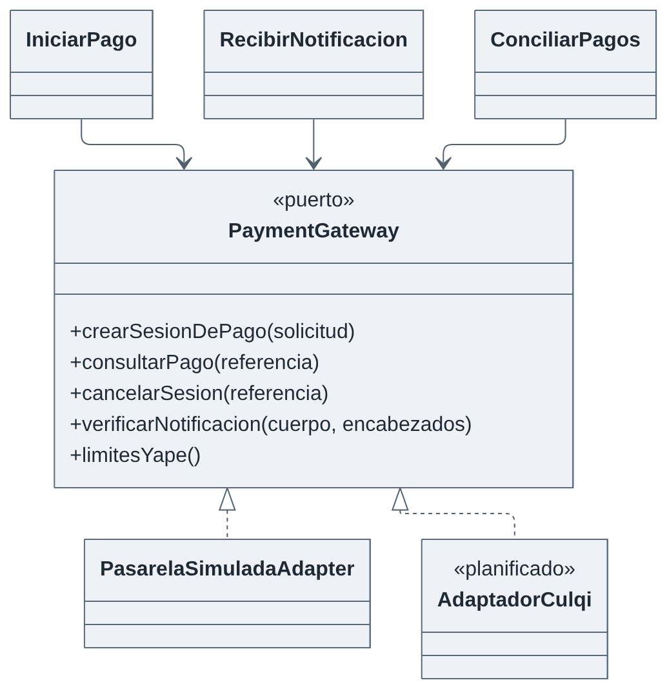
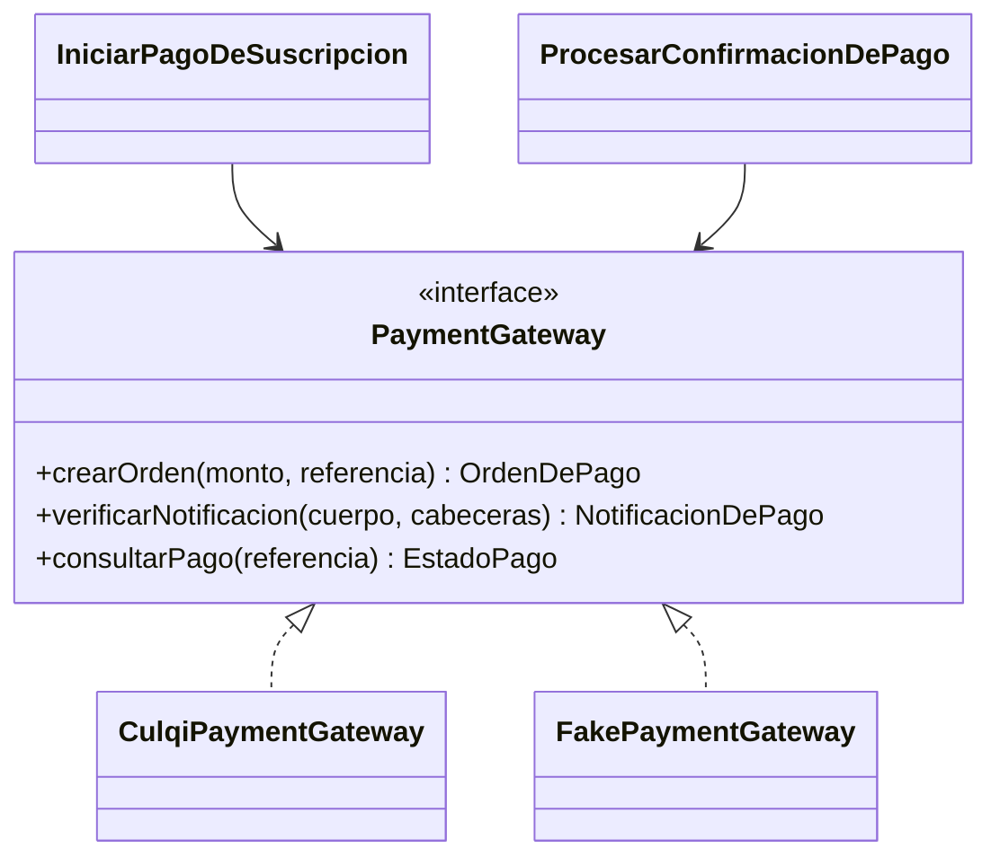

# Patrones de diseño

Un patrón de diseño es una solución reutilizable a un problema recurrente de diseño. Se aplican **solo donde resuelven un problema real** del proyecto (ver ADR-011 sobre proporcionalidad). Estado: planificado.

| Patrón                                                    | Problema                                                                             | Solución                                                                                  | Dónde se aplica                                                                                             | Requisito / EQ |
| --------------------------------------------------------- | ------------------------------------------------------------------------------------ | ----------------------------------------------------------------------------------------- | ----------------------------------------------------------------------------------------------------------- | -------------- |
| **Repository**                                            | La lógica no debe conocer SQL ni el ORM                                              | Interfaz de acceso a agregados implementada en infraestructura                            | `CitaRepository`, `SubscriptionRepository`, `PagoRepository`                                                | EQ-09, EQ-14   |
| **Adapter**                                               | El proveedor externo tiene su propia API; la aplicación necesita un contrato estable | Un adaptador traduce el contrato propio al del proveedor                                  | `CulqiPaymentGateway` → `PaymentGateway`; `LlmAIProvider` → `AIProvider`; `SmtpEmailSender` → `EmailSender` | EQ-14, EQ-20   |
| **Factory**                                               | Crear la implementación adecuada según la configuración                              | Fábrica que entrega el adaptador (real o simulado) y la `PlanPolicy` del plan             | `PaymentGatewayFactory`, `PlanPolicyFactory`                                                                | EQ-20          |
| **Facade / servicio de aplicación**                       | El controlador no debe orquestar varios pasos                                        | Caso de uso que coordina entidades, repositorios y puertos y expone una operación simple  | `ReservarCita`, `ProcesarConfirmacionDePago`                                                                | RF12, RF24     |
| **Strategy**                                              | Las reglas cambian según el plan                                                     | Una interfaz con una implementación por plan                                              | `PlanPolicy` (`PlanPrueba`, `PlanBasico`, `PlanProfesional`)                                                | RF21           |
| **State** (variante simple)                               | El comportamiento depende del estado de la cita/suscripción                          | Enumeración con tabla de transiciones válidas dentro de la entidad                        | `EstadoCita`, `EstadoSuscripcion`, `EstadoPago`                                                             | RF15, RF22     |
| **Circuit Breaker**                                       | Un servicio externo lento o caído arrastra a todo el sistema                         | Tras N fallos el circuito se abre y se responde con alternativa; luego se prueba de nuevo | Adaptadores de pagos, IA y Redis                                                                            | EQ-05, EQ-06   |
| **Observer / eventos de dominio**                         | Reaccionar a hechos sin acoplar módulos                                              | Bus de eventos en proceso                                                                 | `PagoConfirmado` → `suscripciones` (M03); `CitaCreada` → M05                                                | EQ-14          |
| **Idempotent Receiver**                                   | Los webhooks se repiten                                                              | Índice único por identificador de evento y operaciones condicionadas                      | `webhook_event`                                                                                             | EQ-17          |
| **CORS** (mecanismo del navegador, política del servidor) | El navegador bloquea llamadas entre orígenes distintos                               | Lista explícita de orígenes, métodos y cabeceras permitidos                               | Middleware del host                                                                                         | RC03, EQ-10    |

## Ejemplo: puerto y adaptador de pagos

_Figura. Ejemplo: puerto y adaptador de pagos._

Código fuente del diagrama (Mermaid)

Agregar otro proveedor o método de pago consiste en escribir un nuevo adaptador y cambiar la configuración, sin modificar los casos de uso (EQ-14).

## Patrones que se evitan

| Patrón                                    | Motivo                                                        |
| ----------------------------------------- | ------------------------------------------------------------- |
| Singleton global con estado               | Impide pruebas y rompe la ausencia de estado entre instancias |
| Active Record en el dominio               | Acopla el dominio a la base de datos                          |
| Capas de abstracción sin riesgo de cambio | Sobreingeniería para un equipo pequeño (ADR-011)              |
