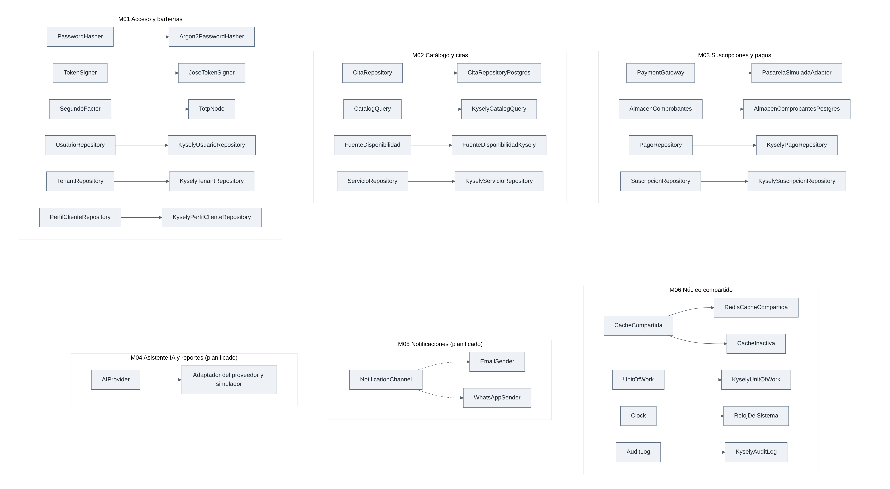
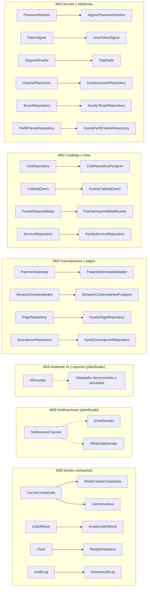

# Principios de diseño (SOLID y complementarios)

## 1. Objetivo y contexto

Este documento explica cómo se aplican los principios SOLID en la plataforma de barberías, módulo por módulo, y señala los archivos que lo demuestran.

El backend es un **monolito modular** ([ADR-001](../../01-analisis-de-sistema/07-decisiones-arquitectonicas.md#adr-001-monolito-modular)) con **Clean Architecture de cuatro capas**: presentación, aplicación, dominio e infraestructura. Tiene **seis módulos**:

| ID  | Módulo                  | Estado                                       |
| --- | ----------------------- | -------------------------------------------- |
| M01 | Acceso y barberías      | Implementado                                 |
| M02 | Catálogo y citas        | Implementado                                 |
| M03 | Suscripciones y pagos   | Implementado, con pasarela simulada          |
| M04 | Asistente IA y reportes | Planificado (005), sin código                |
| M05 | Notificaciones          | Planificado (004), sin código                |
| M06 | Núcleo compartido       | Parcial: lo que se cita aquí está implementado |

Convenciones de este documento:

- **Puerto.** En el código es una `abstract class`, no una `interface` de TypeScript, porque la interfaz no existe en tiempo de ejecución y NestJS necesita un valor para inyectar la dependencia: `{ provide: CitaRepository, useClass: CitaRepositoryPostgres }`.
- **Rutas.** Son relativas a `tecnologia/plataforma-barberias/`, salvo la de `.github/`, que es relativa a la raíz del repositorio.
- **Planificado.** M04 y M05 usan los nombres que ya están en la documentación: `AIProvider` ([ADR-008](../../01-analisis-de-sistema/07-decisiones-arquitectonicas.md)) y `NotificationChannel` ([ADR-013](../../01-analisis-de-sistema/07-decisiones-arquitectonicas.md#adr-013-notificaciones-multicanal-al-cliente-correo-y-whatsapp)). Son diseño propuesto, y sus nombres se confirmarán en la especificación de cada funcionalidad.
- **M06.** `shared/` no se divide en capas: sus puertos están junto a su adaptador o en la carpeta de cada servicio técnico. En M01, M02 y M03, en cambio, los puertos viven en `application/`.

## 2. SOLID en el proyecto

_Figura 1. Puertos de cada módulo y adaptadores que los implementan. Se muestran los más representativos; la lista completa está en la sección 4._

Código fuente del diagrama (Mermaid)

Leyenda: en cada fila, a la izquierda está el puerto y a la derecha el adaptador; la flecha se lee "lo implementa". La dependencia del código va al revés: el adaptador importa el puerto, y el puerto no conoce al adaptador. Flecha continua = existe en el código; flecha discontinua = planificado. Este diagrama no usa colores.

Evidencia: enlaces puerto-adaptador en `backend/src/modules/acceso-barberias/acceso-barberias.module.ts`, `backend/src/modules/catalogo-citas/catalogo-citas.module.ts`, `backend/src/modules/suscripciones-pagos/suscripciones-pagos.module.ts` y `backend/src/shared/shared.module.ts`; la pasarela se elige en `backend/src/modules/suscripciones-pagos/pagos/infrastructure/fabrica-pasarela.ts`. M04 y M05: solo diseño, sin código ([diseño interno §4 y §7](diseño-interno-de-modulos.md), ADR-008 y ADR-013).

## 3. Los cinco principios en el código

| Principio | Capa | Cómo se cumple en el proyecto | Archivos reales |
| --------- | ---- | ------------------------------ | ---------------- |
| **S** Responsabilidad única: una clase tiene una sola razón para cambiar | Dominio y aplicación | **M02:** `ReservarCita` coordina la reserva; `calcularHorariosLibres` solo calcula las horas libres; `Cita` guarda sus transiciones de estado. **M03:** `PoliticaDeOperacion` solo decide qué permite cada estado; `estado-suscripcion.ts` decide el siguiente estado. **M06:** `ClavesCache` es el único lugar que construye claves de caché. | `backend/src/modules/catalogo-citas/citas/application/reservar-cita.ts` `backend/src/modules/catalogo-citas/catalogo/domain/calculadora-horarios.ts` `backend/src/modules/catalogo-citas/citas/domain/cita.ts` `backend/src/modules/suscripciones-pagos/suscripciones/domain/politica-de-operacion.ts` `backend/src/modules/suscripciones-pagos/suscripciones/domain/estado-suscripcion.ts` `backend/src/shared/cache/claves-cache.ts` |
| **O** Abierto/cerrado: abierto a extensión, cerrado a modificación | Aplicación e infraestructura | **M03:** un proveedor de pagos nuevo es un adaptador nuevo de `PaymentGateway` y un caso en `crearPasarela`; los casos de uso no se editan. Un plan nuevo es una fila de `plan`. **M02:** una forma nueva de obtener la disponibilidad extiende `FuenteDisponibilidad`, sin tocar `ConsultarHorarios`. **M06:** una tarea programada nueva se registra en `backend/src/host/tareas.ts`, sin editar `EjecutorTareas`. **M05 (planificado):** un canal nuevo será un adaptador de `NotificationChannel`. | `backend/src/modules/suscripciones-pagos/pagos/infrastructure/fabrica-pasarela.ts` `backend/src/modules/suscripciones-pagos/suscripciones/domain/plan.ts` `backend/src/modules/catalogo-citas/catalogo/application/consultar-horarios.ts` `backend/src/shared/tareas/ejecutor-tareas.ts` `backend/src/host/tareas.ts` |
| **L** Sustitución de Liskov: cualquier implementación del contrato puede reemplazar a otra | Infraestructura | **M03:** `PasarelaSimuladaAdapter` cumple la suite de contrato PR20 (`probarContratoDePasarela`); el adaptador real (planificado) deberá cumplir la misma. **M06:** `shared.module.ts` entrega `RedisCacheCompartida` o `CacheInactiva` según exista `REDIS_URL`, sin que quien usa `CacheCompartida` cambie. `RelojDePrueba` sustituye a `RelojDelSistema` en las pruebas. **M02:** `ConsultarHorarios.ejecutar` recibe `FuenteDisponibilidadKysely` o una de las dos fuentes públicas de `CatalogoPublicoRepository`, y calcula igual. Solo `PaymentGateway` tiene hoy una suite de contrato escrita. | `backend/test/contract/payment-gateway.contract.ts` `backend/src/modules/suscripciones-pagos/pagos/infrastructure/pasarela-simulada.adapter.ts` `backend/src/shared/shared.module.ts` `backend/src/shared/cache/redis-cache-compartida.ts` `backend/src/shared/cache/cache-inactiva.ts` `backend/test/helpers/plataforma.ts` `backend/src/modules/catalogo-citas/catalogo/infrastructure/publico/catalogo-publico.repository.ts` |
| **I** Segregación de interfaces: interfaces pequeñas y específicas | Aplicación | **M01:** `PasswordHasher`, `TokenSigner` y `SegundoFactor` están separados; `IniciarSesion` usa el primero sin conocer los otros dos. **M02:** `ReservarCita` lee con `CatalogQuery` y guarda con `CitaRepository`; no depende de `ServicioRepository`, que es para administrar el catálogo. **M03:** `PaymentGateway`, `PagoRepository`, `EventoProveedorRepository` y `AlmacenComprobantes` están separados. **M06:** `EjecutorTareas` pide `CandadoDeTareas` y `RegistroDeCorridas` por separado. | `backend/src/modules/acceso-barberias/identidad/application/ports/password-hasher.ts` `backend/src/modules/acceso-barberias/identidad/application/ports/token-signer.ts` `backend/src/modules/acceso-barberias/identidad/application/ports/segundo-factor.ts` `backend/src/modules/catalogo-citas/catalogo/application/ports/catalog-query.ts` `backend/src/modules/catalogo-citas/catalogo/application/ports/catalogo-repositorios.ts` `backend/src/modules/suscripciones-pagos/pagos/application/ports/payment-gateway.ts` `backend/src/modules/suscripciones-pagos/pagos/application/ports/pago-repository.ts` `backend/src/modules/suscripciones-pagos/pagos/application/ports/almacen-comprobantes.ts` `backend/src/shared/tareas/ejecutor-tareas.ts` |
| **D** Inversión de dependencias: depender de abstracciones, no de implementaciones | Todas; los puertos se definen en aplicación y se implementan en infraestructura | **M02:** `ReservarCita` recibe `CitaRepository`, `CatalogQuery`, `UnitOfWork`, `Clock` y `AuditLog`; no importa PostgreSQL. **M01:** `IniciarSesion` recibe `UsuarioRepository` y `PasswordHasher`; no conoce Argon2. **M03:** `IniciarPago` recibe `PaymentGateway` y `PagoRepository`; no conoce al proveedor. **M04 (planificado):** solo llegará al modelo por `AIProvider`. El enlace con cada implementación está en los `*.module.ts`, fuera de los casos de uso. | `backend/src/modules/catalogo-citas/citas/application/reservar-cita.ts` `backend/src/modules/catalogo-citas/citas/application/ports/cita-repository.ts` `backend/src/modules/catalogo-citas/citas/infrastructure/cita-repository-postgres.ts` `backend/src/modules/acceso-barberias/identidad/application/iniciar-sesion.ts` `backend/src/modules/suscripciones-pagos/pagos/application/iniciar-pago.ts` `backend/.dependency-cruiser.cjs` |

## 4. Por módulo

Los puertos y sus adaptadores van en el mismo orden en ambas columnas.

| Módulo | Puertos o interfaces | Adaptadores | Principio que mejor ilustra |
| ------ | -------------------- | ----------- | --------------------------- |
| **M01** Acceso y barberías | **Puertos (16).** `identidad`: `UsuarioRepository`, `SesionRepository`, `ActivacionRepository`, `IntentosRepository`, `PasswordHasher`, `TokenSigner`, `SegundoFactor`, `AdminsPlataforma`, `SesionesPlataformaVigentes`, `AccesoPlataformaRepository`, `AuditoriaAccesoPlataforma`. `barberias`: `TenantRepository`, `TermsAcceptanceRepository`, `BarberiasPlataformaLectura`. `clientes`: `PerfilClienteRepository`, `ConsentimientoRepository`. **Interfaz pública hacia otros módulos (3):** `BarberiasApi`, `ClientesApi`, `PersonalApi`. | `KyselyUsuarioRepository`, `KyselySesionRepository`, `KyselyActivacionRepository`, `KyselyIntentosRepository`, `Argon2PasswordHasher`, `JoseTokenSigner`, `TotpNode`, `AdminsPlataformaLectura`, `SesionesPlataformaLectura`, `KyselyAccesoPlataforma`, `KyselyAuditoriaAccesoPlataforma`, `KyselyTenantRepository`, `KyselyTermsAcceptanceRepository`, `BarberiasPlataformaKysely`, `KyselyPerfilClienteRepository`, `KyselyConsentimientoRepository`. La interfaz pública la implementan `BarberiasApiImpl`, `ClientesApiImpl` y `PersonalApiImpl`, en la capa de aplicación. | **I:** contraseña, token y segundo factor son tres contratos distintos |
| **M02** Catálogo y citas | **Puertos (9).** `catalogo`: `ServicioRepository`, `BarberoRepository`, `HorarioRepository`, `BloqueoRepository`, `CitasActivasQuery`, `CatalogQuery`, `CatalogoPublicoQuery`, `FuenteDisponibilidad`. `citas`: `CitaRepository`. | `KyselyServicioRepository`, `KyselyBarberoRepository`, `KyselyHorarioRepository`, `KyselyBloqueoRepository`, `KyselyCitasActivasQuery`, `KyselyCatalogQuery`, `CatalogoPublicoRepository`, `FuenteDisponibilidadKysely`, `CitaRepositoryPostgres` | **S:** coordinar la reserva, calcular horarios y cambiar de estado están en piezas distintas |
| **M03** Suscripciones y pagos | **Puertos (10).** `pagos`: `PaymentGateway`, `PagoRepository`, `EventoProveedorRepository`, `UbicacionDePagos`, `AlmacenComprobantes`. `suscripciones`: `SuscripcionRepository`, `SuscripcionesPorVencer`. `plataforma`: `ColaDeComprobantesLectura`, `PagosPorRevisarLectura`, `ResumenesDeSuscripcionLectura`. | `PasarelaSimuladaAdapter`, `KyselyPagoRepository`, `KyselyEventoProveedorRepository`, `UbicacionDePagosPlataforma`, `AlmacenComprobantesPostgres`, `KyselySuscripcionRepository`, `SuscripcionesPorVencerPlataforma`, `ColaDeComprobantesPlataforma`, `PagosPorRevisarPlataforma`, `ResumenesDeSuscripcionPlataforma` | **O:** un proveedor nuevo no edita los casos de uso; **L:** la suite PR20 fija el contrato |
| **M04** Asistente IA y reportes _(planificado)_ | `AIProvider` (`interpretar`, `redactarRespuesta`) y `HerramientaIA` | Adaptador del proveedor y simulador; proveedor sin elegir | **D:** el asistente dependerá del puerto, no del proveedor |
| **M05** Notificaciones _(planificado)_ | `NotificationChannel` (`enviar(destinatario, mensaje)`) | `EmailSender` y `WhatsAppSender` (ADR-013), más un simulador del canal para las pruebas | **O:** un canal nuevo será un adaptador nuevo, sin tocar M02 |
| **M06** Núcleo compartido | **Puertos (6).** `UnitOfWork`, `AuditLog`, `Clock`, `CacheCompartida`, `CandadoDeTareas`, `RegistroDeCorridas` | `KyselyUnitOfWork`, `KyselyAuditLog`, `RelojDelSistema`, `RedisCacheCompartida` y `CacheInactiva`, `CandadoPostgres`, `RegistroDeCorridasPostgres` | **L:** `CacheInactiva` reemplaza a `RedisCacheCompartida` sin cambios en quien usa la caché |

## 5. Qué pasaría sin SOLID y qué ocurre con SOLID

La columna "Sin SOLID" describe el escenario que se evita; no es código del proyecto. La columna "Estado hoy" separa lo que existe de lo planificado.

| Caso | Sin SOLID | Con SOLID | Estado hoy |
| ---- | --------- | --------- | ---------- |
| **Cambiar de pasarela de pagos** | `IniciarPago`, `RecibirNotificacion` y `ConciliarPagos` llamarían a la API del proveedor; cada cambio tocaría los tres y sus pruebas | Se escribe un adaptador de `PaymentGateway`, se agrega a `crearPasarela` y se cambia `PAGOS_PROVEEDOR`. Un proveedor distinto de `simulado` y `culqi` también se agrega a `PROVEEDORES_DE_PAGO`. Los casos de uso no cambian y el adaptador pasa la misma suite PR20 | Solo existe `PasarelaSimuladaAdapter`. Con `PAGOS_PROVEEDOR=culqi`, `crearPasarela` falla con un error claro hasta que exista el adaptador (R15) |
| **Cambiar el servicio de correo o de WhatsApp** | `ReservarCita` llamaría al proveedor; cambiarlo tocaría el flujo de reserva y un fallo de envío podría afectar a la reserva (alternativa rechazada en ADR-013) | Se escribe otro adaptador de `NotificationChannel`; M02 no se entera del proveedor | **Planificado (004).** Hoy no hay código de correo ni de WhatsApp |
| **Probar una reserva sin base de datos** | Toda regla exigiría levantar PostgreSQL | `Cita.reservar` y `calcularHorariosLibres` son dominio puro y se prueban sin base (`backend/test/unit/citas/cita.spec.ts`, `backend/test/unit/catalogo/calculadora-horarios.spec.ts`) | **Parcial.** El caso de uso `ReservarCita` completo se prueba con PostgreSQL real (`backend/test/integration/citas/reservar.spec.ts`): el repositorio no tiene un doble de `CitaRepository`, aunque el puerto lo permite. M01 ya prueba casos de uso con dobles (`backend/test/unit/identidad/casos-uso-permisos.spec.ts`). Que no haya dos citas solapadas no se puede probar sin base, porque lo garantiza la restricción de exclusión (`backend/test/integration/citas/concurrencia-reservas.spec.ts`) |
| **Cambiar una regla de la cita** | La regla estaría repetida en controladores, casos de uso y consultas SQL | Las transiciones se cambian en `Cita` (`backend/src/modules/catalogo-citas/citas/domain/cita.ts`) y se comprueban en `backend/test/unit/citas/transiciones.spec.ts` | Implementado. El solapamiento es la excepción: no vive en `Cita`, sino en PostgreSQL |
| **Cambiar una regla de la suscripción** | Cada caso de uso de escritura tendría su propia lista de estados permitidos | Se cambia la tabla `PERMITIDA_EN` de `PoliticaDeOperacion`; los casos de uso siguen llamando a `SuscripcionesApi.exigirOperacion`. La prueba `backend/test/unit/suscripciones/politica-de-operacion.spec.ts` comprueba la tabla | Implementado |

## 6. Relación con Clean Architecture y los patrones

SOLID dice cómo escribir cada pieza, Clean Architecture dice dónde va y los patrones son la forma concreta que toma. Los detalles de cada patrón están en [patrones de diseño](patrones-de-diseño.md), y los de las capas, en [enfoque arquitectónico](../../02-arquitectura-software/enfoque-arquitectonico.md).

| Concepto | Qué significa en el proyecto | Principio que apoya | Dónde se ve |
| -------- | ---------------------------- | ------------------- | ----------- |
| **Regla de dependencia** | Las dependencias apuntan hacia adentro: el dominio no importa a nadie de fuera, la aplicación define puertos y la infraestructura los implementa | D | Reglas `dominio-sin-frameworks`, `dominio-solo-dominio`, `dominio-solo-nucleo-puro` y `aplicacion-sin-infraestructura` en `backend/.dependency-cruiser.cjs` |
| **Repository** | La aplicación pide y guarda agregados sin conocer SQL; Kysely queda confinado a la infraestructura | D, I | `CitaRepository` → `CitaRepositoryPostgres`, `SuscripcionRepository` → `KyselySuscripcionRepository`; regla `kysely-solo-en-infraestructura` |
| **Adapter** | Traduce el contrato propio al de la tecnología o el proveedor externo | O, L | `PaymentGateway` → `PasarelaSimuladaAdapter`, `CacheCompartida` → `RedisCacheCompartida`, `PasswordHasher` → `Argon2PasswordHasher`; `AIProvider` y `NotificationChannel` _(planificados)_; reglas `pasarela-solo-por-puerto` y `redis-confinado` |

La regla de dependencia tiene dos matices. La capa de aplicación importa `@nestjs/common` para usar `@Injectable()`; las reglas prohíben los frameworks solo en el dominio. Además, no toda regla de negocio está en el dominio: la garantía de que no haya dos citas solapadas la da PostgreSQL por decisión de diseño, y `ReservarCita` hace antes comprobaciones que solo sirven para dar mensajes claros.

## Principios complementarios

| Principio                            | Aplicación                                                                                                                             |
| ------------------------------------ | -------------------------------------------------------------------------------------------------------------------------------------- |
| **Separación de responsabilidades**  | Cuatro capas; presentación sin reglas críticas                                                                                         |
| **Alta cohesión, bajo acoplamiento** | Módulos con interfaz pública y matriz de dependencias                                                                                  |
| **DRY con criterio**                 | El constructor de claves de caché y el contexto de tenant son únicos; no se unifican entidades de módulos distintos solo por parecerse |
| **YAGNI**                            | No se escriben adaptadores por adelantado (`PaymentGateway` solo tiene el simulado, R15); no hay microservicios; no hay app móvil      |
| **Fail fast**                        | Validar al borde; errores de dominio explícitos (`HorarioNoDisponible`, `TransicionInvalida`)                                          |
| **Mínimo privilegio**                | Cada rol y rol de base de datos solo con lo necesario                                                                                  |
| **Idempotencia**                     | Operaciones externas repetibles sin efectos dobles                                                                                     |

## Cómo se comprueba

- PR14: prueba de arquitectura que falla si el dominio importa infraestructura o si un módulo viola la matriz (`backend/test/architecture/reglas.spec.ts` y `backend/test/architecture/operaciones-con-politica.spec.ts`, 24/24 en verde).
- PR20: pruebas de contrato del puerto de pagos (`backend/test/integration/pagos/gateway-simulado.spec.ts`).
- Integración continua (`.github/workflows/plataforma-barberias.yml`): en cada _pull request_ que toca la plataforma o `specs/`, el backend pasa `npm run lint`, `npm run build`, `npm test`, `npm run test:int` y `npm run test:arch`.
