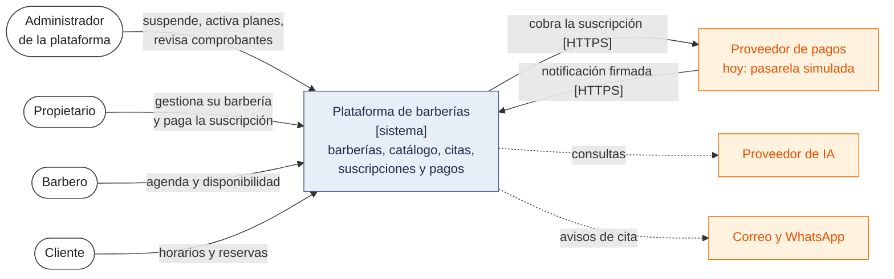
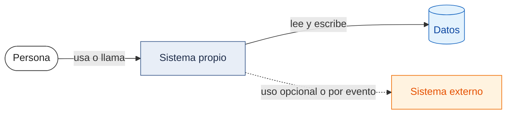

# C4 Nivel 1: Diagrama de contexto del sistema

**Propósito.** Mostrar la plataforma como una caja negra, quiénes la usan y con qué sistemas externos se relaciona. **Audiencia:** cualquier persona (evaluadores, propietarios, equipo). No muestra tecnologías internas.

**Buenas prácticas C4 aplicadas.** Notación consistente con una sola leyenda; pocas cajas; cada flecha lleva un verbo; este nivel es el "zoom out" del que parten los niveles 2, 3 y 4.

_Figura 1. C4 nivel 1: contexto del sistema._

Código fuente del diagrama (Mermaid)

Leyenda: blanco = persona; azul grisáceo = sistema propio; naranja = sistema externo; azul claro = datos. Flecha discontinua = relación planificada. Correo y WhatsApp se agrupan en una caja para que el diagrama se lea de un vistazo; son dos servicios distintos (EXT-03 y EXT-04).

Evidencia: actores en [01-actores](../01-analisis-de-sistema/01-actores.md); rutas en `backend/src/modules/*/*/presentation/*.controller.ts`; pasarela simulada en `backend/simulador-pagos/` y `docker-compose.yml` (servicio `pasarela-simulada`). No hay código de IA, correo ni WhatsApp.

## Leyenda común de todos los diagramas

_Figura 2. Convención de colores que usan todos los diagramas de `docs/`._

Código fuente del diagrama (Mermaid)

En algunos diagramas se usa además rojo para una solicitud rechazada. Los diagramas de secuencia y entidad-relación no admiten colores por caja: su estado se indica en el título y en la línea "Leyenda" debajo de cada uno.
## Elementos y su origen

| Elemento                        | Tipo            | Origen (requisito)                                              | Estado                                                |
| ------------------------------- | --------------- | --------------------------------------------------------------- | ----------------------------------------------------- |
| Administrador de la plataforma  | Persona         | HU01, HU19, HU26 / RF02, RF22, RF31                             | Implementado (003); indicadores (RF31) planificados    |
| Propietario de barbería         | Persona         | HU02–HU04, HU17, HU18, HU23, HU24 / RF01, RF06, RF20, RF29      | Implementado (001–003); reportes e IA planificados     |
| Barbero                         | Persona         | HU09, HU14 / RF09, RF15, RF16                                   | Implementado (002)                                     |
| Cliente                         | Persona         | HU06, HU10–HU13, HU22, HU25 / RF05, RF11–RF14, RF27, RF30, RF33 | Implementado (002); reprogramar, avisos e IA planificados |
| Plataforma SaaS                 | Sistema         | Todos los RF                                                    | Implementado en local: 25 RF, 1 parcial y 8 planificados |
| Proveedor de pagos              | Sistema externo | RF23–RF26, RC05, ADR-007, ADR-022                               | **Simulado** (pasarela simulada); proveedor real planificado (candidato: Culqi, sin contratar) |
| Proveedor de IA                 | Sistema externo | RF27, RF28, RC11, ADR-008                                       | Planificado (sin elegir)                              |
| Servicio de correo              | Sistema externo | RF30, HU25                                                      | Planificado (sin elegir)                              |
| Servicio de mensajería WhatsApp | Sistema externo | RF30, RF33, HU25, ADR-013                                       | Planificado (proveedor sin elegir; solo si es viable) |

## Notas

- La plataforma es **solo web**: no aparece ninguna aplicación móvil nativa (evolución futura).
- Los clientes **no pagan citas** en esta etapa: el proveedor de pagos solo se relaciona con la suscripción de las barberías.
- Ningún sistema externo accede directamente a la base de datos.

**Siguiente nivel:** [Nivel 2 – Contenedores](Nivel2-DiagramadeContenedores.md).
