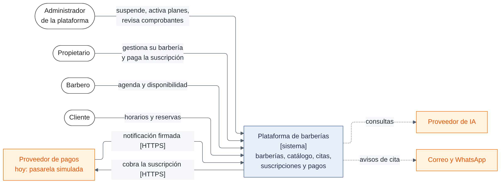
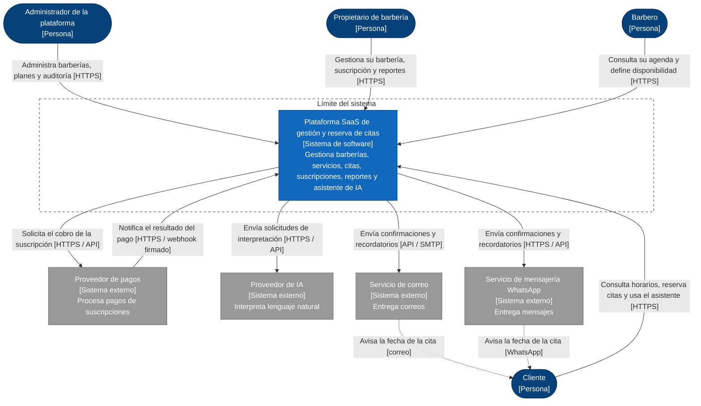
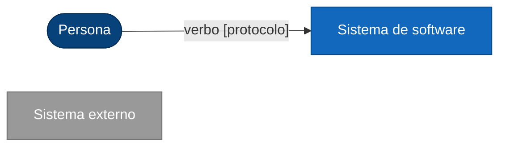

# C4 Nivel 1: Diagrama de contexto del sistema

**Propósito.** Mostrar la plataforma como una caja negra, quiénes la usan y con qué sistemas externos se relaciona. **Audiencia:** cualquier persona (evaluadores, propietarios, equipo). No muestra tecnologías internas.

**Buenas prácticas C4 aplicadas.** Notación consistente con leyenda; nivel de detalle adecuado (una caja por actor o sistema); cada flecha lleva verbo y protocolo; la línea discontinua marca el límite del sistema; este nivel es el "zoom out" del que parten los niveles 2, 3 y 4.

_Figura. C4 Nivel 1: Diagrama de contexto del sistema._

Código fuente del diagrama (Mermaid)

## Leyenda

_Figura. Leyenda._

Código fuente del diagrama (Mermaid)

La línea discontinua rodea el límite del sistema. Los textos entre corchetes indican el tipo de elemento o el protocolo.

## Elementos y su origen

| Elemento                        | Tipo            | Origen (requisito)                                              | Estado                                                |
| ------------------------------- | --------------- | --------------------------------------------------------------- | ----------------------------------------------------- |
| Administrador de la plataforma  | Persona         | HU01, HU19, HU26 / RF02, RF22, RF31                             | Planificado                                           |
| Propietario de barbería         | Persona         | HU02–HU04, HU17, HU18, HU23, HU24 / RF01, RF06, RF20, RF29      | Planificado                                           |
| Barbero                         | Persona         | HU09, HU14 / RF09, RF15, RF16                                   | Planificado                                           |
| Cliente                         | Persona         | HU06, HU10–HU13, HU22, HU25 / RF05, RF11–RF14, RF27, RF30, RF33 | Planificado                                           |
| Plataforma SaaS                 | Sistema         | Todos los RF                                                    | Planificado                                           |
| Proveedor de pagos              | Sistema externo | RF23–RF26, RC05, ADR-007                                        | Planificado (candidato: Culqi, sin contratar)         |
| Proveedor de IA                 | Sistema externo | RF27, RF28, RC11, ADR-008                                       | Planificado (sin elegir)                              |
| Servicio de correo              | Sistema externo | RF30, HU25                                                      | Planificado (sin elegir)                              |
| Servicio de mensajería WhatsApp | Sistema externo | RF30, RF33, HU25, ADR-013                                       | Planificado (proveedor sin elegir; solo si es viable) |

## Notas

- La plataforma es **solo web**: no aparece ninguna aplicación móvil nativa (evolución futura).
- Los clientes **no pagan citas** en esta etapa: el proveedor de pagos solo se relaciona con la suscripción de las barberías.
- Ningún sistema externo accede directamente a la base de datos.

**Siguiente nivel:** [Nivel 2 – Contenedores](Nivel2-DiagramadeContenedores.md).
