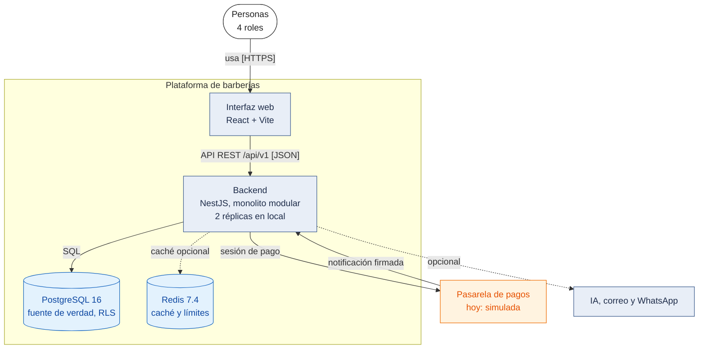

# C4 Nivel 2: Diagrama de contenedores

**Propósito.** Abrir la caja de la plataforma y mostrar las aplicaciones y almacenes de datos que la componen. **Audiencia:** equipo técnico y evaluadores.

> En C4, **contenedor** es una aplicación o almacén de datos ejecutable por separado (no necesariamente Docker). El backend es **un solo contenedor** (monolito modular); sus módulos se muestran en el nivel 3 como componentes.

**Zoom del nivel 1.** Se mantienen las relaciones del nivel 1: las personas usan la plataforma (ahora, mediante la interfaz web); la plataforma (ahora, el backend) se relaciona con la pasarela de pagos y, en el futuro, con IA, correo y WhatsApp.

_Figura 1. C4 nivel 2: contenedores._

Código fuente del diagrama (Mermaid)

Leyenda: la [leyenda común](Nivel1-DiagramadeContextodelSistema.md#leyenda-común-de-todos-los-diagramas). La línea discontinua hacia Redis indica que el backend funciona sin él. El balanceador Nginx no aparece porque es despliegue: está en la [comunicación del entorno local](../02-arquitectura-software/despliegue-y-escalabilidad.md#21-entorno-escalado-local-funcionalidad-006).

Evidencia: `frontend/` (React 19, Vite 6), `backend/` (NestJS 11), `docker-compose.yml` (servicios `db`, `redis`, `backend-1`, `backend-2`, `pasarela-simulada`), `backend/src/shared/cache/` y `backend/src/shared/persistence/`.

## Contenedores

| Contenedor                 | Responsabilidad                                                                            | Tecnología                                                                 | Origen           | ADR                         | Estado                                                                                                         |
| -------------------------- | ------------------------------------------------------------------------------------------ | -------------------------------------------------------------------------- | ---------------- | --------------------------- | -------------------------------------------------------------------------------------------------------------- |
| Interfaz web               | Presentación para los cuatro roles y el administrador; consume la API; sin reglas críticas | React 19, Vite 6 y TypeScript; sistema de diseño propio con Radix UI        | RC01, RC03, AC06 | ADR-002, 014, 016, 017, 018 | Implementado (001, 002 y 003): registro, ingreso, panel, catálogo público, reservas, suscripción y `/plataforma` |
| Backend monolítico modular | Casos de uso, reglas, seguridad e integraciones; módulos con 4 capas; sin estado          | TypeScript con NestJS 11                                                   | Todos los RF     | ADR-001, 002, 011           | Implementado: M01, M02, M03 y M06 (parcial); M04 y M05 planificados                                            |
| PostgreSQL                 | Fuente de verdad: datos de negocio, restricciones de exclusión, RLS, auditoría             | PostgreSQL 16                                                              | RC04, RF12       | ADR-003, 004, 009, 015      | Implementado: 32 tablas (migraciones 0001 a 0020)                                                              |
| Redis                      | Caché del catálogo público y contadores del límite por IP                                  | Redis 7.4, sin persistencia                                                | AC01, DA03       | ADR-005, 029                | Implementado (006)                                                                                             |
| Pasarela simulada          | Hace de proveedor de pagos en local (fuera del monolito; nunca en producción)              | Node 22, `node:http`                                                       | RF23–RF26        | ADR-022                     | Implementado (003)                                                                                             |
## Relaciones con sistemas externos (protocolos)

| Relación                       | Protocolo                               | Observación                                                   |
| ------------------------------ | --------------------------------------- | ------------------------------------------------------------- |
| Backend ↔ Proveedor de pagos   | HTTP en local con el simulador (HTTPS con el proveedor real); notificación firmada hacia el backend | La notificación no lleva token de usuario sino la firma HMAC del proveedor |
| Backend → Proveedor de IA _(planificado)_ | HTTPS                        | Sin secretos ni datos innecesarios                            |
| Backend → Servicio de correo _(planificado)_ | SMTP o API HTTPS          | Correo es el canal base y de respaldo                         |
| Backend → Servicio de WhatsApp _(planificado)_ | HTTPS (API del proveedor) | Solo con consentimiento del cliente                           |

## Notas

- **Balanceador de carga:** pertenece al **despliegue**, no a la arquitectura lógica. En local es **Nginx** delante de dos réplicas (ADR-030); en la nube sería el **Application Load Balancer de AWS** (planificado). Ver [despliegue-y-escalabilidad.md](../02-arquitectura-software/despliegue-y-escalabilidad.md). Las réplicas son copias del **mismo** contenedor backend.
- El backend es el **único** componente que accede a PostgreSQL y Redis. Ni la interfaz web ni los sistemas externos tienen acceso directo a la base de datos.
- Los pagos se tratan solo en el backend; la interfaz redirige a la página alojada del proveedor (hoy, la del simulador) y no maneja datos de tarjeta (RC12).
- No existe un contenedor de aplicación móvil: queda como evolución futura.

**Anterior:** [Nivel 1](Nivel1-DiagramadeContextodelSistema.md) · **Siguiente:** [Nivel 3 – Componentes](Nivel3-Diagrama-de-Componentes.md).
