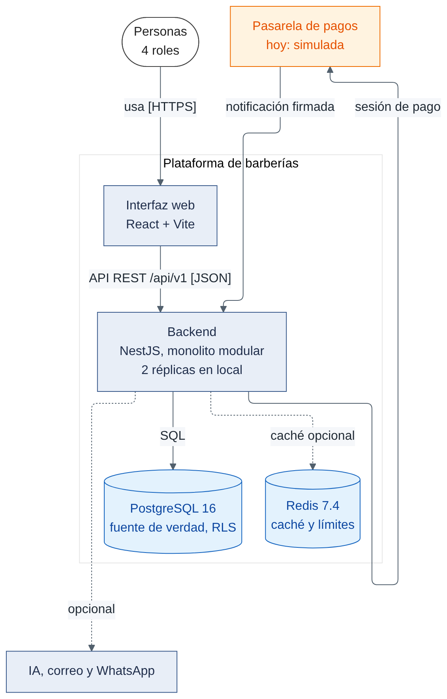
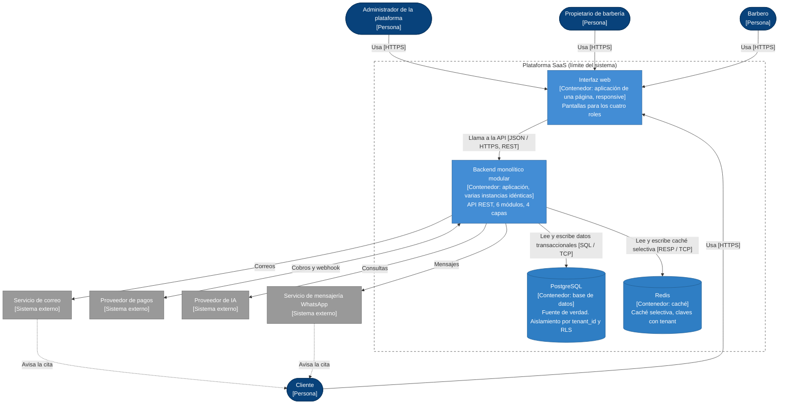

# C4 Nivel 2: Diagrama de contenedores

**Propósito.** Abrir la caja de la plataforma y mostrar las aplicaciones y almacenes de datos que la componen. **Audiencia:** equipo técnico y evaluadores.

> En C4, **contenedor** es una aplicación o almacén de datos ejecutable por separado (no necesariamente Docker). El backend es **un solo contenedor** (monolito modular); sus módulos se muestran en el nivel 3 como componentes.

**Zoom del nivel 1.** Se mantienen las relaciones del nivel 1: las personas usan la plataforma (ahora, mediante la interfaz web); la plataforma (ahora, el backend) se relaciona con pagos, IA y correo.

_Figura. C4 Nivel 2: Diagrama de contenedores._

Código fuente del diagrama (Mermaid)

## Leyenda

Persona (azul oscuro) · Contenedor aplicación (azul medio) · Contenedor almacén de datos (cilindro) · Sistema externo (gris) · Línea discontinua = límite del sistema · Flechas con verbo y protocolo.

## Contenedores

| Contenedor                 | Responsabilidad                                                                            | Tecnología (propuesta)            | Origen           | ADR               | Estado      |
| -------------------------- | ------------------------------------------------------------------------------------------ | --------------------------------- | ---------------- | ----------------- | ----------- |
| Interfaz web               | Presentación para los cuatro roles; consume la API; validación básica; sin reglas críticas | React 19, Vite 6 y TypeScript; sistema de diseño propio con Radix UI; pantallas con carga diferida | RC01, RC03, AC06 | ADR-002, 014, 016, 017, 018 | Implementado en parte (funcionalidad 001: registro, ingreso, activación, inicio y usuarios) |
| Backend monolítico modular | Casos de uso, reglas, seguridad, integraciones; 6 módulos con 4 capas; sin estado          | TypeScript con NestJS 11          | Todos los RF     | ADR-001, 002, 011 | Implementado en parte (funcionalidad 001: M01, M03 mínimo y M06) |
| PostgreSQL                 | Fuente de verdad: datos de negocio, restricciones de exclusión, RLS, auditoría             | PostgreSQL 16                     | RC04, RF12       | ADR-003, 004, 009, 015 | Implementado en parte (tablas y RLS de la funcionalidad 001) |
| Redis                      | Caché selectiva y contadores de límite de solicitudes                                      | Redis                             | AC01, DA03       | ADR-005           | Planificado |

## Relaciones con sistemas externos (protocolos)

| Relación                       | Protocolo                               | Observación                                                   |
| ------------------------------ | --------------------------------------- | ------------------------------------------------------------- |
| Backend ↔ Proveedor de pagos   | HTTPS; webhook firmado hacia el backend | El webhook no lleva token de usuario sino firma del proveedor |
| Backend → Proveedor de IA      | HTTPS                                   | Sin secretos ni datos innecesarios                            |
| Backend → Servicio de correo   | SMTP o API HTTPS                        | Correo es el canal base y de respaldo                         |
| Backend → Servicio de WhatsApp | HTTPS (API del proveedor)               | Solo con consentimiento del cliente                           |

## Notas

- **Balanceador de carga:** pertenece al **despliegue**, no a la arquitectura lógica. En la nube es el **Application Load Balancer de AWS**: se ubica entre los usuarios y las instancias del backend y se muestra en [despliegue-y-escalabilidad.md](../02-arquitectura-software/despliegue-y-escalabilidad.md). Las varias instancias son copias del **mismo** contenedor backend.
- El backend es el **único** componente que accede a PostgreSQL y Redis. Ni la interfaz web ni la IA ni los sistemas externos tienen acceso directo a la base de datos.
- Los pagos se tratan solo en el backend; la interfaz redirige al flujo alojado del proveedor y no maneja datos de tarjeta (RC12).
- No existe un contenedor de aplicación móvil: queda como evolución futura.

**Anterior:** [Nivel 1](Nivel1-DiagramadeContextodelSistema.md) · **Siguiente:** [Nivel 3 – Componentes](Nivel3-Diagrama-de-Componentes.md).
