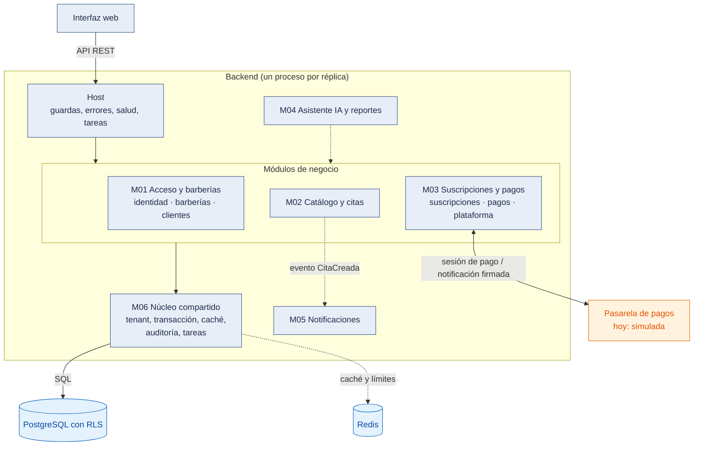

# C4 Nivel 3: Diagrama de componentes del backend

**Propósito.** Mostrar los componentes (módulos) dentro del contenedor "Backend monolítico modular" y sus interacciones. **Los módulos no son servicios desplegables:** viven en el mismo proceso y se llaman por interfaces públicas. **Audiencia:** equipo de desarrollo.

**Zoom del nivel 2.** Se mantienen las relaciones del contenedor backend: recibe llamadas de la interfaz web, usa PostgreSQL y Redis y se relaciona con la pasarela de pagos (hoy simulada).

_Figura 1. C4 nivel 3: componentes del backend._

Código fuente del diagrama (Mermaid)

Leyenda: la [leyenda común](Nivel1-DiagramadeContextodelSistema.md#leyenda-común-de-todos-los-diagramas). Flecha continua = llamada que existe hoy; discontinua = planificada (o, hacia Redis, opcional: el sistema funciona sin él). Para que se lea de un vistazo, el acceso a PostgreSQL se dibuja desde M06: cada módulo tiene sus repositorios en su carpeta `infrastructure/`, pero todos abren la transacción con la `UnitOfWork` de M06.

Evidencia: carpetas `backend/src/host/`, `backend/src/modules/{acceso-barberias,catalogo-citas,suscripciones-pagos}/`, `backend/src/shared/`; importaciones entre módulos en sus `index.ts`; prueba `backend/test/architecture/reglas.spec.ts` (PR14).

## Componentes

| Componente                             | Responsabilidad                                                                                                     | Requisitos (origen)    | ADR                    | Estado                                                      |
| -------------------------------------- | ------------------------------------------------------------------------------------------------------------------- | ---------------------- | ---------------------- | ----------------------------------------------------------- |
| Host                                   | Ensamblar módulos, `AuthGuard` y `RolesGuard`, filtro de errores, salud, CORS, límite general, tareas programadas    | RF04, RC03             | ADR-001, 010, 024      | Implementado                                                |
| M01 Acceso y barberías                 | Cuentas, tokens, roles, administrador con segundo factor; alta, configuración y estado de la barbería; clientes y consentimiento | RF01–RF06     | ADR-003, 010, 015, 020, 031 | Implementado (001–003); RF32 y RF33 planificados       |
| M02 Catálogo y citas                   | Catálogo, horario y disponibilidad; horarios libres, reservas sin duplicados, estados, agenda e historial          | RF07–RF12, RF14–RF17   | ADR-005, 009, 021, 029 | Implementado (002, 006); RF13 y RF34 planificados (004)     |
| M03 Suscripciones y pagos              | Planes, prueba gratuita, estados y restricciones; pagos, notificación firmada, conciliación; operaciones de la plataforma | RF18–RF26        | ADR-007, 022, 023, 024, 031 | Implementado (001, 003), con pasarela simulada         |
| M04 Asistente IA y reportes            | Asistente con herramientas cerradas; reportes de solo lectura                                                       | RF27–RF29              | ADR-008, 012           | Planificado (005)                                           |
| M05 Notificaciones                     | Correos y WhatsApp al cliente                                                                                       | RF30, RF33, RF34       | ADR-012, 013           | Planificado (004)                                           |
| M06 Núcleo compartido                  | Tenant, transacción con RLS, auditoría, caché, límites, reloj, tareas programadas, resiliencia                      | RF31 (auditoría)       | ADR-005, 024, 029      | Parcial: eventos y enlaces firmados (004) planificados      |

## Asignación a carpetas reales del código

Las rutas son relativas a `tecnologia/plataforma-barberias/`. Cada submódulo tiene cuatro subcarpetas: `presentation`, `application`, `domain` e `infrastructure`.

| Componente                | Carpeta del código                                                                                   | Interfaz pública (`index.ts`)                                                                                  |
| ------------------------- | ---------------------------------------------------------------------------------------------------- | -------------------------------------------------------------------------------------------------------------- |
| Host                      | `backend/src/host/`                                                                                  | `AppModule`, `AuthGuard`, `RolesGuard`, `ErrorFilter`, `SaludController`, `TareasProgramadas`                  |
| M01 Acceso y barberías    | `backend/src/modules/acceso-barberias/` (`identidad/`, `barberias/`, `clientes/`)                    | `ValidarSolicitud`, `ValidarSolicitudPlataforma`, `Permisos`, `PersonalApi`, `ClientesApi`, `BarberiasApi`      |
| M02 Catálogo y citas      | `backend/src/modules/catalogo-citas/` (`catalogo/`, `citas/`)                                        | `PermisosCatalogoCitas` (el resto solo por sus controladores)                                                   |
| M03 Suscripciones y pagos | `backend/src/modules/suscripciones-pagos/` (`suscripciones/`, `pagos/`, `plataforma/`)               | `SuscripcionesApi`, `VencerSuscripciones`, `ConciliarPagos`, `ExpirarTransferencias`                           |
| M04 Asistente IA y reportes | _(planificado; sin carpeta)_                                                                       | —                                                                                                              |
| M05 Notificaciones        | _(planificado; sin carpeta)_                                                                         | —                                                                                                              |
| M06 Núcleo compartido     | `backend/src/shared/` (`audit`, `cache`, `clock`, `config`, `http`, `limites`, `persistence`, `resiliencia`, `tareas`, `tenant`, `tiempo`) | `TenantContext`, `UnitOfWork`, `AuditLog`, `CacheCompartida`, `EjecutorTareas`, `Clock`        |
## Cómo leer las relaciones

- Las dependencias de módulo a módulo coinciden con la matriz de [estilo-arquitectonico.md](../02-arquitectura-software/estilo-arquitectonico.md#3-dependencias-permitidas). Lo que no aparece como flecha está prohibido.
- Todos los módulos de negocio usan M06.
- Las relaciones entre submódulos del mismo módulo (por ejemplo, `pagos` actualiza `suscripciones` dentro de M03, en la misma transacción) no se dibujan en este nivel; se ven en el [nivel 4](Nivel4-DiagramadeCodigo.md).
- Dentro de cada submódulo hay cuatro capas (presentación, aplicación, dominio, infraestructura); su detalle está en el nivel 4 y en [enfoque-arquitectonico.md](../02-arquitectura-software/enfoque-arquitectonico.md).
- La notificación del proveedor de pagos entra por Nginx y el Host (`POST /api/v1/pagos/notificaciones`) y la atiende M03; no lleva token de usuario sino la firma del proveedor.
- _(Planificado)_ La IA (M04) no accederá a PostgreSQL por su cuenta: solo llamará a casos de uso de M02 y a sus propios reportes, con el rol y el tenant del usuario.

**Anterior:** [Nivel 2](Nivel2-DiagramadeContenedores.md) · **Siguiente:** [Nivel 4 – Código](Nivel4-DiagramadeCodigo.md).
