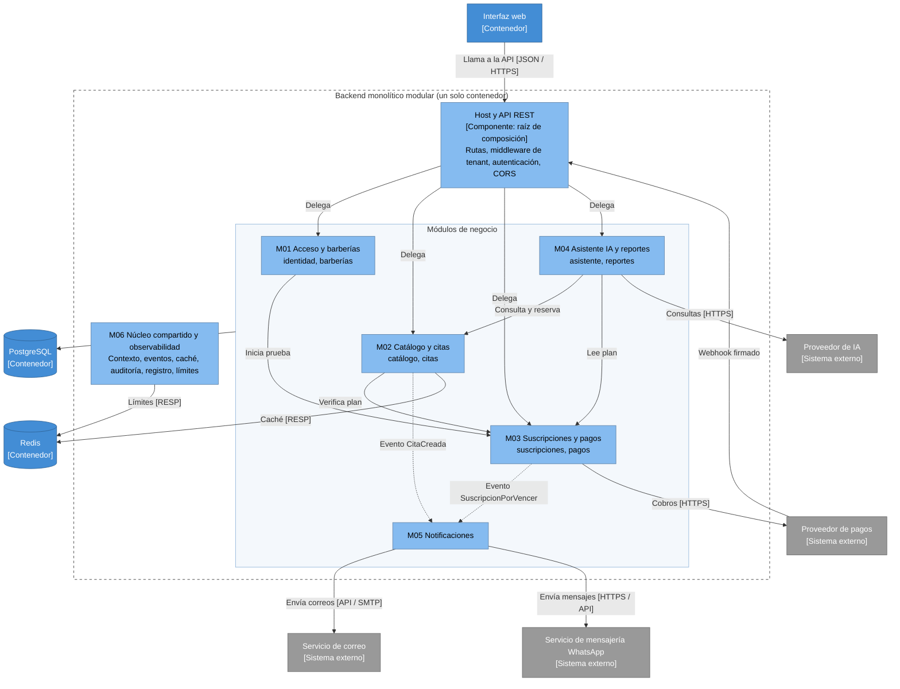

# C4 Nivel 3: Diagrama de componentes del backend

**Propósito.** Mostrar los componentes (módulos) dentro del contenedor "Backend monolítico modular" y sus interacciones. **Los módulos no son servicios desplegables:** viven en el mismo proceso y se llaman por interfaces públicas. **Audiencia:** equipo de desarrollo.

**Zoom del nivel 2.** Se mantienen las relaciones del contenedor backend: recibe llamadas de la interfaz web, usa PostgreSQL y Redis, y se relaciona con pagos, IA, correo y WhatsApp.

_Figura. C4 Nivel 3: Diagrama de componentes del backend._

Código fuente del diagrama (Mermaid)

## Leyenda

Contenedor (azul medio) · Componente (azul claro) · Sistema externo (gris) · Línea continua = llamada por interfaz pública · Línea discontinua = evento publicado en el bus de M06 · Recuadro discontinuo = límite del contenedor.

## Componentes

| Componente                             | Responsabilidad                                                                                                            | Requisitos (origen)   | ADR               | Estado      |
| -------------------------------------- | -------------------------------------------------------------------------------------------------------------------------- | --------------------- | ----------------- | ----------- |
| Host y API REST                        | Ensamblar módulos, exponer rutas, middleware de autenticación y tenant, CORS, límites                                      | RF04, RC03            | ADR-001, 010      | Planificado |
| M01 Acceso y barberías                 | Cuentas, tokens, roles, consentimiento, solicitudes de datos; alta del tenant, configuración y estado                      | RF01–RF06, RF32, RF33 | ADR-003, 010      | Planificado |
| M02 Catálogo y citas                   | Catálogo y disponibilidad configurada; disponibilidad, reservas sin duplicados, estados, agenda, respuesta al recordatorio | RF07–RF17, RF34       | ADR-005, 009      | Planificado |
| M03 Suscripciones y pagos              | Planes, prueba gratuita, estados y restricciones; pagos de suscripción, webhooks, conciliación                             | RF18–RF26             | ADR-007, 012      | Planificado |
| M04 Asistente IA y reportes            | Asistente con herramientas cerradas; reportes de solo lectura                                                              | RF27–RF29             | ADR-003, 008, 012 | Planificado |
| M05 Notificaciones                     | Correos y WhatsApp al cliente desde eventos y recordatorios                                                                | RF30, RF33, RF34      | ADR-012, 013      | Planificado |
| M06 Núcleo compartido y observabilidad | Contexto, eventos, caché, auditoría, registro, límites, enlaces firmados                                                   | RF31                  | ADR-005, 012      | Planificado |

## Asignación a abstracciones reales (carpetas del código)

Cada componente del diagrama corresponde a una agrupación real de código (carpeta o paquete) del backend, como pide el modelo C4 para este nivel. Cada módulo contiene submódulos y cada submódulo tiene cuatro subcarpetas: `presentation`, `application`, `domain` e `infrastructure`.

Las rutas son relativas a `tecnologia/plataforma-barberias/`.

| Componente                             | Carpeta del código (planificada)                                                    | Interfaz pública                                                                                   |
| -------------------------------------- | ----------------------------------------------------------------------------------- | -------------------------------------------------------------------------------------------------- |
| Host y API REST                        | `backend/src/host/`                                                                 | Rutas y middleware                                                                                 |
| M01 Acceso y barberías                 | `backend/src/modules/acceso-barberias/` (submódulos `identidad/` y `barberias/`)    | `IdentityService`, `ConsentRegistry`, `DataRequestService`, `TenantDirectory`, `RegistrarBarberia` |
| M02 Catálogo y citas                   | `backend/src/modules/catalogo-citas/` (submódulos `catalogo/` y `citas/`)           | `CatalogQuery`, `CatalogAdmin`, `AvailabilityQuery`, `BookingService`, `AgendaQuery`               |
| M03 Suscripciones y pagos              | `backend/src/modules/suscripciones-pagos/` (submódulos `suscripciones/` y `pagos/`) | `SubscriptionPolicy`, `SubscriptionService`, `PaymentService`                                      |
| M04 Asistente IA y reportes            | `backend/src/modules/asistente-reportes/` (submódulos `asistente/` y `reportes/`)   | `AssistantService`, `ReportService`                                                                |
| M05 Notificaciones                     | `backend/src/modules/notificaciones/`                                               | `NotificationService`                                                                              |
| M06 Núcleo compartido y observabilidad | `backend/src/shared/`                                                               | `TenantContext`, `EventBus`, `Cache`, `AuditLog`, `SignedActionToken`                              |

## Cómo leer las relaciones

- Las dependencias de módulo a módulo coinciden con la matriz de [estilo-arquitectonico.md](../02-arquitectura-software/estilo-arquitectonico.md#3-dependencias-permitidas). Lo que no aparece como flecha está prohibido.
- Todos los módulos de negocio usan M06; para no saturar el diagrama no se dibuja esa flecha.
- Las relaciones entre submódulos del mismo módulo (por ejemplo, `pagos` avisa a `suscripciones` dentro de M03) no se dibujan en este nivel; se ven en el [nivel 4](Nivel4-DiagramadeCodigo.md).
- Dentro de cada submódulo hay cuatro capas (presentación, aplicación, dominio, infraestructura); su detalle está en el nivel 4 y en [enfoque-arquitectonico.md](../02-arquitectura-software/enfoque-arquitectonico.md).
- El webhook de pagos entra por el Host, que lo entrega a M03; no lleva token de usuario sino firma del proveedor.
- La IA (M04) no accede a PostgreSQL por su cuenta: solo llama a casos de uso de M02 y a sus propios reportes, con el rol y el tenant del usuario.

**Anterior:** [Nivel 2](Nivel2-DiagramadeContenedores.md) · **Siguiente:** [Nivel 4 – Código](Nivel4-DiagramadeCodigo.md).
