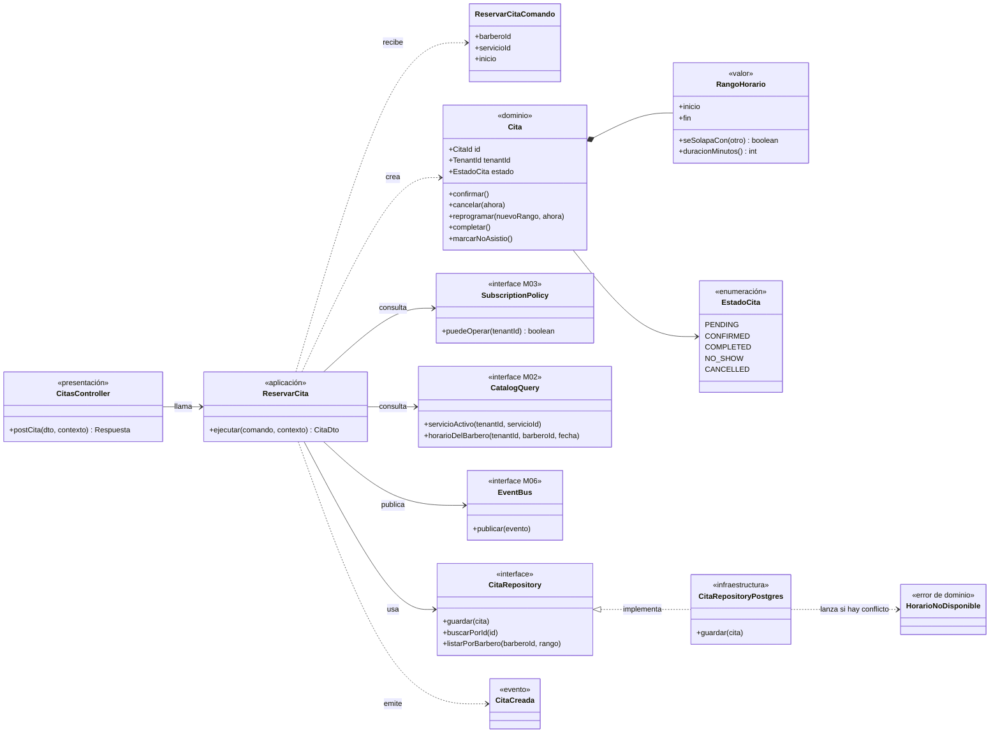
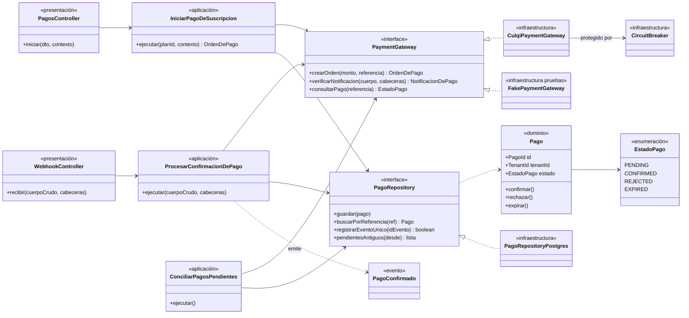

# C4 Nivel 4: Diagrama de código

**Propósito.** Mostrar clases e interfaces de componentes críticos. Se documentan dos: **"Reservar cita" (submódulo `citas`, M02)** y **`PaymentGateway` (submódulo `pagos`, M03)**. **Audiencia:** desarrolladores. Es el "zoom" del componente del nivel 3; el diagrama es ilustrativo del diseño y se detallará durante la implementación (estado: planificado).

## 1. Submódulo `citas` (M02): caso de uso "Reservar cita"

_Figura. 1. Submódulo `citas` (M02): caso de uso "Reservar cita"._

Código fuente del diagrama (Mermaid)

**Lectura.** `ReservarCita` (aplicación) solo conoce interfaces; `Cita` y `RangoHorario` (dominio) no conocen nada de infraestructura; `CitaRepositoryPostgres` traduce la violación de la restricción de exclusión a `HorarioNoDisponible`.

| Clase / interfaz                     | Capa                | Responsabilidad                                                               | Requisito    |
| ------------------------------------ | ------------------- | ----------------------------------------------------------------------------- | ------------ |
| `CitasController`                    | Presentación        | Validar formato, recibir contexto, mapear errores a HTTP (409 para conflicto) | RF12         |
| `ReservarCita`                       | Aplicación          | Orquestar la reserva                                                          | RF12, RF21   |
| `Cita`, `RangoHorario`, `EstadoCita` | Dominio             | Invariantes y transiciones                                                    | RF12–RF15    |
| `CitaRepository`                     | Aplicación (puerto) | Contrato de persistencia                                                      | EQ-09, EQ-16 |
| `CitaRepositoryPostgres`             | Infraestructura     | Inserción en transacción con tenant fijado                                    | ADR-009      |

## 2. Submódulo `pagos` (M03): puerto `PaymentGateway` y casos de uso

_Figura. 2. Submódulo `pagos` (M03): puerto `PaymentGateway` y casos de uso._

Código fuente del diagrama (Mermaid)

**Lectura.** Cambiar de proveedor o agregar un método de pago es escribir otra implementación de `PaymentGateway` (EQ-14, EQ-20). `registrarEventoUnico` usa el índice único de `webhook_event` para la idempotencia (EQ-17). Ninguna clase guarda datos de tarjeta (RC12).

| Clase / interfaz             | Capa                | Responsabilidad                                                  | Requisito     |
| ---------------------------- | ------------------- | ---------------------------------------------------------------- | ------------- |
| `IniciarPagoDeSuscripcion`   | Aplicación          | Crear `Pago` PENDING y pedir la orden al proveedor               | RF23          |
| `ProcesarConfirmacionDePago` | Aplicación          | Verificar, registrar evento único, confirmar pago, emitir evento | RF24          |
| `ConciliarPagosPendientes`   | Aplicación          | Consultar al proveedor los pagos sin resolver                    | RF26          |
| `PaymentGateway`             | Aplicación (puerto) | Contrato con el proveedor                                        | RC05, ADR-007 |
| `CulqiPaymentGateway`        | Infraestructura     | Adaptador del candidato (por confirmar)                          | ADR-007       |
| `FakePaymentGateway`         | Infraestructura     | Simulador para pruebas                                           | EQ-20         |

## 3. Notas

- Los nombres son de diseño; el código real puede variar al implementar, manteniendo las responsabilidades.
- La IA (`AIProvider`) sigue el mismo patrón: ver [diseño interno, sección 4](../03-diseño-de-software/diseño-interno/diseño-interno-de-modulos.md#4-submódulo-asistente-m04-asistente-ia-y-reportes).

**Anterior:** [Nivel 3](Nivel3-Diagrama-de-Componentes.md).
