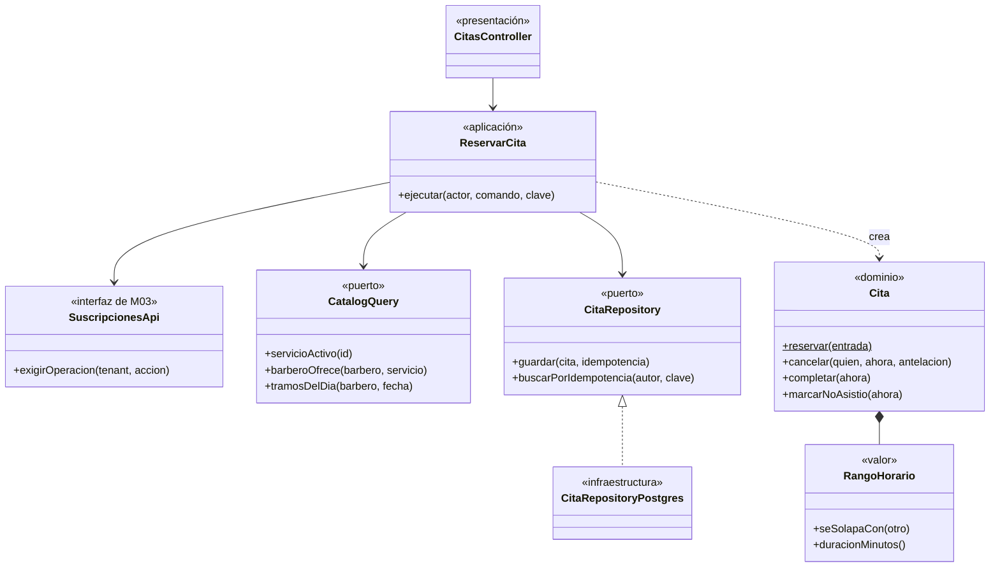
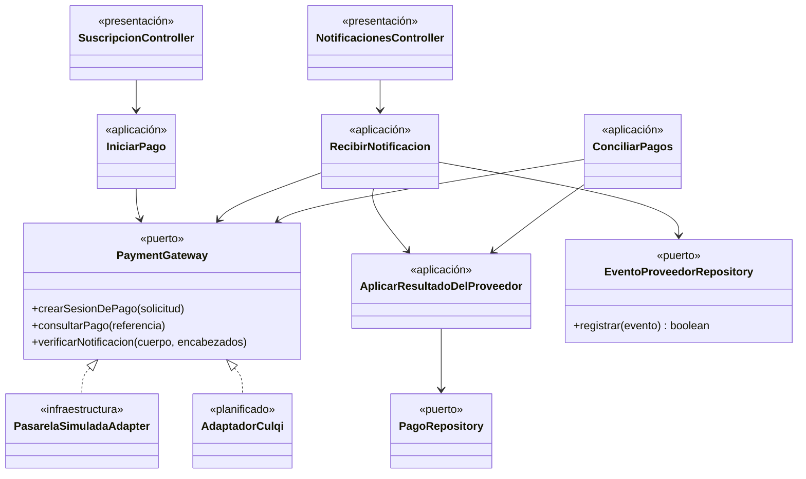

# C4 Nivel 4: Diagrama de código

**Propósito.** Mostrar clases e interfaces de componentes críticos. Se documentan dos: **"Reservar cita" (submódulo `citas`, M02)** y **el puerto `PaymentGateway` (submódulo `pagos`, M03)**. **Audiencia:** desarrolladores. Es el "zoom" del componente del nivel 3. Los dos diagramas muestran **clases reales** del código (implementado); para que se lean de un vistazo, cada uno muestra solo las clases y los métodos principales.

## 1. Submódulo `citas` (M02): caso de uso "Reservar cita"

_Figura 1. Clases del caso de uso "Reservar cita" (implementado)._

Código fuente del diagrama (Mermaid)

Leyenda: azul grisáceo = sistema propio. **Lectura.** `ReservarCita` (aplicación) solo conoce interfaces; `Cita` y `RangoHorario` (dominio) no conocen nada de infraestructura; `CitaRepositoryPostgres` traduce la violación de la restricción de exclusión a `HorarioNoDisponible` (409). Los estados de la cita son `PENDIENTE`, `CONFIRMADA`, `COMPLETADA`, `NO_ASISTIO` y `CANCELADA` ([diseño interno, 1.1](../03-diseño-de-software/diseño-interno/diseño-interno-de-modulos.md#11-estados-de-la-cita)).

| Clase / interfaz                     | Capa                | Responsabilidad                                                               | Requisito    |
| ------------------------------------ | ------------------- | ----------------------------------------------------------------------------- | ------------ |
| `CitasController`                    | Presentación        | Validar formato (`ReservarCitaDto`), tomar el actor del token, exigir `Idempotency-Key` | RF12   |
| `ReservarCita`                       | Aplicación          | Orquestar la reserva y auditarla                                              | RF12, RF21   |
| `Cita`, `RangoHorario`, `EstadoCita` | Dominio             | Invariantes y transiciones                                                    | RF12–RF15    |
| `CitaRepository`                     | Aplicación (puerto) | Contrato de persistencia                                                      | EQ-09, EQ-16 |
| `CitaRepositoryPostgres`             | Infraestructura     | Inserción en la transacción con tenant fijado                                 | ADR-009      |

Evidencia: `backend/src/modules/catalogo-citas/citas/presentation/citas.controller.ts`, `citas/application/reservar-cita.ts`, `citas/application/ports/cita-repository.ts`, `citas/domain/cita.ts`, `catalogo/domain/rango-horario.ts`, `catalogo/application/ports/catalog-query.ts`, `citas/infrastructure/`; pruebas `backend/test/unit/citas/cita.spec.ts` e `integration/citas/reservar.spec.ts`.

## 2. Submódulo `pagos` (M03): puerto `PaymentGateway` y casos de uso

_Figura 2. Clases del submódulo `pagos` (implementado, con el adaptador real planificado)._

Código fuente del diagrama (Mermaid)

Leyenda: azul grisáceo = sistema propio; gris discontinuo = adaptador pendiente. **Lectura.** Cambiar de proveedor es escribir otra implementación de `PaymentGateway` y cambiar `PAGOS_PROVEEDOR` (EQ-14, EQ-20). `EventoProveedorRepository.registrar` inserta en `provider_event`, cuya clave primaria `event_id` da la idempotencia (EQ-17). La notificación y la conciliación aplican el resultado con la **misma** función (`AplicarResultadoDelProveedor`). El estado del pago (`PENDIENTE`, `ESPERANDO_COMPROBANTE`, `EN_REVISION`, `APROBADO`, `RECHAZADO`, `ANULADO`, `EXPIRADO`) y sus transiciones están en `pagos/domain/pago.ts` (`transicionDePago`). Ninguna clase guarda datos de tarjeta (RC12).

| Clase / interfaz               | Capa                | Responsabilidad                                                              | Requisito     |
| ------------------------------ | ------------------- | ---------------------------------------------------------------------------- | ------------- |
| `IniciarPago`                  | Aplicación          | Crear el pago (o reutilizar el abierto) y pedir la sesión al proveedor       | RF20, RF23    |
| `RecibirNotificacion`          | Aplicación          | Verificar la firma, encontrar el tenant y aplicar el resultado con el evento | RF24          |
| `ConciliarPagos`               | Aplicación          | Consultar al proveedor los pagos pendientes de más de 10 min                 | RF26          |
| `AplicarResultadoDelProveedor` | Aplicación          | Aplicar la transición del pago, el período y la suscripción                  | RF22, RF24    |
| `PaymentGateway`               | Aplicación (puerto) | Contrato con el proveedor                                                    | RC05, ADR-022 |
| `PasarelaSimuladaAdapter`      | Infraestructura     | Habla con el simulador por HTTP, con tiempo límite e interruptor             | ADR-022       |
| Adaptador del proveedor real   | Infraestructura     | _(planificado)_ Depende de credenciales y de Yape confirmado (R15)           | ADR-007       |

Evidencia: `backend/src/modules/suscripciones-pagos/pagos/application/` (`iniciar-pago.ts`, `recibir-notificacion.ts`, `conciliar-pagos.ts`, `aplicar-resultado.ts`), `pagos/application/ports/`, `pagos/infrastructure/pasarela-simulada.adapter.ts` y `fabrica-pasarela.ts`, `pagos/domain/pago.ts`; pruebas `backend/test/unit/pagos/pago.spec.ts`, `integration/pagos/notificaciones.spec.ts` y `gateway-simulado.spec.ts`.

## 3. Notas

- Los nombres de los dos diagramas son los del código. Los controladores tienen más rutas de las que se ven aquí (ver [API REST](../02-arquitectura-software/api-rest.md)).
- La IA (`AIProvider`, planificada en 005) seguirá el mismo patrón de puerto y adaptador: ver [diseño interno, sección 4](../03-diseño-de-software/diseño-interno/diseño-interno-de-modulos.md#4-submódulo-asistente-m04-asistente-ia-y-reportes).

**Anterior:** [Nivel 3](Nivel3-Diagrama-de-Componentes.md).
