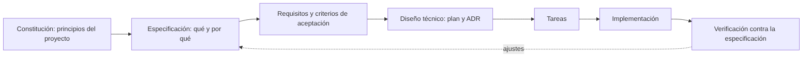
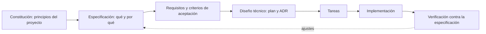

# SDD (Spec-Driven Development) y Spec Kit

**SDD** es la forma de **especificar antes de implementar**: la especificación es el artefacto principal y guía el plan, las tareas y el código. No es un estilo arquitectónico ni un marco de gestión.

## 1. Flujo propuesto



_Figura. 1. Flujo propuesto._

<details>
<summary>Código fuente del diagrama (Mermaid)</summary>



</details>

| Paso                   | Contenido en este proyecto                                                                                                 | Relación con el backlog                 |
| ---------------------- | -------------------------------------------------------------------------------------------------------------------------- | --------------------------------------- |
| Constitución           | Reglas: monolito modular, 4 capas, regla de dependencia, aislamiento de tenant, sin datos de tarjeta, pruebas obligatorias | Vincula todas las HU                    |
| Especificación         | Por funcionalidad: HU, escenarios, límites                                                                                 | Una especificación por HU o grupo de HU |
| Requisitos y criterios | RF y criterios de aceptación de [02](../01-analisis-de-sistema/02-historias-del-usuario.md)                                | HU → RF                                 |
| Diseño técnico         | Decisiones y diagramas ya documentados ([ADR](../01-analisis-de-sistema/07-decisiones-arquitectonicas.md), C4)             | ADR                                     |
| Tareas                 | Lista ordenada derivada del plan                                                                                           | Sprint Backlog                          |
| Implementación         | Código por módulo                                                                                                          | Incremento                              |
| Verificación           | Pruebas PRnn contra EQ y criterios                                                                                         | DoD                                     |

## 2. Estructura de carpetas propuesta

```text
specs/
  constitucion.md
  001-registro-de-barberia/   (spec.md, plan.md, tasks.md)
  004-reserva-de-cita/        (spec.md, plan.md, tasks.md)
  ...
docs/                         (análisis, arquitectura, diseño, C4, gestión)
docs/adr/                     (opcional: un archivo por ADR si se separan)
tecnologia/plataforma-barberias/            (backend/ y frontend/: la aplicación)
```

## 3. Spec Kit (herramienta opcional)

Spec Kit es un conjunto de herramientas de código abierto para desarrollo guiado por especificaciones (repositorio `github/spec-kit`). Lo registrado en el README consultado:

| Elemento                  | Lo leído                                                                                                                  | Estado                                           |
| ------------------------- | ------------------------------------------------------------------------------------------------------------------------- | ------------------------------------------------ |
| Requisitos                | Python 3.11 o superior y `uv`                                                                                             | Primaria; verificar                              |
| Instalación               | `uv tool install specify-cli`                                                                                             | Primaria; verificar                              |
| Inicialización            | `specify init my-project --integration copilot`                                                                           | Primaria; verificar                              |
| Comandos del flujo núcleo | `/speckit-constitution`, `/speckit-specify`, `/speckit-plan`, `/speckit-tasks`, `/speckit-implement`, `/speckit-converge` | Primaria; **la sintaxis cambia entre versiones** |

> **No inventar comandos.** Otras versiones documentan los nombres con punto (`/speckit.constitution`) y comandos adicionales (clarify, analyze). Antes de usarlo, confirmar con `specify --help` en la versión instalada y con el repositorio oficial. Si el equipo no usa Spec Kit, puede aplicar SDD solo con las carpetas y plantillas Markdown anteriores.

## 4. Cómo se conecta con el resto

- Cada especificación referencia su HU, sus RF, los EQ que debe cumplir y los ADR que respeta.
- La verificación usa las pruebas PRnn de [04-pruebas.md](04-pruebas.md).
- Una especificación se considera terminada cuando cumple el DoD ([01-scrum.md](01-scrum.md#4-definition-of-done-dod)).

## 5. Los 22 puntos de SDD y dónde están en el repositorio

| N.° | Punto SDD                    | Archivo                                                                                                                                   |
| --- | ---------------------------- | ----------------------------------------------------------------------------------------------------------------------------------------- |
| 1   | Constitución del proyecto    | Sección 1 de este documento                                                                                                               |
| 2   | Contexto y problema          | [00-contexto](../00-contexto-negocio-y-evidencias.md)                                                                                     |
| 3   | Actores                      | [01-actores](../01-analisis-de-sistema/01-actores.md)                                                                                     |
| 4   | Alcance y exclusiones        | [README](../../README.md), [05-restricciones](../01-analisis-de-sistema/05-restricciones.md)                                              |
| 5   | Historias de usuario         | [02-historias-del-usuario](../01-analisis-de-sistema/02-historias-del-usuario.md)                                                         |
| 6   | Requisitos funcionales       | [03-requisitos-funcionales](../01-analisis-de-sistema/03-requisitos-funcionales.md)                                                       |
| 7   | Atributos de calidad         | [04-atributos-de-calidad](../01-analisis-de-sistema/04-atributos-de-calidad.md)                                                           |
| 8   | Restricciones                | [05-restricciones](../01-analisis-de-sistema/05-restricciones.md)                                                                         |
| 9   | Drivers                      | [06-driver-arquitectonicos](../01-analisis-de-sistema/06-driver-arquitectonicos.md)                                                       |
| 10  | Escenarios de calidad        | [08-escenarios](../01-analisis-de-sistema/08-escenarios-atributos-calidad.md)                                                             |
| 11  | Decisiones (ADR)             | [07-decisiones](../01-analisis-de-sistema/07-decisiones-arquitectonicas.md)                                                               |
| 12  | Modelo de datos              | [multi-tenancy-y-datos](../02-arquitectura-software/multi-tenancy-y-datos.md)                                                             |
| 13  | Diseño de API                | [api-rest](../02-arquitectura-software/api-rest.md)                                                                                       |
| 14  | Estilo y componentes         | [estilo](../02-arquitectura-software/estilo-arquitectonico.md), [componentes](../02-arquitectura-software/componentes-arquitectonicos.md) |
| 15  | Seguridad y privacidad       | [seguridad-y-privacidad](../02-arquitectura-software/seguridad-y-privacidad.md)                                                           |
| 16  | IA con herramientas cerradas | Especificaciones IA-001 e IA-002 (sección 6)                                                                                              |
| 17  | Diseño interno               | [diseño interno](../03-diseño-de-software/diseño-interno/)                                                                                |
| 18  | Modelo C4                    | [modelo C4](../04-modelo-c4/)                                                                                                             |
| 19  | Despliegue                   | [despliegue-y-escalabilidad](../02-arquitectura-software/despliegue-y-escalabilidad.md)                                                   |
| 20  | Pruebas                      | [04-pruebas](04-pruebas.md)                                                                                                               |
| 21  | Backlog y sprints            | [02-backlog-y-sprints](02-backlog-y-sprints.md)                                                                                           |
| 22  | Trazabilidad                 | [trazabilidad](../trazabilidad.md)                                                                                                        |

## 6. Especificaciones de ejemplo

### US-001 Reserva de cita (HU-10 a HU-12 · RF11, RF12 · EQ de consistencia)

**Como** cliente **quiero** reservar un servicio con un barbero en un horario libre **para** asegurar mi atención.

| Criterio | Dado / Cuando / Entonces                                                                                                            |
| -------- | ----------------------------------------------------------------------------------------------------------------------------------- |
| CA1      | Dado un horario libre, cuando el cliente confirma, entonces se crea la cita en estado PENDING o CONFIRMED y se publica `CitaCreada` |
| CA2      | Dado un horario ya ocupado, cuando otro cliente intenta reservarlo, entonces recibe 409 `HORARIO_NO_DISPONIBLE` y no se crea nada   |
| CA3      | Dadas 20 solicitudes simultáneas por el mismo horario, entonces solo una cita queda creada                                          |
| CA4      | Dada una barbería con suscripción vencida o suspendida, entonces la reserva se rechaza con 403                                      |
| CA5      | Dado un cliente de otra barbería, entonces no puede ver ni modificar esta cita (RLS)                                                |

Fuera de alcance: cobro de la cita (los pagos son solo de la suscripción). Verificación: prueba de concurrencia en el backend de `tecnologia/plataforma-barberias/`. Estado: **planificado**.

### IA-001 Interpretar una solicitud de reserva (RF27)

| Elemento                | Descripción                                                                                                        |
| ----------------------- | ------------------------------------------------------------------------------------------------------------------ |
| Entrada                 | Texto libre del cliente, por ejemplo "quiero corte mañana por la tarde"                                            |
| Salida esperada         | JSON validado: `{ "intencion": "CONSULTAR_DISPONIBILIDAD", "servicio": "corte", "fecha": "…", "franja": "tarde" }` |
| Herramientas permitidas | `consultar_catalogo`, `consultar_disponibilidad`, `proponer_reserva`                                               |
| Reglas                  | La IA **propone**; la reserva solo se crea cuando el cliente confirma y la ejecuta el caso de uso de M02           |
| Prohibido               | Consultar la base de datos libremente, ejecutar SQL, ver otro tenant, cobrar, inventar horarios                    |
| Si falla                | Mensaje de contingencia y flujo manual de reserva (EQ de degradación)                                              |
| Registro                | `ai_conversation` y `ai_message` (intención, herramienta, resultado), sin datos sensibles innecesarios             |
| Verificación            | Entradas ambiguas, intento de inyección de instrucciones y proveedor caído                                         |

### IA-002 Consulta administrativa (RF28)

| Elemento                | Descripción                                                                                 |
| ----------------------- | ------------------------------------------------------------------------------------------- |
| Entrada                 | "¿Cuántas citas tengo hoy?", "resumen de la semana"                                         |
| Herramientas permitidas | `resumen_agenda`, `reporte_citas` (solo lectura)                                            |
| Reglas                  | Solo el rol PRO (propietario); el tenant sale del token; ninguna herramienta modifica datos |
| Si falla                | Se indica que el asistente no está disponible y se ofrece el reporte estándar               |
| Verificación            | Un barbero o cliente no accede a reportes; no aparecen datos de otras barberías             |
