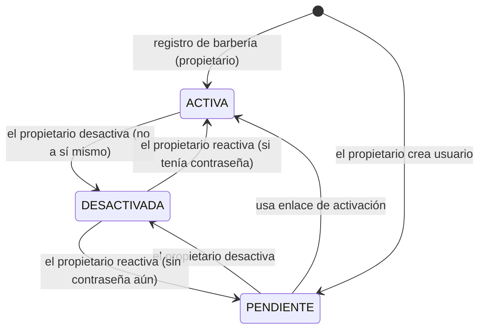
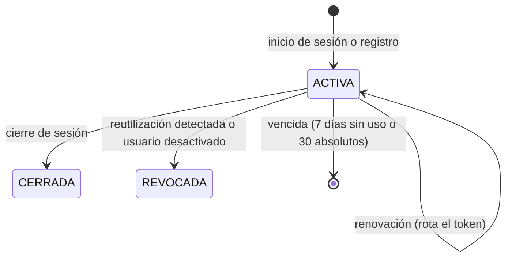

# Modelo de datos: Registro de barbería, acceso con roles y aislamiento

**Funcionalidad**: [spec.md](spec.md) · **Investigación**: [research.md](research.md)

Basado en [multi-tenancy-y-datos.md](../../docs/02-arquitectura-software/multi-tenancy-y-datos.md).
Nombres de tablas en inglés como en el documento de referencia; entidades de dominio en español.

## 1. Resumen por tabla

| Tabla                | Módulo / submódulo | Alcance  | RLS | Dominio                                  |
| -------------------- | ------------------ | -------- | --- | ---------------------------------------- |
| `tenant`             | M01 / barberias    | Global   | No  | `Barberia`                               |
| `role`               | M01 / identidad    | Global   | No  | `Rol` (objeto de valor)                  |
| `user_account`       | M01 / identidad    | Global (sin `tenant_id`) | Sí (por membresía, ADR-015) | `CuentaUsuario`  |
| `membership`         | M01 / identidad    | Tenant   | Sí  | `Membresia`                              |
| `auth_session`       | M01 / identidad    | Tenant   | Sí  | `Sesion`                                 |
| `account_activation` | M01 / identidad    | Tenant   | Sí  | `Activacion`                             |
| `terms_acceptance`   | M01 / barberias    | Tenant   | Sí  | `AceptacionTerminos`                     |
| `login_attempt`      | M01 / identidad    | Global   | No  | (técnica, sin entidad de dominio)        |
| `plan`               | M03 / suscripciones | Global  | No  | `Plan`                                   |
| `subscription`       | M03 / suscripciones | Tenant  | Sí  | `Suscripcion`                            |
| `audit_log`          | M06                | Tenant   | Sí  | `RegistroAuditoria`                      |

Tablas globales: acceso de `barberias_app` limitado por `GRANT` por columna/operación. Tablas de
tenant: `tenant_id uuid NOT NULL`, `ENABLE` + `FORCE ROW LEVEL SECURITY`, política
`tenant_isolation` (USING y WITH CHECK), `UNIQUE (tenant_id, id)` para claves foráneas compuestas.
Todas las fechas en `timestamptz` (UTC).

Roles de base de datos (R04, ADR-015): `barberias_owner` (dueño de tablas, migraciones, sujeto a
RLS por `FORCE`), `barberias_app` (aplicación, `NOBYPASSRLS`) y `barberias_auth` (`NOLOGIN
BYPASSRLS`, dueño solo de las tres funciones de la sección 5, con `SELECT` solo sobre las columnas
que ellas leen).

## 2. Tablas

### `tenant` (Barbería)

| Columna      | Tipo          | Reglas                                                          |
| ------------ | ------------- | --------------------------------------------------------------- |
| `id`         | uuid PK       | Generado por la aplicación (UUID v7)                            |
| `name`       | varchar(120)  | 2–120 caracteres tras `trim`; se permiten duplicados            |
| `slug`       | varchar(140)  | `UNIQUE`; derivado del nombre (minúsculas, guiones) + sufijo si choca |
| `status`     | varchar(16)   | `CHECK IN ('ACTIVA','SUSPENDIDA')`; inicia `ACTIVA`             |
| `created_at` | timestamptz   | `DEFAULT now()`                                                 |

`GRANT SELECT, INSERT` a `barberias_app`; `UPDATE (status)` queda para RF02 (fuera de alcance).

### `role` (catálogo)

| Columna       | Tipo        | Reglas                                                                 |
| ------------- | ----------- | ---------------------------------------------------------------------- |
| `code`        | varchar(24) PK | Semilla: `ADMIN_PLATAFORMA`, `PROPIETARIO`, `BARBERO`, `CLIENTE` |
| `description` | varchar(120) |                                                                       |

Solo lectura para `barberias_app`.

### `user_account` (CuentaUsuario)

| Columna             | Tipo         | Reglas                                                                 |
| ------------------- | ------------ | ---------------------------------------------------------------------- |
| `id`                | uuid PK      |                                                                        |
| `email`             | varchar(254) | Normalizado (`trim` + minúsculas) por el dominio; `UNIQUE`            |
| `full_name`         | varchar(120) | 2–120 caracteres                                                       |
| `password_hash`     | varchar(255) NULL | Cadena PHC Argon2id; `NULL` mientras está pendiente de activar    |
| `is_platform_admin` | boolean      | `DEFAULT false`; siempre `false` en esta funcionalidad                 |
| `created_at`        | timestamptz  |                                                                        |

No guarda datos de negocio de la barbería. RLS con `FORCE` (ADR-015):

- Política `cuentas_del_tenant` (SELECT y UPDATE): `USING (EXISTS (SELECT 1 FROM membership m WHERE m.user_id = user_account.id))`. Como `membership` ya está filtrada por RLS, solo se ven las cuentas con membresía en el tenant actual; sin contexto, ninguna.
- Política `alta_de_cuenta` (INSERT): `WITH CHECK (true)`, porque la cuenta se crea antes que su membresía. Por eso estas inserciones no usan `RETURNING` (el id se genera en la aplicación).
- GRANT a `barberias_app`: `SELECT (id, email, full_name, is_platform_admin, created_at)`, `INSERT` y `UPDATE (password_hash, full_name)`. **Sin** `SELECT` sobre `password_hash`: solo lo lee la función `auth_resolver_cuenta`. Ningún DTO ni registro lo expone.

### `membership` (Membresía: usuario ↔ barbería con un rol)

| Columna      | Tipo        | Reglas                                                                    |
| ------------ | ----------- | ------------------------------------------------------------------------- |
| `id`         | uuid PK     |                                                                           |
| `tenant_id`  | uuid        | FK → `tenant(id)`                                                         |
| `user_id`    | uuid        | FK → `user_account(id)`                                                   |
| `role_code`  | varchar(24) | FK → `role(code)`; `CHECK IN ('PROPIETARIO','BARBERO')` en esta funcionalidad |
| `status`     | varchar(16) | `CHECK IN ('PENDIENTE','ACTIVA','DESACTIVADA')`                           |
| `created_at` | timestamptz |                                                                           |
| `updated_at` | timestamptz |                                                                           |

- `UNIQUE (tenant_id, user_id)` (FR-016: un rol por barbería).
- Índice único parcial `membership_staff_one_tenant ON membership(user_id) WHERE role_code IN ('PROPIETARIO','BARBERO')` (supuesto: un usuario del personal pertenece a una sola barbería).
- Índice único parcial `one_owner_per_tenant ON membership(tenant_id) WHERE role_code = 'PROPIETARIO'`.
- Índice `(tenant_id, role_code, status)` para listar.

### `auth_session` (Sesión)

| Columna              | Tipo        | Reglas                                                    |
| -------------------- | ----------- | --------------------------------------------------------- |
| `id`                 | uuid PK     | Es el `sid` del token de acceso                           |
| `tenant_id`          | uuid        | FK                                                        |
| `user_id`            | uuid        | FK compuesta con la membresía del mismo tenant            |
| `refresh_token_hash` | char(64)    | SHA-256 hex del token vigente; `UNIQUE`                   |
| `previous_token_hash`| char(64) NULL | Último token rotado, para detectar reutilización        |
| `rotated_at`         | timestamptz NULL | Momento en que el token vigente reemplazó al anterior; inicio del período de gracia (R23) |
| `grace_used_at`      | timestamptz NULL | Momento en que se aceptó el token anterior en el período de gracia; `NULL` si no se usó (R23) |
| `superseded_token_hash` | char(64) NULL | Token vigente que el uso de la gracia dejó sin efecto; presentarlo revoca la sesión (R23) |
| `status`             | varchar(16) | `CHECK IN ('ACTIVA','CERRADA','REVOCADA')`                |
| `created_at`         | timestamptz |                                                           |
| `last_used_at`       | timestamptz | Para la vida deslizante de 7 días                         |
| `absolute_expires_at`| timestamptz | `created_at + 30 días`                                    |
| `ip`, `user_agent`   | inet, varchar(200) | Para auditoría; se borran con la fila (retención abajo) |
| `ended_at`           | timestamptz NULL | Momento en que pasó a `CERRADA` o `REVOCADA`          |

Índice `(tenant_id, user_id, status)` para revocar todas las sesiones de un usuario. Retención
(R08): cada inicio de sesión borra las sesiones terminadas del mismo usuario (cerradas, revocadas o
vencidas) hace más de 30 días; GRANT `DELETE` a `barberias_app`.

### `account_activation` (Activación)

| Columna      | Tipo        | Reglas                                      |
| ------------ | ----------- | ------------------------------------------- |
| `id`         | uuid PK     |                                             |
| `tenant_id`  | uuid        | FK                                          |
| `user_id`    | uuid        | FK                                          |
| `token_hash` | char(64)    | `UNIQUE`                                    |
| `expires_at` | timestamptz | `created_at + 72 h`                         |
| `used_at`    | timestamptz NULL |                                        |
| `revoked_at` | timestamptz NULL | Al regenerar el enlace                 |
| `created_by` | uuid        | Propietario que lo generó                   |
| `created_at` | timestamptz |                                             |

### `terms_acceptance` (AceptaciónTérminos, FR-005)

| Columna        | Tipo        | Reglas                              |
| -------------- | ----------- | ----------------------------------- |
| `id`           | uuid PK     |                                     |
| `tenant_id`    | uuid        | FK                                  |
| `user_id`      | uuid        | FK                                  |
| `document`     | varchar(32) | `CHECK IN ('TERMINOS','POLITICA_DATOS')` |
| `text_version` | varchar(32) | Versión vigente que mostró la pantalla (validada en servidor) |
| `accepted_at`  | timestamptz |                                     |
| `ip`           | inet        |                                     |

Solo `INSERT, SELECT` para `barberias_app`.

### `login_attempt` (técnica, R10)

| Columna        | Tipo        | Reglas                                      |
| -------------- | ----------- | ------------------------------------------- |
| `id`           | bigserial PK |                                            |
| `email_hash`   | char(64)    | SHA-256 del correo normalizado (no guarda el correo) |
| `ip`           | inet        |                                             |
| `attempted_at` | timestamptz |                                             |

Índice `(email_hash, ip, attempted_at)`. Sin datos de barbería. Purga oportunista (R10): cada
registro de intento borra en la misma sentencia las filas de más de 24 h.

### `plan` (M03)

| Columna      | Tipo        | Reglas                                    |
| ------------ | ----------- | ----------------------------------------- |
| `id`         | uuid PK     |                                           |
| `code`       | varchar(32) | `UNIQUE`; semilla `TRIAL`                 |
| `trial_days` | int NULL    | `> 0`; `TRIAL` = 14 (por validar)         |
| `max_users`  | int         | `> 0`; `TRIAL` = 5 incluido el propietario (por validar) |
| `max_barbers`| int         | Lo usará M02                              |
| `ai_enabled` | boolean     |                                           |

### `subscription` (M03)

| Columna              | Tipo        | Reglas                                                                 |
| -------------------- | ----------- | ---------------------------------------------------------------------- |
| `id`                 | uuid PK     |                                                                        |
| `tenant_id`          | uuid        | FK; `UNIQUE (tenant_id)`                                               |
| `plan_id`            | uuid        | FK → `plan`                                                            |
| `status`             | varchar(16) | `CHECK IN ('TRIAL','ACTIVE','PAST_DUE','EXPIRED','CANCELLED','SUSPENDED')`; aquí solo `TRIAL` |
| `started_at`         | timestamptz | = fecha del registro                                                   |
| `trial_ends_at`      | timestamptz | `started_at + plan.trial_days`                                         |
| `current_period_end` | timestamptz NULL |                                                                   |

### `audit_log` (M06)

| Columna      | Tipo        | Reglas                                                                 |
| ------------ | ----------- | ---------------------------------------------------------------------- |
| `id`         | uuid PK     |                                                                        |
| `tenant_id`  | uuid        | Tenant del actor (del contexto)                                        |
| `actor_id`   | uuid NULL   | `NULL` solo en el registro anónimo previo a crear la cuenta            |
| `action`     | varchar(48) | `BARBERIA_REGISTRADA`, `USUARIO_CREADO`, `USUARIO_DESACTIVADO`, `USUARIO_REACTIVADO`, `ACTIVACION_REGENERADA`, `ACCESO_DENEGADO_ROL`, `ACCESO_TENANT_AJENO`, `SESION_REUTILIZADA`, `SESION_RENOVADA_EN_GRACIA` |
| `resource`   | varchar(80) | p. ej. `usuario:<id>`                                                  |
| `result`     | varchar(12) | `PERMITIDO` / `DENEGADO`                                               |
| `ip`         | inet        |                                                                        |
| `correlation_id` | varchar(64) |                                                                    |
| `at`         | timestamptz |                                                                        |

`GRANT INSERT, SELECT` únicamente (inmutable para la aplicación). Sin datos personales en texto
libre. `ACCESO_TENANT_AJENO` se registra solo ante intentos explícitos de indicar otra barbería
(campos `tenantId`, `tenant_id`, `barberiaId` o encabezado `X-Tenant-Id`); un identificador de
recurso de otra barbería da 404 sin este registro (escenario 4 de US3).

## 3. Entidades de dominio y reglas

| Entidad / objeto de valor | Reglas (probadas sin infraestructura)                                                                 | FR             |
| ------------------------- | ----------------------------------------------------------------------------------------------------- | -------------- |
| `Correo`                  | Normaliza `trim` + minúsculas; formato válido; ≤ 254                                                  | FR-028, FR-029 |
| `Contrasena`              | 10–128 caracteres; no está en lista común; no contiene el correo                                       | FR-014         |
| `NombreBarberia`          | 2–120 caracteres; sin caracteres de control                                                           | FR-001         |
| `Slug`                    | Derivado del nombre; solo `[a-z0-9-]`                                                                 | —              |
| `Rol`                     | `PROPIETARIO`, `BARBERO`; `esAsignablePorPropietario()` solo `BARBERO`                                | FR-015, FR-017 |
| `Membresia`               | Un rol, fijo; transiciones de estado (abajo); el propietario no puede desactivarse a sí mismo          | FR-016, FR-018, FR-019 |
| `Sesion`                  | `rotar()`, `cerrar()`, `revocar()`; `estaVigente(ahora)` con 7 días deslizantes y 30 absolutos; `clasificarToken(hash, ahora, graciaMs)` → `VIGENTE`, `GRACIA`, `REUTILIZADO` o `DESCONOCIDO`; `rotarEnGracia()` de un solo uso que no extiende la ventana | FR-008, FR-008a, FR-011 |
| `Activacion`              | `usar(ahora)` una sola vez, antes de `expires_at`, si no revocada                                     | FR-022         |
| `PoliticaIntentos`        | Decide bloqueo y `Retry-After` a partir de los fallos de la ventana                                   | FR-010         |
| `Suscripcion` (M03)       | `iniciarPrueba(plan, ahora)` → `TRIAL`, `trial_ends_at = ahora + trial_days`                          | FR-003         |
| `LimiteUsuarios` (M01)    | `puedeAgregar(actuales, max)`; cuenta `PENDIENTE` + `ACTIVA`. Se aplica al crear y al reactivar, con la fila de `subscription` bloqueada (`FOR UPDATE`) durante la transacción | FR-020         |
| `Permisos` (M01)          | Matriz `operacion → roles permitidos` de [contracts/rbac.md](contracts/rbac.md); `permite(rol, operacion)` (R22) | FR-021 |

## 4. Transiciones de estado

### Membresía

Desactivar revoca todas las sesiones activas del usuario en la misma transacción.

### Sesión

### Token de renovación dentro de una sesión (FR-008a, R23)

Con la fila de la sesión bloqueada (`FOR UPDATE`), el token presentado se clasifica así (`G` =
`REFRESH_GRACIA_SEGUNDOS`, 10 por defecto, de 0 a 30):

| Token presentado | Condición | Resultado |
| --- | --- | --- |
| Vigente | — | Rotación normal: el vigente pasa a anterior, `rotated_at = ahora`, `grace_used_at` y `superseded_token_hash` a `NULL` |
| Anterior | `ahora − rotated_at ≤ G` y `grace_used_at` nulo | Gracia: token nuevo; el vigente pasa a `superseded_token_hash`; `grace_used_at = ahora`; `rotated_at` no cambia. Auditoría `SESION_RENOVADA_EN_GRACIA` |
| Anterior | Fuera de la ventana o gracia ya usada | Revocación (`REVOCADA`) y `SESION_REUTILIZADA` |
| Reemplazado | — | Revocación y `SESION_REUTILIZADA` |
| Otro | — | 401, sin cambios |

## 5. Funciones `SECURITY DEFINER` (R05, ADR-015)

| Función                              | Entrada      | Salida (máx. 1 fila)                                                |
| ------------------------------------ | ------------ | ------------------------------------------------------------------- |
| `auth_resolver_cuenta(varchar)`      | correo normalizado | `user_id`, `password_hash`, `tenant_id`, `role_code`, `membership_status`, `tenant_status` |
| `auth_buscar_sesion(char(64))`       | hash de token (vigente, anterior o reemplazado; el último desde la migración `0008`) | `session_id`, `tenant_id`, `user_id`, `status`, `es_token_anterior` (verdadero si no es el vigente) |
| `auth_buscar_activacion(char(64))`   | hash de token | `activation_id`, `tenant_id`, `user_id`, `expires_at`, `used_at`, `revoked_at` |

Dueño: `barberias_auth` (`NOLOGIN NOINHERIT BYPASSRLS`, sin propiedad de tablas; `SELECT` solo
sobre las columnas que leen las funciones). `SET search_path = public, pg_temp`,
`REVOKE ALL FROM PUBLIC`, `GRANT EXECUTE TO barberias_app`. Ninguna recibe `tenant_id` ni devuelve
más de una fila. **Por validar:** creación del rol `BYPASSRLS` en Amazon RDS for PostgreSQL.

## 6. Consultas clave por caso de uso

| Caso de uso                | Tablas (orden)                                                                                   | Transacción |
| -------------------------- | ------------------------------------------------------------------------------------------------ | ----------- |
| `RegistrarBarberia`        | `tenant` → `set_config` → `user_account` (sin `RETURNING`), `membership`, `terms_acceptance`, M03 `subscription`, `audit_log`, `auth_session` | Una         |
| `IniciarSesion`            | `login_attempt` → `auth_resolver_cuenta` → `set_config` → `auth_session` (purga de terminadas + nueva) | Una tras resolver |
| `RenovarSesion`            | `auth_buscar_sesion` → `set_config` → `auth_session` (rotar) + verificación de membresía y tenant | Una         |
| `CerrarSesion`             | `set_config` (del token) → `auth_session`                                                        | Una         |
| `ValidarSolicitud` (guard) | `set_config` → `auth_session` ⨝ `membership` ⨝ `tenant` por clave                                 | Lectura     |
| `CrearUsuario`             | `set_config` → M03 límite → `user_account`, `membership`, `account_activation`, `audit_log`      | Una         |
| `ActivarCuenta`            | `auth_buscar_activacion` → `set_config` → `account_activation`, `user_account`, `membership`     | Una         |
| `ListarUsuarios` / `ObtenerUsuario` | `set_config` → `membership` ⨝ `user_account`                                            | Lectura     |
| `ActualizarUsuario`        | `set_config` → `membership`, `auth_session` (revocar), `audit_log`                               | Una         |
