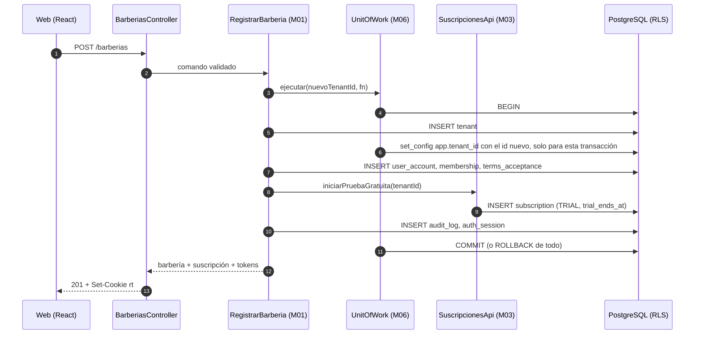

# Implementation Plan: Registro de barbería, acceso con roles y aislamiento por barbería

**Branch**: `001-registro-acceso-barberia` | **Date**: 2026-10-15 | **Spec**: [spec.md](spec.md)

**Input**: Feature specification from `/specs/001-registro-acceso-barberia/spec.md`

## Summary

Primera funcionalidad de la plataforma (proyecto nuevo: `tecnologia/plataforma-barberias/` está
vacío). Una barbería se registra y, en **una sola transacción**, se crean su tenant, la cuenta del
propietario, su membresía y la suscripción en prueba gratuita (M03). Los usuarios inician sesión con
correo y contraseña (Argon2id) y reciben un JWT ES256 de 15 min con `sub`, `tid`, `rol` y `sid`,
más un token de renovación rotativo en cookie HttpOnly. El propietario crea usuarios
con rol BARBERO, que activan su cuenta con un enlace de un solo uso.

El aislamiento descansa en varias barreras: el `tenant_id` sale solo del token, el contexto de
tenant de M06 fija `app.tenant_id` en cada transacción, los repositorios filtran por tenant,
PostgreSQL aplica RLS con `FORCE` (también en `user_account`) y un rol de aplicación sin
`BYPASSRLS`, y la suite PR09 lo demuestra. Las búsquedas previas a conocer el tenant (login,
renovación, activación) usan tres funciones `SECURITY DEFINER` acotadas cuyo dueño es el rol
`barberias_auth` (`NOLOGIN BYPASSRLS`), según
[ADR-015](../../docs/01-analisis-de-sistema/07-decisiones-arquitectonicas.md#adr-015-autenticación-antes-de-conocer-el-tenant-y-rls-en-user_account)
y [research.md](research.md) R05. Los permisos por rol se comprueban en dos lugares: el guard HTTP
y, sobre todo, cada caso de uso en la capa de aplicación (R22).

## Technical Context

**Language/Version**: TypeScript 5 (`strict`) sobre Node.js 22 LTS

**Primary Dependencies**: Backend: NestJS 11, Kysely + `pg`, `argon2`, `jose`, `class-validator`,
`@nestjs/throttler`. Frontend: React 19, Vite 6, React Router, TanStack Query, `react-hook-form` +
`zod`, `openapi-typescript`; tras el rediseño, Radix UI (`react-dialog`, `react-dropdown-menu`,
`react-tooltip`, `react-toast`) y fuentes autohospedadas `@fontsource-variable` (Fraunces e Inter)
(ADR-016). Versiones exactas fijadas en `package.json` (ver
[tecnologías §5](../../docs/02-arquitectura-software/tecnologias.md)).

**Storage**: PostgreSQL 16 con RLS (`ENABLE` + `FORCE`) en toda tabla con `tenant_id` y en
`user_account`; roles `barberias_owner` (migraciones), `barberias_app` (`NOBYPASSRLS`) y
`barberias_auth` (`NOLOGIN BYPASSRLS`, solo dueño de 3 funciones; creación en Amazon RDS **por
validar**). Sin Redis en esta funcionalidad.

**Testing**: Backend: Jest + `supertest` + Testcontainers (PostgreSQL real); `dependency-cruiser`
para PR14. Frontend: Vitest + Testing Library + MSW.

**Target Platform**: Contenedores Linux (Docker Compose en desarrollo; AWS con ALB como destino,
ADR-006). Navegadores móviles y de escritorio actuales.

**Project Type**: Aplicación web: API REST (NestJS) + SPA responsive (React).

**Performance Goals**: Inicio de sesión p95 < 2 s (SC-008); registro completo en < 3 min de
interacción (SC-001); guard de autenticación con una sola consulta por clave por solicitud. Interfaz:
JavaScript inicial ≤ 400 KB sin comprimir (carga diferida por pantalla, ADR-018), Lighthouse ≥ 90 en
rendimiento (modo celular), accesibilidad y buenas prácticas, y WCAG 2.2 AA (ADR-016).

**Constraints**: `tenant_id` nunca desde el cliente; 0 fugas entre barberías (SC-003); 100 % de
tokens inválidos o de sesión cerrada rechazados (SC-004); sexto fallo de login en 60 s → 429
(SC-006); HTTPS, CORS solo al origen del frontend; cuerpo ≤ 16 KB; secretos fuera del código.

**Scale/Scope**: MVP de decenas de barberías y menos de 10 usuarios del personal por barbería;
11 tablas, 12 operaciones REST, 4 pantallas (registro, ingreso, activación, usuarios).

## Constitution Check

*GATE: Must pass before Phase 0 research. Re-check after Phase 1 design.*

Gates from `.specify/memory/constitution.md` (v1.0.1).

| # | Puerta | Antes de Fase 0 | Tras el diseño | Evidencia |
| - | ------ | --------------- | -------------- | --------- |
| I | Seis módulos | ✅ | ✅ | Solo M01 (`identidad`, `barberias`), M03 (`suscripciones`, mínimo) y M06. M01→M03 y M01→M06 están permitidos en la matriz. M01 usa `suscripciones-pagos/index.ts` (`iniciarPruebaGratuita`, `obtenerLimiteUsuarios`), nunca sus tablas. Sin módulos nuevos |
| II | Cuatro capas | ✅ | ✅ | Cada submódulo con `presentation/application/domain/infrastructure`. Puertos donde hay riesgo de cambio: `PasswordHasher`, `TokenSigner`, repositorios, `UnitOfWork`. El dominio no importa Nest, Kysely, `pg`, `argon2` ni `jose` (lo verifica PR14). RBAC en la capa de aplicación con `Autorizacion.exigir` en cada caso de uso protegido (R22, ADR-010) |
| III | Aislamiento por barbería | ✅ | ✅ | `tid` solo del JWT verificado (R07, R09); `set_config(..., true)` por transacción (R03); RLS `FORCE` en tablas de tenant y en `user_account`; rol de aplicación sin bypass (R04); filtro por tenant obligatorio en cada repositorio desde su creación y verificado automáticamente; campos de tenant del cliente → 400 (R11); auditoría con tenant. La única omisión de RLS son las 3 funciones de ADR-015 (dueño `barberias_auth`, sin tenant como parámetro, ≤ 1 fila), probadas en PR09 |
| IV | Citas sin duplicados | N/A | N/A | No se tocan citas |
| V | Pagos | ✅ | ✅ | El registro no pide ni acepta datos de pago (FR-004); no se toca `PaymentGateway` |
| VI | IA | N/A | N/A | No se toca M04 |
| VII | Notificaciones | ✅ | ✅ | No se envían mensajes; el enlace de activación se entrega por pantalla. Cuando exista M05 escuchará `UsuarioCreado` sin cambiar M01 |
| VIII | Redis solo caché | ✅ | ✅ | No se usa Redis. Revocación y límite de intentos van en PostgreSQL, no en Redis (R09, R10) |
| IX | Solo web responsive | ✅ | ✅ | SPA React móvil primero |
| X | Pruebas obligatorias | ✅ | ✅ | Pruebas de dominio, PR07, PR08 ([rbac.md](contracts/rbac.md)), **PR09**, PR10, PR12, PR13 y **PR14**, más pruebas de frontend. PR16 no aplica (no hay reservas). CI bloquea la fusión |
| XI | ADR | ✅ | ✅ | La omisión acotada de RLS para autenticar sin tenant y la RLS en `user_account` quedaron registradas **antes de implementar** como ADR-015 (con `multi-tenancy-y-datos.md` y `trazabilidad.md` ya actualizados). El resto cabe en ADR-003, -004, -010, -011 y -014. Pendiente en el mismo cambio que el código: librerías en `tecnologias.md` (lo pide ADR-014) y estado de componentes en `trazabilidad.md` |
| XII | Ubicación del código | ✅ | ✅ | Todo el código bajo `tecnologia/plataforma-barberias/`; solo el flujo de CI en `.github/workflows/`, permitido por la excepción de la constitución v1.0.1 |

**Resultado**: pasa. La única excepción (omisión acotada de RLS en 3 funciones, ADR-015) está justificada en Complexity Tracking, como exige la gobernanza de la constitución.

## Project Structure

### Documentation (this feature)

```text
specs/001-registro-acceso-barberia/
├── plan.md              # Este archivo
├── research.md          # Fase 0: decisiones R01–R22
├── data-model.md        # Fase 1: tablas, RLS, entidades y estados
├── quickstart.md        # Fase 1: guía de validación de punta a punta
├── contracts/
│   ├── openapi.yaml     # Fase 1: contrato REST /api/v1
│   └── rbac.md          # Fase 1: matriz rol × operación (fuente de PR08)
├── checklists/
│   └── requirements.md
└── tasks.md             # Fase 2 (/speckit-tasks; no lo crea este comando)
```

### Source Code (repository root)

```text
tecnologia/plataforma-barberias/
├── docker-compose.yml                 # db (postgres:16), backend, frontend
├── .env.example
├── db/
│   └── init/01-roles.sql              # crea barberias_owner, barberias_app (NOBYPASSRLS) y barberias_auth (NOLOGIN BYPASSRLS)
├── backend/
│   ├── package.json
│   ├── .dependency-cruiser.cjs        # PR14: matriz de módulos + regla de capas
│   ├── src/
│   │   ├── main.ts
│   │   ├── host/                      # raíz de composición
│   │   │   ├── app.module.ts
│   │   │   ├── auth.guard.ts          # verifica JWT + sesión/membresía/tenant vigentes; fija TenantContext
│   │   │   ├── roles.guard.ts         # RBAC por endpoint (@Roles)
│   │   │   ├── tenant-header.interceptor.ts  # rechaza X-Tenant-Id
│   │   │   └── error.filter.ts        # formato { codigo, mensaje, detalles }
│   │   ├── modules/
│   │   │   ├── acceso-barberias/      # M01
│   │   │   │   ├── index.ts           # interfaz pública del módulo
│   │   │   │   ├── identidad/
│   │   │   │   │   ├── presentation/  # AuthController, UsuariosController, DTO
│   │   │   │   │   ├── application/   # IniciarSesion, RenovarSesion, CerrarSesion, ValidarSolicitud,
│   │   │   │   │   │                  # CrearUsuario, ActivarCuenta, ListarUsuarios, ActualizarUsuario,
│   │   │   │   │   │                  # RegenerarActivacion; Autorizacion (RBAC, R22);
│   │   │   │   │   │                  # puertos PasswordHasher, TokenSigner, repositorios
│   │   │   │   │   ├── domain/        # Correo, Contrasena, Rol, Permisos, Membresia, Sesion, Activacion,
│   │   │   │   │   │                  # PoliticaIntentos, LimiteUsuarios, errores de dominio
│   │   │   │   │   └── infrastructure/ # repositorios Kysely, Argon2Hasher, JoseTokenSigner
│   │   │   │   └── barberias/
│   │   │   │       ├── presentation/  # BarberiasController (POST /barberias)
│   │   │   │       ├── application/   # RegistrarBarberia
│   │   │   │       ├── domain/        # Barberia, NombreBarberia, Slug, AceptacionTerminos
│   │   │   │       └── infrastructure/ # TenantRepository, TermsAcceptanceRepository
│   │   │   └── suscripciones-pagos/   # M03 (solo lo que necesita esta funcionalidad)
│   │   │       ├── index.ts           # SuscripcionesApi: iniciarPruebaGratuita, obtenerLimiteUsuarios
│   │   │       └── suscripciones/
│   │   │           ├── application/
│   │   │           ├── domain/        # Suscripcion, Plan
│   │   │           └── infrastructure/
│   │   └── shared/                    # M06
│   │       ├── index.ts
│   │       ├── tenant/                # TenantId, TenantContext (AsyncLocalStorage)
│   │       ├── persistence/           # UnitOfWork (puerto) + KyselyUnitOfWork (set_config por transacción)
│   │       ├── audit/                 # AuditLog
│   │       └── clock/                 # Clock (puerto) para probar vencimientos
│   ├── migrations/                    # Kysely, SQL explícito: tablas, RLS, GRANT, funciones SECURITY DEFINER (ADR-015), semillas
│   └── test/
│       ├── unit/                      # dominio sin infraestructura
│       ├── integration/               # Testcontainers: casos de uso + RLS
│       │   ├── aislamiento/           # PR09: rls, funciones-definer (ADR-015), aislamiento-tenant, filtro-repositorios
│       │   └── auditoria.spec.ts      # PR13
│       ├── contract/                  # HTTP vs openapi.yaml; rbac.spec.ts (PR08)
│       └── architecture/              # PR14
└── frontend/
    ├── package.json
    ├── index.html                     # aplica el tema guardado antes de pintar
    ├── public/                        # favicon.svg, robots.txt, img/ (fotos de marca y su README)
    ├── src/
    │   ├── api/                       # cliente HTTP + tipos generados de openapi.yaml
    │   ├── auth/                      # SesionProvider (token en memoria, renovación silenciosa),
    │   │                              # indicadorSesion (cookie hay_sesion, ADR-017), RutaProtegida, PantallaCarga
    │   ├── styles/                    # tokens.css (tema claro y oscuro) y global.css (ADR-016)
    │   ├── components/
    │   │   ├── ui/                    # sistema de diseño: Boton, Campo, Tarjeta, EtiquetaEstado,
    │   │   │                          # ModalConfirmacion, Avisos, Menu, Ayuda, Esqueleto, EstadoVacio, ConmutadorTema
    │   │   ├── app/                   # DisenoApp (barra lateral, cabecera, navegación inferior), MenuUsuario,
    │   │   │                          # EncabezadoPagina (migas de pan)
    │   │   ├── marca/                 # ImagenMarca e IlustracionBarberia (SVG propio)
    │   │   └── MarcoAcceso, Logo, Icono, IndicadorFortaleza
    │   ├── pages/                     # Registro, Ingresar, Activar, Inicio, Usuarios, DialogoEnlace
    │   ├── tema.ts                    # preferencia de tema (sistema, claro, oscuro)
    │   └── routes.tsx                 # rutas protegidas por rol, cargadas con React.lazy (ADR-018)
    └── test/                          # Vitest + Testing Library + MSW
```

**Structure Decision**: Aplicación web con backend y frontend separados dentro de
`tecnologia/plataforma-barberias/` (principio XII, ADR-014), siguiendo la organización de
[estilo-arquitectonico.md §4](../../docs/02-arquitectura-software/estilo-arquitectonico.md). Solo
se crean los módulos que toca esta funcionalidad (M01, el mínimo de M03 y M06); M02, M04 y M05 se
añadirán en sus funcionalidades. El host es el único lugar que ensambla módulos y aplica los guards.

## Flujo principal (diseño)



## Trazabilidad

| HU | RF | Escenario | ADR | Componente | Prueba |
| -- | -- | --------- | --- | ---------- | ------ |
| HU02 | RF01, RF18 | EQ-09 | ADR-003 | M01 `barberias` · `RegistrarBarberia`; M03 `SuscripcionesApi` | Integración de registro, PR09 |
| HU05 | RF04 | EQ-07, EQ-12 | ADR-010 | M01 `identidad` · `IniciarSesion`, `RenovarSesion`, `CerrarSesion`, `auth.guard` | PR07, PR12 |
| HU04 | RF06 | EQ-08, EQ-13 | ADR-010 | M01 `identidad` · `CrearUsuario`, `ActualizarUsuario`, `Autorizacion`, `roles.guard`; M06 `AuditLog` | PR08, PR13 |
| — | (todas) | EQ-09, EQ-10 | ADR-003, ADR-010, ADR-015 | M06 `TenantContext`, `UnitOfWork`; RLS; funciones de autenticación sin tenant | PR09, PR10 |
| — | — | EQ-14 | ADR-002, ADR-011 | Estructura de capas y módulos | PR14 |
| HU02, HU04, HU05 | RF01, RF04, RF06 | — (atributo AC06, usabilidad) | ADR-014, ADR-016, ADR-018 | Interfaz web: sistema de diseño, estructura de la aplicación y carga diferida de pantallas | Vitest (registro, usuarios, activar, componentes base); axe-core y Lighthouse (quickstart 3.1) |
| HU05 | RF04 | EQ-07 | ADR-010, ADR-017 | Interfaz web: `SesionProvider` e indicador `hay_sesion` | Vitest `sesion` |

## Complexity Tracking

| Violation | Why Needed | Simpler Alternative Rejected Because |
|-----------|------------|-------------------------------------|
| Omisión acotada de RLS (principio III y control 5 de multi-tenancy-y-datos.md) en 3 funciones `SECURITY DEFINER` cuyo dueño es `barberias_auth` (`NOLOGIN BYPASSRLS`): `auth_resolver_cuenta`, `auth_buscar_sesion`, `auth_buscar_activacion`. Registrada como [ADR-015](../../docs/01-analisis-de-sistema/07-decisiones-arquitectonicas.md#adr-015-autenticación-antes-de-conocer-el-tenant-y-rls-en-user_account) | Iniciar sesión, renovar la sesión y activar una cuenta ocurren antes de tener token, así que no se conoce el tenant, y las filas que se consultan están bajo RLS con `FORCE` (ni el dueño de las tablas las ve). El rol de aplicación conserva `NOBYPASSRLS`; cada función busca por clave exacta, devuelve como máximo una fila y no recibe tenant (pruebas en T050) | Hacer globales `membership`, `auth_session` y `account_activation` dejaría datos de negocio sin RLS (contradice el principio III en todas las consultas, no en tres). Un rol `BYPASSRLS` con conexión propia omitiría RLS en cualquier consulta que hiciera. Pedir la barbería en el login o en la cookie haría que el tenant viniera del cliente (prohibido por ADR-010) |
