# Modelo de datos: Catálogo, citas y cuenta de cliente

**Funcionalidad**: [spec.md](spec.md) · **Investigación**: [research.md](research.md) · **Base**:
[modelo de datos de 001](../001-registro-acceso-barberia/data-model.md)

Mismas convenciones que en 001:

- Tablas en inglés y entidades de dominio en español.
- Identificadores UUID v7 generados por la aplicación.
- Todas las fechas en `timestamptz`, en UTC.
- Toda tabla con `tenant_id` tiene `ENABLE` + `FORCE ROW LEVEL SECURITY`, la política
  `tenant_isolation` (`rlsPorTenant` de `migrations/sql-comun.ts`) y `UNIQUE (tenant_id, id)` para
  las claves foráneas compuestas. Así una fila nunca puede apuntar a otra barbería.

## 1. Resumen por tabla

| Tabla                        | Módulo / submódulo | Alcance | RLS                                                                      | Dominio                   | Vía pública (ADR-021)                              |
| ---------------------------- | ------------------ | ------- | ------------------------------------------------------------------------ | ------------------------- | -------------------------------------------------- |
| `tenant` (ampliada)          | M01 / barberias    | Global  | **Sí, nueva**: `SELECT`/`INSERT` libres, `UPDATE` solo del tenant actual | `Barberia`                | Columnas públicas                                  |
| `business_hours`             | M01 / barberias    | Tenant  | Sí                                                                       | `HorarioAtencion`         | Sí                                                 |
| `membership` (ampliada)      | M01 / identidad    | Tenant  | Sí                                                                       | `Membresia` (+ `CLIENTE`) | No                                                 |
| `customer_profile`           | M01 / clientes     | Tenant  | Sí                                                                       | `PerfilCliente`           | No                                                 |
| `consent_record`             | M01 / clientes     | Tenant  | Sí                                                                       | `Consentimiento`          | No                                                 |
| `service`                    | M02 / catalogo     | Tenant  | Sí                                                                       | `Servicio`                | Columnas públicas                                  |
| `barber`                     | M02 / catalogo     | Tenant  | Sí                                                                       | `Barbero`                 | Columnas públicas (sin `user_id`)                  |
| `barber_service`             | M02 / catalogo     | Tenant  | Sí                                                                       | (parte de `Barbero`)      | Sí                                                 |
| `working_hours`              | M02 / catalogo     | Tenant  | Sí                                                                       | `DisponibilidadSemanal`   | Columnas públicas                                  |
| `time_off`                   | M02 / catalogo     | Tenant  | Sí                                                                       | `Bloqueo`                 | Sin `reason` ni autor                              |
| `appointment`                | M02 / citas        | Tenant  | Sí                                                                       | `Cita`                    | Solo `barber_id`, `starts_at`, `ends_at`, `status` |
| `appointment_status_history` | M02 / citas        | Tenant  | Sí                                                                       | `CambioEstadoCita`        | No                                                 |

## 2. Tablas nuevas y cambios

### `tenant` (ampliada, RF03)

| Columna nueva               | Tipo              | Reglas                                                                        |
| --------------------------- | ----------------- | ----------------------------------------------------------------------------- |
| `address`                   | varchar(200) NULL | Hasta 200 caracteres, sin caracteres de control                               |
| `phone`                     | varchar(20) NULL  | Teléfono de la barbería (dato público); `^\+?[0-9 ]{6,20}$`                   |
| `description`               | varchar(500) NULL | Opcional                                                                      |
| `timezone`                  | varchar(40)       | `DEFAULT 'America/Lima'`; `CHECK (timezone = 'America/Lima')` por ahora (R07) |
| `cancel_min_notice_minutes` | int               | `DEFAULT 120`; `CHECK BETWEEN 0 AND 4320` (FR-004, FR-038)                    |

- `slug` ya existe (001, `UNIQUE`, `CHECK` de formato). Al editarlo, el dominio exige además 3–60
  caracteres y que no sea una palabra reservada (R15).
- **RLS nueva (R15):** `ENABLE` + `FORCE` y tres políticas:
  - `tenant_lectura`: `FOR SELECT USING (true)`.
  - `tenant_alta`: `FOR INSERT WITH CHECK (true)`.
  - `tenant_edicion`: `FOR UPDATE USING (id = tenant actual) WITH CHECK (id = tenant actual)`.

  Las funciones de ADR-015 no cambian: su dueño tiene `BYPASSRLS`.

- **Permisos:**
  - `GRANT UPDATE (name, slug, address, phone, description, cancel_min_notice_minutes)` a
    `barberias_app`. `status` sigue sin `UPDATE` (RF02, funcionalidad 003).
  - `GRANT SELECT (id, slug, name, address, phone, description, timezone, status)` a
    `barberias_publico`.

### `business_hours` (HorarioAtencion, RF03)

| Columna                  | Tipo     | Reglas                                |
| ------------------------ | -------- | ------------------------------------- |
| `id`                     | uuid PK  |                                       |
| `tenant_id`              | uuid     | FK → `tenant(id)`                     |
| `weekday`                | smallint | `CHECK BETWEEN 0 AND 6` (0 = domingo) |
| `start_time`, `end_time` | time     | `CHECK (start_time < end_time)`       |

- **Escritura:** se reemplaza la semana completa en una transacción (`DELETE` + `INSERT`). El dominio
  valida que los tramos de un mismo día no se solapen.
- **Índice:** `(tenant_id, weekday)`.
- **Vía pública:** `GRANT SELECT (tenant_id, weekday, start_time, end_time)`.

### `membership` (ampliada, ADR-020)

- `role_code`: el `CHECK` pasa a `IN ('PROPIETARIO','BARBERO','CLIENTE')`.
- `membership_staff_one_tenant` (índice único parcial de 001) **no cambia**: el personal sigue en una
  sola barbería.
- El cliente nace `ACTIVA`.
- El conteo del límite de usuarios y la lista de usuarios filtran `role_code IN ('PROPIETARIO','BARBERO')`.

### `customer_profile` (PerfilCliente, RF05, FR-035)

| Columna                    | Tipo              | Reglas                                               |
| -------------------------- | ----------------- | ---------------------------------------------------- |
| `id`                       | uuid PK           |                                                      |
| `tenant_id`                | uuid              | FK                                                   |
| `user_id`                  | uuid NULL         | FK → `user_account(id)`; `NULL` = cliente presencial |
| `full_name`                | varchar(120)      | 2–120 caracteres                                     |
| `email`                    | varchar(254) NULL | Normalizado; obligatorio si hay `user_id`            |
| `phone`                    | varchar(20)       | Obligatorio (HU06)                                   |
| `origin`                   | varchar(16)       | `CHECK IN ('EN_LINEA','PRESENCIAL')`                 |
| `created_by`               | uuid NULL         | Propietario que lo registró (presencial)             |
| `created_at`, `updated_at` | timestamptz       |                                                      |

- **Índices:**
  - Único parcial `customer_profile_cuenta ON (tenant_id, user_id) WHERE user_id IS NOT NULL`.
  - Para la búsqueda del propietario: `(tenant_id, lower(full_name))` y `(tenant_id, phone)`.
- **Permisos:** `SELECT, INSERT, UPDATE (full_name, phone, updated_at)` a `barberias_app`.
  Sin `DELETE` (RF32, funcionalidad 007).

### `consent_record` (Consentimiento, FR-024)

| Columna        | Tipo        | Reglas                                                    |
| -------------- | ----------- | --------------------------------------------------------- |
| `id`           | uuid PK     |                                                           |
| `tenant_id`    | uuid        | FK                                                        |
| `customer_id`  | uuid        | FK compuesta → `customer_profile(tenant_id, id)`          |
| `document`     | varchar(32) | `CHECK IN ('POLITICA_DATOS')` (WhatsApp se agrega en 004) |
| `text_version` | varchar(32) | Validada contra la vigente en el servidor                 |
| `method`       | varchar(16) | `CHECK IN ('EN_LINEA','PRESENCIAL')`                      |
| `recorded_by`  | uuid NULL   | Obligatorio si `method = 'PRESENCIAL'` (`CHECK`)          |
| `ip`           | inet NULL   | En línea                                                  |
| `accepted_at`  | timestamptz |                                                           |

Solo `INSERT, SELECT` (inmutable para la aplicación).

### `service` (Servicio, RF07)

| Columna                    | Tipo              | Reglas                                                            |
| -------------------------- | ----------------- | ----------------------------------------------------------------- |
| `id`                       | uuid PK           |                                                                   |
| `tenant_id`                | uuid              | FK                                                                |
| `name`                     | varchar(80)       | 2–80 caracteres                                                   |
| `description`              | varchar(300) NULL |                                                                   |
| `price`                    | numeric(10,2)     | `CHECK (price >= 0 AND price < 100000)`                           |
| `duration_min`             | smallint          | `CHECK (duration_min BETWEEN 5 AND 480 AND duration_min % 5 = 0)` |
| `active`                   | boolean           | `DEFAULT true`                                                    |
| `created_at`, `updated_at` | timestamptz       |                                                                   |

- **Índice:** único `(tenant_id, lower(name))`, que hace a FR-006 nombre único por barbería.
- **Permisos:** sin `DELETE` (solo se desactiva).

### `barber` (Barbero, RF08)

| Columna                    | Tipo        | Reglas                                                      |
| -------------------------- | ----------- | ----------------------------------------------------------- |
| `id`                       | uuid PK     |                                                             |
| `tenant_id`                | uuid        | FK                                                          |
| `user_id`                  | uuid NULL   | Usuario del personal vinculado (validado vía `PersonalApi`) |
| `display_name`             | varchar(80) | Dato público (constitución 1.2.0, principio III)            |
| `active`                   | boolean     | `DEFAULT true`                                              |
| `created_at`, `updated_at` | timestamptz |                                                             |

- **Índice:** único parcial `(tenant_id, user_id) WHERE user_id IS NOT NULL`: un usuario, a lo sumo
  un barbero (FR-009).
- **Vía pública:** `GRANT SELECT (tenant_id, id, display_name, active)`, **sin** `user_id`.

### `barber_service` (RF08)

PK `(tenant_id, barber_id, service_id)`; FK compuestas a `barber(tenant_id, id)` y
`service(tenant_id, id)`. Índice `(tenant_id, service_id)`.

### `working_hours` (DisponibilidadSemanal, RF09)

| Columna                  | Tipo     | Reglas                  |
| ------------------------ | -------- | ----------------------- |
| `id`                     | uuid PK  |                         |
| `tenant_id`, `barber_id` | uuid     | FK compuesta → `barber` |
| `weekday`                | smallint | 0–6                     |
| `start_time`, `end_time` | time     | `start_time < end_time` |

Se reemplaza la semana del barbero en una transacción. El dominio valida que no haya solapes y que
cada tramo quede dentro del horario de atención (FR-013). Índice `(tenant_id, barber_id, weekday)`.

### `time_off` (Bloqueo, RF09)

| Columna                  | Tipo              | Reglas                                                             |
| ------------------------ | ----------------- | ------------------------------------------------------------------ |
| `id`                     | uuid PK           |                                                                    |
| `tenant_id`, `barber_id` | uuid              | FK compuesta → `barber`                                            |
| `starts_at`, `ends_at`   | timestamptz       | `CHECK (starts_at < ends_at)`; hasta 30 días de duración (dominio) |
| `reason`                 | varchar(200) NULL | Solo visible para la barbería                                      |
| `created_by`             | uuid              |                                                                    |
| `created_at`             | timestamptz       |                                                                    |

- **Índice:** GiST `(tenant_id, barber_id, tstzrange(starts_at, ends_at, '[)'))` para la ocupación.
- **Permisos:** `DELETE` permitido (FR-015).
- **Vía pública:** solo `(tenant_id, barber_id, starts_at, ends_at)`.

### `appointment` (Cita, RF12, RF14, RF15)

| Columna                    | Tipo              | Reglas                                                                        |
| -------------------------- | ----------------- | ----------------------------------------------------------------------------- |
| `id`                       | uuid PK           |                                                                               |
| `tenant_id`                | uuid              | FK                                                                            |
| `barber_id`                | uuid              | FK compuesta → `barber(tenant_id, id)`                                        |
| `service_id`               | uuid              | FK compuesta → `service(tenant_id, id)`                                       |
| `customer_id`              | uuid              | FK compuesta → `customer_profile(tenant_id, id)`                              |
| `service_name`             | varchar(80)       | Copia al reservar (FR-008)                                                    |
| `price`                    | numeric(10,2)     | Copia                                                                         |
| `duration_min`             | smallint          | Copia                                                                         |
| `starts_at`, `ends_at`     | timestamptz       | `CHECK (starts_at < ends_at)`; `ends_at = starts_at + duration_min` (dominio) |
| `period`                   | tstzrange         | `GENERATED ALWAYS AS (tstzrange(starts_at, ends_at, '[)')) STORED`            |
| `status`                   | varchar(12)       | `CHECK IN ('PENDIENTE','CONFIRMADA','COMPLETADA','NO_ASISTIO','CANCELADA')`   |
| `origin`                   | varchar(16)       | `CHECK IN ('EN_LINEA','PRESENCIAL')`                                          |
| `late_cancellation`        | boolean           | `DEFAULT false`                                                               |
| `created_by`               | uuid              | Usuario que reservó (cliente o propietario)                                   |
| `cancelled_by`             | uuid NULL         |                                                                               |
| `cancelled_at`             | timestamptz NULL  |                                                                               |
| `cancel_reason`            | varchar(200) NULL |                                                                               |
| `idempotency_key`          | uuid NULL         | R09                                                                           |
| `request_hash`             | char(64) NULL     | R09                                                                           |
| `created_at`, `updated_at` | timestamptz       |                                                                               |

Restricciones e índices (principio IV, R06):

```sql
-- Ilustrativo; la migración 0011 es la fuente.
CREATE EXTENSION IF NOT EXISTS btree_gist;

ALTER TABLE appointment
  ADD CONSTRAINT appointment_no_overlap_barber
    EXCLUDE USING gist (tenant_id WITH =, barber_id WITH =, period WITH &&)
    WHERE (status IN ('PENDIENTE', 'CONFIRMADA')),
  ADD CONSTRAINT appointment_no_overlap_customer
    EXCLUDE USING gist (tenant_id WITH =, customer_id WITH =, period WITH &&)
    WHERE (status IN ('PENDIENTE', 'CONFIRMADA')),
  ADD CONSTRAINT appointment_cancelacion_coherente
    CHECK ((status = 'CANCELADA') = (cancelled_at IS NOT NULL));

CREATE UNIQUE INDEX appointment_idempotencia
  ON appointment (tenant_id, created_by, idempotency_key) WHERE idempotency_key IS NOT NULL;
CREATE INDEX appointment_agenda   ON appointment (tenant_id, starts_at);
CREATE INDEX appointment_cliente  ON appointment (tenant_id, customer_id, starts_at DESC);
```

Las restricciones de exclusión crean sus propios índices GiST, que también sirven para la ocupación
por barbero.

**Permisos:**

- `barberias_app`: `SELECT, INSERT, UPDATE (status, late_cancellation, cancelled_by, cancelled_at, cancel_reason, updated_at)`,
  sin `DELETE`.
- `barberias_publico`: `SELECT (tenant_id, barber_id, starts_at, ends_at, status)`.

### `appointment_status_history` (CambioEstadoCita, FR-043)

| Columna          | Tipo             | Reglas                       |
| ---------------- | ---------------- | ---------------------------- |
| `id`             | uuid PK          |                              |
| `tenant_id`      | uuid             | FK                           |
| `appointment_id` | uuid             | FK compuesta → `appointment` |
| `from_status`    | varchar(12) NULL | `NULL` en la creación        |
| `to_status`      | varchar(12)      |                              |
| `changed_by`     | uuid             |                              |
| `changed_at`     | timestamptz      |                              |

Solo `INSERT, SELECT`. Índice `(tenant_id, appointment_id, changed_at)`.

## 3. Rol de base de datos nuevo (ADR-021)

`barberias_publico`: `LOGIN NOSUPERUSER NOBYPASSRLS NOINHERIT NOCREATEDB NOCREATEROLE`. Se crea en
`db/init/01-roles.sql` (y en la base temporal de las pruebas) con `CONNECT` y `USAGE` sobre `public`.
Sus únicos permisos son los `SELECT` por columna marcados arriba. Sin `EXECUTE` sobre funciones
`SECURITY DEFINER`. Toda transacción suya es `READ ONLY`.

## 4. Función de ADR-015 modificada (ADR-020)

`auth_resolver_cuenta(p_email varchar)`: misma firma y misma salida. Cambia `JOIN membership … AND role_code IN ('PROPIETARIO','BARBERO')`
por `LEFT JOIN` (y `LEFT JOIN tenant`). Devuelve la cuenta aunque sea solo de cliente, con
`tenant_id`, `role_code`, `membership_status` y `tenant_status` nulos. Sigue con `LIMIT 1`, sin
parámetro de tenant. Requiere la revisión obligatoria de ADR-015.

## 5. Migraciones

| Migración                 | Contenido                                                                                                                                                                         |
| ------------------------- | --------------------------------------------------------------------------------------------------------------------------------------------------------------------------------- |
| `0009_cuenta_cliente.ts`  | `membership.role_code` + `CLIENTE`; `customer_profile`, `consent_record` con RLS y permisos; `auth_resolver_cuenta` con `LEFT JOIN` (`CREATE OR REPLACE`, mismo dueño y permisos) |
| `0010_catalogo.ts`        | Columnas nuevas de `tenant` y su RLS; `business_hours`, `service`, `barber`, `barber_service`, `working_hours`, `time_off` con RLS, índices y permisos                            |
| `0011_citas.ts`           | `btree_gist`; `appointment` con `period`, restricciones de exclusión, índice de idempotencia; `appointment_status_history`                                                        |
| `0012_lectura_publica.ts` | `GRANT SELECT` por columna a `barberias_publico` (lista cerrada de ADR-021)                                                                                                       |

Todas tienen su `down`. Se ejecutan como `barberias_owner` al arrancar el backend en desarrollo y como
paso separado en producción (despliegue §4). Los tipos de `shared/persistence/db-types.ts` se amplían
en el mismo cambio.

## 6. Entidades de dominio y reglas (probadas sin infraestructura)

| Entidad / objeto de valor                    | Reglas                                                                                                                                                                                                                                                                                                        | FR                     |
| -------------------------------------------- | ------------------------------------------------------------------------------------------------------------------------------------------------------------------------------------------------------------------------------------------------------------------------------------------------------------- | ---------------------- |
| `HorarioSemanal` (atención y disponibilidad) | Tramos `inicio < fin`; sin solapes por día; `contiene(otro)` para validar la disponibilidad dentro de la atención                                                                                                                                                                                             | FR-002, FR-013         |
| `Servicio`                                   | Nombre 2–80; precio 0–99 999,99; duración 5–480, múltiplo de 5; `desactivar()`                                                                                                                                                                                                                                | FR-006, FR-007         |
| `Barbero`                                    | `asignar(servicio)`, `quitar(servicio)`, `ofrece(servicio)`; `desactivar()`, `reactivar()`                                                                                                                                                                                                                    | FR-009–FR-011          |
| `Bloqueo`                                    | `inicio < fin`; duración ≤ 30 días                                                                                                                                                                                                                                                                            | FR-015                 |
| `RangoHorario`                               | `[inicio, fin)`; `seSolapaCon`; `contieneEnteramente`                                                                                                                                                                                                                                                         | FR-020, FR-031         |
| `CalculadoraHorarios`                        | Función pura de R08 (ventanas ∩, ocupación, paso, "ahora", horizonte)                                                                                                                                                                                                                                         | FR-017, FR-020, FR-021 |
| `Cita`                                       | Nace `CONFIRMADA`; `cancelar(actor, ahora, antelacion)` (cliente hasta el inicio; tardía si `inicio − ahora < antelación`; propietario nunca tardía); `completar(ahora)` y `marcarNoAsistio(ahora)` solo si `ahora ≥ inicio`; `aprobar()` desde `PENDIENTE`; cualquier otra transición → `TransicionInvalida` | FR-035a, FR-036–FR-043 |
| `MarcaConflicto`                             | `enConflicto(cita, bloqueos, tramosDelDia)` calculado al leer                                                                                                                                                                                                                                                 | FR-016, FR-045         |
| `PerfilCliente`                              | Nombre 2–120; teléfono válido; correo normalizado si hay cuenta; el presencial exige constancia de consentimiento                                                                                                                                                                                             | FR-023, FR-035         |
| `Consentimiento`                             | Versión vigente; `PRESENCIAL` exige `registradoPor`                                                                                                                                                                                                                                                           | FR-024                 |
| `Slug` (ampliado)                            | 3–60, formato, palabras reservadas                                                                                                                                                                                                                                                                            | FR-003                 |
| `FechaLocal` / `ZonaHoraria` (M06)           | Conversión local ↔ instante (`Intl`); días cortados a medianoche local                                                                                                                                                                                                                                        | FR-047                 |
| `PermisosCatalogoCitas` (M02)                | Matriz de [contracts/rbac.md](contracts/rbac.md)                                                                                                                                                                                                                                                              | FR-049                 |
| `LimiteBarberos`                             | `puedeAgregar(activos, max)` con la suscripción bloqueada                                                                                                                                                                                                                                                     | FR-012                 |

## 7. Transiciones de la cita

```mermaid
stateDiagram-v2
    [*] --> CONFIRMADA: reserva del cliente o cita presencial (FR-035a)
    PENDIENTE --> CONFIRMADA: aprobar (propietario; ningún flujo de 002 crea PENDIENTE)
    PENDIENTE --> CANCELADA: cancelar o rechazar
    CONFIRMADA --> CANCELADA: cancelar (cliente hasta el inicio; propietario siempre)
    CONFIRMADA --> COMPLETADA: completar (barbero vinculado o propietario, desde el inicio)
    CONFIRMADA --> NO_ASISTIO: marcar inasistencia (ídem)
    COMPLETADA --> [*]
    NO_ASISTIO --> [*]
    CANCELADA --> [*]
```



Solo `PENDIENTE` y `CONFIRMADA` ocupan el horario: las restricciones de exclusión usan esos estados.
La reprogramación (RF13) llega en la funcionalidad 004.

## 8. Consultas clave por caso de uso

| Caso de uso                          | Tablas (orden)                                                                                                                                                                                                           | Transacción       |
| ------------------------------------ | ------------------------------------------------------------------------------------------------------------------------------------------------------------------------------------------------------------------------ | ----------------- |
| `RegistrarCliente`                   | `tenant` por `slug` (activa) → `set_config` → `user_account` (sin `RETURNING`), `membership` (`CLIENTE`), `customer_profile`, `consent_record`, `audit_log`, `auth_session`                                              | Una               |
| `IniciarSesion` con enlace           | `login_attempt` → `auth_resolver_cuenta` → verificar contraseña → `tenant` por `slug` → `set_config` → `membership` del usuario (RLS) → [unión: `membership`, `customer_profile`, `consent_record`] → `auth_session`     | Una tras resolver |
| `CambiarBarberia`                    | `tenant` por `slug` → `set_config` (destino) → `membership` del `sub` (o unión) → `auth_session` nueva → otra transacción con el tenant del token: cerrar la sesión actual                                               | Dos               |
| `ConsultarHorarios` (pública)        | Pool público: `BEGIN READ ONLY` → `tenant` por `slug` → `set_config` → `business_hours`, `barber`, `barber_service`, `working_hours`, `service` → `time_off` y `appointment` del día                                     | Lectura           |
| `ReservarCita`                       | `set_config` → M01 `perfilDeSesion` → idempotencia → `service`, `barber`, `barber_service`, `working_hours`, `business_hours`, `time_off` → `INSERT appointment` (exclusión) + `appointment_status_history`, `audit_log` | Una               |
| `CancelarCita` / `CambiarEstadoCita` | `set_config` → `appointment … FOR UPDATE` → `UPDATE` + historial + auditoría                                                                                                                                             | Una               |
| `ConsultarAgenda`                    | `set_config` → `appointment` del día (+ barbero) → `time_off`, `working_hours`, `business_hours` (marcas) → M01 `datosDeContacto` en lote                                                                                | Lectura           |
| `CrearBloqueo`                       | `set_config` → `appointment` activas solapadas → (409 o) `INSERT time_off` + auditoría                                                                                                                                   | Una               |
| `CrearBarbero` / `ReactivarBarbero`  | `set_config` → M03 `obtenerLimiteBarberos` (suscripción `FOR UPDATE`) → conteo de activos → `INSERT`/`UPDATE barber`                                                                                                     | Una               |
