# Data Model: Suscripciones y pagos (003)

**Fecha**: 2026-10-24 · Decisiones en [research.md](research.md) · Migraciones nuevas `0014` a `0017`

Convenciones de 001 y 002:

- identificadores UUID v7 generados en la aplicación, sin `RETURNING` en tablas con RLS (ADR-015);
- `rlsPorTenant()` (RLS con `FORCE` y la política `tenant_isolation`) en toda tabla con `tenant_id`;
- `UNIQUE (tenant_id, id)` para claves foráneas compuestas dentro de la barbería;
- importes en céntimos enteros.

## 1. Tablas

### 1.1 Cambios en tablas existentes

| Tabla           | Cambio                                                                                                                                                                                                                                                                                                                                       | Motivo           |
| --------------- | -------------------------------------------------------------------------------------------------------------------------------------------------------------------------------------------------------------------------------------------------------------------------------------------------------------------------------------------- | ---------------- |
| `plan` (global) | + `name varchar(40) NOT NULL`, `price_cents int NULL CHECK (price_cents > 0)`, `currency char(3) NOT NULL DEFAULT 'PEN'`, `active boolean NOT NULL DEFAULT true`, `public boolean NOT NULL DEFAULT false`. Se siembran `BASICO` (4900, 3 usuarios, 3 barberos) y `PRO` (8900, 8, 8), los dos públicos. `TRIAL` queda no público y sin precio | R11, FR-002      |
| `subscription`  | + `grace_ends_at timestamptz`, `suspended_at timestamptz`, `suspension_reason varchar(300)`, `updated_at timestamptz NOT NULL DEFAULT now()`. Nuevos permisos de `barberias_app`: `UPDATE (plan_id, status, current_period_end, grace_ends_at, suspended_at, suspension_reason, updated_at)`                                                 | R04, R12, FR-035 |

### 1.2 Tablas nuevas de M03 (con `tenant_id` y RLS)

**`subscription_period`**: un período pagado.

| Columna                | Tipo        | Regla                                                                                                                               |
| ---------------------- | ----------- | ----------------------------------------------------------------------------------------------------------------------------------- |
| `id`, `tenant_id`      | uuid        | PK; `UNIQUE (tenant_id, id)`                                                                                                        |
| `subscription_id`      | uuid        | FK `(tenant_id, subscription_id)` → `subscription`                                                                                  |
| `payment_id`           | uuid        | FK `(tenant_id, payment_id)` → `payment`; **`UNIQUE`**: un pago, a lo sumo un período                                               |
| `plan_id`              | uuid        | FK `plan`                                                                                                                           |
| `starts_at`, `ends_at` | timestamptz | `CHECK (ends_at > starts_at)`                                                                                                       |
| —                      | —           | **`EXCLUDE USING gist (subscription_id WITH =, tstzrange(starts_at, ends_at, '[)') WITH &&)`**: los períodos no se solapan (FR-004) |

**`payment`**: cada intento de pagar un período.

| Columna                                  | Tipo                      | Regla                                                                                                                                          |
| ---------------------------------------- | ------------------------- | ---------------------------------------------------------------------------------------------------------------------------------------------- |
| `id`, `tenant_id`                        | uuid                      | PK; `UNIQUE (tenant_id, id)`                                                                                                                   |
| `subscription_id`                        | uuid                      | FK compuesta                                                                                                                                   |
| `plan_id`                                | uuid                      | FK `plan`                                                                                                                                      |
| `amount_cents`                           | int                       | `> 0`; fijado al iniciar (FR-005b)                                                                                                             |
| `currency`                               | char(3)                   | `PEN`                                                                                                                                          |
| `method`                                 | varchar(16)               | `YAPE`, `TRANSFERENCIA` o `MANUAL`                                                                                                             |
| `status`                                 | varchar(24)               | `PENDIENTE`, `ESPERANDO_COMPROBANTE`, `EN_REVISION`, `APROBADO`, `RECHAZADO`, `ANULADO` o `EXPIRADO` (§3)                                      |
| `review`                                 | varchar(24) NULL          | `DUPLICADO`, `IMPORTE_DISTINTO`, `APROBADO_TRAS_RECHAZO`, `DEVOLUCION` o `NUMERO_REPETIDO`: marca para la lista del administrador (FR-025a)    |
| `review_resolved_at`, `review_note`      | timestamptz, varchar(300) | Resolución de la marca                                                                                                                         |
| `provider_reference`                     | varchar(80) NULL          | **`UNIQUE`** global (la referencia del proveedor no se repite)                                                                                 |
| `checkout_url_expires_at`                | timestamptz NULL          | Vida de la sesión del proveedor                                                                                                                |
| `transfer_reference`                     | varchar(32) NULL          | `SUS-…` (R05); `UNIQUE`                                                                                                                        |
| `bank_operation_number`                  | varchar(40) NULL          | Normalizado; **`UNIQUE` global `WHERE status = 'APROBADO'`** (FR-022b)                                                                         |
| `transfer_date`                          | date NULL                 | Declarada por el propietario                                                                                                                   |
| `rejection_reason`                       | varchar(300) NULL         | Obligatorio si se rechaza                                                                                                                      |
| `manual_reason`, `manual_external_ref`   | varchar(300), varchar(80) | Solo `MANUAL` (FR-036)                                                                                                                         |
| `created_by`                             | uuid                      | Propietario o administrador                                                                                                                    |
| `created_at`, `approved_at`, `closed_at` | timestamptz               | —                                                                                                                                              |
| —                                        | —                         | **`UNIQUE (subscription_id) WHERE status IN ('PENDIENTE', 'ESPERANDO_COMPROBANTE', 'EN_REVISION')`**: un pago abierto por suscripción (FR-012) |

**`payment_receipt`**: metadatos del comprobante.

| Columna                                                        | Tipo              | Regla                                                                                    |
| -------------------------------------------------------------- | ----------------- | ---------------------------------------------------------------------------------------- |
| `id`, `tenant_id`                                              | uuid              | PK                                                                                       |
| `payment_id`                                                   | uuid              | FK compuesta; `UNIQUE (payment_id) WHERE reviewed_at IS NULL` (uno en revisión por pago) |
| `content_type`                                                 | varchar(20)       | `image/jpeg`, `image/png` o `application/pdf`, verificado por bytes                      |
| `size_bytes`                                                   | int               | `CHECK (size_bytes BETWEEN 1 AND 5242880)`                                               |
| `sha256`                                                       | char(64)          | Detección de reutilización (R09)                                                         |
| `uploaded_by`, `uploaded_at`                                   | uuid, timestamptz | —                                                                                        |
| `reviewed_by`, `reviewed_at`, `review_result`, `review_reason` |                   | Revisión única (FR-022c)                                                                 |

El nombre original del archivo **no se guarda** (FR-042).

**`payment_receipt_file`**: contenido.

| Columna                   | Tipo  | Regla                                                                      |
| ------------------------- | ----- | -------------------------------------------------------------------------- |
| `tenant_id`, `receipt_id` | uuid  | PK `(tenant_id, receipt_id)`; FK → `payment_receipt`                       |
| `content`                 | bytea | `STORAGE EXTERNAL` (sin compresión: JPEG, PNG y PDF ya vienen comprimidos) |

`barberias_plataforma` **no** recibe ningún permiso sobre esta tabla.

**`receipt_upload_counter`**: límite diario (FR-020a). Columnas `tenant_id`, `day date`,
`count int`, PK `(tenant_id, day)`, con RLS.

### 1.3 Tablas globales de la plataforma (sin tenant; amparadas por ADR-031)

| Tabla                | Contenido                                                                                                                                                                                                                                                       | Quién la usa                                                                                       |
| -------------------- | --------------------------------------------------------------------------------------------------------------------------------------------------------------------------------------------------------------------------------------------------------------- | -------------------------------------------------------------------------------------------------- |
| `provider_event`     | `event_id varchar(80) PK`, `received_at`, `provider_reference`, `reported_status`, `amount_cents`, `currency`, `tenant_id uuid NULL`, `payment_id uuid NULL`, `effect` (`APLICADO`, `SIN_EFECTO`, `REVISION` o `SIN_PAGO`). **Sin datos del pagador** (FR-013b) | La notificación (`INSERT`, dentro de la transacción del tenant) y la plataforma (`SELECT`)         |
| `platform_admin`     | `id`, `email UNIQUE`, `full_name`, `password_hash`, `totp_secret_enc bytea`, `totp_last_step bigint`, `recovery_codes_hash text[]`, `status` (`ACTIVA` o `DESACTIVADA`), `created_at`                                                                           | Solo el ingreso del administrador, por la vía de la plataforma (el rol de la aplicación no la lee) |
| `platform_session`   | Como `auth_session`, sin tenant: `id`, `admin_id`, `refresh_token_hash`, `previous_token_hash`, `status`, `created_at`, `expires_at` (8 h), `last_used_at`                                                                                                      | Sesión del administrador                                                                           |
| `platform_challenge` | `id`, `admin_id`, `expires_at` (5 min), `used_at`                                                                                                                                                                                                               | Desafío entre la contraseña y el TOTP                                                              |
| `platform_audit_log` | `id`, `admin_id NULL`, `action` (`ADMIN_INGRESO`, `ADMIN_SEGUNDO_FACTOR_FALLIDO`, `ADMIN_CODIGO_RECUPERACION_USADO`, `ADMIN_SALIDA`), `result`, `ip`, `at`                                                                                                      | Auditoría del acceso del administrador (sin barbería)                                              |
| `scheduled_job_run`  | `id`, `job`, `replica`, `started_at`, `finished_at`, `processed int`, `failed int`, `error_summary varchar(300)`                                                                                                                                                | Ejecutor de tareas (ADR-024). Solo conteos                                                         |

Las acciones del administrador **sobre una barbería** van al `audit_log` de esa barbería (FR-037).

## 2. Máquina de estados de la suscripción

```mermaid
stateDiagram-v2
    [*] --> TRIAL: registro de la barbería (001)
    TRIAL --> ACTIVE: termina la prueba con un período pagado que empieza
    TRIAL --> EXPIRED: termina la prueba sin pago (tarea)
    ACTIVE --> ACTIVE: empieza el período siguiente ya pagado (cambia plan_id si corresponde)
    ACTIVE --> PAST_DUE: termina el período sin el siguiente pagado (tarea; gracia de 7 días)
    PAST_DUE --> ACTIVE: pago aprobado (el período empieza al final del vencido)
    PAST_DUE --> EXPIRED: termina la gracia sin pago (tarea)
    EXPIRED --> ACTIVE: pago aprobado (el período empieza al aprobarse)
    TRIAL --> SUSPENDED: el administrador suspende
    ACTIVE --> SUSPENDED: el administrador suspende
    PAST_DUE --> SUSPENDED: el administrador suspende
    EXPIRED --> SUSPENDED: el administrador suspende
    SUSPENDED --> TRIAL: reactivación, recalculada por fechas
    SUSPENDED --> ACTIVE: reactivación, recalculada por fechas
    SUSPENDED --> PAST_DUE: reactivación, recalculada por fechas
    SUSPENDED --> EXPIRED: reactivación, recalculada por fechas
```

- **Pagos durante la prueba:** con un pago aprobado durante `TRIAL`, la suscripción sigue en `TRIAL`
  hasta que termina la prueba. Al terminar, la tarea la pasa a `ACTIVE` con el plan del período que
  empieza.
- **Suspensión:** en `SUSPENDED`, las fechas siguen corriendo y los pagos se registran y crean
  períodos. Al reactivar, el estado se **recalcula** con los períodos (FR-035).
- **`CANCELLED`:** existe en la tabla, pero ningún flujo de 003 llega a él.
- **Transiciones condicionales:** `UPDATE ... WHERE status = $esperado` con la fila bloqueada. Una
  transición repetida no hace nada (FR-032).

## 3. Máquina de estados del pago

| Desde                   | Evento                                                        | Hacia                                          | Efecto                                                    |
| ----------------------- | ------------------------------------------------------------- | ---------------------------------------------- | --------------------------------------------------------- |
| —                       | Iniciar con Yape                                              | `PENDIENTE`                                    | Sesión creada en el proveedor                             |
| —                       | Iniciar por transferencia                                     | `ESPERANDO_COMPROBANTE`                        | Referencia `SUS-…`                                        |
| —                       | Activación manual                                             | `APROBADO`                                     | Período nuevo (FR-036)                                    |
| `PENDIENTE`             | Aprobado por el proveedor (notificación o conciliación)       | `APROBADO`                                     | Período nuevo, o `review = DUPLICADO` si ya está cubierto |
| `PENDIENTE`             | Rechazado por el proveedor                                    | `RECHAZADO`                                    | —                                                         |
| `PENDIENTE`             | Otro plan o medio elegido; proveedor caído al crear           | `ANULADO`                                      | Se intenta `cancelarSesion`                               |
| `PENDIENTE`             | 24 h sin respuesta final                                      | `EXPIRADO`                                     | —                                                         |
| `ANULADO`, `EXPIRADO`   | Aprobado por el proveedor                                     | `APROBADO`                                     | Como arriba (FR-012a)                                     |
| `RECHAZADO`             | Aprobado por el proveedor                                     | `RECHAZADO` + `review = APROBADO_TRAS_RECHAZO` | Sin período; lo decide el administrador (FR-017)          |
| `APROBADO`              | Pendiente o rechazado atrasado                                | `APROBADO`                                     | Evento sin efecto                                         |
| `APROBADO`              | Devolución o contracargo                                      | `APROBADO` + `review = DEVOLUCION`             | Sin cambio en la suscripción (FR-017a)                    |
| `ESPERANDO_COMPROBANTE` | Comprobante subido                                            | `EN_REVISION`                                  | —                                                         |
| `ESPERANDO_COMPROBANTE` | 7 días sin comprobante, u otro medio elegido                  | `EXPIRADO` o `ANULADO`                         | —                                                         |
| `EN_REVISION`           | El administrador aprueba (importe exacto, número no repetido) | `APROBADO`                                     | Período nuevo                                             |
| `EN_REVISION`           | El administrador rechaza (con motivo)                         | `RECHAZADO`                                    | El propietario puede iniciar otro                         |

Cómo se muestran al propietario:

| Estado y marca                      | Texto                          |
| ----------------------------------- | ------------------------------ |
| `PENDIENTE`                         | "pendiente de confirmación"    |
| `EN_REVISION`                       | "comprobante en revisión"      |
| `APROBADO` con `review = DUPLICADO` | "pago duplicado (en revisión)" |

## 4. RLS y permisos por rol de base de datos

| Tabla                                                      | `barberias_app`                                                           | `barberias_plataforma` (solo lectura, ADR-031)                                                                                                | `barberias_publico` |
| ---------------------------------------------------------- | ------------------------------------------------------------------------- | --------------------------------------------------------------------------------------------------------------------------------------------- | ------------------- |
| `subscription`                                             | SELECT, INSERT y UPDATE de las columnas de §1.1; RLS por tenant           | SELECT de todas las columnas; política `USING (true)`                                                                                         | —                   |
| `subscription_period`                                      | SELECT, INSERT; RLS                                                       | SELECT                                                                                                                                        | —                   |
| `payment`                                                  | SELECT, INSERT y UPDATE de las columnas de estado, revisión y fechas; RLS | SELECT **sin** `bank_operation_number` completo (se lee una vista `payment_plataforma` con los últimos 4 caracteres y la marca "repetido")    | —                   |
| `payment_receipt`                                          | SELECT, INSERT y UPDATE de la revisión; RLS                               | SELECT de los metadatos                                                                                                                       | —                   |
| `payment_receipt_file`                                     | SELECT, INSERT; RLS                                                       | **ninguno**                                                                                                                                   | —                   |
| `receipt_upload_counter`                                   | SELECT, INSERT, UPDATE; RLS                                               | —                                                                                                                                             | —                   |
| `provider_event`                                           | INSERT, y SELECT por `event_id`                                           | SELECT                                                                                                                                        | —                   |
| `tenant`                                                   | (como hoy)                                                                | SELECT `(id, name, slug, status)`                                                                                                             | (como hoy)          |
| `plan`                                                     | SELECT                                                                    | SELECT                                                                                                                                        | —                   |
| `platform_admin`, `platform_session`, `platform_challenge` | **ninguno**                                                               | SELECT, más INSERT y UPDATE solo de las columnas de sesión, desafío y último paso TOTP (única excepción de escritura, sin datos de barberías) | —                   |
| `platform_audit_log`, `scheduled_job_run`                  | INSERT                                                                    | SELECT, INSERT                                                                                                                                | —                   |

- **El rol `barberias_plataforma`:** `LOGIN NOBYPASSRLS NOINHERIT`, sin privilegios por defecto y sin
  `EXECUTE` sobre las funciones de ADR-015. Lo usa un pool propio, `LecturaPlataforma` en
  `shared/lectura-plataforma.ts`, con transacciones `READ ONLY`, salvo el ingreso del administrador,
  que escribe en sus tablas de sesión.
- **Las demás tablas** (citas, clientes, catálogo, usuarios, `user_account`, `auth_session`) no le
  dan **ningún** permiso. Lo comprueba PR09 `lectura-plataforma`.
- **Validación de entradas:** importe = precio del plan (FR-005b); `bank_operation_number` normalizado
  con 6 a 40 caracteres; `transfer_date` no futura y con menos de 60 días de antigüedad; motivo de 5 a
  300 caracteres.
