# Data Model: Suscripciones y pagos (003)

**Fecha**: 2026-10-24 (corregido tras el análisis de consistencia) · Decisiones en
[research.md](research.md) · Migraciones nuevas `0014` a `0018` · Constitución 1.3.1

Convenciones de 001 y 002:

- identificadores UUID v7 generados en la aplicación, sin `RETURNING` en tablas con RLS (ADR-015);
- `rlsPorTenant()` (RLS con `FORCE` y la política `tenant_isolation`) en toda tabla con `tenant_id`;
- `UNIQUE (tenant_id, id)` para claves foráneas compuestas dentro de la barbería;
- importes en céntimos enteros.

## 1. Tablas

### 1.1 Cambios en tablas existentes

| Tabla           | Cambio                                                                                                                                                                                                                                                                                                                                       | Motivo           |
| --------------- | -------------------------------------------------------------------------------------------------------------------------------------------------------------------------------------------------------------------------------------------------------------------------------------------------------------------------------------------- | ---------------- |
| `plan` (global) | + `name varchar(40) NOT NULL`, `price_cents int NULL CHECK (price_cents > 0)`, `currency char(3) NOT NULL DEFAULT 'PEN'`, `active boolean NOT NULL DEFAULT true`, `public boolean NOT NULL DEFAULT false`. Se siembran `BASICO` (4900, 3 usuarios, 3 barberos) y `PRO` (8900, 8, 8), los dos públicos. `TRIAL` queda no público y sin precio | R11, FR-002      |
| `subscription`  | + `grace_ends_at timestamptz`, `suspended_at timestamptz`, `suspension_reason varchar(300)`, `updated_at timestamptz NOT NULL DEFAULT now()`. Nuevos permisos de `barberias_app`: `UPDATE (plan_id, status, current_period_end, grace_ends_at, suspended_at, suspension_reason, updated_at)`                                                 | R04, R12, FR-035 |
| `tenant`        | Nuevo permiso de `barberias_app`: `UPDATE (status)`, con la misma política `tenant_edicion` (solo el tenant de la transacción). Solo lo usan los casos de uso del administrador (`SuspenderBarberia` y `ReactivarBarberia`); ninguna ruta del propietario cambia `status`, y una prueba lo comprueba                                         | FR-034 (H5)      |

**Fuente de verdad de la cobertura (M2).** `subscription_period` es la fuente de verdad. La columna
`subscription.current_period_end` es una **copia derivada**: el fin del último período, o el fin de la
prueba si no hay períodos. Se actualiza **en la misma transacción** que inserta un período o que hace
una transición, nunca por separado. La prueba `cobertura-derivada` comprueba esa igualdad después de
cada operación de pago, de vencimiento, de reactivación y de activación manual.

### 1.2 Tablas nuevas de M03 (con `tenant_id` y RLS)

**`subscription_period`**: un período pagado.

| Columna                | Tipo        | Regla                                                                                                                               |
| ---------------------- | ----------- | ----------------------------------------------------------------------------------------------------------------------------------- |
| `id`, `tenant_id`      | uuid        | PK; `UNIQUE (tenant_id, id)`                                                                                                        |
| `subscription_id`      | uuid        | FK `(tenant_id, subscription_id)` → `subscription`                                                                                  |
| `payment_id`           | uuid        | FK `(tenant_id, payment_id)` → `payment`; **`UNIQUE`**: un pago, a lo sumo un período                                               |
| `plan_id`              | uuid        | FK `plan`                                                                                                                           |
| `starts_at`, `ends_at` | timestamptz | `CHECK (ends_at > starts_at)`                                                                                                       |
| —                      | —           | **`EXCLUDE USING gist (subscription_id WITH =, tstzrange(starts_at, ends_at, '[)') WITH &&)`**: los períodos no se solapan (FR-004) |

**`payment`**: cada intento de pagar un período.

| Columna                                  | Tipo                      | Regla                                                                                                                                                                                                                                                    |
| ---------------------------------------- | ------------------------- | -------------------------------------------------------------------------------------------------------------------------------------------------------------------------------------------------------------------------------------------------------- |
| `id`, `tenant_id`                        | uuid                      | PK; `UNIQUE (tenant_id, id)`                                                                                                                                                                                                                             |
| `subscription_id`                        | uuid                      | FK compuesta                                                                                                                                                                                                                                             |
| `plan_id`                                | uuid                      | FK `plan`                                                                                                                                                                                                                                                |
| `amount_cents`                           | int                       | `> 0`; fijado al iniciar con el precio del plan (FR-005b). La activación manual también registra el precio del plan (FR-036, M6)                                                                                                                         |
| `currency`                               | char(3)                   | `PEN`                                                                                                                                                                                                                                                    |
| `method`                                 | varchar(16)               | `YAPE`, `TRANSFERENCIA` o `MANUAL`                                                                                                                                                                                                                       |
| `status`                                 | varchar(24)               | `PENDIENTE`, `ESPERANDO_COMPROBANTE`, `EN_REVISION`, `APROBADO`, `RECHAZADO`, `ANULADO` o `EXPIRADO` (§3)                                                                                                                                                |
| `covers_after`                           | timestamptz NOT NULL      | **Período objetivo** (FR-004, H1): la cobertura vigente al iniciar el pago (fin de la prueba o del último período, o el instante de inicio si estaba vencida). Al aprobar, si ya existe un período con `starts_at >= covers_after`, el pago es duplicado |
| `review`                                 | varchar(24) NULL          | `DUPLICADO`, `IMPORTE_DISTINTO`, `APROBADO_TRAS_RECHAZO`, `DEVOLUCION` o `NUMERO_REPETIDO`: marca para la lista del administrador (FR-025a)                                                                                                              |
| `review_resolved_at`, `review_note`      | timestamptz, varchar(300) | Resolución de la marca                                                                                                                                                                                                                                   |
| `provider_reference`                     | varchar(80) NULL          | **`UNIQUE`** global (la referencia del proveedor no se repite)                                                                                                                                                                                           |
| `checkout_url_expires_at`                | timestamptz NULL          | Vida de la sesión del proveedor. Un pago `PENDIENTE` se reutiliza solo si es posterior a ahora (FR-012, H3)                                                                                                                                              |
| `checkout_url`                           | varchar(500) NULL         | Página alojada del proveedor (migración 0018): solo Yape, junto con `checkout_url_expires_at`. Permite devolver el mismo pago y la misma URL al repetir el intento con la sesión vigente (FR-012). La plataforma no la lee                               |
| `transfer_reference`                     | varchar(32) NULL          | `SUS-…` (R05); `UNIQUE`                                                                                                                                                                                                                                  |
| `bank_operation_number`                  | varchar(40) NULL          | Normalizado y completo. Solo lo lee el rol de la aplicación, con el tenant fijado. **`UNIQUE` global `WHERE status = 'APROBADO'`** (FR-022b)                                                                                                             |
| `bank_operation_last4`                   | char(4) NULL              | Últimos 4 caracteres, para listados y para la plataforma (H2)                                                                                                                                                                                            |
| `bank_operation_hash`                    | char(64) NULL             | SHA-256 del número normalizado, para detectar repeticiones entre barberías sin exponer el número (H2)                                                                                                                                                    |
| `transfer_date`                          | date NULL                 | Declarada por el propietario                                                                                                                                                                                                                             |
| `rejection_reason`                       | varchar(300) NULL         | Obligatorio si se rechaza                                                                                                                                                                                                                                |
| `manual_reason`, `manual_external_ref`   | varchar(300), varchar(80) | Solo `MANUAL` (FR-036)                                                                                                                                                                                                                                   |
| `created_by`                             | uuid                      | Propietario o administrador                                                                                                                                                                                                                              |
| `created_at`, `approved_at`, `closed_at` | timestamptz               | —                                                                                                                                                                                                                                                        |
| —                                        | —                         | **`UNIQUE (subscription_id) WHERE status IN ('PENDIENTE', 'ESPERANDO_COMPROBANTE', 'EN_REVISION')`**: un pago abierto por suscripción (FR-012)                                                                                                           |

**`payment_receipt`**: metadatos del comprobante.

| Columna                                                        | Tipo              | Regla                                                                                    |
| -------------------------------------------------------------- | ----------------- | ---------------------------------------------------------------------------------------- |
| `id`, `tenant_id`                                              | uuid              | PK                                                                                       |
| `payment_id`                                                   | uuid              | FK compuesta; `UNIQUE (payment_id) WHERE reviewed_at IS NULL` (uno en revisión por pago) |
| `content_type`                                                 | varchar(20)       | `image/jpeg`, `image/png` o `application/pdf`, verificado por bytes                      |
| `size_bytes`                                                   | int               | `CHECK (size_bytes BETWEEN 1 AND 5242880)`                                               |
| `sha256`                                                       | char(64)          | Detección de reutilización (R09)                                                         |
| `uploaded_by`, `uploaded_at`                                   | uuid, timestamptz | —                                                                                        |
| `reviewed_by`, `reviewed_at`, `review_result`, `review_reason` |                   | Revisión única (FR-022c)                                                                 |

El nombre original del archivo **no se guarda** (FR-042).

**`payment_receipt_file`**: contenido.

| Columna                   | Tipo  | Regla                                                                      |
| ------------------------- | ----- | -------------------------------------------------------------------------- |
| `tenant_id`, `receipt_id` | uuid  | PK `(tenant_id, receipt_id)`; FK → `payment_receipt`                       |
| `content`                 | bytea | `STORAGE EXTERNAL` (sin compresión: JPEG, PNG y PDF ya vienen comprimidos) |

`barberias_plataforma` **no** recibe ningún permiso sobre esta tabla.

**`receipt_upload_counter`**: límite diario (FR-020a). Columnas `tenant_id`, `day date`,
`count int`, PK `(tenant_id, day)`, con RLS.

### 1.3 Tablas de la plataforma (sin barbería y sin datos de negocio; constitución 1.3.1, ADR-031)

| Tabla                | Contenido                                                                                                                                                                                                                                                                                                                       | Quién la escribe y quién la lee                                                                                                                                                                                                                                                                                                                                  |
| -------------------- | ------------------------------------------------------------------------------------------------------------------------------------------------------------------------------------------------------------------------------------------------------------------------------------------------------------------------------- | ---------------------------------------------------------------------------------------------------------------------------------------------------------------------------------------------------------------------------------------------------------------------------------------------------------------------------------------------------------------- |
| `provider_event`     | `event_id varchar(80) PK`, `received_at`, `provider_reference`, `reported_status`, `amount_cents`, `currency`, `tenant_id uuid NULL`, `payment_id uuid NULL`, `effect` (`APLICADO`, `SIN_EFECTO`, `REVISION` o `SIN_PAGO`). **Sin datos del pagador** (FR-013b)                                                                 | Escribe el rol de la aplicación, **solo `INSERT … ON CONFLICT DO NOTHING`**, sin destino (con `(event_id)`, PostgreSQL exigiría `SELECT` sobre la columna), sin `SELECT` ni `UPDATE`: el `effect` se calcula antes de insertar, con el pago ya bloqueado, y la cantidad de filas insertadas dice si el evento era repetido (C1). Lee solo `barberias_plataforma` |
| `platform_admin`     | `id`, `email UNIQUE`, `full_name`, `password_hash`, `totp_secret_enc bytea`, `recovery_codes_hash text[]`, `status` (`ACTIVA` o `DESACTIVADA`), `created_at`                                                                                                                                                                    | Escribe solo la orden `plataforma:crear-admin`, con `barberias_owner`. Lee solo `barberias_plataforma`. El rol de la aplicación **no tiene ningún permiso** (C3)                                                                                                                                                                                                 |
| `platform_session`   | Como `auth_session`, sin tenant: `id`, `admin_id`, `refresh_token_hash`, `previous_token_hash`, `status`, `totp_step bigint` (paso TOTP con el que se abrió; **`UNIQUE (admin_id, totp_step)`**, para que dos ingresos simultáneos con el mismo código no abran dos sesiones), `created_at`, `expires_at` (8 h), `last_used_at` | Escribe y lee el rol de la aplicación (`SELECT`, `INSERT`, `UPDATE` de estado, hashes y fechas). Un código TOTP ya usado se detecta porque existe una sesión del mismo administrador con `totp_step >=` ese paso (R07)                                                                                                                                           |
| `platform_challenge` | `id`, `admin_id`, `expires_at` (5 min), `used_at`, `used_recovery_index smallint NULL`; **`UNIQUE (admin_id, used_recovery_index)`**                                                                                                                                                                                            | Escribe y lee el rol de la aplicación. El índice único garantiza en la base que cada código de recuperación se usa una sola vez                                                                                                                                                                                                                                  |
| `platform_audit_log` | `id`, `admin_id NULL`, `action` (`ADMIN_INGRESO`, `ADMIN_SEGUNDO_FACTOR_FALLIDO`, `ADMIN_CODIGO_RECUPERACION_USADO` o `ADMIN_SALIDA`), `result`, `ip`, `at`                                                                                                                                                                     | Escribe el rol de la aplicación (`INSERT`); lee `barberias_plataforma`. Es la auditoría del acceso del administrador, sin barbería (constitución 1.3.1)                                                                                                                                                                                                          |
| `scheduled_job_run`  | `id`, `job`, `replica`, `started_at`, `finished_at`, `processed int`, `failed int`, `error_summary varchar(300)`                                                                                                                                                                                                                | Escribe el rol de la aplicación (`INSERT` y `UPDATE` de fin y conteos, con `SELECT` solo de `id`, que exige el `UPDATE ... WHERE id`); lee `barberias_plataforma`. Solo conteos                                                                                                                                                                                  |

Las acciones del administrador **sobre una barbería** van al `audit_log` de esa barbería (FR-037).

## 2. Máquina de estados de la suscripción

```mermaid
stateDiagram-v2
    [*] --> TRIAL: registro de la barbería (001)
    TRIAL --> ACTIVE: termina la prueba con un período pagado que empieza
    TRIAL --> EXPIRED: termina la prueba sin pago (tarea)
    ACTIVE --> ACTIVE: empieza el período siguiente ya pagado (cambia plan_id si corresponde)
    ACTIVE --> PAST_DUE: termina el período sin el siguiente pagado (tarea; gracia de 7 días)
    PAST_DUE --> ACTIVE: pago aprobado (el período empieza al final del vencido)
    PAST_DUE --> EXPIRED: termina la gracia sin pago (tarea)
    EXPIRED --> ACTIVE: pago aprobado (el período empieza al aprobarse)
    TRIAL --> SUSPENDED: el administrador suspende
    ACTIVE --> SUSPENDED: el administrador suspende
    PAST_DUE --> SUSPENDED: el administrador suspende
    EXPIRED --> SUSPENDED: el administrador suspende
    SUSPENDED --> TRIAL: reactivación, recalculada por fechas
    SUSPENDED --> ACTIVE: reactivación, recalculada por fechas
    SUSPENDED --> PAST_DUE: reactivación, recalculada por fechas
    SUSPENDED --> EXPIRED: reactivación, recalculada por fechas
```

- **Pagos durante la prueba:** con un pago aprobado durante `TRIAL`, la suscripción sigue en `TRIAL`
  hasta que termina la prueba. Al terminar, la tarea la pasa a `ACTIVE` con el plan del período que
  empieza.
- **Suspensión:** en `SUSPENDED`, las fechas siguen corriendo y los pagos se registran y crean
  períodos. Al reactivar, el estado se **recalcula** con los períodos (FR-035).
- **`CANCELLED`:** existe en la tabla, pero ningún flujo de 003 llega a él.
- **Transiciones condicionales:** `UPDATE ... WHERE status = $esperado` con la fila bloqueada. Una
  transición repetida no hace nada (FR-032).

## 3. Máquina de estados del pago

| Desde                   | Evento                                                                                   | Hacia                                          | Efecto                                                                                                            |
| ----------------------- | ---------------------------------------------------------------------------------------- | ---------------------------------------------- | ----------------------------------------------------------------------------------------------------------------- |
| —                       | Iniciar con Yape                                                                         | `PENDIENTE`                                    | Sesión creada en el proveedor; se fija `covers_after`                                                             |
| —                       | Iniciar por transferencia                                                                | `ESPERANDO_COMPROBANTE`                        | Referencia `SUS-…`; se fija `covers_after`                                                                        |
| —                       | Activación manual                                                                        | `APROBADO`                                     | Importe = precio del plan; período nuevo, con las mismas reglas que un pago (FR-036)                              |
| `PENDIENTE`             | Aprobado por el proveedor (notificación o conciliación)                                  | `APROBADO`                                     | **Regla de aprobación** (abajo)                                                                                   |
| `PENDIENTE`             | Rechazado por el proveedor                                                               | `RECHAZADO`                                    | —                                                                                                                 |
| `PENDIENTE`             | Otro plan o medio elegido; mismo intento con la sesión vencida; proveedor caído al crear | `ANULADO`                                      | Se intenta `cancelarSesion` (FR-012, H3)                                                                          |
| `PENDIENTE`             | 24 h sin respuesta final                                                                 | `EXPIRADO`                                     | —                                                                                                                 |
| `ANULADO`, `EXPIRADO`   | Aprobado por el proveedor                                                                | `APROBADO`                                     | **Regla de aprobación** (FR-012a)                                                                                 |
| `RECHAZADO`             | Aprobado por el proveedor                                                                | `RECHAZADO` + `review = APROBADO_TRAS_RECHAZO` | Sin período; lo decide el administrador (FR-017)                                                                  |
| `APROBADO`              | Pendiente o rechazado atrasado                                                           | `APROBADO`                                     | Evento sin efecto                                                                                                 |
| `APROBADO`              | Devolución o contracargo                                                                 | `APROBADO` + `review = DEVOLUCION`             | Sin cambio en la suscripción (FR-017a)                                                                            |
| `ESPERANDO_COMPROBANTE` | Comprobante subido                                                                       | `EN_REVISION`                                  | —                                                                                                                 |
| `ESPERANDO_COMPROBANTE` | 7 días sin comprobante, u otro medio elegido                                             | `EXPIRADO` o `ANULADO`                         | —                                                                                                                 |
| `EN_REVISION`           | Otro plan o medio elegido                                                                | **sin cambio**                                 | El intento nuevo recibe 409 `COMPROBANTE_YA_EN_REVISION`; un pago en revisión nunca se anula (FR-012, FR-021, H4) |
| `EN_REVISION`           | El administrador aprueba (importe exacto, número no repetido)                            | `APROBADO`                                     | **Regla de aprobación**                                                                                           |
| `EN_REVISION`           | El administrador rechaza (con motivo)                                                    | `RECHAZADO`                                    | El propietario puede iniciar otro                                                                                 |

**Regla de aprobación** (FR-004, FR-012a; H1). Con la suscripción y el pago bloqueados:

1. Si ya existe un período de la suscripción con `starts_at >= covers_after` del pago, el período
   objetivo está tomado: el pago queda `APROBADO` con `review = DUPLICADO` y **sin período**.
2. Si no, se calcula el inicio según FR-004 (cobertura vigente, final del período vencido si está en
   gracia, o ahora si está vencida) y se comprueba **otra vez** el tope de un período por adelantado.
   Si se excediera, el pago queda como `DUPLICADO`.
3. Si pasa, se inserta el período (restricciones `EXCLUDE` y `UNIQUE (payment_id)` como última
   barrera) y se actualiza `current_period_end` en la misma transacción.

Cómo se muestran al propietario:

| Estado y marca                      | Texto                          |
| ----------------------------------- | ------------------------------ |
| `PENDIENTE`                         | "pendiente de confirmación"    |
| `ESPERANDO_COMPROBANTE`             | "esperando comprobante"        |
| `EN_REVISION`                       | "comprobante en revisión"      |
| `APROBADO` con `review = DUPLICADO` | "pago duplicado (en revisión)" |

## 4. RLS y permisos por rol de base de datos

| Tabla                                    | `barberias_app`                                                           | `barberias_plataforma` (**solo lectura**, ADR-031)                                                                                      | `barberias_publico` |
| ---------------------------------------- | ------------------------------------------------------------------------- | --------------------------------------------------------------------------------------------------------------------------------------- | ------------------- |
| `subscription`                           | SELECT, INSERT y UPDATE de las columnas de §1.1; RLS por tenant           | SELECT; política `FOR SELECT USING (true)`                                                                                              | —                   |
| `subscription_period`                    | SELECT, INSERT; RLS                                                       | SELECT                                                                                                                                  | —                   |
| `payment`                                | SELECT, INSERT y UPDATE de las columnas de estado, revisión y fechas; RLS | SELECT de todas las columnas **salvo** `bank_operation_number` (permiso por columna; ve `bank_operation_last4` y `bank_operation_hash`) | —                   |
| `payment_receipt`                        | SELECT, INSERT y UPDATE de la revisión; RLS                               | SELECT de los metadatos                                                                                                                 | —                   |
| `payment_receipt_file`                   | SELECT, INSERT; RLS                                                       | **ninguno**                                                                                                                             | —                   |
| `receipt_upload_counter`                 | SELECT, INSERT, UPDATE; RLS                                               | —                                                                                                                                       | —                   |
| `tenant`                                 | (como hoy) + `UPDATE (status)`                                            | SELECT `(id, name, slug, status)`                                                                                                       | (como hoy)          |
| `plan`                                   | SELECT                                                                    | SELECT                                                                                                                                  | —                   |
| `provider_event`                         | **solo INSERT**                                                           | SELECT                                                                                                                                  | —                   |
| `platform_admin`                         | **ninguno**                                                               | SELECT                                                                                                                                  | —                   |
| `platform_session`, `platform_challenge` | SELECT, INSERT, UPDATE                                                    | SELECT                                                                                                                                  | —                   |
| `platform_audit_log`                     | INSERT                                                                    | SELECT                                                                                                                                  | —                   |
| `scheduled_job_run`                      | INSERT, UPDATE de fin y conteos, SELECT solo de `id`                      | SELECT                                                                                                                                  | —                   |

- **El rol `barberias_plataforma`:** `LOGIN NOBYPASSRLS NOINHERIT`, sin privilegios por defecto, sin
  `EXECUTE` sobre las funciones de ADR-015 y **sin ningún `INSERT`, `UPDATE` ni `DELETE`**. Lo usa un
  pool propio, `LecturaPlataforma` en `shared/lectura-plataforma.ts`, siempre con transacciones
  `READ ONLY`.
- **Las demás tablas** (citas, clientes, catálogo, usuarios, `user_account`, `auth_session`) no le
  dan **ningún** permiso. Lo comprueba PR09 `lectura-plataforma`.
- **Validación de entradas:** importe = precio del plan (FR-005b); `bank_operation_number` normalizado
  con 6 a 40 caracteres; `transfer_date` no futura y con menos de 60 días de antigüedad; motivo de 5 a
  300 caracteres.
