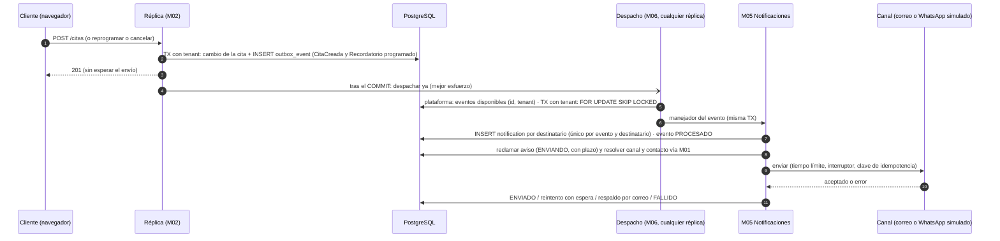

# Implementation Plan: Notificaciones y reprogramación de citas

**Branch**: `004-notificaciones-reprogramacion` | **Date**: 2026-11-04 | **Spec**: [spec.md](spec.md)

**Input**: Feature specification from `/specs/004-notificaciones-reprogramacion/spec.md`

**Estado del plan**: **aprobado (2026-11-04).** El responsable aprobó la enmienda 1.4.0 de la constitución, ADR-025, ADR-026, ADR-032 y la revisión de ADR-013, y respondió las cinco preguntas abiertas. La **fase 0** (gobierno) está aplicada:

- constitución 1.4.0 con su Sync Impact Report;
- puerta III de la plantilla del plan;
- los ADR en `docs/01-analisis-de-sistema/07-decisiones-arquitectonicas.md`;
- `multi-tenancy-y-datos.md`;
- la matriz de módulos en `estilo-arquitectonico.md` y `componentes-arquitectonicos.md`.

[decisiones/](decisiones/) conserva el detalle de cada decisión, ya con estado Aceptado. Queda lista para `/speckit-tasks`.

## Summary

La funcionalidad 004 hace tres cosas:

- **M02 aprende a reprogramar** una cita con las mismas reglas de una reserva nueva. La garantía sigue siendo la restricción de exclusión de 002: la reprogramación es un `UPDATE` de la misma fila, dentro de una transacción. Si choca, se revierte y la cita conserva su hora (FR-004).
- **M05 Notificaciones nace como módulo con código.** Envía avisos de citas y de la suscripción por el puerto `NotificationChannel`, con dos adaptadores:
  - **correo SMTP:** en desarrollo y en las pruebas, contra **Mailpit**; en producción, con un proveedor **por verificar**;
  - **WhatsApp:** un **simulador en proceso aparte**, como el de pagos. No hay proveedor real (R17).
- **M06 gana dos piezas sin reglas de negocio:**
  - un **bus de eventos con salida transaccional** (_outbox_ en PostgreSQL, ADR-025): ningún aviso se pierde ni se duplica entre las dos réplicas;
  - **enlaces de acción firmados** (ADR-032): el recordatorio lleva enlaces de un solo uso para confirmar, reprogramar o cancelar sin sesión.

La parte delicada es el **principio III**. Una acción por enlace ocurre sin token, así que la barbería y la cita salen **solo del dato firmado del enlace**. Eso no estaba entre las tres excepciones de la 1.3.1 y requirió una **cuarta excepción acotada** (enmienda 1.4.0 y ADR-032, aprobados el 2026-11-04). Las acciones por enlace usan el rol normal de la aplicación con RLS. Las tareas en segundo plano localizan el tenant con la lectura de plataforma, como en 003. **Ningún paso usa un rol que omita RLS.**

## Technical Context

**Language/Version**: TypeScript 5 (`strict`) sobre Node.js 22 LTS, igual que 001, 002, 003 y 006.

**Primary Dependencies**: las mismas de 003, más **una dependencia nueva aprobada** (research R10):

| Necesidad                          | Cómo se cubre                                                                                       |
| ---------------------------------- | --------------------------------------------------------------------------------------------------- |
| Envío de correo por SMTP           | **`nodemailer`**, con versión exacta fija (licencia y versión se verifican al instalarla en la fase 1). La fase 1 agrega el escaneo de dependencias a la CI, que hoy no existe |
| Firma de los enlaces (HMAC-SHA256) | `node:crypto`                                                                                       |
| Simulador de WhatsApp              | `node:http`, como el simulador de pagos                                                             |
| HTTP al simulador de WhatsApp      | `fetch` con tiempo límite                                                                           |
| Circuito por canal                 | `Interruptor` de M06 (`shared/resiliencia/`), ya existente                                          |

**Storage**: PostgreSQL 16, con las migraciones nuevas `0021` a `0025` ([data-model.md](data-model.md)). No se modifica ninguna migración existente.

| Migración | Módulo | Contenido                                                                                                           |
| --------- | ------ | ------------------------------------------------------------------------------------------------------------------- |
| `0021`    | M06    | `outbox_event` (salida transaccional), RLS y lectura de plataforma por columna                                     |
| `0022`    | M01    | `customer_notification_preference` y `whatsapp_consent`                                                             |
| `0023`    | M02    | `appointment.version` y `appointment.client_confirmed_at`; `appointment_reschedule`; `appointment_link_use`; nuevos `GRANT UPDATE` |
| `0024`    | M05    | `notification` (avisos por destinatario), RLS y lectura de plataforma por columna                                  |
| `0025`    | —      | `action_link_attempt` (intentos rechazados por IP), tabla técnica sin barbería, nombrada en la constitución 1.4.0 (research R07) |

Redis no guarda nada de 004 (principio VIII). Los contadores de seguridad de los enlaces viven en PostgreSQL.

**Testing**:

- **Jest**: unitarias de dominio (reprogramación, reglas del enlace, elección de canal y respaldo, política de reintentos).
- **Testcontainers con PostgreSQL real**: PR16 de reprogramación (50 simultáneas), PR09, PR27, PR28, salida de eventos con dos instancias en proceso y caída simulada.
- **Contrato del puerto** `NotificationChannel` (research R11), contra Mailpit (contenedor) y el simulador de WhatsApp (en proceso). Hay una variante para un proveedor real que se omite sin credenciales, como `gateway-sandbox` en 003.
- **PR14**: reglas nuevas (M05, confinamiento de enlaces y del bus).
- **Vitest con MSW**: interfaz (reprogramar, canal de aviso, página del enlace, marca en la agenda).

**Target Platform**: contenedores Linux en Docker Compose (entorno de 003) más dos servicios: `mailpit` (unos 32 MB) y `whatsapp-simulado` (64 MB). Sin despliegue en la nube.

**Project Type**: aplicación web (API REST NestJS y SPA React), con la misma estructura.

**Performance Goals**:

- La reserva, cancelación o reprogramación no tarda más por los avisos (SC-003). Publicar el evento es un `INSERT` en la misma transacción.
- Confirmación entregada en ≤ 5 min para ≥ 95 % (SC-004). Con el despacho inmediato tras confirmar y la tarea cada 15 s como respaldo, la meta de diseño es menos de 1 minuto.
- Recordatorio entregado en ≤ 10 min desde su momento (SC-006).

**Constraints**:

- Datos mínimos en los mensajes (principio VII).
- El texto de los mensajes no se guarda en la base.
- El enlace no se puede reconstruir a partir de lo guardado.
- Secretos solo en `.env` (`ENLACES_LLAVE`, credenciales SMTP y token del simulador).
- Equipo de 8 GB: los dos servicios nuevos suman menos de 100 MB.
- Nada se descarga en C:. En las fases de plan y tareas no se descarga ni se ejecuta nada de Docker: el responsable verifica que Docker guarde las imágenes en D: y descarga la imagen de Mailpit al llegar la fase 1.

**Scale/Scope**: decenas de barberías y de citas por barbería y por día:

- 8 rutas nuevas ([contracts/openapi.yaml](contracts/openapi.yaml)) y un campo nuevo en la cita de 002 (`confirmadaPorClienteEn`);
- 4 pantallas o partes de pantalla (reprogramar, canal de aviso, página del enlace, marca en la agenda);
- 4 o 5 migraciones;
- 2 servicios de Compose.

## Constitution Check

_GATE: Must pass before Phase 0 research. Re-check after Phase 1 design._

Primera verificación con la constitución **1.3.1**, antes de la investigación y tras el diseño: III y XI no pasaban. **Segunda verificación (2026-11-04), con la constitución 1.4.0** y los ADR aprobados, abajo:

- [x] **I. Seis módulos.** Todo queda en los módulos existentes, sin crear ninguno:
  - M02: reprogramación, acciones por enlace y marca de asistencia;
  - M05: avisos, puerto y adaptadores;
  - M01: canal y consentimiento de WhatsApp;
  - M03: publica los hechos de la suscripción;
  - M06: bus de eventos, enlaces firmados e intervalo por tarea.

  Los efectos entre módulos van **por eventos del bus de M06** (M02 → M05 y M03 → M05), como exige el principio. Hay **un cambio en la matriz**: **M05 → M01**, de solo lectura (canal, consentimiento vigente y correo del destinatario al enviar). Está aprobado en la revisión de ADR-013 (Aceptado el 2026-11-04), ya figura en la matriz de `estilo-arquitectonico.md` §3 (nota ²) y PR14 lo verificará con `matriz-m05`. M02 y M03 no llaman a M05: solo publican.
- [x] **II. Cuatro capas.**
  - El puerto `NotificationChannel` está en `notificaciones/application/ports/` y los adaptadores en `infrastructure/`.
  - La elección de canal, el respaldo, la política de reintentos y las reglas de la reprogramación y del enlace son dominio puro.
  - El bus y los enlaces firmados son M06 sin reglas de negocio.
- [x] **III. Aislamiento.** ✅ **con la constitución 1.4.0** (con la 1.3.1 no pasaba). Una acción por enlace no tiene token: la barbería y la cita salen del dato firmado del enlace. Eso queda **dentro de la cuarta excepción acotada**, "acciones por enlace de la cita" (enmienda 1.4.0 y ADR-032, aprobados y aplicados el 2026-11-04; ver Complexity Tracking): firma verificada antes de leer nada, `barberias_app` con RLS, una cita, una acción y un uso, sin reconstrucción posible a partir de lo guardado y contador de rechazos en PostgreSQL. Todo lo demás cumple:
  - toda tabla de negocio nueva tiene `tenant_id` y RLS con `FORCE`;
  - las acciones por enlace usan `barberias_app` (sin `BYPASSRLS`) con el tenant fijado desde el dato firmado;
  - las tareas localizan pendientes con `barberias_plataforma` por columna, como permite la tercera excepción, y procesan cada barbería en su transacción;
  - los eventos y los avisos llevan el tenant;
  - nada va a la caché.

  `action_link_attempt` es una tabla técnica sin barbería, como `login_attempt`; la 1.4.0 nombra a las dos.
- [x] **IV. Sin citas duplicadas.**
  - La reprogramación es un `UPDATE` del período en una transacción. Lo protegen las mismas restricciones `appointment_no_overlap_barber` y `appointment_no_overlap_customer`, y el conflicto se traduce a "horario no disponible".
  - El candado consultivo por barbero de 002 se toma para el barbero anterior y el nuevo, en orden fijo (research R03).
  - PR16 suma 50 reprogramaciones simultáneas.
- [x] **V. Pagos.** No se toca el cobro. M03 solo publica eventos en las transacciones que ya existen (aprobación, rechazo, gracia y vencimiento).
- [x] **VI. IA.** No aplica.
- [x] **VII. Notificaciones.** Es el principio central de 004:
  - puerto `NotificationChannel`;
  - M05 reacciona a eventos;
  - WhatsApp solo con consentimiento vigente, y si no hay consentimiento o el canal falla, correo;
  - envío asíncrono con reintentos y circuito;
  - un fallo nunca bloquea ni revierte la operación;
  - datos mínimos;
  - recordatorios sin duplicados entre instancias (ADR-024 y ADR-025).
- [x] **VIII. Redis.** No se usa. El contador de enlaces rechazados es de seguridad: vive en PostgreSQL. El límite general por IP de 006 se aplica también a las rutas del enlace.
- [x] **IX. Solo web.** Pantallas responsive en la SPA; la página del enlace funciona en el navegador del celular sin sesión.
- [x] **X. Pruebas obligatorias.** Se amplían PR09 (avisos, enlaces, canal y consentimiento), PR16 (reprogramación) y PR14 (reglas nuevas). PR06 cubre correo y WhatsApp caídos con los simuladores. PR27 y PR28 pasan de planificadas a ejecutadas.
- [x] **XI. ADR.** ADR-025, ADR-026 y ADR-032 están registrados y **Aceptados** (2026-11-04) en `07-decisiones-arquitectonicas.md`, y ADR-013 pasó a **Aceptado** con su revisión, antes de implementar. Los documentos afectados (constitución, plantilla, multi-tenancy, estilo, componentes y diseño interno) se actualizaron en el mismo cambio.
- [x] **XII. Ubicación.** Todo el código va en `tecnologia/plataforma-barberias/`, incluido el simulador (`backend/simulador-whatsapp/`).

**Resultado (2026-11-04, constitución 1.4.0): pasa.** Las doce puertas están en verde. La excepción nueva solo puede usarse dentro de lo que describe ADR-032; PR28 y PR09 (`aislamiento-avisos`) la verificarán al implementar. Queda lista para `/speckit-tasks`.

## Project Structure

### Documentation (this feature)

```text
specs/004-notificaciones-reprogramacion/
├── spec.md
├── plan.md                              # este archivo
├── research.md                          # R01–R18
├── data-model.md                        # tablas nuevas, RLS, roles y estados
├── quickstart.md                        # recorrido de validación (Compose y pruebas)
├── contracts/
│   ├── openapi.yaml                     # rutas nuevas de 004
│   ├── rbac.md                          # quién puede qué (PR08)
│   ├── eventos.md                       # catálogo de eventos y semántica de la salida transaccional
│   ├── enlaces-de-accion.md             # formato, validación, uso único y datos mostrados
│   ├── notification-channel.md          # puerto, adaptadores, simulador y suite de contrato
│   └── texto-consentimiento-whatsapp.md # texto base, versión 2026-11, por validar con asesoría legal
├── decisiones/                          # detalle de las decisiones ACEPTADAS el 2026-11-04 (aplicadas en docs/ y .specify/)
│   ├── enmienda-constitucion-1.4.0.md
│   ├── ADR-025-salida-transaccional.md
│   ├── ADR-026-correo-y-whatsapp.md
│   ├── ADR-032-acciones-por-enlace.md
│   └── ADR-013-revision.md
├── checklists/requirements.md
└── tasks.md                             # /speckit-tasks (después de la aprobación)
```

### Source Code (repository root)

```text
tecnologia/plataforma-barberias/
├── docker-compose.yml                       # + servicios mailpit y whatsapp-simulado; variables SMTP_*, WHATSAPP_*, ENLACES_*
├── .env.example                             # + ENLACES_LLAVE, SMTP_*, WHATSAPP_*, URL_PUBLICA, EVENTOS_INTERVALO_MS
├── backend/
│   ├── migrations/0021_salida_de_eventos.ts … 0025_intentos_enlaces.ts
│   ├── simulador-whatsapp/                  # servidor.ts, estado.ts, modos.ts (fuera de src/, como simulador-pagos)
│   ├── scripts/
│   │   ├── whatsapp-modo.ts                 # npm run whatsapp:modo
│   │   └── demo-avisos.ts                   # npm run demo:avisos (dos réplicas, correo caído y vuelto)
│   ├── src/
│   │   ├── host/
│   │   │   ├── tareas.ts                    # + despachar-eventos, enviar-avisos, avisar-fin-de-prueba
│   │   │   └── eventos.ts                   # suscribe los manejadores de M05 en el bus de M06
│   │   ├── shared/                          # M06
│   │   │   ├── eventos/                     # BusDeEventos (publicar, reemplazar, anular), despachador, salida-postgres
│   │   │   ├── enlaces/                     # EnlacesFirmados (emitir y verificar; HMAC, sin reglas de negocio)
│   │   │   └── tareas/ejecutor-tareas.ts    # + intervalo por tarea
│   │   └── modules/
│   │       ├── notificaciones/              # M05 (módulo sin submódulos: cuatro capas)
│   │       │   ├── domain/                  # Aviso, elección de canal, respaldo, reintentos, plantillas en texto simple
│   │       │   ├── application/             # manejadores de eventos, EnviarAvisos, ports/notification-channel.ts
│   │       │   ├── infrastructure/          # canal-correo-smtp.ts, canal-whatsapp-simulado.ts, repositorio de avisos
│   │       │   │   └── plataforma/          # lectura de avisos pendientes (barberias_plataforma)
│   │       │   └── index.ts
│   │       ├── catalogo-citas/citas/        # M02: ReprogramarCita, AccionPorEnlace, ConfirmarAsistencia, eventos de la cita
│   │       ├── acceso-barberias/clientes/   # M01: preferencia de aviso y consentimiento de WhatsApp; ClientesApi ampliada
│   │       └── suscripciones-pagos/         # M03: publica PruebaPorTerminar, SuscripcionEnGracia, SuscripcionVencida, PagoAprobado, PagoRechazado
│   └── test/ (unit, integration/avisos, integration/citas, integration/enlaces, integration/aislamiento, contract, architecture)
└── frontend/src/pages/
    ├── cliente/                             # reprogramar desde Mis citas; CanalAviso.tsx en la ruta propia /mis-avisos, enlazada desde Mis citas
    ├── panel/                               # reprogramar desde la agenda; marca "confirmada por el cliente" / "sin confirmar"
    └── publico/Enlace.tsx                   # /e#<token>: confirmar, cancelar o reprogramar (reutiliza la disponibilidad de 002)
```

**Structure Decision**: se mantiene la estructura de 001, 002, 003 y 006 (principio XII). M05 se crea como la carpeta `modules/notificaciones/` prevista en la plantilla del plan, sin submódulos. El simulador de WhatsApp vive en `backend/simulador-whatsapp/`, fuera de `src/`, con una regla de PR14 que impide que el monolito lo importe, igual que `simulador-pagos/`.

## Reprogramación atómica (FR-001 a FR-007, pedido del plan)

1. **Caso de uso `ReprogramarCita` (M02)**, dentro de `uow.ejecutar(tenant)`:
   - autorización (cliente dueño de la cita, o propietario);
   - `exigirOperacion(RESERVAR)` de M03;
   - antelación de cancelación solo para el cliente (FR-006);
   - las mismas reglas de 002 de la reserva nueva (servicio, barbero que lo ofrece, disponibilidad, bloqueos, horizonte y hora de la barbería).
2. **Candados.** `pg_advisory_xact_lock` por `(tenant, barbero)` del barbero anterior y del nuevo, **en orden de identificador** para no generar bloqueos mutuos. Es una ayuda de rendimiento, no la garantía (research R03).
3. **Una sola sentencia condicional.**
   ```text
   UPDATE appointment SET barber_id, starts_at, ends_at, version = version + 1, client_confirmed_at = NULL
   WHERE tenant_id AND id AND version = $esperada AND status IN ('PENDIENTE','CONFIRMADA') AND starts_at > now()
   ```
   La restricción de exclusión evalúa el período nuevo contra las demás citas activas (la propia fila no choca consigo misma). `23P01` se traduce a `HorarioNoDisponible` o `CitaSolapadaDelCliente`. Cero filas afectadas significa que la cita cambió: se responde "la cita cambió".
4. **En la misma transacción:**
   - historial en `appointment_reschedule`;
   - auditoría;
   - evento `CitaReprogramada`;
   - **reemplazo** del recordatorio programado (clave `recordatorio:<citaId>`, ADR-025).
   Si algo falla, la transacción entera se revierte y la cita conserva su hora (FR-004).
5. **Idempotencia natural.** Reprogramar a la misma hora y barbero que ya tiene la cita no cambia nada ni publica avisos (200 sin efecto).
6. **Prueba (PR16, ampliada):** `reprogramar-concurrencia`:
   - 50 citas distintas reprogramadas a la misma hora libre del mismo barbero, a la vez: **1 éxito, 49 respuestas 409, 0 respuestas 5xx**, y cada perdedora conserva su hora original;
   - una variante mezcla 25 reservas nuevas y 25 reprogramaciones;
   - otra corre a través de Nginx con dos réplicas (Compose).

## Flujo principal (diseño)



## Fases de implementación (una fase = un commit, como en 003)

| Fase | Contenido                                                                                                                                                                                                                                                                  | Bloquea a       | Recorte                    |
| ---- | -------------------------------------------------------------------------------------------------------------------------------------------------------------------------------------------------------------------------------------------------------------------------- | --------------- | -------------------------- |
| 0    | **Gobierno (sin código) · HECHA el 2026-11-04:** enmienda 1.4.0, ADR-025, ADR-026, ADR-032 y la revisión de ADR-013 aprobados y aplicados en la constitución, la plantilla, `07-decisiones-arquitectonicas.md`, `multi-tenancy-y-datos.md` y la matriz (`estilo-arquitectonico.md`, `componentes-arquitectonicos.md` y `diseño-interno-de-modulos.md` §7); Constitution Check en verde | Todas           | —                          |
| 1    | **Base:** revisión previa de `npm audit` (lo alto con arreglo se corrige; sin arreglo, excepción documentada con fecha) y luego **escaneo de dependencias en la CI** (solo producción, falla desde nivel alto); migraciones `0021`–`0025`; bus de eventos de M06 con despacho e intervalo por tarea (un tipo sin manejador queda `SIN_MANEJADOR`); enlaces firmados de M06; esqueleto de M05 con el puerto, el adaptador de correo (`nodemailer` y `@types/nodemailer` con versión fija) y la **suite de contrato independiente del canal**, que en esta fase corre con Mailpit; Compose (`mailpit`; la imagen la descarga el responsable); reglas de PR14; PR09 `lectura-plataforma` con las columnas nuevas | 2–6             | Nunca                      |
| 2    | **US1 Reprogramar (P1):** `ReprogramarCita`, rutas del cliente y del propietario, interfaz (Mis citas y Agenda), PR16 de reprogramación                                                                                                                                      | 4               | Nunca                      |
| 3    | **US2 Avisos de la cita (P1):** eventos `CitaCreada`, `CitaCancelada` y `CitaReprogramada`; manejadores de M05; envío con reintentos y circuito; avisos al personal; PR27 (correo), PR06 (correo caído), salida de eventos con dos instancias y con caída                  | 4, 5, 6         | Nunca                      |
| 4    | **US3 Recordatorio y enlaces (P2):** recordatorio programado; enlaces de acción; rutas `/enlaces`; página `/e`; marca en la agenda; contador de rechazos; PR28                                                                                                                | —               | Línea de corte 2 ya aplicada (reutiliza la disponibilidad de 002) |
| 5    | **US4 Canal y consentimiento (P2):** **simulador de WhatsApp en proceso aparte** (nunca en producción) con su adaptador y su servicio de Compose, agregado a la misma suite de contrato; preferencia y consentimiento de WhatsApp en M01, con el texto base `2026-11`; respaldo por correo; pantalla en la ruta propia `/mis-avisos`, enlazada desde Mis citas; PR18 y PR27 (WhatsApp) | —               | Nunca (RF33)               |
| 6    | **US5 Avisos de suscripción (P3) · PRIMER RECORTE:** eventos de M03 en sus transiciones existentes; tarea `avisar-fin-de-prueba`; plantillas; pruebas. **Grupo de tareas separado:** si el calendario aprieta, se omite completo sin afectar a las fases 1–5             | —               | **Primero que se recorta** |
| 7    | **Cierre:** documentación (ver "Documentos que se actualizan"), suite completa, recorrido del [quickstart](quickstart.md) y demostración con dos réplicas                                                                                                                     | —               | Nunca                      |

**Dependencias.** La fase 3 necesita el bus de la fase 1, y la 2 publica el evento de reprogramación que la 3 consume. Por eso la 2 deja el evento publicado aunque nadie lo maneje todavía: hasta la fase 3, el despacho lo marca `SIN_MANEJADOR`, escribe una advertencia y no lo reintenta. La 4 usa la reprogramación (2) y el envío (3). La 5 agrega el simulador de WhatsApp y cambia cómo se elige el canal en el envío (3). La 6 solo agrega publicadores en M03 y plantillas en M05.

**Líneas de corte** (backlog §3.2): 1) plantillas en texto simple (ya en el diseño); 2) reprogramar desde el enlace reutiliza la disponibilidad de 002 (ya en el diseño); 3) sin panel de envíos (ya en el diseño). **Se suma, por decisión del responsable (2026-11-04):** la fase 6 (US5) es la primera que se recorta.

**No se recortan nunca:** la salida transaccional (sin eventos perdidos), los recordatorios sin duplicados, WhatsApp solo con consentimiento, PR09, PR16 y PR14.

### Esfuerzo relativo por fase

S = pequeño (medio día o menos), M = mediano (alrededor de un día), L = grande (más de un día). Son estimaciones relativas para ordenar el trabajo de una persona, no mediciones.

| Fase | Contenido resumido                                   | Esfuerzo | Por qué                                                                                                   |
| ---- | ---------------------------------------------------- | -------- | --------------------------------------------------------------------------------------------------------- |
| 0    | Gobierno                                             | S        | Hecha (solo documentos)                                                                                   |
| 1    | Base: `npm audit`, migraciones, bus, enlaces, M05 (correo), CI | **L** | Piezas nuevas de M06 y de M05 desde cero, cinco migraciones, la revisión de `npm audit` y la suite de contrato con Mailpit           |
| 2    | US1 Reprogramar                                      | M        | Reutiliza las reglas y el repositorio de 002; lo nuevo es la sentencia condicional y los dos candados     |
| 3    | US2 Avisos de la cita                                | **L**    | Manejadores, envío con reintentos, circuito y respaldo, y las pruebas de dos réplicas y de caída          |
| 4    | US3 Recordatorio y enlaces                           | **L**    | Rutas sin sesión, uso único, contador de rechazos, página `/e` y PR28                                     |
| 5    | US4 Canal, consentimiento y WhatsApp simulado        | M        | Dos tablas de M01, una pantalla, la regla de canal (existe desde la fase 3) y el simulador, que sigue el patrón del de pagos |
| 6    | US5 Avisos de suscripción (primer recorte)           | S        | Solo publicadores en transacciones existentes de M03, una tarea pequeña y cuatro plantillas               |
| 7    | Cierre: documentación, suite y quickstart            | M        | Muchos documentos; el recorrido del quickstart con Compose                                                |

### Si solo quedan 4 días para 004

Con 2 fases L y 3 fases M, el plan completo no cabe en 4 días sin recortes. Se recorta **en este orden** y se decide al final de cada día, sin esperar al último:

1. **Fase 6 completa (US5, avisos de suscripción).** Es el primer recorte acordado. El panel de 003 ya muestra esos estados, y RF30 queda con una deuda explícita: los avisos al propietario.
2. **Demostraciones automatizadas en Compose** (`npm run demo:avisos`). Se reemplazan por los pasos guiados del quickstart. Las pruebas con dos instancias **en proceso** se mantienen.
3. **Modos del simulador de WhatsApp.** Quedan solo `normal`, `caido` y `fallar_n`, que bastan para el respaldo por correo y PR06. Se omiten `lento`, `colgado`, `rechazar` y `limite` (el tiempo límite se prueba igual con el correo).
4. **PR16 de reprogramación a través de Nginx.** Se mantiene la versión en proceso con 50 simultáneas, igual de válida para el principio IV.
5. **Acabado visual** de las pantallas nuevas: funcionales, accesibles y con los componentes existentes, sin pulido adicional.

**No se recorta:** la salida transaccional, el recordatorio único, los enlaces de un solo uso con su contador, WhatsApp solo con consentimiento, la reprogramación atómica, PR09, PR14, PR16 en proceso, PR27 y PR28.

| Día | Fases                                                | Recortes ya aplicados                         |
| --- | ---------------------------------------------------- | --------------------------------------------- |
| 1   | 1 (base)                                             | 1, 2 y 3 decididos desde el inicio            |
| 2   | 2 (US1) y 3 (US2)                                    | —                                             |
| 3   | 4 (US3) y 5 (US4)                                    | Si la fase 3 no terminó el día 2: 4 y 5       |
| 4   | Final de 4 y 5, y 7 (cierre)                         | —                                             |

## Pruebas por escenario de la especificación

| Escenario / requisito                                      | Prueba                                                                                                                       | Tipo                     | Dos réplicas |
| ---------------------------------------------------------- | ---------------------------------------------------------------------------------------------------------------------------- | ------------------------ | ------------ |
| US1-1, US1-4, FR-003, FR-005                               | `reprogramar` (hora libre, reglas de 002, historial y hora anterior libre)                                                   | Integración              | —            |
| US1-2, US1-3, FR-004 · **PR16**                            | `reprogramar-concurrencia`: 50 simultáneas → 1 éxito; mezcla con reservas; las perdedoras conservan su hora                  | Integración              | Sí (Compose, por Nginx) |
| US1-5, FR-006, SC-012                                      | `reprogramar-antelacion` (cliente rechazado con la oferta de cancelar; propietario sin regla)                                | Unitaria + integración   | —            |
| US1-6, US1-7                                               | `reprogramar-propietario`, `restricciones-estado` (ampliada con REPROGRAMAR)                                                 | Integración              | —            |
| US2-1 a US2-4, FR-008, FR-009, FR-013 · **PR27**           | `avisos-cita` (un correo por operación en Mailpit, contenido mínimo, avisos al personal)                                     | Integración (Mailpit)    | —            |
| US2-5, FR-011, SC-003 · **PR06**                           | `correo-caido` (operaciones con el mismo resultado y tiempo; avisos al volver, una vez)                                       | Integración              | —            |
| US2-6, FR-012, SC-005 · ADR-025                            | `salida-eventos-dos-instancias` (100 operaciones → 100 avisos) y `salida-eventos-caida` (caída después del COMMIT y con el aviso reclamado) | Integración              | **Sí** (dos instancias en proceso) |
| US2-7, FR-010                                              | `avisos-cita` (operación fallida → 0 avisos)                                                                                 | Integración              | —            |
| US3-1, US3-6, FR-022, FR-023, SC-006 · **PR28**            | `recordatorio` (2 h antes, una vez; reservada con < 2 h: ninguno; reemplazo al reprogramar)                                  | Integración              | **Sí**       |
| US3-2 a US3-4, US3-8, FR-026, FR-028 a FR-030 · **PR28**   | `enlaces-acciones` (confirmar, cancelar y reprogramar; abrir no consume)                                                     | Integración + interfaz   | —            |
| US3-7, FR-024, FR-025, SC-008 · **PR28**                   | `enlaces-rechazos` (usado, vencido, alterado, de cita cambiada; 2 usos simultáneos → 1)                                      | Unitaria + integración   | Sí (dos instancias) |
| FR-027, FR-034, SC-011 · **PR09**                          | `aislamiento-avisos` (enlace firmado para A con cita de B, avisos y consentimientos de otra barbería → 404/rechazo)          | Integración              | —            |
| FR-031                                                     | `enlaces-limite` (bloqueo tras N rechazos por IP)                                                                            | Integración              | —            |
| US3-5, SC-010                                              | `recordatorio` (sin respuesta: la cita no cambia)                                                                            | Integración              | —            |
| US4-1 a US4-6, FR-016 a FR-021, SC-007, SC-009 · **PR18**, **PR27** | `canal-aviso` y `respaldo-whatsapp` (0 mensajes sin consentimiento; WhatsApp caído → correo una vez)                | Integración (simulador)  | —            |
| US5-1 a US5-5, FR-036 a FR-040, SC-013 (fase 6)            | `avisos-suscripcion` (cuatro hechos, una vez; correo caído no frena la transición)                                           | Integración              | **Sí**       |
| Puerto `NotificationChannel`                               | `notification-channel.contract` contra Mailpit y el simulador (proveedor real: omitida sin credenciales)                      | Contrato                 | —            |
| Arquitectura · **PR14**                                    | reglas de M05, bus confinado, enlaces confinados, simulador fuera del monolito, M05 → M01                                    | Arquitectura             | —            |

**Qué queda probado con dos réplicas:** sin pérdidas ni duplicados en la salida de eventos, recordatorio único, uso único del enlace con dos solicitudes simultáneas en réplicas distintas, PR16 de reprogramación por Nginx y los avisos de suscripción de la tarea de vencimiento. **Qué no se prueba con dos réplicas:** la caída de una réplica **en medio del envío** al proveedor (después de que el canal aceptó y antes de anotarlo). Ese caso puede duplicar un aviso y no se afirma lo contrario (ADR-025, "Lo que no garantiza").

## Riesgos

| Riesgo                                                                                         | Mitigación                                                                                                                                       |
| ---------------------------------------------------------------------------------------------- | ------------------------------------------------------------------------------------------------------------------------------------------------ |
| Calendario de 4 días para 004 con dos fases L                                                  | Recortes en orden, decididos al final de cada día ("Si solo quedan 4 días para 004"); la fase 0 ya está aplicada                                 |
| `nodemailer` entra sin escaneo de dependencias: hoy la CI no tiene ninguno                     | La fase 1 corre `npm audit` a mano y decide cada hallazgo alto (se corrige si tiene arreglo; si no, excepción documentada con fecha en `tecnologias.md`), y después lo agrega a la CI antes de instalar `nodemailer`; no se afirma que esté revisada hasta que ese paso pase |
| Una réplica cae entre la aceptación del canal y su registro: aviso duplicado                   | Ventana mínima; clave de idempotencia por aviso (cabecera `Message-ID` en el correo); se declara en "Lo que no se afirma"                       |
| Enlace filtrado (reenviado, captura de pantalla)                                               | Vence a la hora de inicio; sirve para una sola cita y acción; muestra solo datos mínimos; el token va en el fragmento y no queda en los registros |
| Fuerza bruta sobre los enlaces                                                                 | Firma HMAC de 256 bits (no se puede adivinar); límite por IP; contador de rechazos en PostgreSQL (R07)                                          |
| Despacho más frecuente que el resto de las tareas (15 s): más consultas por réplica           | Una consulta indexada por columna; el candado evita trabajo repetido; se mide en la fase 7                                                       |
| Calendario muy ajustado (4 días, R14 del backlog)                                              | Fase 6 recortable completa; las líneas de corte ya están aplicadas en el diseño                                                                  |
| Imágenes de Docker nuevas (Mailpit) en un disco con poco espacio o en C:                       | Imagen pequeña; el responsable verifica que Docker guarde las imágenes en D: y la descarga él al llegar la fase 1                               |
| Retiro del consentimiento entre la creación del aviso y su envío                               | El canal y el consentimiento se leen **al enviar** (M05 → M01), no al publicar el evento                                                         |

## Lo que NO se afirmará

- **No hay proveedor real de WhatsApp.** Todo envío por WhatsApp es al simulador. Las condiciones de la WhatsApp Business Platform (plantillas aprobadas, costos, ventana de 24 h) quedan **por verificar** (R17, RC16).
- **No hay correo de producción.** Mailpit es un buzón de pruebas que no entrega correo real. El proveedor de producción y su entregabilidad (SPF, DKIM, rebotes) quedan **por verificar** (ADR-026).
- **"Entregado" significa aceptado por el canal** (Mailpit o el simulador), no leído por el cliente ni en su bandeja.
- **No se garantiza "exactamente una vez" ante una caída en medio del envío al proveedor.** Se garantiza que ningún evento se pierde y que, en ausencia de esa caída, no hay duplicados (ADR-025).
- **No se miden en producción** SC-004 (95 % en ≤ 5 min) ni EQ-06: se miden en local, con los simuladores, y siguen como "propuesta por validar".
- **El texto del consentimiento de WhatsApp es un texto base, por validar con asesoría legal** ([contracts/texto-consentimiento-whatsapp.md](contracts/texto-consentimiento-whatsapp.md), versión `2026-11`). No se afirma que cumpla la Ley N.° 29733.
- **No se afirma que las dependencias estén escaneadas** hasta que la CI tenga el paso de escaneo que agrega la fase 1.
- **No hay pantalla de envíos.** Lo enviado se comprueba en las pruebas, en Mailpit y en el registro del simulador (línea de corte 3).

## Documentos que se actualizan

**Aplicado con la aprobación (fase 0, 2026-11-04):**

| Documento                                                      | Cambio                                                                                     |
| -------------------------------------------------------------- | ------------------------------------------------------------------------------------------ |
| `.specify/memory/constitution.md`                              | Enmienda 1.4.0 con su Sync Impact Report                                                   |
| `.specify/templates/plan-template.md`                          | Puerta III con la cuarta excepción y las tablas técnicas de intentos                       |
| `docs/01-analisis-de-sistema/07-decisiones-arquitectonicas.md` | ADR-025, ADR-026 y ADR-032 nuevos; ADR-013 revisado y Aceptado; filas de la tabla resumen  |
| `docs/02-arquitectura-software/estilo-arquitectonico.md`       | Matriz: M05 → M01 (solo lectura, nota ²); regla 4; diagrama de dependencias               |
| `docs/02-arquitectura-software/componentes-arquitectonicos.md` | M05: depende de M01 (lectura) y M06; §3 con los eventos y la llamada de M05               |
| `docs/03-diseño-de-software/diseño-interno/diseño-interno-de-modulos.md` | §7: "M05 solo dependerá de M06" corregido a M05 → M01 de lectura y M06           |
| `docs/02-arquitectura-software/multi-tenancy-y-datos.md`       | §1.3: cuatro excepciones (diagrama con la cuarta, planificada); control 1; casos especiales; tablas técnicas; §2.1: permisos planificados de `barberias_plataforma` |

**Quedan para el cierre** (no estaban en la lista aprobada de la fase 0):

- `docs/05-gestion/02-backlog-y-sprints.md` §3.3: ADR-025 y ADR-026 siguen "por escribir"; ADR-032 no figura;
- las imágenes `img/aislamiento-excepciones.png` y `img/modulos-dependencias-permitidas.png`, que se regeneran desde su código Mermaid ya actualizado;
- `docs/05-gestion/07-guion-exposicion-y-defensa.md`, que todavía menciona "las tres excepciones".

**Al cerrar (fase 7):**

| Documento                                                      | Cambio                                                                                                     |
| -------------------------------------------------------------- | ---------------------------------------------------------------------------------------------------------- |
| `docs/trazabilidad.md`                                         | §4: tabla de 004 con componentes y evidencia; §1: RF13, RF30, RF33 y RF34 implementados                  |
| `docs/02-arquitectura-software/componentes-arquitectonicos.md` | M05 implementado (puerto, adaptadores, eventos); §3 comunicación por eventos; M06 eventos y enlaces       |
| `docs/03-diseño-de-software/diseño-interno/diseño-interno-de-modulos.md` | §7 M05: nombres reales; secuencias de notificación y recordatorio ya implementadas             |
| `docs/03-diseño-de-software/diseño-interno/principios-de-diseño.md` y `patrones-de-diseño.md` | M05 deja de ser "planificado"; Observer/eventos implementado               |
| `docs/05-gestion/02-backlog-y-sprints.md`                      | Fila de 004: implementada, con las líneas de corte aplicadas                                               |
| `docs/05-gestion/04-pruebas.md`                                | PR06 (correo y WhatsApp), PR09, PR16, PR18, PR27 y PR28 con resultados medidos                             |
| `docs/01-analisis-de-sistema/08-escenarios-atributos-calidad.md` | EQ-06 y EQ-18: estado con la mensajería medida contra los simuladores                                   |
| `docs/02-arquitectura-software/tecnologias.md`, `api-rest.md`, `seguridad-y-privacidad.md` | SMTP y Mailpit, simulador de WhatsApp, rutas nuevas, enlaces firmados          |
| `tecnologia/plataforma-barberias/README.md`                    | Servicios nuevos de Compose, variables y comandos                                                         |

## Trazabilidad

| Historia | RF         | EQ           | ADR                         | Componente                                                | Pruebas                                       |
| -------- | ---------- | ------------ | --------------------------- | --------------------------------------------------------- | --------------------------------------------- |
| US1      | RF13       | EQ-16        | ADR-009                     | M02 `citas`; M03 (`exigirOperacion`)                      | PR16, `reprogramar*`                          |
| US2      | RF30       | EQ-06        | ADR-012, 013, 025, 026      | M02 (eventos), M05, M06 `eventos`                         | PR27, PR06, `salida-eventos-*`                |
| US3      | RF34       | EQ-08, EQ-09 | ADR-024, 025, 032           | M02 (acciones por enlace), M05 (envío), M06 `enlaces`     | PR28, PR09                                    |
| US4      | RF33       | EQ-18        | ADR-013, 026                | M01 `clientes`; M05 (elección de canal)                   | PR18, PR27                                    |
| US5      | RF30       | EQ-06        | ADR-024, 025                | M03 (publicadores), M05                                   | `avisos-suscripcion`                          |

## Complexity Tracking

| Violación                                                                                                                                                                                                                                                                                                        | Por qué hace falta                                                                                                                                                                                                                              | Alternativa más simple descartada                                                                                                                                                                                                                                                                                                                                                                                                                                                                                                                                          |
| ---------------------------------------------------------------------------------------------------------------------------------------------------------------------------------------------------------------------------------------------------------------------------------------------------------------- | ----------------------------------------------------------------------------------------------------------------------------------------------------------------------------------------------------------------------------------------------- | -------------------------------------------------------------------------------------------------------------------------------------------------------------------------------------------------------------------------------------------------------------------------------------------------------------------------------------------------------------------------------------------------------------------------------------------------------------------------------------------------------------------------------------------------------------------------- |
| **Principio III:** una acción por enlace ocurre sin token; la barbería y la cita salen del dato firmado del enlace (cuarta excepción, enmienda 1.4.0 y ADR-032, **aprobados y aplicados el 2026-11-04**: queda amparada por la cuarta excepción del principio III)                                                                                                          | RF34 y HU28 exigen confirmar, reprogramar o cancelar desde el recordatorio **sin iniciar sesión**. El cliente presencial con correo ni siquiera tiene cuenta                                                                                    | **Pedir que inicie sesión:** contradice HU28 (criterio 2) y deja fuera al cliente presencial. **Guardar el token y buscarlo con la lectura de plataforma:** el token quedaría en la base (reconstruible) y la búsqueda por un dato del cliente no está permitida por la tercera excepción. **Función `SECURITY DEFINER` de `barberias_auth`:** ese rol tiene `BYPASSRLS`, y el pedido lo excluye. **Token de sesión de corta vida por correo:** sería otra credencial con más alcance que una cita y una acción. La solución elegida no lee nada antes de verificar la firma, usa `barberias_app` con RLS y alcanza solo una cita y una acción |
| **Matriz de módulos:** M05 → M01, de solo lectura (revisión de ADR-013, **Aceptada el 2026-11-04**, ya en la matriz)                                                                                                                                                                                                                 | El canal y el consentimiento de WhatsApp deben leerse **al enviar** (FR-019: "consentimiento vigente"), y el correo del destinatario no debe viajar en el evento (datos mínimos en la salida de eventos)                                         | **Copiar canal, consentimiento y contacto en el evento al publicarlo:** un recordatorio se envía horas después, y un retiro del consentimiento en ese lapso no se respetaría (FR-019); además, la salida de eventos guardaría datos de contacto. **Mover canal y consentimiento a M05:** separa el consentimiento de WhatsApp del de la política de datos y contradice la asignación de RF33 a M01                                                                                                                                                                                      |
