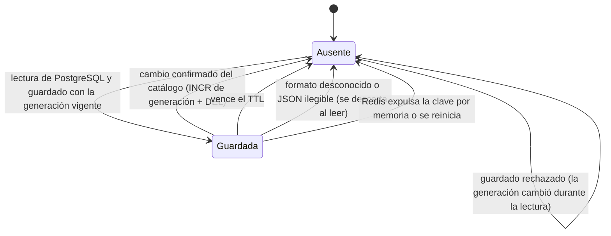

# Data Model: Escalabilidad y rendimiento de la plataforma

**Funcionalidad**: [spec.md](spec.md) · **Decisiones**: [research.md](research.md)

Esta funcionalidad **no agrega tablas de negocio**. PostgreSQL sigue siendo la fuente de verdad
(principio VIII). Agrega una migración de permisos, entradas y contadores en Redis (datos no
críticos y descartables) y un registro de mediciones en la documentación.

## 1. PostgreSQL

### Migración `0013_salud_listo.ts`

| Cambio                                              | Detalle                                                                                                                         | Motivo                                                                                 |
| --------------------------------------------------- | ------------------------------------------------------------------------------------------------------------------------------- | -------------------------------------------------------------------------------------- |
| `GRANT SELECT ON kysely_migration TO barberias_app` | Solo lectura sobre la tabla técnica de Kysely (nombre y fecha de cada migración aplicada). Sin datos de negocio ni de barberías | `GET /salud/listo` compara la última migración aplicada con la última del código (R02) |

- **Reversión (`down`):** `REVOKE SELECT ON kysely_migration FROM barberias_app`.
- **Sin RLS:** no es una tabla de negocio (principio III).
- **Pruebas que deben seguir en verde:** las que comparan los permisos exactos del rol público
  (`lectura-publica`); esta migración no lo toca.

### Lo que **no** cambia

- Intentos de inicio de sesión (`login_attempt`), sesiones y revocación, idempotencia de reservas y
  la restricción de exclusión de citas: siguen en PostgreSQL (FR-005, FR-017).

## 2. Redis: entradas de caché

Todas las claves de datos de una barbería las construye `ClavesCache`
([contracts/cache-claves.md](contracts/cache-claves.md)) y empiezan por `bp:v1:t:{tenantId}:`.

### 2.1 Entrada del catálogo público

| Campo              | Tipo                                                          | Origen (columnas públicas, ADR-021)                                        |
| ------------------ | ------------------------------------------------------------- | -------------------------------------------------------------------------- |
| `v`                | entero (`1`)                                                  | Versión del formato; otra versión → se descarta (FR-015)                   |
| `generacion`       | entero                                                        | Generación con la que se guardó (R08)                                      |
| `horario.tramos[]` | `{ diaSemana, inicio "HH:MM", fin "HH:MM" }`                  | `business_hours (weekday, start_time, end_time)`                           |
| `servicios[]`      | `{ id, nombre, descripcion, precio "0.00", duracionMinutos }` | `service` activos                                                          |
| `barberos[]`       | `{ id, nombre, servicioIds[] }`                               | `barber` activos (`display_name`) y `barber_service` con servicios activos |

- **Clave:** `bp:v1:t:{tenantId}:catalogo-publico`.
- **Tiempo de vida:** `CACHE_CATALOGO_TTL_SEGUNDOS` (120 por defecto, de 10 a 300).
- **No contiene:** los datos de la barbería ni el enlace (se leen en cada solicitud, R07), datos de
  clientes, contacto o cuenta del personal, motivos de bloqueo, citas ni disponibilidad semanal
  (FR-013).
- **Ciclo de vida:**

### 2.2 Generación del catálogo

| Clave                                     | Valor                | Tiempo de vida                | Cambia cuando                                      |
| ----------------------------------------- | -------------------- | ----------------------------- | -------------------------------------------------- |
| `bp:v1:t:{tenantId}:catalogo-publico:gen` | Entero (ausente = 0) | 24 h, renovado en cada `INCR` | Se confirma un cambio de la matriz de invalidación |

### 2.3 Horarios calculados (solo si se activa FR-013b)

| Clave                                                                                   | Valor                                                                                  | Tiempo de vida                |
| --------------------------------------------------------------------------------------- | -------------------------------------------------------------------------------------- | ----------------------------- |
| `bp:v1:t:{tenantId}:horarios:gen`                                                       | Entero                                                                                 | 24 h, renovado en cada `INCR` |
| `bp:v1:t:{tenantId}:horarios:g{gen}:{servicioId}:{fecha AAAA-MM-DD}:{barberoId\|todos}` | `{ v: 1, …HorariosLibresVista }`, la misma respuesta de `GET /publico/{slug}/horarios` | 30 s                          |

Por defecto, `CACHE_HORARIOS_ACTIVA=false`: no se escribe ninguna de estas claves.

## 3. Redis: contadores del límite de solicitudes

| Clave          | Valor                             | Tiempo de vida                                               | Notas                                                                                                                                                                                      |
| -------------- | --------------------------------- | ------------------------------------------------------------ | ------------------------------------------------------------------------------------------------------------------------------------------------------------------------------------------ |
| `rl:v1:{hash}` | Entero: solicitudes en la ventana | La ventana del límite (60 s), fijada en el primer incremento | `hash` = la clave que ya calcula `@nestjs/throttler` (controlador, ruta, nombre del límite e IP). Por IP: sin tenant (principio VIII). No crítico: si se pierde, el conteo empieza de cero |

**No hay contadores** de intentos de inicio de sesión ni de cuota de IA en Redis (FR-017).

## 4. Configuración nueva (variables de entorno)

| Variable                                 | Por defecto | Validación                                  | Uso                                                                          |
| ---------------------------------------- | ----------- | ------------------------------------------- | ---------------------------------------------------------------------------- |
| `REDIS_URL`                              | _(vacía)_   | URL `redis://`                              | Sin valor: `CacheInactiva` (siempre ausente) y límite en memoria             |
| `CACHE_CATALOGO_ACTIVA`                  | `true`      | `true` o `false`                            | `false` para la medición sin caché (variantes A y C)                         |
| `CACHE_HORARIOS_ACTIVA`                  | `false`     | `true` o `false`                            | Ajuste condicionado FR-013b                                                  |
| `CACHE_CATALOGO_TTL_SEGUNDOS`            | `120`       | Entero de 10 a 300                          | FR-012                                                                       |
| `CACHE_TIMEOUT_MS`                       | `100`       | Entero de 10 a 1000                         | Tiempo límite por operación                                                  |
| `CACHE_FALLOS_PARA_ABRIR`                | `5`         | Entero de 1 a 50                            | Interruptor                                                                  |
| `CACHE_PAUSA_MS`                         | `10000`     | Entero de 1000 a 60000                      | Interruptor                                                                  |
| `PROXIES_CONFIABLES`                     | `loopback`  | Lista de IP, subredes o palabras de Express | `trust proxy` (R04)                                                          |
| `INSTANCIA_ID`                           | _(vacía)_   | Texto corto (`[a-z0-9-]{1,32}`)             | Encabezado `X-Instancia` (R14)                                               |
| `DB_POOL_APP_MAX`, `DB_POOL_PUBLICO_MAX` | `10`, `10`  | Entero de 2 a 50                            | Tamaño de los pools, para poder ajustarlos en la medición sin cambiar código |

## 5. Registro de una ejecución de medición (documentación)

No es una tabla: es una fila de la sección "Registro de ejecuciones" del
[quickstart](quickstart.md) y de la trazabilidad (FR-027).

| Campo         | Ejemplo                                                                                   |
| ------------- | ----------------------------------------------------------------------------------------- |
| Fecha         | 2026-10-26                                                                                |
| Equipo        | Windows 11, 8 GB de RAM, Docker Desktop (WSL 2, N GB asignados)                           |
| Prueba        | PR01 · variante D (2 réplicas, catálogo en caché)                                         |
| Datos         | 5 barberos, 60 citas en el día, 10 rondas de 50 consultas                                 |
| Resultados    | p50, p95, máximo, % de 5xx, reparto por réplica                                           |
| Para caídas   | Tiempo de detección, % de errores en la transición, p95 durante la caída, reincorporación |
| Observaciones | Causa probable si no se cumple la meta; cambios aplicados entre variantes                 |
