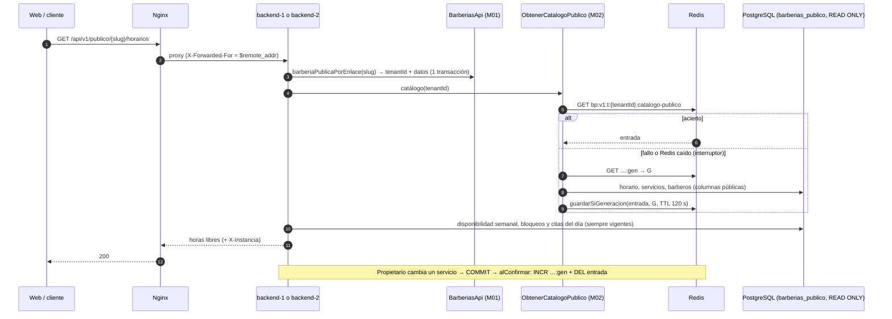

# Implementation Plan: Escalabilidad y rendimiento de la plataforma

**Branch**: `006-escalado-cache-balanceo` | **Date**: 2026-10-18 | **Spec**: [spec.md](spec.md)

**Input**: Feature specification from `/specs/006-escalado-cache-balanceo/spec.md`

## Summary

Tercera funcionalidad en orden de entrega (días 7–9). No agrega RF: demuestra rendimiento,
escalabilidad y disponibilidad (EQ-01, EQ-04 y EQ-05) sobre 001 y 002, con herramientas fijadas por
el responsable: Nginx, Redis y Docker Compose.

- **Balanceo.**
  - Docker Compose levanta `nginx` delante de dos réplicas explícitas, `backend-1` y `backend-2`,
    con IP fijas y build compilado.
  - Un servicio de una sola ejecución, `preparar-backend`, instala, compila y migra una sola vez.
  - Nginx reparte por turnos y saca una réplica que falla. Su comprobación es pasiva: reintenta en
    la otra solo las solicitudes idempotentes.
  - Cada réplica declara si está lista con `GET /salud/listo` (base de datos y migraciones al día).
  - Ver ADR-030 y [research.md](research.md) R01–R03.
- **IP real del cliente.** Nginx **sobrescribe** `X-Forwarded-For`, y el backend confía solo en la
  IP de Nginx (`PROXIES_CONFIABLES`) (R04).
- **Caché del catálogo.**
  - M06 ofrece el puerto `CacheCompartida`, con un adaptador `ioredis`. Las claves de barbería solo
    las construye `ClavesCache`, que exige un `TenantId`.
  - Cada operación tiene un tiempo límite de 100 ms, y un interruptor deja de usar Redis 10 s tras
    5 fallos (R05, R06).
  - Se guarda el catálogo público de cada barbería (`bp:v1:t:{tenantId}:catalogo-publico`, 120 s).
    No se guarda nada por `slug`.
  - El enlace y los datos de la barbería se leen en cada solicitud, en **una** transacción de M01,
    no en dos (R07).
  - Se invalida **después de confirmar** con `UnitOfWork.alConfirmar`. Un contador de generación y
    un guardado condicionado cierran la carrera entre lectura e invalidación (R08).
- **Horarios libres.** Disponibilidad, bloqueos y citas se leen siempre de PostgreSQL, y cada
  consulta abre una sola transacción pública (R07).
  - Con el catálogo en caché, toman de la entrada el servicio, el horario de atención y los
    barberos: pasan de 3 transacciones y 8 consultas a 2 y 4.
  - Sin entrada (caché desactivada, fallo o Redis caído), una fuente completa lee todo en una
    transacción: 2 transacciones y 7 consultas.
  - Si con eso no se cumplen los 800 ms, se evalúa el ajuste condicionado FR-013b (horarios
    calculados, 30 s, con generación por barbería) (R10).
- **Límite de solicitudes.** El `storage` de `@nestjs/throttler` pasa a contadores en Redis (Lua:
  `INCR` + `PEXPIRE`), con el almacenamiento en memoria como respaldo si Redis falla. Los intentos de
  inicio de sesión siguen en PostgreSQL (R09).
- **Evidencia:**
  - `medir:horarios` ampliado, con cuatro variantes (una o dos réplicas, con o sin caché);
  - `demo:caida` para la caída de una réplica y la de Redis;
  - pruebas en CI con Testcontainers (PostgreSQL, Redis y Nginx con la misma plantilla), incluida
    **PR16 a través de Nginx** (R13, R15).
- **Equipo de 8 GB.** Cada contenedor tiene un límite de memoria (uso estable de unos 1,9 GB). Nada
  se descarga al disco C: (R05, R12).

## Technical Context

**Language/Version**: TypeScript 5 (`strict`) sobre Node.js 22 LTS (igual que 001 y 002).

**Primary Dependencies**: las de 002, más **una dependencia nueva del backend**:

- **`ioredis` 5** (MIT), con la versión exacta fijada al instalar y registrada en
  [tecnologías](../../docs/02-arquitectura-software/tecnologias.md).
- **Instalación sin tocar C::** `npm install … --cache D:\proyecto-final-barberia-ayacucho\tmp\npm-cache`,
  y luego se borra esa carpeta.
- **Pruebas:** `testcontainers`, que ya está instalado, con `GenericContainer` para Redis y Nginx.
  No se agrega `@testcontainers/redis`.
- **Frontend:** sin dependencias nuevas, ni cambios de código previstos. Habrá un ajuste mínimo en
  `src/api/client.ts` solo si la prueba del mensaje `SERVICIO_NO_DISPONIBLE` lo exige (T021).

**Storage**:

- **PostgreSQL 16**, sin tablas nuevas. La migración `0013` concede `SELECT` sobre `kysely_migration`
  a `barberias_app` ([data-model.md](data-model.md) §1).
- **Redis 7.4** como caché sin persistencia (`--save "" --appendonly no`, `maxmemory 48mb`,
  `allkeys-lru`), solo con:
  - el catálogo público por barbería;
  - las generaciones de invalidación;
  - los contadores del límite por IP;
  - los horarios calculados, solo si se activa FR-013b.

**Testing**:

- Como en 002 (Jest, `supertest`, Testcontainers, `dependency-cruiser`; Vitest y MSW en el
  frontend).
- Nuevo: contenedores de Redis y de Nginx en la integración, con la plantilla de Nginx del
  repositorio y `TestContainers.exposeHostPorts` hacia dos instancias en proceso.
- La prueba de carga y las demos son scripts propios, fuera de CI (R13, R15).

**Target Platform**: contenedores Linux en Docker Compose (Docker Desktop con WSL 2 en Windows) y,
solo documentado, AWS (Application Load Balancer y ElastiCache) (R16).

**Project Type**: aplicación web (API REST NestJS y SPA React), sin cambios de estructura.

**Terminología**: "réplica" (plan, tareas, entorno) e "instancia del backend" (especificación) son
lo mismo: una copia idéntica y sin estado del backend detrás del balanceador.

**Performance Goals**:

- **Horarios libres** con 50 consultas simultáneas, dos réplicas y caché: p95 ≤ 800 ms y 0 % de 5xx
  (SC-001). Línea base de 002: 935–1 011 ms con una réplica y sin caché.
- **Caída de una réplica:** detección ≤ 15 s y ≤ 2 % de errores en la transición (SC-002).
- **Redis caído:** p95 de lecturas ≤ 2 s (SC-005).
- **Por operación de caché:** < 2 ms normalmente y tiempo límite de 100 ms.

**Constraints**:

- Ninguna clave de caché de barbería sin tenant, ni claves por `slug` (principio III).
- Redis nunca decide la disponibilidad (principios IV y VIII).
- Invalidación solo después de confirmar.
- Contadores de seguridad en PostgreSQL.
- La plataforma funciona sin Redis.
- Memoria total estable ≤ 2 GB.
- Nada fuera de D:, salvo lo que ya usa Node instalado.
- Contratos de negocio de 002 sin cambios.

**Scale/Scope**:

- 2 réplicas, decenas de barberías, 50 consultas simultáneas.
- Unos 15 archivos nuevos del backend, una migración, 2 scripts, 1 plantilla de Nginx, el
  `docker-compose.yml` reescrito, unas 10 suites de pruebas nuevas y 1 prueba del frontend.
- 3 días de implementación (plan de entrega, días 7–9).

## Constitution Check

_GATE: Must pass before Phase 0 research. Re-check after Phase 1 design._

Gates from `.specify/memory/constitution.md` (v1.2.0). Revisada el 2026-10-18, antes de la Fase 0 y
después del diseño. **No hace falta enmendarla**: la versión 1.1.0 ya incluyó en el principio VIII
los contadores no críticos en Redis, y el diseño cumple el principio III sin usar sus excepciones
para la caché.

| #    | Puerta                   | Antes de Fase 0 | Tras el diseño | Evidencia                                                                                                                                                                                                                                                                                                                                                                                                                                                                                                                                                              |
| ---- | ------------------------ | --------------- | -------------- | ---------------------------------------------------------------------------------------------------------------------------------------------------------------------------------------------------------------------------------------------------------------------------------------------------------------------------------------------------------------------------------------------------------------------------------------------------------------------------------------------------------------------------------------------------------------------- |
| I    | Seis módulos             | ✅              | ✅             | La caché, el interruptor y el almacenamiento de límites viven en M06 (`shared/cache/`, `shared/limites/`), sin reglas de negocio. M02 usa `CacheCompartida` por `shared/index.ts`. M01 agrega `BarberiasApi.barberiaPublicaPorEnlace` en su `index`. M01 no depende de M02: `ActualizarBarberia` no invalida nada, porque los datos de la barbería no se guardan (R07). Sin módulos nuevos ni dependencias nuevas en la matriz                                                                                                                                         |
| II   | Cuatro capas             | ✅              | ✅             | `ObtenerCatalogoPublico` e `InvalidadorCatalogoPublico` están en `catalogo/application` y dependen de puertos (`CacheCompartida`, la consulta del catálogo público). El adaptador Redis está en la infraestructura de M06. El dominio no importa Redis. La regla nueva de PR14, `redis-confinado`, permite `ioredis` solo en `shared/cache/`                                                                                                                                                                                                                           |
| III  | Aislamiento por barbería | ✅              | ✅             | Toda clave de datos de barbería incluye `t:{tenantId}` y solo la construye `ClavesCache` con un `TenantId` (FR-014). **No hay claves por `slug`**: el enlace se resuelve en PostgreSQL en cada solicitud, con lo que la caché no necesita ninguna excepción. La vía pública sigue siendo la de ADR-021 (pool público, solo columnas públicas), y lo guardado es exactamente lo que ya devolvía. Los contadores por IP no llevan tenant, como permite el principio VIII. PR09 `aislamiento-cache` (R15)                                                                 |
| IV   | Citas sin duplicados     | ✅              | ✅             | La reserva no usa la caché. Los horarios calculados (FR-013b) son solo para mostrar, y la restricción de exclusión sigue siendo la garantía. PR16 se repite a través de Nginx con dos réplicas                                                                                                                                                                                                                                                                                                                                                                         |
| V    | Pagos                    | N/A             | N/A            | No se tocan pagos                                                                                                                                                                                                                                                                                                                                                                                                                                                                                                                                                      |
| VI   | IA                       | N/A             | N/A            | No se toca M04                                                                                                                                                                                                                                                                                                                                                                                                                                                                                                                                                         |
| VII  | Notificaciones           | N/A             | N/A            | No hay envíos. Las tareas programadas sin duplicados entre réplicas llegan con ADR-024 en 003                                                                                                                                                                                                                                                                                                                                                                                                                                                                          |
| VIII | Redis solo como caché    | ✅              | ✅             | Solo caché con TTL (máximo 300 s) e invalidación después de confirmar, y contadores del límite general por IP, que toleran pérdida. Intentos de inicio de sesión, sesiones, revocación e idempotencia siguen en PostgreSQL (FR-017; prueba `limite-compartido`). Redis no es fuente de verdad ni decide la disponibilidad. Sin Redis: lectura de PostgreSQL, límite por instancia e interruptor (R06, R11; PR05)                                                                                                                                                       |
| IX   | Solo web responsive      | ✅              | ✅             | Solo cambia el mensaje del 503 del balanceador en la interfaz                                                                                                                                                                                                                                                                                                                                                                                                                                                                                                          |
| X    | Pruebas obligatorias     | ✅              | ✅             | PR09 (caché), **PR16 por Nginx**, PR14 (`redis-confinado`), PR04 y PR05 automatizadas en CI, más unitarias sin infraestructura (claves, interruptor, almacenamiento de límites). La prueba de carga y las demos quedan fuera de CI y se registran (R15). CI bloquea la fusión                                                                                                                                                                                                                                                                                          |
| XI   | ADR                      | ✅              | ✅             | **ADR-029** (caché compartida con claves por barbería y límite general compartido) y **ADR-030** (balanceo local como representación de ADR-006) quedaron registrados el 2026-10-18 y el responsable los **aceptó el 2026-10-19**, antes de implementar. ADR-005 recibe una nota que remite a ADR-029. En este mismo cambio se actualizan `estrategia-de-cache.md` y la fila de 006 en `trazabilidad.md`. Con el código se actualizarán `despliegue-y-escalabilidad.md` (R16), `tecnologias.md` (`ioredis`, imágenes), `api-rest.md` (`/salud/listo`, 503) y el README |
| XII  | Ubicación del código     | ✅              | ✅             | Todo bajo `tecnologia/plataforma-barberias/`, incluida la plantilla `nginx/`. El flujo de CI no cambia: las pruebas nuevas corren dentro de `npm run test:int`                                                                                                                                                                                                                                                                                                                                                                                                         |

**Resultado:** pasa sin violaciones. ADR-029 y ADR-030 están Aceptados (2026-10-19), así que no
queda nada pendiente para implementar.

## Project Structure

### Documentation (this feature)

```text
specs/006-escalado-cache-balanceo/
├── plan.md                    # Este archivo
├── research.md                # Fase 0: decisiones R01–R16
├── data-model.md              # Fase 1: migración 0013, entradas y contadores de Redis, variables, registro de mediciones
├── quickstart.md              # Fase 1: guía de validación, demos y prueba de carga
├── contracts/
│   ├── openapi.yaml           # Fase 1: /salud/listo, 503 SERVICIO_NO_DISPONIBLE, X-Instancia
│   ├── cache-claves.md        # Fase 1: claves, matriz de invalidación, scripts atómicos (fuente de las pruebas)
│   └── entorno-compose.md     # Fase 1: servicios, red, memoria, comportamiento de Nginx, comandos
├── checklists/
│   └── requirements.md
└── tasks.md                   # Fase 2 (/speckit-tasks; no lo crea este comando)
```

### Source Code (repository root)

Solo se listan las carpetas nuevas y los archivos que cambian.

```text
tecnologia/plataforma-barberias/
├── docker-compose.yml                    # reescrito: red fija, redis, preparar-backend, backend-1/2 (ancla x-backend), nginx; límites de memoria
├── .env.example                          # + REDIS_URL, CACHE_*, PROXIES_CONFIABLES, INSTANCIA_ID, DB_POOL_*, RED_SUBRED e IP fijas
├── nginx/
│   └── templates/default.conf.template   # upstream api (BACKEND_1, BACKEND_2), XFF sobrescrito, 503 JSON, /nginx-salud
├── README.md                             # entorno escalado, comandos y memoria
├── backend/
│   ├── package.json                      # + ioredis; scripts demo:caida; medir:horarios con opciones
│   ├── .dependency-cruiser.cjs           # + regla redis-confinado
│   ├── migrations/0013_salud_listo.ts    # GRANT SELECT ON kysely_migration TO barberias_app
│   ├── scripts/
│   │   ├── medir-horarios.ts             # + --url, --etiqueta, --salida, reparto por X-Instancia
│   │   └── demo-caida.ts                 # nuevo: tráfico + stop/start de backend-2 o redis + métricas
│   ├── src/
│   │   ├── main.ts                       # trust proxy desde PROXIES_CONFIABLES; X-Instancia
│   │   ├── host/
│   │   │   ├── app.module.ts             # ThrottlerModule con storage AlmacenLimitesCompartido
│   │   │   └── salud.controller.ts       # + GET /salud/listo
│   │   ├── shared/                       # M06
│   │   │   ├── index.ts                  # + CacheCompartida, ClavesCache, ClaveCache, UnitOfWork.alConfirmar
│   │   │   ├── cache/
│   │   │   │   ├── cache-compartida.ts   # puerto
│   │   │   │   ├── claves-cache.ts       # ClavesCache, ClaveCache, ClaveGeneracion, ClaveContador
│   │   │   │   ├── interruptor.ts        # interruptor de circuito con reloj inyectable
│   │   │   │   ├── redis-cache-compartida.ts  # ioredis + scripts Lua (único import de ioredis)
│   │   │   │   └── cache-inactiva.ts     # sin REDIS_URL
│   │   │   ├── limites/almacen-limites-compartido.ts  # ThrottlerStorage: Redis con respaldo en memoria
│   │   │   ├── persistence/
│   │   │   │   ├── unit-of-work.ts, kysely-unit-of-work.ts  # + alConfirmar
│   │   │   │   ├── database.ts           # + VerificadorMigraciones; tamaño de pool configurable
│   │   │   │   └── lectura-publica.ts    # tamaño de pool configurable
│   │   │   └── config/configuracion.ts   # + variables de data-model.md §4
│   │   └── modules/
│   │       ├── acceso-barberias/         # M01
│   │       │   ├── api-publica.ts, barberias/application/barberias-api.ts  # + barberiaPublicaPorEnlace (una transacción)
│   │       │   └── barberias/infrastructure/kysely-tenant-repository.ts   # consulta única por slug con datos públicos
│   │       └── catalogo-citas/catalogo/  # M02
│   │           ├── application/
│   │           │   ├── obtener-catalogo-publico.ts      # nuevo: cache-aside con generación
│   │           │   ├── invalidador-catalogo-publico.ts  # nuevo: alConfirmar → invalidar
│   │           │   ├── servicios.ts, barberos.ts, horarios.ts  # llaman al invalidador (matriz)
│   │           │   └── ports/catalogo-publico-query.ts  # nuevo puerto que implementa el repositorio público
│   │           ├── infrastructure/publico/catalogo-publico.repository.ts  # implementa el puerto; fuenteDelDia (con entrada) y fuenteCompleta (sin entrada), una transacción cada una
│   │           └── presentation/publico.controller.ts   # usa barberiaPublicaPorEnlace + ObtenerCatalogoPublico
│   └── test/
│       ├── unit/shared/                  # claves-cache, interruptor, almacen-limites, entrada-catalogo
│       ├── helpers/redis.ts, helpers/nginx.ts   # contenedores de Redis y Nginx (plantilla del repo)
│       └── integration/escalado/         # cache-catalogo, aislamiento-cache (PR09), limite-compartido,
│                                         # redis-caido (PR05), salud-listo, balanceador (PR04 + PR16 por Nginx)
└── frontend/
    └── src/api/                          # sin cambios previstos (ajuste mínimo en client.ts solo si la prueba lo exige); prueba de SERVICIO_NO_DISPONIBLE
```

**Structure Decision**: se mantiene la estructura de 001 y 002 (principio XII). La caché y los
límites son infraestructura transversal de M06, como la persistencia. El único código de negocio que
cambia es la lectura pública del catálogo (M02) y su resolución del enlace (M01). La configuración
de Nginx vive junto al `docker-compose.yml`, porque es parte del entorno de la aplicación.

## Flujo principal (diseño)



## Trazabilidad

| HU              | RF         | Escenario    | ADR                   | Componente                                                                                                                       | Prueba                                                |
| --------------- | ---------- | ------------ | --------------------- | -------------------------------------------------------------------------------------------------------------------------------- | ----------------------------------------------------- |
| HU10            | RF10, RF11 | EQ-01        | ADR-005, **029**, 021 | M02 `ObtenerCatalogoPublico`, `InvalidadorCatalogoPublico`; M01 `barberiaPublicaPorEnlace`; M06 `CacheCompartida`, `ClavesCache` | `cache-catalogo`, PR01 (`medir:horarios`)             |
| HU10            | RF10, RF11 | EQ-09        | ADR-003, **029**      | M06 `ClavesCache` (tenant obligatorio)                                                                                           | **PR09** `aislamiento-cache`                          |
| — (transversal) | —          | EQ-04        | ADR-006, **030**      | Nginx, `backend-1`, `backend-2`, `/salud/listo`                                                                                  | PR04 `balanceador` (CI) y `demo:caida replica`        |
| —               | —          | EQ-05        | ADR-005, 012, **029** | M06 interruptor, `CacheInactiva`, respaldo del límite                                                                            | PR05 `redis-caido` (CI) y `demo:caida redis`          |
| HU11            | RF12       | EQ-16        | ADR-009, **030**      | Reserva a través del balanceador                                                                                                 | **PR16** por Nginx                                    |
| —               | —          | EQ-12        | ADR-010, **029**      | M06 `AlmacenLimitesCompartido`; `PROXIES_CONFIABLES`                                                                             | `limite-compartido`, `balanceador` (encabezado falso) |
| —               | —          | EQ-14        | ADR-002, 011          | Regla `redis-confinado`                                                                                                          | PR14                                                  |
| —               | —          | EQ-02, EQ-03 | ADR-006               | —                                                                                                                                | PR02 y PR03 **pendientes** (fuera de 006)             |

## Complexity Tracking

Sin violaciones de la constitución. Se registran dos decisiones de diseño que agregan piezas, con la
alternativa más simple que se descartó:

| Decisión                                                                                                    | Por qué hace falta                                                                                                                                                                                         | Alternativa más simple descartada                                                                  |
| ----------------------------------------------------------------------------------------------------------- | ---------------------------------------------------------------------------------------------------------------------------------------------------------------------------------------------------------- | -------------------------------------------------------------------------------------------------- |
| Contador de generación y guardado condicionado (Lua) en la caché del catálogo                               | Sin él, una lectura que empezó antes de un cambio puede volver a guardar el catálogo viejo después de la invalidación, y quedaría hasta el TTL. Eso incumple SC-003 en el caso límite de la especificación | Invalidar con `DEL` y confiar en el TTL: deja la carrera abierta hasta 120 s                       |
| Servicio `preparar-backend` y réplicas con build compilado (sin recarga en caliente en el entorno escalado) | Dos `npm ci` o dos compiladores en modo vigilancia sobre los mismos volúmenes se corrompen; además asegura una sola ejecución de las migraciones                                                           | Mantener `start:dev` en ambas réplicas: carpetas `dist/` y `node_modules` compartidas que se pisan |
